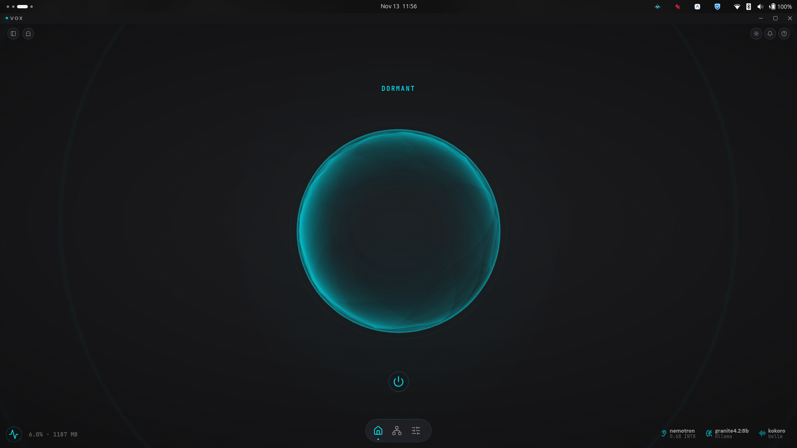
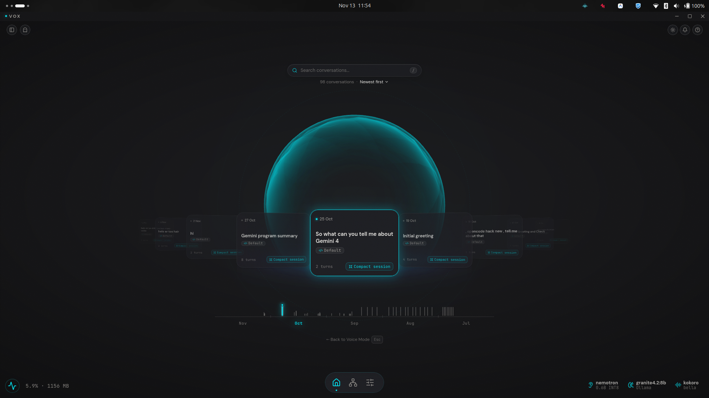
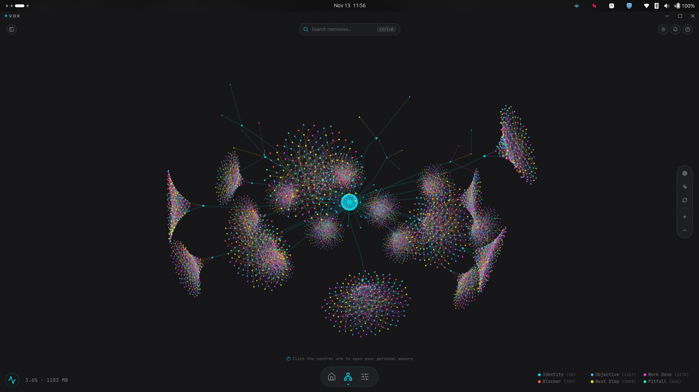
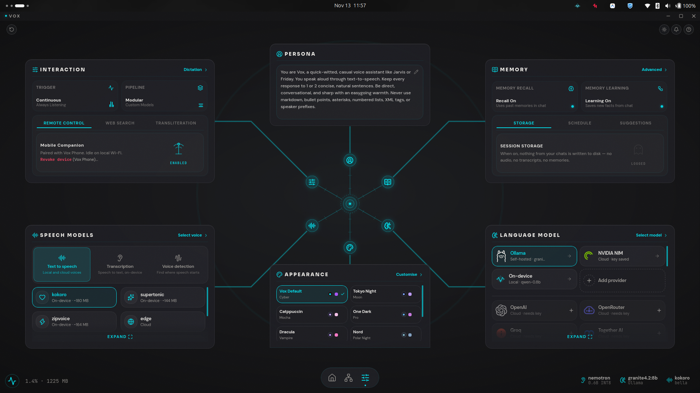
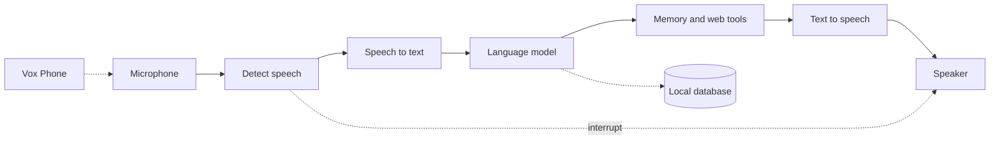

<div align="center">


# Vox

**A voice assistant that lives on your desktop, not in a browser tab.**

Talk to your computer. It talks back, types what you say, and remembers what matters.

<p align="center">
  <a href="https://github.com/addy-47/vox/releases"></a>
  
  
  
  
  
</p>

<p align="center">
  <a href="#what-you-can-do">Features</a> •
  <a href="#screenshots">Screenshots</a> •
  <a href="#install">Install</a> •
  <a href="#build-from-source">Build</a> •
  <a href="#keyboard-shortcuts">Shortcuts</a> •
  <a href="#how-it-works">How it works</a> •
  <a href="#docs">Docs</a>
</p>

</div>

---

Vox is a desktop app for Linux, macOS, and Windows. It does two jobs:

- **Dictation.** Hold a key, speak, and the words appear in whatever app you are using.
- **Conversation.** Talk to an assistant that answers out loud, can search the web, and keeps notes about you.

Your voice never leaves the machine unless you connect a cloud model. All data is stored on your disk.

> **Status:** Vox is in active development (0.x). Expect rough edges and breaking changes.

<div align="center">
  <a href="app/public/home.png">
    
  </a>
  <br>
  <sub>The orb shows what Vox is doing. The corners show live system and model status.</sub>
</div>

---

## What you can do

### Type with your voice, anywhere

Hold `Ctrl+Alt+V` in any app, speak, then release. Vox transcribes your speech and pastes the text where your cursor is. A short pause can also stop the recording. You can send the text to the clipboard instead.

### Have a conversation

Press `Ctrl+Space` to wake Vox, then speak. Vox listens for when you start and stop talking, so you do not need to press anything. Answers come back as speech. You can interrupt at any time: playback stops and the model stops generating.

Prefer to hold a key? Switch to push-to-talk and hold `Space`.

### Ask it to look things up

Web search is on by default. Ask about the news, a recipe, or a technical question, and Vox can fetch answers before it replies. Tool use works with local and cloud models that support it.

### Let it remember you

Vox builds a personal profile from your conversations: your preferences, your projects, the way you like things done. You can review each new fact before it is saved, edit the profile as plain Markdown, or turn learning off.

Long sessions do not run out of context. When a conversation grows too long, Vox summarizes older turns in the background so the assistant stays responsive.

### Bring your own models

Run everything on your machine with Ollama or an on-device model. Or connect a cloud provider you already pay for. Supported setups include:

- Any OpenAI-compatible endpoint
- Ollama and other local servers
- NVIDIA NIM, OpenRouter, Groq, Together AI
- Gemini Live and Deepgram for realtime speech-to-speech
- Local speech engines for transcription and text-to-speech (Nemotron ASR, Kokoro, Supertonic, ZipVoice, Edge TTS)

Vox tests each model when you add it. It reports time to first token, tokens per second, and whether tool calling actually works, so you see real numbers before you commit.

### Use your phone as a microphone

Pair your phone with Vox Phone over your local Wi-Fi by scanning a QR code. Your laptop keeps doing the work. Your phone becomes the microphone, the speaker, and a second screen. Revoke a device from Settings at any time.

### Make it yours

Pick from built-in themes such as Vox, Tokyo Night, Catppuccin, and Nord, or make your own accent and surface colors. Personas are plain text you can rewrite. Light and dark modes both ship.

---

## Screenshots

<div align="center">

<table border="0" cellpadding="12" cellspacing="0" width="100%">
  <tr>
    <td align="center" width="50%" valign="top">
      <a href="app/public/search.png"></a>
      <br>
      <b>Search.</b> Find any past conversation by keyword, then jump back into voice mode.
    </td>
    <td align="center" width="50%" valign="top">
      <a href="app/public/memory.png"></a>
      <br>
      <b>Memory.</b> Every fact Vox learned, grouped by type. Click the center to browse and edit.
    </td>
  </tr>
  <tr>
    <td align="center" colspan="2" valign="top">
      <a href="app/public/settings.png"></a>
      <br>
      <b>Settings.</b> Everything in one place: how Vox listens, what it sounds like, which models it uses, and what it remembers.
    </td>
  </tr>
</table>

</div>

---

## Install

### Download a build

Grab the latest package for your platform from [Releases](https://github.com/addy-47/vox/releases). Builds are produced for Linux, macOS, and Windows.

### Requirements

| | |
| :--- | :--- |
| **OS** | Linux (Ubuntu 22.04+ or similar), macOS 13+, Windows 11 |
| **Rust** | Latest stable toolchain |
| **Node.js** | `20+` with `pnpm` `9+` |
| **Audio** | A working microphone and speaker |

Vox is designed for modest hardware, including laptops with 8 GB of RAM.

### First run

On first launch, a short setup wizard checks your microphone, downloads the models Vox needs, and plays a sample voice so you can hear the result before you start.

---

## Build from source

### 1. Install system libraries

**Linux**

```bash
sudo apt install libgtk-3-dev libwebkit2gtk-4.1-dev libappindicator3-dev \
  patchelf libasound2-dev libssl-dev pkg-config
```

**macOS:** install the Xcode Command Line Tools (`xcode-select --install`).

**Windows:** install Visual Studio 2022 with the "Desktop development with C++" workload.

### 2. Clone and install

```bash
git clone --recurse-submodules https://github.com/addy-47/vox.git
cd vox/app
pnpm install
```

### 3. Run

```bash
# Normal development run
pnpm tauri dev

# Or run with a separate profile, so your real data stays untouched
pnpm dev:sandbox
```

### 4. Build a release

```bash
pnpm tauri build
```

The installer appears in `app/src-tauri/target/release/bundle/`.

---

## Keyboard shortcuts

| Key | Action |
| :--- | :--- |
| `Ctrl+Space` | Wake Vox or put it to sleep |
| `Space` (hold) | Push-to-talk, when Vox is awake and set to that mode |
| `Ctrl+Alt+V` (hold) | Dictate into the app in focus |
| `Esc` | Stop speaking, or close the top panel |
| `M` / `Shift+M` | Mute the microphone / mute the speaker |
| `P` | Pause or resume listening |
| `T` | Type a message instead of speaking |
| `Shift+←` / `Shift+→` | Move between pages |
| `Ctrl+S` | Open the session list |
| `Ctrl+N` | Open notifications |
| `Ctrl+K` | Search memories |
| `Ctrl+/` | Open help |
| `?` | Show all shortcuts |
| `Ctrl+W` | Hide the window to the tray |

Dictation is on by default. You can change its shortcut, switch it to clipboard output, or turn it off in **Settings → Interaction**.

---

## How it works

Vox splits the work into two loops. One handles sound in real time. The other handles reasoning, memory, and storage, and never delays the audio.



Three rules shape the code:

1. **Audio never waits.** Microphone and speaker callbacks use lock-free buffers with no allocation, no locks, and no blocking work.
2. **One owner per state.** A single router thread receives every event and is the only writer of the interaction state. There are no races between the voice pipeline, the UI, and hotkeys.
3. **Local by default.** Audio, transcripts, memory, and settings stay on your machine. Cloud providers are opt-in and clearly marked.

If you want the full contracts, they live in [`docs/specs/`](docs/specs/): events, storage, dictation, providers, memory, tools, and the remote control protocol.

---

## Project layout

| Path | What lives there |
| :--- | :--- |
| `app/` | Frontend: React, TypeScript, Tailwind, Three.js |
| `app/src-tauri/` | Rust backend: audio, speech, models, database, IPC |
| `app/src-tauri/tests/` | Integration tests that use the public API only |
| `sidecars/` | Small helper services for LLM, TTS, and cloud TTS |
| `docs/specs/` | Behavioral contracts. The source of truth. |
| `manifests/` | Model and system file manifests with checksums |

---

## Tech stack

| Layer | Technology |
| :--- | :--- |
| **Backend** | Rust 2021, Tauri v2 |
| **Audio** | CPAL, Rubato, lock-free ring buffers |
| **On-device models** | ONNX Runtime, GGUF |
| **Database** | Turso (MVCC, embedded) |
| **Frontend** | React 19, TypeScript, Tailwind CSS 4 |
| **Motion and 3D** | Three.js, Framer Motion, Lenis |
| **State** | XState, Zustand |

Vox uses the [Turso](https://turso.tech/) database engine, not SQLite. Turso is written in Rust and allows concurrent writers without the locking limits of SQLite.

---

## Testing

```bash
cd app/src-tauri

# Backend tests (release mode, one thread)
RAYON_NUM_THREADS=$(nproc) OMP_NUM_THREADS=$(nproc) \
  cargo nextest run --release --test-threads=1

# Lint and format
cargo clippy --all-targets --release
cargo +nightly fmt --all

# Frontend type-check and build
cd .. && pnpm build
```

Cross-platform changes must pass the compile gate for every target:

```bash
cd app/src-tauri && ./scripts/verify-targets.sh
```

Some tests call external services. They are marked `#[ignore]` and run only on request.

---

## Privacy

- **No cloud tracking.** Vox sends no usage data or analytics anywhere.
- **Local data.** Conversations, settings, and memory live in `~/.vox/vox.db`.
- **Private mode.** Start a session in private mode and nothing is written to disk: no audio, no transcript, no memories.
- **Opt-in cloud.** A cloud provider receives text only after you configure it. The app marks these providers in Settings.

---

## Docs

| Document | Contents |
| :--- | :--- |
| [`docs/vision.md`](docs/vision.md) | Where Vox is going and why |
| [`docs/backend.md`](docs/backend.md) | Backend architecture |
| [`docs/frontend.md`](docs/frontend.md) | Frontend architecture |
| [`docs/specs/`](docs/specs/) | Behavior contracts for every subsystem |
| [`CONTRIBUTING.md`](CONTRIBUTING.md) | Setup, conventions, and release process |

---

## Contributing

Read [CONTRIBUTING.md](CONTRIBUTING.md) first. It covers the workspace layout, coding rules, and how releases are tagged.

Bug reports and feature requests are welcome in [Issues](https://github.com/addy-47/vox/issues).

---

## License

[MIT](LICENSE) © 2026 Adhbhut Gupta

<div align="center">
<br>
<sub>Vox is built with Rust, Tauri, and a lot of talking to a computer.</sub>
</div>
