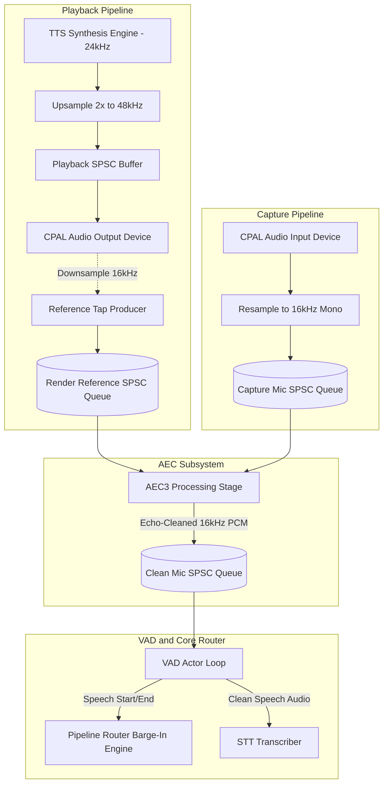
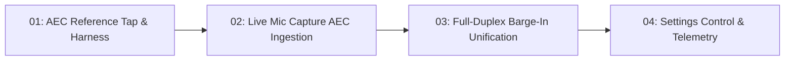

# Acoustic Echo Cancellation (AEC) Architecture & Execution Plan

**Document Status:** Approved Architecture Plan  
**Target Subsystem:** Audio Ingestion, Playback Reference Tap, VAD & Barge-In  
**Target Platforms:** Linux Desktop (`x86_64-unknown-linux-gnu`) & Android (`aarch64-linux-android`)

---

## 1. Incident Root Cause Analysis (`vox2.log`)

During interactive pipeline testing with a headset configured, Vox interrupted itself and transcribed its own speech.

### 1.1 Chronological Log Evidence
Examining lines 160–248 of `vox2.log` reveals the failure sequence:

1. **TTS Output Ingestion & Playback (Turn 1):**
   ```text
   2026-10-17T12:08:17.487144Z INFO [Pipeline::Llm] LlmFinished processed (turn 1, chars 141): 
     'I cannot hear your voice directly because I am a text-based assistant. Please type what you would like to say and I will respond immediately.'
   2026-10-17T12:08:17.332584Z INFO [Audio::Playback] Preroll cushion satisfied (12288 samples) — PlaybackStarted emitted (turn 1, intent: TurnResponse)
   ```
2. **False Speech Start Detection:**
   ```text
   2026-10-17T12:08:18.331338Z INFO [VAD Actor] Speech Start (turn: 1)
   2026-10-17T12:08:18.331593Z INFO [Audio::Playback] Cancelled (turn 1) — buffer signal sent
   2026-10-17T12:08:18.332028Z INFO [Pipeline::Interrupt] Interruption handled (interrupted turn: 1, new turn: 2)
   ```
3. **Transcription of Leaked Audio:**
   ```text
   2026-10-17T12:08:22.046148Z INFO [STT] Final received (turn 3, samples 36416, 2.28s, cancelled false, active_turn 3, owner Assistant)
   2026-10-17T12:08:22.351183Z INFO [STT-Nemotron] Transcribed: "What type what you would like to say and".
   2026-10-17T12:08:22.352379Z INFO [Pipeline::Transcript] Turn 3: User said: 'What type what you would like to say and'
   ```

### 1.2 Root Cause
The microphone physically picked up the acoustic output of the headset. Silero VAD identified the leaked speech as a user speech onset, triggering immediate playback cancellation (`Pipeline::Interrupt`). Nemotron STT transcribed the leaked clause (`"What type what you would like to say and"`), which the pipeline ingested as Turn 3 user input.

---

## 2. Why Headset Mode Suffers From Echo

The assumption that "headsets do not require echo cancellation" is physically and architecturally incorrect for three distinct reasons:

1. **Acoustic Leakage:**
   Headphones (especially open-back models, high volume settings, or loose earbuds) leak significant acoustic energy into free air. A sensitive cardioid or omnidirectional mic on a boom or laptop chassis readily captures this sound above standard neural VAD thresholds (typically SNR > 3dB).
2. **Electrical Ground Crosstalk (TRRS 3.5mm Jacks):**
   Standard analog 3.5mm headset jacks use a common ground line for left headphone, right headphone, and microphone. The relatively high return current from driving headphone speakers generates a non-zero voltage across the shared ground impedance. This induces a direct electrical copy of the speaker audio onto the high-impedance microphone line.
3. **No Automatic OS-Level Echo Cancellation:**
   Linux PipeWire and PulseAudio do **not** apply echo cancellation by default. CPAL opens direct ALSA/Pulse stream nodes. While PipeWire includes `libpipewire-module-echo-cancel`, it only processes streams explicitly routed through a configured echo-cancel filter-chain node. Vox currently connects directly to raw hardware nodes.

### 2.1 The Legacy Speaker Suppression Hack
In `app/src-tauri/src/services/vad/actor.rs`:
```rust
let is_suppressed = state.realtime_tx.is_none()
    && InteractionState::from(state_atomic.load(Ordering::Relaxed)) == InteractionState::Speaking
    && state.audio_mode == AudioOutputMode::Speaker;
```
In `Speaker` mode, Vox simply muted the microphone during playback. Interruption did not fail because barge-in was completely disabled. In `Headset` mode, microphone suppression was bypassed, exposing the lack of AEC.

---

## 3. Empirical Dependency & Cross-Target Evaluation

To identify the correct AEC implementation, we evaluated the candidate crates against Vox's dual-target compile gate (`x86_64-unknown-linux-gnu` and `aarch64-linux-android`).

### 3.1 Candidate Comparison

| Metric / Requirement | `sonora` (`0.2.0`) | `webrtc-audio-processing` (`2.1.0`) |
| :--- | :--- | :--- |
| **Language / Implementation** | 100% Pure Rust port of WebRTC APM | C++ WebRTC wrapper (`bindgen` + `cc` / `autotools`) |
| **Desktop Linux Build** | **Success** (Compiles in ~19.9s) | **Success** (Requires desktop development headers) |
| **Android NDK (`aarch64-linux-android`)** | **Success** (Compiles in **3.0s**, 0 warnings) | **FAILED** (Exit code 101, missing `pkg-config` cross sysroot) |
| **Algorithms Included** | WebRTC AEC3, NS (Wiener filter), AGC2 | WebRTC AEC, NS, AGC |
| **External C/C++ Dependencies** | **None** | `libwebrtc-audio-processing-2`, CMake, Clang |
| **Android Style Guide (§4.2) Compliance** | **Full** | **Violated** (Fails NDK compile gate) |

### 3.2 Android Build Proof Log

#### `sonora 0.2.0` on Android:
```text
$ bash -c 'source scripts/android-env.sh && cargo check --target "$ANDROID_TARGET" --release'
    Checking sonora-simd v0.2.0
    Checking sonora-fft v0.2.0
    Checking sonora-common-audio v0.2.0
    Checking sonora-ns v0.2.0
    Checking sonora-aec3 v0.2.0
    Checking sonora-agc2 v0.2.0
    Checking sonora v0.2.0
    Finished `release` profile [optimized] target(s) in 3.00s
```

#### `webrtc-audio-processing 2.1.0` on Android:
```text
$ bash -c 'source scripts/android-env.sh && cargo check --target "$ANDROID_TARGET" --release'
error: failed to run custom build command for `webrtc-audio-processing-sys v2.1.0`
Caused by:
  Couldn't find webrtc-audio-processing-2 with pkg-config:
  pkg-config has not been configured to support cross-compilation.
```

**Architecture Decision:** Adopt `sonora = "0.2.0"`. It satisfies the cross-platform compile gate without introducing C++ toolchain fragility or Android NDK build breaks.

---

## 4. End-State Pipeline Architecture



### 4.1 Audio Stream Contracts
- **Render Reference:** 16kHz mono `f32` pushed from `PlaybackStreamContext` at the exact moment audio is submitted to the output hardware buffer.
- **Capture Input:** 16kHz mono `f32` from CPAL input callback.
- **AEC Chunk Size:** 10ms frame chunks (160 samples @ 16kHz), matching `sonora`'s internal sub-band frequency decomposition.
- **Fallback Guarantee:** When playback is inactive, the AEC render buffer drains silence or passes capture frames with 0ms delay estimation penalty.

---

## 5. Decomposed Tracer-Bullet Tickets

Tickets follow the `<local-ticket-template>` format and reside in `.scratch/aec-integration/issues/`.



### [Ticket 01: AEC Reference Tap and End-to-End Echo Reduction Harness](file:///home/addy/projects/apps/vox/.scratch/aec-integration/issues/01-aec-reference-tap-and-harness.md)
- **What to build:** An end-to-end audio processing tracer that extracts rendered audio directly from the playback sink into a lock-free reference queue, runs it alongside a simulated mic capture stream through Sonora AEC3, and outputs clean speech with at least 20dB echo suppression.
- **Blocked by:** None (can start immediately).
- **Deliverable:** `sonora` dependency integration, `PlaybackStreamContext` reference tap, `AecProcessor` module, and `tests/aec_pipeline_test.rs`.

### [Ticket 02: Live Microphone Capture AEC Ingestion Pipeline](file:///home/addy/projects/apps/vox/.scratch/aec-integration/issues/02-live-mic-capture-aec-ingestion.md)
- **What to build:** Route live hardware CPAL microphone audio and real-time playback render audio into the in-process `AecProcessor` before feeding the VAD actor, so that speech detection and STT receive echo-free audio during live assistant playback.
- **Blocked by:** Ticket 01.
- **Deliverable:** Live CPAL stream rewiring, lock-free handoff, real-time buffer safety, and `tests/audio_capture_aec_test.rs`.

### [Ticket 03: Full-Duplex Barge-In Unification and Speaker Suppression Deletion](file:///home/addy/projects/apps/vox/.scratch/aec-integration/issues/03-barge-in-unification.md)
- **What to build:** Enable true user voice barge-in across all audio output modes (Headset and Speaker) by removing the artificial microphone muting logic during playback, allowing users to interrupt the assistant naturally while preventing self-interruption.
- **Blocked by:** Ticket 02.
- **Deliverable:** Elimination of `state.audio_mode == Speaker` suppression in `actor.rs`, unified interruption testing under active playback, and `tests/barge_in_aec_test.rs`.

### [Ticket 04: AEC Settings Control, IPC Bridge, UI Toggle, and Telemetry](file:///home/addy/projects/apps/vox/.scratch/aec-integration/issues/04-aec-settings-and-telemetry.md)
- **What to build:** An end-to-end user setting and monitoring slice allowing users to toggle AEC on/off in the Settings UI, dispatching IPC updates to dynamically bypass or activate the AEC processor, and displaying real-time AEC telemetry in monitoring.
- **Blocked by:** Ticket 03.
- **Deliverable:** `config.rs` toggle, IPC command, Settings switch in `InteractionConfigDesk.tsx`, and telemetry display in `Monitoring.tsx`.
