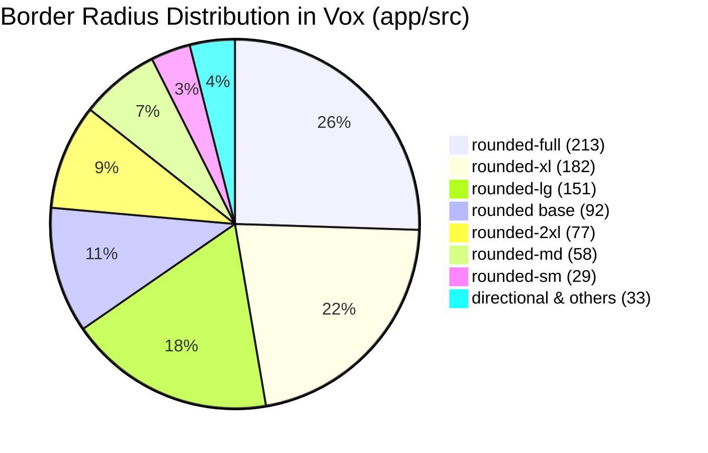

# Border Radius Audit & Standardization Report: The Geometry of Liquid Space

> **Report Type:** Audit & Architectural Assessment  
> **Target:** Vox Desktop & Mobile Frontend (`app/src/`)  
> **Benchmarks:** [Impeccable Design System Standard](file:///home/addy/.gemini/config/skills/impeccable/SKILL.md) & [Vox Design System Spec §5](file:///home/addy/projects/apps/vox/docs/specs/design-spec.md#L281-L330)  
> **Status:** Completed

---

## 1. Executive Summary

Vox's visual interface currently exhibits significant **border-radius fragmentation**. Across 835 occurrences of `rounded-*` in `app/src/`, radii are chosen ad-hoc rather than derived from an architectural hierarchy or the concentric nesting formula ($R_{inner} = R_{outer} - P$).

Sibling cards within the same application shell oscillate between `rounded-lg` (16px), `rounded-xl` (24px), and `rounded-2xl` (28px). Popovers range from razor-sharp `rounded-sm` (4px in `ContextMenuShell`) to hyper-rounded `rounded-2xl` (24px in catalog filter popovers). Action buttons employ six different radius classes.

Furthermore, a critical **token configuration drift** was discovered:
1. [design-spec.md](file:///home/addy/projects/apps/vox/docs/specs/design-spec.md#L83-L92) specifies `xl: 1.25rem` (20px) and `2xl: 1.75rem` (28px).
2. [tailwind.config.js](file:///home/addy/projects/apps/vox/app/tailwind.config.js#L24-L31) overrides `xl: 1.5rem` (24px) but **omits `2xl` entirely**, causing Tailwind to fall back to its internal default, creating an inverted or distorted scale.

This report documents:
- What the **Impeccable** craft doctrine dictates regarding shape, curvature, and concentric geometry.
- What the authoritative **Vox Design Spec** mandates versus what exists in code.
- A quantitative and layer-by-layer audit of all 835 radius occurrences.
- A unified, mathematical **Border Radius Matrix** with concrete rules for when to use `2xl`, `xl`, `lg`, `md`, `sm`, and `full`.

---

## 2. Core Concepts: What Impeccable & Geometry Dictate

### 2.1 The Concentric Curvature Law ($R_{inner} = R_{outer} - P$)

In premium UI design, nested rounded elements must share the **same concentric center of curvature**. 

```
┌────────────────────────────────────── R_outer ──┐
│                                                 │
│   Padding (P)                                   │
│   ┌─────────────────────────── R_inner ─────┐   │
│   │                                         │   │
│   │   Content / Nested Control              │   │
│   │                                         │   │
│   └─────────────────────────────────────────┘   │
│                                                 │
└─────────────────────────────────────────────────┘
```

The mathematical formula for visual harmony is:
$$\mathbf{R_{inner} = R_{outer} - P}$$

- **When $R_{inner} > R_{outer} - P$ (The Pinch Effect):** The inner corner is too round relative to the container. It crowds into the corner padding, creating visual tension and an amateur "squashed bubble" appearance.
- **When $R_{inner} < R_{outer} - P$ (The Sharpness Clash):** The inner corner is too sharp relative to the container, making the inside look severed from its enclosure.
- **When $P \ge R_{outer}$:** The gap between the outer container and inner child is larger than the outer radius. The curvature effect has decayed, so the inner child should drop to a subtle, smaller radius step (`rounded-md` or `rounded-lg`).

### 2.2 Hierarchical Scale (Macro to Micro)

Border radius communicates **elevation and container depth**. Larger boundaries enclose larger visual contexts and require softer, larger radii. Smaller, internal controls require tighter radii to maintain structural sharpness and information density.

| Level | Role | Visual Purpose | Standard Step |
|---|---|---|---|
| **Level 5: Shell / Overlay** | Modals, Drawers, Floating Docks | Highest elevation, wraps major context | `rounded-2xl` (20px–24px) / `rounded-full` (capsules) |
| **Level 4: Workspace / Hero** | Large desks, preview banners, tab workspaces | Encloses multi-column suites of controls | `rounded-2xl` (20px) |
| **Level 3: Cards & Containers** | Model cards, voice cards, session items | Self-contained information blocks | `rounded-xl` (14px–16px) |
| **Level 2: Controls & Fields** | Buttons, text inputs, search bars, popovers | Interactive targets operated by the user | `rounded-lg` (8px–10px) |
| **Level 1: Micro Elements** | Badges, tags, metric cells, checkboxes | Compact metadata and inline indicators | `rounded-md` (6px) or `rounded-sm` (4px) |
| **Invariant: Circular Targets** | Icon-only sphere buttons, floating toggles | 1:1 aspect ratio click targets | `rounded-full` |

### 2.3 The Impeccable Craft Floor & Vox Invariants

From `/impeccable` [craft-floor.md](file:///home/addy/.gemini/config/skills/impeccable/reference/craft-floor.md) and Vox [design-spec.md §5.1](file:///home/addy/projects/apps/vox/docs/specs/design-spec.md#L300-L312):

1. **Strictly No Faux-Pill Copy:** Pill containers (`rounded-full` with background, border, and inset padding) are **strictly reserved for interactive controls** (buttons, segmented toggles, floating dock). Text labels, status readouts, and metadata tags must NEVER use `rounded-full`. They must be either unboxed typography or subtle rectangular chips (`rounded-md`).
2. **One Radius Step Per Sibling Group:** Sibling cards in the same grid or list (e.g. `VoiceCard` vs `RemoteModelCard`) must never mix radius classes. If `VoiceCard` is `rounded-2xl` while `RemoteModelCard` is `rounded-xl` and `SubModelCard` is `rounded-lg`, the interface lacks visual unity.
3. **No Decorative Rounding Overdose:** Rounding is structural punctuation. Over-rounding secondary elements (e.g., a 24px radius on a small popover or a 12px radius on a 20px badge) turns clean engineering tools into toy-like bubbles.

---

## 3. The Token Drift: Spec vs. Tailwind vs. Code

An audit of the design system tokens reveals an active configuration disconnect between `docs/specs/design-spec.md`, `app/tailwind.config.js`, and the Tailwind v4 runtime:

| Step | Spec (`design-spec.md`) | `tailwind.config.js` | Tailwind v4 Default | Active In App | Finding |
|---|---|---|---|---|---|
| `sm` | `0.25rem` (4px) | `0.25rem` (4px) | `0.125rem` (2px) | `4px` | Aligned |
| `DEFAULT` / `base` | `0.5rem` (8px) | `0.5rem` (8px) | `0.25rem` (4px) | `8px` | Aligned |
| `md` | `0.75rem` (12px) | `0.75rem` (12px) | `0.375rem` (6px) | `12px` | Aligned |
| `lg` | `1.0rem` (16px) | `1.0rem` (16px) | `0.5rem` (8px) | `16px` | Aligned |
| `xl` | **`1.25rem` (20px)** | **`1.5rem` (24px)** | `0.75rem` (12px) | **`24px`** | **DRIFT**: Config expanded `xl` to 24px, skipping the 20px step! |
| `2xl` | **`1.75rem` (28px)** | **Missing from config** | `1.0rem` (16px) or unextended | **Inconsistent** | **DEFECT**: Missing in Tailwind config; `rounded-2xl` relies on unextended defaults. |
| `3xl` | *Not defined* | *Missing from config* | `1.5rem` (24px) | `24px` | Used once in `Drawer.tsx` (`rounded-t-3xl`). |
| `pill` / `full` | `9999px` | *Tailwind standard* | `9999px` | `9999px` | Aligned |

> [!WARNING]
> Because `xl` was overridden to `1.5rem` (24px) while `2xl` was left undeclared in `tailwind.config.js`, developers reaching for `rounded-xl` were getting 24px corners (which should be reserved for macro cards/modals), causing elements with `rounded-xl` and `rounded-2xl` to have nearly indistinguishable or inverted radii.

---

## 4. Codebase Audit: Layer-by-Layer Findings

### 4.1 Quantitative Distribution (835 Total Occurrences)



- **`rounded-full` (213 occurrences / 25.5%):** Heavily utilized. While correctly applied to circular icon buttons (`w-8 h-8 rounded-full`), it is frequently misapplied to static copy badges (violating [design-spec.md §5.1](file:///home/addy/projects/apps/vox/docs/specs/design-spec.md#L300-L312)).
- **`rounded-xl` (182 occurrences / 21.8%):** Overused as a default catch-all for cards, buttons, search inputs, and popovers alike.
- **`rounded-lg` (151 occurrences / 18.1%):** The workhorse token, but competes unpredictably with `rounded-xl`.
- **`rounded-2xl` (77 occurrences / 9.2%):** Applied to modals, drawers, and certain cards (`VoiceCard`, `HistoryListView` row).

---

### 4.2 Layer Breakdown & Inconsistencies

#### A. Modals & Overlay Shells
- **Current State:**
  - `Modal.tsx`: `rounded-2xl`
  - `ExpandableList.tsx` modal: `rounded-2xl`
  - `Drawer.tsx`: `rounded-t-3xl`
- **Assessment:** Consistent at `rounded-2xl`. Macro containers properly frame high-elevation modals with soft corners.

#### B. Content & Catalog Cards
- **Current State:**
  - `VoiceCard.tsx`: `rounded-2xl` (28px / 24px)
  - `RemoteModelCard.tsx`: `rounded-xl` (24px)
  - `SubModelCard.tsx`: `rounded-lg` (16px)
  - `HistoryListView.tsx` card: `rounded-2xl`
  - `ToolCard.tsx`: `rounded-xl`
  - `PersonaCard.tsx`: `rounded-xl`
- **Assessment:** **Severe inconsistency.** `VoiceCard` and `RemoteModelCard` serve the exact same catalog browsing function, yet `VoiceCard` is `rounded-2xl` while `RemoteModelCard` is `rounded-xl`. Sibling sub-cards drop to `rounded-lg`.
- **Verdict:** All primary interactive cards should be standardized to **`rounded-xl`** (or a calibrated 16px/18px step), with child containers nesting down cleanly to `rounded-lg` and `rounded-md`.

#### C. Floating Popovers, Context Menus & Tooltips
- **Current State:**
  - `ContextMenuShell.tsx`: `rounded-sm` (4px)
  - Compact Filter Popovers (`VoiceCatalogModalView`, `CloudProvidersModalView`): `rounded-2xl` (24px)
  - `ChapterScrubber.tsx` popover: `rounded-xl` (24px)
  - `CalendarPicker.tsx`: `rounded-xl`
  - Tooltips (`SubModelCard`, `NodeTooltip`): `rounded-lg` (16px)
- **Assessment:** **Complete disparity.** A context menu at 4px looks like an archaic Windows utility, while a filter dropdown popover right next to it has balloon-like 24px corners (`rounded-2xl`).
- **Verdict:** Floating utility popovers and menus should be standardized to **`rounded-xl`** (12px–14px) for menus/dropdowns and **`rounded-lg`** (8px–10px) for small tooltips.

#### D. Action Buttons
- **Current State:**
  - `rounded-xl`: 54 occurrences (e.g., standard action buttons in modals, restore defaults)
  - `rounded-lg`: 47 occurrences (e.g., clone buttons, apply buttons, re-probe)
  - `rounded-full`: 29 occurrences (circular icon buttons, floating capsules)
  - `rounded` (base): 28 occurrences
  - `rounded-md`: 9 occurrences
  - `rounded-sm`: 3 occurrences
- **Assessment:** Buttons have no single owner. Sibling buttons in the same modal switch between `rounded-xl` and `rounded-lg`.
- **Verdict:** Standardize:
  - Standard action / submit buttons: **`rounded-xl`** (if card is 2xl) or **`rounded-lg`** (system standard).
  - Compact utility buttons & icon squares: **`rounded-lg`**.
  - Circular icon buttons: **`rounded-full`**.

#### E. Inputs & Search Fields
- **Current State:**
  - Modal Search Bars (`VoiceCatalogModalView`, `CloudProvidersModalView`): `rounded-xl`
  - `UnderlineInput.tsx`, `HistorySearchBar.tsx`, `Memory SearchBar.tsx`: Frameless underline (`border-b`, `rounded-none`)
  - Inline prompt edit field in `VoicePreviewBanner.tsx`: Frameless underline (`border-b`)
  - Textarea in `PersonaCard.tsx`: `rounded-xl`
- **Assessment:** Clear pattern: boxed inputs use `rounded-xl`, while inline prompt / query bars use frameless underlines. Boxed inputs at `rounded-xl` look modern and match mobile text fields, but nest clumsily inside `rounded-xl` cards.
- **Verdict:** Boxed inputs inside a modal toolbar should use **`rounded-xl`** (12px–14px) when standalone, or **`rounded-lg`** (8px–10px) when nested inside a card.

#### F. Badges, Chips & Status Indicators
- **Current State:**
  - `RemoteModelCard.tsx` context tags: `rounded-md` and `rounded`
  - `VoiceCard.tsx` badges: `rounded-md`
  - `VoicePreviewBanner.tsx` tag badges: `rounded-full` (static text!)
  - Count pills: `rounded-full`
- **Assessment:** The Voice Preview banner has static badges wrapped in `rounded-full` (e.g., gender, locale, style), which violates [design-spec.md §5.1](file:///home/addy/projects/apps/vox/docs/specs/design-spec.md#L308-L311) ("Never wrap descriptive text, labels, or static metrics in pill containers").
- **Verdict:** Migrate static tag chips to **`rounded-md`** (6px) or unboxed typography. Preserve `rounded-full` strictly for interactive pill toggles and numeric count capsules.

---

## 5. The Standardized Border Radius Matrix

To eliminate guesswork and establish a single source of truth aligned with Impeccable standards and the Concentric Rule ($R_{inner} = R_{outer} - P$), use the following calibrated matrix:

| Token | CSS Value | Tailwind Class | Designated UI Role | Concentric Nesting Role |
|:---|:---|:---|:---|:---|
| **Pill** | `9999px` | `rounded-full` | **Interactive Controls Only**<br>• Circular icon buttons (`w-8 h-8`, `w-12 h-12`)<br>• Floating dock (`EdgeNav`)<br>• Segmented toggle pills<br>• Numeric notification count pills | Independent or Floating |
| **2XL** | `1.5rem` (24px) | `rounded-2xl` | **Level 5: Overlays & Macro Surfaces**<br>• Modals (`Modal.tsx`, `ExpandableList` dialog)<br>• Bottom Sheet Drawer (`Drawer.tsx`, `rounded-t-2xl`)<br>• Hero Workspaces (`TtsModelWorkspace`) | Outer Enclosure |
| **XL** | `1.125rem` (18px) | `rounded-xl` | **Level 4: Primary Cards & Popovers**<br>• All Catalog & Content Cards (`VoiceCard`, `RemoteModelCard`, `PersonaCard`)<br>• Preview Banners (`VoicePreviewBanner`)<br>• Dropdown Popovers (`FilterMenuPopover`, `CalendarPicker`) | Sits inside `2XL` with $P \ge 12px$<br>($24 - 12 = 12 \dots 18px$) |
| **LG** | `0.75rem` (12px) | `rounded-lg` | **Level 3: Primary Controls & Nested Panels**<br>• Primary & secondary action buttons (`Apply`, `Save`, `Clone`)<br>• Boxed form inputs and search fields<br>• Inner metric panels inside cards (`RemoteModelCard` latency grid)<br>• Context menus (`ContextMenuShell`) | Sits inside `XL` with $P \ge 8px$<br>($18 - 8 = 10 \dots 12px$) |
| **MD** | `0.5rem` (8px) | `rounded-md` | **Level 2: Secondary Controls & Chips**<br>• Static metadata chips (gender, locale, model tags)<br>• Compact utility buttons (`p-1.5` square icon buttons)<br>• Tooltip callouts | Sits inside `LG` with $P \ge 4px$<br>($12 - 4 = 8px$) |
| **SM** | `0.25rem` (4px) | `rounded-sm` | **Level 1: Micro Indicators**<br>• Checkbox squares<br>• Progress indicator track endcaps<br>• Subtle keycap badges | Sits inside `MD` |
| **None** | `0px` | `rounded-none` | **Frameless Elements**<br>• Underline input fields (`border-b`)<br>• Full-bleed tab navigation strips | Base Canvas |

---

## 6. Concrete Recommendations & Migration Roadmap

### 6.1 Phase 1: Fix Tailwind Token SSOT Drift
Update [tailwind.config.js](file:///home/addy/projects/apps/vox/app/tailwind.config.js) and [design-spec.md](file:///home/addy/projects/apps/vox/docs/specs/design-spec.md) so the token scale is mathematically monotonic:
```javascript
// app/tailwind.config.js
extend: {
  borderRadius: {
    sm: '0.25rem',    // 4px
    DEFAULT: '0.375rem', // 6px
    md: '0.5rem',     // 8px
    lg: '0.75rem',    // 12px
    xl: '1.125rem',   // 18px
    '2xl': '1.5rem',  // 24px
    '3xl': '1.75rem', // 28px
  }
}
```

### 6.2 Phase 2: Card Standardization (`rounded-xl`)
Unify `VoiceCard.tsx`, `RemoteModelCard.tsx`, `HistoryListView.tsx`, and `ToolCard.tsx` to **`rounded-xl`**.
- This enforces the rule from [design-spec.md §5](file:///home/addy/projects/apps/vox/docs/specs/design-spec.md#L297): *"Roundness should read as consistent and calm — do not mix `rounded-lg` and `rounded-xl` on sibling cards within the same group."*
- When nested inside a `rounded-2xl` modal with 16px padding, an 18px (`rounded-xl`) card satisfies the concentric rule: $24px - 16px \approx 8px \dots 18px$.

### 6.3 Phase 3: Popover & Menu Calibration (`rounded-xl` & `rounded-lg`)
1. **Elevate ContextMenuShell**: Shift from `rounded-sm` (4px) to `rounded-lg` (8px–10px) with subtle padding. This eliminates the outdated sharp-edged appearance and matches modern desktop OS context menus (macOS / Windows 11).
2. **Calibrate Filter Popovers**: Shift mobile filter dropdowns from `rounded-2xl` (24px) down to `rounded-xl` (14px–18px), eliminating the balloon effect while preserving smooth glassmorphism.

### 6.4 Phase 4: Static Tag Chip Cleanup (Enforce Pill Invariant)
Migrate non-interactive badges in `VoicePreviewBanner`, `VoiceCard`, and `RemoteModelCard` from `rounded-full` to `rounded-md` (e.g. `px-2 py-0.5 rounded-md bg-[rgba(var(--foreground),0.05)]`).
- Keeps `rounded-full` strictly reserved for interactive buttons, toggle triggers, and count pills.
- Prevents users from mistaking static description tags for clickable filter buttons.
