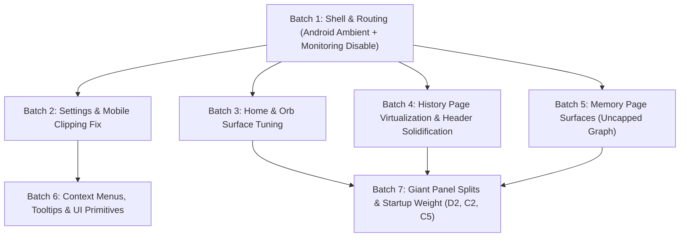

# Frontend UI Optimization & Refactoring Plan (Desktop & Android)

---

## 1. Executive Summary & Goals

This plan defines the end-to-end frontend UI refactoring and optimization for **both Desktop and Android**. It addresses performance bottlenecks (heavy frosted glass, excessive blur/shadow layering, redundant compositing), layout bugs (the 480px / mobile nested card clipping issue), Android platform realities (disabling non-functional CPU/RAM monitoring and isolating ambient backgrounds to Home only), and codebase modularity (D2 giant panel splits).

### Primary Objectives:
1. **Fix UI Clipping on 480px / Mobile Layouts:** Eliminate nested card border-radius conflicts, excessive horizontal padding, scrollbar collision, and bottom dock overlap in the Settings and modal interfaces.
2. **Android Platform Alignment:** 
   - Restrict `AmbientBackground` exclusively to Home (`/`) on Android (saving battery and compositor redraws).
   - Completely disable the `/monitoring` route and its bottom-nav icon on Android because SELinux blocks host `/proc/stat` and `/proc/meminfo`.
3. **De-layer Blurs & Shadows Across Desktop and Mobile:**
   - Migrate 58 `backdrop-blur-*` sites down to lightweight blurs or solid surfaces.
   - Replace 27 heavy `shadow-2xl` drop-shadows with crisp, modern `shadow-lg` or `shadow-md` styling.
   - Remove stacked blur + shadow + transparency combos that force permanent GPU compositing layers.
4. **Structural & Startup Optimization (D2, C2, C5):**
   - Modularize 1000+ line monolithic components (`SessionPanel.tsx`, `MemoryTimeline.tsx`, `LlmCatalogView.tsx`).
   - Defer Three.js loading so first paint is instant.
   - Replace simple Framer Motion fades with native CSS transitions.
5. **Graph Integrity Guarantee:** Per explicit user instruction, the 3D memory graph node count and simulation remain completely uncapped.

---

## 2. Invariant & Architecture Compliance

1. **Dual-Target Verification:** Every batch must pass `app/src-tauri/scripts/verify-targets.sh` (0 warnings / 0 errors).
2. **TypeScript & Unit Tests:** `pnpm tsc --noEmit` and `pnpm test` must stay green throughout.
3. **AST Invariant Checker:** `.agents/skills/review-ui/scripts/check_invariants.mjs` must satisfy all 5 frontend invariants.
4. **No Compatibility Shims:** Remove obsolete abstractions cleanly; do not introduce dead fallbacks.

---

## 3. Dependency & Blast Radius Analysis

---

## 4. Execution Batches (Component & Page Grouped)

### Batch 1: Shell, Navigation & Platform Gates (Desktop & Android)
- **Target Components:** `ResponsiveLayout.tsx`, `EdgeNav.tsx`, `TitleBar.tsx`, `App.tsx`, `index.html`.
- **Scope & Blast Radius:**
  1. **Android Ambient Background Isolation:** In `ResponsiveLayout.tsx`, gate `AmbientBackground` so on Android (`isRealMobileDevice()`) it renders **only on Home (`/`)**. On `/history`, `/memory`, `/settings`, it is unmounted. Desktop maintains existing ambient field behavior.
  2. **Disable Android `/monitoring` Route:**
     - In `EdgeNav.tsx`, hide the Activity icon on mobile (`isRealMobileDevice()`).
     - In `App.tsx`, add an Android redirect for `/monitoring` -> `/`.
     - In `ResponsiveLayout.tsx`, suppress mobile monitoring popover anchors.
  3. **TitleBar Hover Cards (Desktop):** In `TitleBar.tsx` (lines 190, 226), reduce `backdrop-blur-xl` + `shadow-2xl` on application and model pill hover cards to `backdrop-blur-md` + `shadow-lg`.
  4. **Error Boundary Sanitization:** Preserve the `ResizeObserver loop completed` notification filter in `app/index.html`.

### Batch 2: Settings Page & Mobile Layout Clipping Fix (Desktop & Mobile)
- **Target Components:** `pages/Settings.tsx`, `SettingsCardWrapper.tsx`, `AppearanceCard.tsx`, `WorkingMemoryCard.tsx`, `WorkingMemoryConfigDesk.tsx`, `ToggleTile.tsx`, `LlmCatalogView.tsx`, `SubModelCard.tsx`, `index.css`.
- **RCA of Screenshot Clipping:**
  - `Settings.tsx` wrapped each card in `glass-card rounded-2xl p-4`.
  - Cards internally wrapped sub-desks in `rounded-xl p-3 border bg-[rgba(var(--foreground),0.02)]`.
  - Sub-desks nested workspace cards in another `rounded-xl border`.
  - Result: 80px+ horizontal padding on a 360–480px viewport squashing elements, coupled with scrollbar thumb collision and dock overlap.
- **Scope & Blast Radius:**
  1. **De-nest Settings on Small Screens:** In `Settings.tsx`, remove the outer redundant `glass-card rounded-2xl p-4` wrapper on small screens; let domain cards render their own direct surface.
  2. **Increase Mobile Bottom Scroll Padding:** Change `pb-[95px]` to `pb-[120px]` in `Settings.tsx` so the bottom card (`WEB SEARCH`) clears `EdgeNav` and `BottomDockFeather`.
  3. **Fix `ToggleTile` Mobile Tap Squashing:** In `ToggleTile.tsx`, restrict `group-hover:w-[38px]` slide-out toggle tab to fine pointers (`@media (pointer: fine)`). On mobile/coarse pointers, suppress hover layout shifts.
  4. **Fix Color Picker Saturation & Hue Bounds:** In `index.css` (`.custom-color-picker`), adjust `react-colorful__saturation` radius from `1rem` to `0.75rem` and set explicit margins so pointer drag handles do not clip.
  5. **De-layer Blurs & Shadows:**
     - `LlmCatalogView.tsx`: Replace 3 `backdrop-blur-2xl` + `shadow-2xl` tooltips (lines 188, 928, 989) with `backdrop-blur-md` + `shadow-lg`.
     - `SubModelCard.tsx`: Replace `shadow-2xl` (line 166) with `shadow-md`.

### Batch 3: Home Page & Orb Surface Tuning (Desktop & Mobile)
- **Target Components:** `pages/Home.tsx`, `DialogueBubble.tsx`, `TurnMetricsBadge.tsx`, `ActiveSessionHeader.tsx`, `AdvancedOrb.tsx`.
- **Scope & Blast Radius:**
  1. **Home Banners & Overlays:** In `Home.tsx`, replace `shadow-2xl` on status/error cards (lines 246, 264) with `shadow-lg`.
  2. **Dialogue Bubble Optimization:** In `DialogueBubble.tsx`, replace `backdrop-blur-xl` + `shadow-xl` (line 43) with `backdrop-blur-md` + `shadow-md`.
  3. **Orb Low-Power Pause:** Retain low-power RAF loop pause when calm & off-screen on touch devices in `AdvancedOrb.tsx`.

### Batch 4: History Page Solidification & Virtualization (Desktop & Mobile)
- **Target Components:** `pages/History.tsx`, `HistoryListView.tsx`, `DetailPanel.tsx`, `CalendarPicker.tsx`, `HistorySearchBar.tsx`.
- **Scope & Blast Radius:**
  1. **Virtualizer Stability:** Ensure the virtualized session list in `HistoryListView.tsx` uses a relative container matching `rowVirtualizer.getTotalSize()`.
  2. **Sticky Header De-blurring:** In `History.tsx` (line 437) and `HistoryListView.tsx` (line 117), replace `bg-[rgb(var(--background))]/80 backdrop-blur-md` with solid `bg-[rgb(var(--background))]` + subtle bottom border, eliminating scrolling compositor churn.
  3. **Message Bubble Styling:** In `DetailPanel.tsx` (line 58), replace `bg-[rgb(var(--card))]/75 backdrop-blur-md` with solid card surface.
  4. **Calendar & Search Drops:**
     - `CalendarPicker.tsx`: Replace `backdrop-blur-2xl` + `shadow-xl` (line 125) with `backdrop-blur-md` + `shadow-lg`.
     - `HistorySearchBar.tsx`: Replace `shadow-2xl` (line 261) with `shadow-lg`.
     - `History.tsx`: Replace `shadow-2xl` on error banners (line 275) with `shadow-lg`.

### Batch 5: Memory Page Surface Tuning (Uncapped Graph Fidelity)
- **Target Components:** `pages/Memory.tsx`, `PersonalMemoryDossierCard.tsx`, `PersonalMemoryStagingCard.tsx`, `PersonalMemoryModalView.tsx`, `MemoryTimeline.tsx`, `SearchBar.tsx`, `GraphControlDock.tsx`, `MemoryNodeTooltip.tsx`, `SessionNodeTooltip.tsx`, `MemoryStates.tsx`, `ExpandableList.tsx`.
- **Scope & Blast Radius:**
  1. **Uncapped Graph Simulation:** Retain full 3D graph node capacity and auto-rotation. Zero capping.
  2. **Modal & Floating Surfaces:**
     - `Memory.tsx` & `ExpandableList.tsx`: Replace `backdrop-blur-2xl` + `shadow-2xl` on full expansion modals (lines 643, 169) with `backdrop-blur-md` + `shadow-xl`.
     - `GraphControlDock.tsx`: Replace `backdrop-blur-2xl` + `shadow-2xl` (line 33) with `backdrop-blur-md` + `shadow-lg`.
     - `MemoryNodeTooltip.tsx` & `SessionNodeTooltip.tsx`: Replace `shadow-2xl` (lines 82, 116) with `shadow-lg`.
     - `SearchBar.tsx`: Replace `shadow-2xl` (line 305) with `shadow-lg`.
     - `PersonalMemoryDossierCard.tsx` & `PersonalMemoryStagingCard.tsx`: Replace `shadow-2xl` (lines 93, 348) with `shadow-lg`.
     - `MemoryStates.tsx`: Replace `backdrop-blur-xl` + `shadow-2xl` (line 18) with `backdrop-blur-md` + `shadow-lg`.
     - `MemoryTimeline.tsx`: Replace `shadow-2xl` on context menus (lines 289, 348) with `shadow-lg`.

### Batch 6: Context Menus, Tooltips & Common UI Primitives (Desktop & Mobile)
- **Target Components:** `shared/ui/Card.tsx`, `shared/ui/SessionContextMenu.tsx`, `shared/ui/ProjectContextMenu.tsx`, `shared/ui/ChapterScrubber.tsx`, `shared/ui/Drawer.tsx`, `shared/ui/Modal.tsx`, `shared/ui/Tooltip.tsx`.
- **Scope & Blast Radius:**
  1. **Context Menus:** In `SessionContextMenu.tsx` and `ProjectContextMenu.tsx`, replace `shadow-2xl` with `shadow-lg`, using solid card backgrounds on mobile.
  2. **Chapter Scrubber:** In `ChapterScrubber.tsx`, replace `backdrop-blur-xl` on turn preview card (line 402) with `backdrop-blur-md`.
  3. **Drawer & Modal Overlays:** In `Drawer.tsx` (line 235), replace `backdrop-blur-sm` on overlay backdrop with unified `OverlayBackdrop`.
  4. **Touch & Coarse Tooltips:** Finalize compact tooltips and tap-to-toggle behavior in `Tooltip.tsx`.

### Batch 7: Giant Panel Splits & Startup Weight (D2, C2, C5)
- **Target Components:** `SessionPanel.tsx`, `MemoryTimeline.tsx`, `LlmCatalogView.tsx`, `AdvancedOrb.tsx`, `Home.tsx`.
- **Scope & Blast Radius:**
  1. **D2 Modularization of `SessionPanel.tsx` (1058 lines):**
     - Extract `SessionTurnItem.tsx` (turn bubble rendering + markdown parsing).
     - Extract `SessionInputBar.tsx` (audio visualizer, action buttons, dictation toggle).
     - Extract `SessionActionsMenu.tsx` (export, clear, settings popovers).
  2. **D2 Modularization of `MemoryTimeline.tsx` (913 lines):**
     - Extract `TimelineQueueSection.tsx` (pipeline status and pending extractions).
     - Extract `SessionAccordionList.tsx` (session accordion virtual items).
  3. **D2 Modularization of `LlmCatalogView.tsx` (1380 lines):**
     - Lazy-mount provider desks (Cloud, Local GGUF, Remote Server).
  4. **C2 Deferred Three.js Initialization:**
     - In `Home.tsx` / `AdvancedOrb.tsx`, ensure Three.js module loading does not block initial UI paint.
  5. **C5 Framer-Motion to CSS:**
     - Replace purely static opacity/fade wrappers across wizard and panel headers with CSS transitions.

---

## 5. Risk Assessment & Verification Gates

| Risk | Mitigation |
| :--- | :--- |
| Visual regression on desktop glass cards | Every batch is visually reviewed component-by-component; blurs are softened to `md` rather than completely deleted on desktop. |
| Memory timeline accordion scroll jumps | `useVirtualizer` with `measureElement` tracks open/collapsed accordion states inside an explicit relative container. |
| Android navigation regression | Removing `/monitoring` leaves a balanced 4-item bottom dock (`Home`, `History`, `Memory`, `Settings`) perfectly spaced on 360–480px viewports. |
| Native compilation failure | Run `app/src-tauri/scripts/verify-targets.sh` after each batch. |
