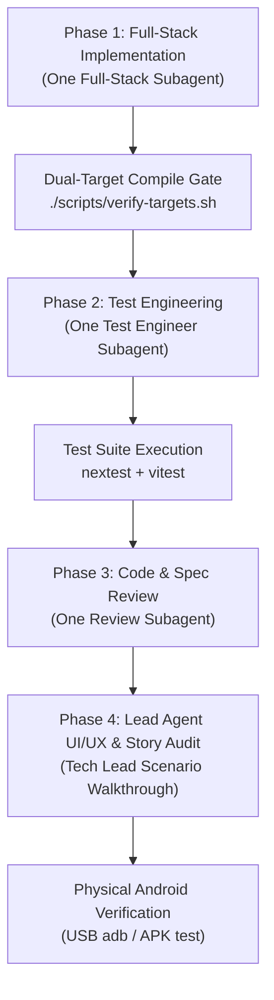

# Remote Control Connection Flow Vertical Slice — Master Execution Plan

**Author:** Tech Lead  
**Status:** Approved & Grounded  
**Phase:** 13 (Active)  
**Target Seam:** Remote Control Connection Flow End-to-End  
**Governing Specs:** [`docs/specs/remote-control-spec.md`](../../specs/remote-control-spec.md), [`docs/specs/ipc-spec.md`](../../specs/ipc-spec.md), [`docs/specs/design-spec.md`](../../specs/design-spec.md)  
**Governing ADR:** [`docs/plans/phase13/remote-control-adr.md`](remote-control-adr.md)  

---

## 1. Executive Summary & Boundaries

This plan executes the **Remote Control Connection Flow** as a **single end-to-end vertical slice**.
Rather than iterating horizontally through isolated waves, this vertical slice implements all required layers—from TCP/WebSocket transport, Noise_XX mutual authentication, and canonical state management, up to Tauri IPC commands, frontend Zustand stores, settings panels, in-app QR camera scanner, Header Rocket button, and ambient visuals.

### In Scope
1. **Physical Transport (`WsLink`):** `tokio-tungstenite` WebSocket transport over TCP implementing the object-safe `RemoteLink` trait (`src/services/remote/link/ws.rs`).
2. **Canonical Session & Heartbeat:** `RemoteLinkState` enum and `RemoteSessionManager` governing Noise_XX mutual authentication, post-handshake `Hello` negotiation, and 2s/1s bidirectional heartbeat loop (`src/services/remote/session/`).
3. **Host Command Guard (`RULE-RC-GUARD`):** Default-deny guard blocking local mutating writes on desktop while connected (`src/services/remote/control/guard.rs`).
4. **Ephemeral Pairing & QR Generation:** Single-use 128-bit pairing token (2-min TTL in memory), local IP detection, SVG QR generation via `qrcode` crate, and inbound approval prompt channel (`src/services/remote/security/`).
5. **Tauri IPC Command & Event Bridge:** 9 IPC commands and 2 IPC events (`remote_state_changed`, `remote_pairing_requested`) strictly matching `docs/specs/ipc-spec.md` (`src/ipc/remote.rs`).
6. **Frontend Services, Store & Guard Hook:** `remoteService.ts`, `remoteStore.ts` (subscribing to pushed events), and `useRemoteGuard.ts` (disabling Engage and mutating controls).
7. **Desktop Host UI:** Settings Remote Desk tab, `PairingModal.tsx` (SVG QR with live 120s timer), and global `PairingPromptModal.tsx` (30s auto-dismiss).
8. **Mobile Controller UI:** Settings Remote Desk tab (empty state and paired host card), in-app WebRTC QR scanner modal (`QrScannerModal.tsx`) with animated reticle, `jsQR` frame parser, and automatic fallback to manual IP/port entry.
9. **Header Rocket Button 🚀 & Ambient Visuals:**
   - `RocketButton.tsx` in `AppHeader.tsx`: always visible on Controller; visible only when Connected on Host with two-step unboxed inline disconnect matching `RestoreDefaultsButton.tsx` (5s auto-revert).
   - Host ambient visuals: motionless dimmed sleeping orb, inward ripples, and compact `● Remote` badge.
   - Controller ambient visuals: inset accent rim glow (`box-shadow: inset 0 0 24px rgba(var(--accent), 0.15)`).
10. **Automated Integration Tests & Physical Device Verification:**
    - Loopback TCP `WsLink` tests and full end-to-end connection integration test (`tests/remote_connection_test.rs`).
    - Vitest unit/DOM tests for frontend stores and components.
    - Physical Android verification via `cargo tauri android dev` / debug APK.

### Strictly Out of Scope
- Audio streaming, PCM framing, and microphone/speaker pipelines (deferred to the subsequent Audio Streaming slice).
- Off-LAN transports (QUIC, relays, NAT punch).
- Multiple simultaneous active controllers (v1 is strictly 1:1 host-to-controller).
- Complex remote tool invocation (`remote_call` dispatcher).

---

## 2. Settled Decisions & Grounded Fixes (Grill-Me Frontier)

During the codebase exploration and `/grill-me` alignment, four critical discrepancies and technical traps in the previous lead's drafts were identified and resolved:

| ID | Issue Found | Grounded Resolution |
| :--- | :--- | :--- |
| **DEC-01** | `ipc-spec.md` §5 lacked an event for inbound pairing requests, and Ticket 05 altered `approve_pairing` argument shape to `{ pairingId, approve }`. | Added `remote_pairing_requested` with `{ deviceId: string, displayName: string }` to `ipc-spec.md` §5. Preserved canonical contract `approve_pairing(decision: "Approve" \| "Reject")`. |
| **DEC-02** | `AndroidManifest.xml` lacked `android.permission.CAMERA`, causing WebRTC `getUserMedia` to crash or be blocked on Android WebView. | Added `android.permission.CAMERA` and `<uses-feature android:name="android.hardware.camera" android:required="false" />` to `AndroidManifest.xml`. |
| **DEC-03** | Ticket 01 required running `run_link_conformance` over `WsLink`, violating ADR-RC-15 (production transports must not implement `RawLink`) and failing due to out-of-scope audio tests. | Verified `WsLink` with dedicated loopback TCP integration tests (`ws_link_control_roundtrip`, `ws_link_framing_limits`, `ws_link_close`), keeping `run_link_conformance` on `LoopbackLink`. |
| **DEC-04** | Handling camera denial or devices lacking cameras in `QrScannerModal.tsx`. | In-app scanner gracefully catches camera permission errors and automatically switches to the inline manual IP/port entry form. |
| **DEC-05** | Ticket 09 diverged `disconnect_device` argument to `{ deviceId, reason }`. | Preserved `ipc-spec.md` contract `disconnect_device(deviceId: string)`. The reason `host_disconnected` is handled internally on the wire. |

---

## 3. Four-Phase Vertical Slice Execution Workflow

Following the user's architectural paradigm, execution proceeds in 4 distinct phases:



---

## 4. Phase 1: Full-Stack Implementation Subagent

### Subagent Configuration
- **Role:** Senior Full-Stack Engineer
- **Rule Files to Read First:**
  - [`.agents/rules/backend-style-guide.md`](file:///home/addy/projects/apps/vox/.agents/rules/backend-style-guide.md)
  - [`.agents/rules/frontend-style-guide.md`](file:///home/addy/projects/apps/vox/.agents/rules/frontend-style-guide.md)
  - [`.agents/rules/android-style-guide.md`](file:///home/addy/projects/apps/vox/.agents/rules/android-style-guide.md)
  - [`AGENTS.md`](file:///home/addy/projects/apps/vox/AGENTS.md) §8 (Remote Control Module Map)
- **Skills to Load:** `implement`
- **Mandatory Compile Gate:**
  ```bash
  cd app/src-tauri && ./scripts/verify-targets.sh
  ```

### Detailed Implementation Tasks
1. **Backend Link Transport (`app/src-tauri/src/services/remote/link/ws.rs`):**
   - Implement `WsLink` wrapping `tokio_tungstenite::WebSocketStream<tokio::net::TcpStream>`.
   - Implement `RemoteLink` trait methods (`send_control`, `recv_control`, `close`, `close_reason`).
   - For this connection slice, `send_audio` and `recv_audio` return `Err(LinkError::Transport("Audio streaming deferred to audio slice".into()))`.
   - Enforce frame caps: `MAX_CONTROL_MESSAGE_BYTES` and `MAX_PREAUTH_MESSAGE_BYTES`.
   - Implement listener (`bind`) and dialer (`dial`).
   - Re-export `WsLink` in `services/remote/link/mod.rs`.

2. **Backend Canonical Session Manager (`app/src-tauri/src/services/remote/session/`):**
   - Create `state.rs`: Define `RemoteLinkState` enum (`Disabled`, `Disconnected`, `Connecting`, `Connected`, `Reconnecting`, `Failed(String)`). Ensure 0 boolean shadows.
   - Create `manager.rs`: Implement `RemoteSessionManager` parameterized by `SessionRole`.
   - Wire Noise_XX handshake using existing `NoiseHandshake` driver from `security/noise.rs`.
   - Wire post-handshake `Hello` exchange with capability bitmask and protocol version check.
   - Wire 2s/1s bidirectional heartbeat loop using named constants (`HEARTBEAT_INTERVAL`, `HEARTBEAT_PONG_TIMEOUT`, `HEARTBEAT_MAX_MISSED_PONGS`).
   - Re-export in `services/remote/session/mod.rs`.

3. **Backend Static Command Routing & Guard (`app/src-tauri/src/services/remote/control/`):**
   - Create `routing.rs`: Static classification (`Remote`, `Local`, `Split`, `Denied`) for all IPC commands and settings domains/keys.
   - Create `guard.rs`: Implement `RULE-RC-GUARD`: When `RemoteLinkState == Connected`, block all desktop mutating commands. Allow all reads, window chrome, `appearance` settings, and remote admin commands (`pair_new_device`, `approve_pairing`, `list_paired_devices`, `revoke_device`, `disconnect_device`).
   - Re-export in `services/remote/control/mod.rs`.

4. **Backend Pairing Coordinator & QR Minting (`app/src-tauri/src/services/remote/security/`):**
   - In `pairing.rs`: Implement `mint_pairing_qr_svg(host_id, public_key, hint_addr, hint_port)` returning SVG string using `qrcode` crate with `svg` feature.
   - Add local IPv4 discovery helper (`local_ip`).
   - Wire inbound pairing connection: upon completed Noise handshake and token consumption, emit `remote_pairing_requested` with `{ deviceId, displayName }` via `AppHandle` and hold oneshot receiver for `approve_pairing`.
   - On "Approve", persist peer to Turso DB `paired_devices` table via `insert_paired_device`.

5. **Backend Tauri IPC Handlers (`app/src-tauri/src/ipc/remote.rs`):**
   - Implement 9 commands conforming to `ipc-spec.md` §4.8:
     - `pair_new_device`
     - `approve_pairing`
     - `list_paired_devices`
     - `revoke_device`
     - `disconnect_device`
     - `connect_host`
     - `disconnect_host`
     - `get_link_state`
     - `get_command_routing`
   - Register in `src/ipc/mod.rs` and `tauri::generate_handler![]` in `src/lib.rs`.
   - Emit `remote_state_changed` on every state transition.

6. **Frontend Service, Store & Guard Hook (`app/src/`):**
   - `src/services/remoteService.ts`: Type-safe wrappers invoking the 9 IPC commands.
   - `src/store/remoteStore.ts`: Zustand store listening to `remote_state_changed` and `remote_pairing_requested`, hydrating initial state on mount via `get_link_state()`.
   - `src/shared/hooks/useRemoteGuard.ts`: Returns `{ isBlocked, guardProps, tooltip }`.
   - Integrate `useRemoteGuard` into `HomeControls.tsx` (disabling Engage button with tooltip *"Remote session active"*).

7. **Frontend Host UI (`app/src/shared/components/`):**
   - `settings/interaction/RemoteDeskPanel.tsx`: Host Remote Desk tab with `remote.accepts_controllers` toggle, `[+ Pair New Device]` button, and paired controller card with Revoke trash button.
   - `remote/PairingModal.tsx`: Renders crisp SVG QR, live 120s countdown timer with auto-close on expiration, and IP/port hint.
   - `remote/PairingPromptModal.tsx`: Global modal showing "Approve [Device Name] to connect?" with 30s timeout, [Approve], and [Deny] buttons. Mounted in `AppLayout.tsx`.

8. **Frontend Controller UI (`app/src/shared/components/`):**
   - `settings/interaction/ControllerRemoteDeskPanel.tsx`: Empty state with "No Host Connected", **[Scan Host QR]** button, and paired host view.
   - `remote/QrScannerModal.tsx`: In-app camera viewfinder using HTML5 WebRTC `getUserMedia({ video: { facingMode: 'environment' } })` + `jsQR` decoding offscreen canvas at 20fps. Reticle corners with scan beam. Automatic fallback to manual IP/port inputs on camera permission denial. Video track cleanup on unmount.

9. **Header Rocket Button & Ambient Visuals:**
   - `remote/RocketButton.tsx`: Mounted in `AppHeader.tsx`.
     - Controller: always visible; opens scanner or disconnects.
     - Host: visible only when `Connected`; two-step unboxed inline transition ("Disconnect remote", red Checkmark, grey Cross, 5s auto-revert).
   - Host ambient visuals: motionless dimmed orb with inward ripples and `● Remote` status pill.
   - Controller ambient visuals: viewport inset accent rim glow (`box-shadow: inset 0 0 24px rgba(var(--accent), 0.15)`).

---

## 5. Phase 2: Test Engineer Subagent

### Subagent Configuration
- **Role:** Senior Test Engineer
- **Rule Files to Read First:**
  - [`.agents/rules/testing-style-guide.md`](file:///home/addy/projects/apps/vox/.agents/rules/testing-style-guide.md)
  - [`.agents/rules/test-engineer.md`](file:///home/addy/projects/apps/vox/.agents/rules/test-engineer.md)
- **Skills to Load:** `create-test`
- **Mandatory Test Commands:**
  ```bash
  cd app/src-tauri && cargo nextest run --test remote_link_test --release --nocapture
  cd app/src-tauri && cargo nextest run --test remote_connection_test --release --nocapture
  cd app && pnpm test:unit
  cd app && pnpm test:dom
  ```

### Detailed Test Engineering Tasks
1. **Link Integration Tests (`tests/remote_link_test.rs`):**
   - Author `ws_link_control_roundtrip_delivers_payload`: Spins up `WsLink` listener and dialer over loopback TCP port; validates message serialization, delivery, and receipt.
   - Author `ws_link_oversized_message_closes_with_protocol_error`: Asserts that messages exceeding `MAX_CONTROL_MESSAGE_BYTES` immediately terminate the link.
   - Author `ws_link_clean_close_notifies_peer`: Asserts that `close(LinkCloseReason::Local)` transitions the peer to `LinkCloseReason::Peer`.
2. **End-to-End Connection Seam Test (`tests/remote_connection_test.rs`):**
   - Author comprehensive loopback scenario:
     - Mints pairing token and generates pairing payload.
     - Simulates inbound dialer; executes Noise_XX handshake.
     - Asserts `remote_pairing_requested` event fires with matching device identity.
     - Answers `approve_pairing(decision: "Approve")` and asserts insertion into Turso `paired_devices`.
     - Completes `Hello` exchange and verifies transition to `RemoteLinkState::Connected`.
     - Runs 2s/1s heartbeat exchange.
     - Simulates 3 missed pongs and asserts timeout transition to `Disconnected`.
     - Verifies `RULE-RC-GUARD`: local desktop write rejected while controller origin accepted.
3. **Frontend Store & Guard Tests (`app/src/test/`):**
   - Unit tests for `remoteStore.ts`: event subscription, state transitions, and hydration.
   - Unit tests for `useRemoteGuard.ts`: verifying `isBlocked` is true strictly when Host is Connected.
   - DOM tests for `PairingModal.dom.test.tsx` and `RocketButton.dom.test.tsx`.

---

## 6. Phase 3: Code & Spec Review Subagent

### Subagent Configuration
- **Role:** Principal Reviewer / Code Quality Auditor
- **Rule Files to Read First:**
  - [`.agents/rules/backend-style-guide.md`](file:///home/addy/projects/apps/vox/.agents/rules/backend-style-guide.md)
  - [`.agents/rules/frontend-style-guide.md`](file:///home/addy/projects/apps/vox/.agents/rules/frontend-style-guide.md)
  - [`.agents/rules/testing-style-guide.md`](file:///home/addy/projects/apps/vox/.agents/rules/testing-style-guide.md)
- **Skills to Load:** `review`, `review-ui`

### Audit Rubrics & Checkpoints
1. **Zero Boolean Shadows:** Ensure no `is_connected`, `controller_attached`, or boolean shadows exist. All components query canonical `RemoteLinkState`.
2. **Grammar Order & File Hygiene:** Check Rust files follow imports -> constants -> data structures -> trait impls -> inherent impls -> helpers. Functions < 50 lines. No `unwrap()` in `src/`.
3. **React 19 & Liquid Space Compliance:** Check unconditional hook ordering, `isMounted` listener guards, proper timer teardown, no raw hex colors, interactive pills only for clickable controls, and camera track stopping on unmount.
4. **Compile Gate Invariant:** Run `./scripts/verify-targets.sh` to confirm 0 warnings and 0 errors across desktop and Android.

---

## 7. Phase 4: Lead Agent UI/UX Scenario Walkthrough & Story Tracing

As the Tech Lead, I will evaluate the implementation not at the syntactic code level, but against real user stories and interaction journeys:

### User Story Traces
- **US-RC-01 (First-Time Pairing):**
  - Story: User clicks `[+ Pair New Device]` on laptop -> QR displays with 2-min countdown -> Phone opens camera scanner -> Scans QR -> Laptop displays "Approve Pixel 8 Pro?" modal -> User approves -> Phone becomes controller -> Laptop persists pairing in Turso DB.
  - Trace: `pair_new_device` -> SVG QR render -> WebRTC video stream -> `jsQR` parse -> `connect_host` -> Noise_XX handshake -> `remote_pairing_requested` -> `approve_pairing` -> Turso `paired_devices` insert -> `remote_state_changed` to `Connected`.
- **US-RC-05 & 06 (Disconnect & Reconnect Resilience):**
  - Story: User disconnects from phone or laptop -> Session persists in Paused state -> Disconnect UI reverts cleanly.
  - Trace: `RocketButton` two-step inline transition ("Disconnect remote" -> Checkmark -> 5s auto-revert) -> `disconnect_device` / `disconnect_host` -> `remote_state_changed` to `Disconnected` -> UI unblocks.
- **US-RC-07 & 08 (Host Passive State & Control Guard):**
  - Story: While phone is connected, laptop user sees dimmed motionless orb, inward ripples, and `● Remote` badge. Clicking Engage or mutating settings is disabled with *"Remote session active"*. History and memory remain browsable.
  - Trace: `useRemoteGuard` checks `linkState === Connected` on Host -> `disabled={true}`, opacity reduction, tooltip -> backend `RULE-RC-GUARD` rejects any direct mutating IPC invoke with `GuardBlocked`.
- **US-RC-09 (Revocation of Lost Device):**
  - Story: User clicks Revoke on paired controller card -> Device row deleted from Turso DB -> Connection dropped immediately -> Attempted reconnect enters terminal `Failed(Revoked)`.

---

## 8. Physical Device APK Verification Checklist

Once Phases 1–3 pass:
1. Connect Android test device via USB (`adb devices`).
2. Run compile gate: `cd app/src-tauri && ./scripts/verify-targets.sh`.
3. Build and install debug APK:
   ```bash
   cd app/src-tauri && cargo tauri android dev
   # OR build debug apk:
   cargo tauri android build --debug
   adb install -r gen/android/app/build/outputs/apk/universal/debug/app-universal-debug.apk
   ```
4. Verify camera permissions prompt on phone upon opening scanner.
5. Verify successful QR scan against laptop screen.
6. Verify approval prompt on laptop, inward ripples on orb, and Rocket Button active state.
