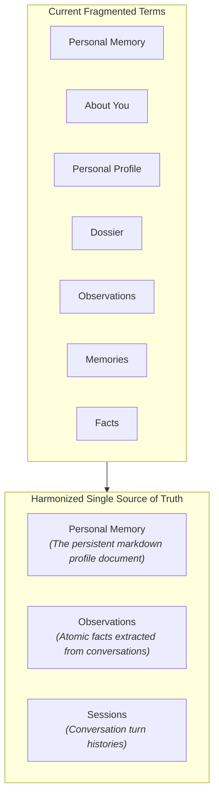
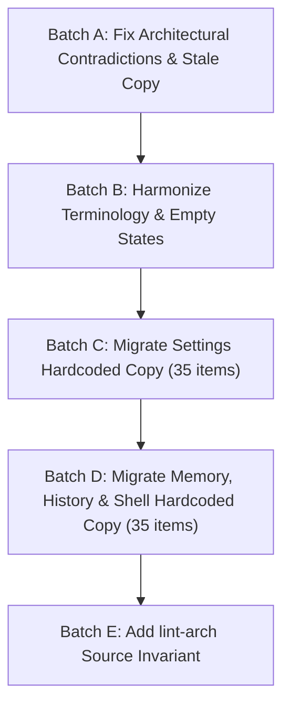

# Phase 13 — Comprehensive Frontend UI Copy & Language Audit Report

> **Auditor:** Impeccable Design & Architecture Reviewer  
> **Rubric:** `/impeccable clarify` Playbook, ASD-STE100 Simplified Technical English, and `.agents/rules/frontend-style-guide.md`  
> **Date:** 2026-10-23  
> **Scope:** Entire frontend surface (~50,000 LOC across `app/src/`, including all 15 files in `app/src/data/` and all 6 UI domains)

---

## 1. Executive Summary

Vox establishes a dedicated copy architecture in `app/src/data/` consisting of **15 files and 2,814 lines of copy**. The system contract defined in `.agents/rules/frontend-style-guide.md` (§3) and `frontend-engineer.md` (§2) states:
> *"Zero hardcoded copy: Place labels, options, and descriptions in `src/data/`. Never inline raw strings inside component templates."*

While core views and panels achieve high adoption (**163 import sites from `@/data/*`**), this comprehensive audit identified critical architectural contradictions, stale navigation breadcrumbs, developer jargon exposed to end-users, and **~70 hardcoded inline strings** residing in component templates outside `data/`.

### Summary Matrix

| Category | Finding Count | Severity | Impact |
| :--- | :--- | :--- | :--- |
| **Architectural Contradictions** | 3 critical | 🔴 High | Misrepresents core engine (SQLite vs Turso DB), breaks mental model with stale menu paths, and introduces confusing step counts in onboarding |
| **Stale Copy & Dead Keys** | 4 keys | ⚠️ Medium | Stale "Coming Soon" flags for active Phase 13 features (Remote Control) and deprecated scope arrays |
| **Terminology Fragmentation** | 4 core concepts | ⚠️ Medium | Multiple competing terms for memory concepts ("Personal Memory" vs "About You" vs "Dossier" vs "Observations" vs "Facts") |
| **Technical Jargon in User UI** | 5 instances | ⚠️ Medium | Exposes developer terms ("RCA Profiler", "Memory Only" RAM ambiguity, "ASR" vs "STT") |
| **Hardcoded Inline Strings** | ~70 instances | ⚠️ Medium | Violates frontend zero-hardcoded-copy invariant; prevents internationalization (i18n) and causes copy drift |

---

## 2. Architectural Contradictions & Stale Copy in `app/src/data/`

These issues in `app/src/data/` contradict current system specifications, active phase plans, or the reality of the codebase:

### 2.1 🔴 Database Engine Contradiction (SQLite vs. Turso DB)
- **Location:** [`app/src/data/settingsCopy.ts:421`](file:///home/addy/projects/apps/vox/app/src/data/settingsCopy.ts#L421)
- **Current Text:**
  ```ts
  sessionStorage: {
    title: "Session Storage",
    description: "When on, nothing from your chats is written to disk — no audio, no transcripts, no memories.",
    enabledLabel: "Incognito",
    disabledLabel: "Logged",
    enabledSub: "No traces saved",
    disabledSub: "Standard SQLite", // <--- Contradiction
  },
  ```
- **Architectural Violation:** Contradicts Vox's non-negotiable architectural invariant (`AGENTS.md` §4.1):
  > *"DATABASE ENGINE (NON-NEGOTIABLE): WE DO NOT USE SQLITE. Vox exclusively uses the Turso Database Engine (`turso` crate: pure-Rust, async-native, MVCC concurrent writers). Never assume SQLite, C toolchains, or rusqlite locking constraints."*
- **Actionable Fix:** Replace `disabledSub: "Standard SQLite"` with `disabledSub: "Local Storage"` or `disabledSub: "Persistent Turso DB"`.

---

### 2.2 🔴 Stale Navigation Path in Mobile Wizard
- **Location:** [`app/src/data/welcomeCopy.ts:306`](file:///home/addy/projects/apps/vox/app/src/data/welcomeCopy.ts#L306)
- **Current Text:**
  ```ts
  skipModal: {
    title: "Skip Setup for Now?",
    description: "Speech recognition and offline intelligence need local model weights to work.",
    settingsNote: "You can download models and configure audio anytime in Settings → Models & Audio.", // <--- Stale Path
    cancelButton: "Continue Setup",
    confirmButton: "Skip to Home",
  },
  ```
- **The Issue:** The "Models & Audio" domain was eliminated during the radial hub refactor. Settings is structured into 6 domains: `Speech Models` (voice, STT, TTS) and `Language Model` (LLM). Telling a user to go to "Settings → Models & Audio" causes dead-end navigation.
- **Actionable Fix:** Change to:
  `"You can download models and configure audio anytime in Settings → Speech Models & Language Model."`

---

### 2.3 🔴 Mismatched Step Counters in Mobile Wizard
- **Location:** [`app/src/data/welcomeCopy.ts:311, 319, 326, 338, 348, 376`](file:///home/addy/projects/apps/vox/app/src/data/welcomeCopy.ts#L311)
- **Current Text:**
  - Hero step: `step: "Step 1 of 5"`
  - Intelligence step: `step: "Step 2 of 5"`
  - Permission step: `step: "Step 3 of 6"`
  - Runtime step: `step: "Step 4 of 6"`
  - Models step: `step: "Step 5 of 6"`
  - Ready step: `step: "Step 6 of 6"`
- **The Issue:** The total step denominator changes from 5 to 6 midway through onboarding. This is an explicit numerical defect in the onboarding flow.
- **Actionable Fix:** Harmonize all 6 steps to the consistent denominator: `"Step 1 of 6"` and `"Step 2 of 6"`.

---

### 2.4 ⚠️ Stale Remote Control Feature Status
- **Location:** [`app/src/data/settingsCopy.ts:371-377`](file:///home/addy/projects/apps/vox/app/src/data/settingsCopy.ts#L371-L377)
- **Current Text:**
  ```ts
  export const REMOTE_CONTROL_COPY = {
    tab: "Remote Control",
    title: "Remote Control",
    description: "Let a paired phone act as the microphone, speaker and screen for this laptop, over your own network.",
    comingSoon: "Coming Soon",
  } as const;
  ```
- **The Issue:** In Phase 13, Remote Control is under active delivery. The wire protocol (`services/remote/protocol`), Noise handshake security (`services/remote/security`), and frontend types (`RemoteSettings` in `app/src/types/settings.ts`) are landed. Statically labeling it "Coming Soon" without pairing action states causes interface stagnation.
- **Actionable Fix:** Replace static placeholder with real status states (`"Pair Phone"`, `"Searching for Controllers"`, `"Controller Connected"`, `"Disconnect"`).

---

## 3. Heuristic Language & Clarity Audit (`/impeccable clarify`)

Following the `/impeccable clarify` playbook:
> *"Use a specific verb and object when the outcome is not already obvious. Keep the same noun and verb for the same concept throughout the product. Do not vary words for literary effect in an interface."*

### 3.1 Vocabulary Fragmentation Across Memory & History



1. **Entity Inconsistency in Memory Domain:**
   - The user's personal notes document is referred to in 4 different ways:
     - `personalMemory: "Personal Memory"` ([`memoryCopy.ts:2`](file:///home/addy/projects/apps/vox/app/src/data/memoryCopy.ts#L2))
     - `dossierTitle: "About You"` ([`memoryCopy.ts:3`](file:///home/addy/projects/apps/vox/app/src/data/memoryCopy.ts#L3))
     - `"personal profile"` ([`memoryCopy.ts:24`](file:///home/addy/projects/apps/vox/app/src/data/memoryCopy.ts#L24))
     - `"dossier"` ([`memoryCopy.ts:153`](file:///home/addy/projects/apps/vox/app/src/data/memoryCopy.ts#L153))
   - Atomic knowledge items are alternately called `"Observations"` in drawers, `"Memories"` in search placeholders, and `"Facts"` in empty states.
   - **Recommendation:**
     - **Personal Memory:** Canonical name for the persistent user profile document.
     - **Observations:** Canonical name for atomic facts extracted from sessions.
     - **Eliminate:** The terms "Dossier" and "Personal Profile" should be purged.

2. **Robotic Phrasing in Empty States:**
   - [`historyCopy.ts:3`](file:///home/addy/projects/apps/vox/app/src/data/historyCopy.ts#L3): `noMemoriesTitle: "No Sessions persist"`
   - [`memoryCopy.ts:8`](file:///home/addy/projects/apps/vox/app/src/data/memoryCopy.ts#L8): `emptyFactsTitle: "No memories persist"`
   - **The Issue:** "Persist" is database implementation jargon, not natural English.
   - **Recommendation:**
     - History: `"No conversations recorded yet"`
     - Memory: `"No observations extracted yet"`

3. **Ambiguous Incognito Tooltip:**
   - [`homeCopy.ts:47`](file:///home/addy/projects/apps/vox/app/src/data/homeCopy.ts#L47): `toggleTooltip: "Incognito Mode (Memory Only)"`
   - **The Issue:** "Memory Only" is developer shorthand for volatile system RAM. End-users misunderstand this as "Vox will only record your personal memory".
   - **Recommendation:** Change to `"Incognito Mode (RAM only — nothing saved to disk)"`.

4. **Internal Developer Jargon in User Navigation:**
   - [`monitoringCopy.ts:17`](file:///home/addy/projects/apps/vox/app/src/data/monitoringCopy.ts#L17): `openProfiler: "Open UI Memory Attribution & RCA Profiler"`
   - **The Issue:** "RCA" (Root Cause Analysis) and "Attribution" are internal engineering terms.
   - **Recommendation:** Change to `"Open UI Diagnostics & Memory Profiler"`.

5. **Acronym Inconsistencies (ASR vs. STT):**
   - [`settingsCopy.ts:274 & 284`](file:///home/addy/projects/apps/vox/app/src/data/settingsCopy.ts#L274): Line 274 uses `"Streaming STT"`, while line 284 uses `"dedicated remote ASR inference node"`.
   - **The Issue:** Introducing two different acronyms for the identical capability confuses users configuring remote servers.
   - **Recommendation:** Standardize on `"Speech-to-Text"` (with `"STT"` where space is constrained). Eliminate `"ASR"` from user-facing copy.

---

## 4. Comprehensive Audit of Hardcoded Copy (Outside `data/`)

Below is the exhaustive inventory of all ~70 user-facing strings hardcoded in component templates, grouped by domain with exact file and line references:

### 4.1 Settings Domain (35 Instances)

| File | Line | Type | Hardcoded String | Context & Remediation |
| :--- | :--- | :--- | :--- | :--- |
| [`ProviderModal.tsx`](file:///home/addy/projects/apps/vox/app/src/shared/components/settings/language/ProviderModal.tsx#L320-L325) | 321 | Text | `"On-Device Speech Recognition"` | Local STT provider card title. Move to `PROVIDERS_CONFIG_DESK_COPY.localMeta.stt.name`. |
| [`ProviderModal.tsx`](file:///home/addy/projects/apps/vox/app/src/shared/components/settings/language/ProviderModal.tsx#L320-L325) | 321 | Text | `"High-accuracy local Whisper & Nemotron transcription. 100% offline."` | Local STT tagline. Move to `PROVIDERS_CONFIG_DESK_COPY.localMeta.stt.tagline`. |
| [`ProviderModal.tsx`](file:///home/addy/projects/apps/vox/app/src/shared/components/settings/language/ProviderModal.tsx#L320-L325) | 322 | Text | `"On-Device Model"` | Local LLM card title. Move to `PROVIDERS_CONFIG_DESK_COPY.localMeta.llm.name`. |
| [`ProviderModal.tsx`](file:///home/addy/projects/apps/vox/app/src/shared/components/settings/language/ProviderModal.tsx#L320-L325) | 322 | Text | `"Local GGUF neural reasoning on CPU or GPU. Zero telemetry, private."` | Local LLM tagline. Move to `PROVIDERS_CONFIG_DESK_COPY.localMeta.llm.tagline`. |
| [`ProviderModal.tsx`](file:///home/addy/projects/apps/vox/app/src/shared/components/settings/language/ProviderModal.tsx#L320-L325) | 323 | Text | `"On-Device Neural Voices"` | Local TTS card title. Move to `PROVIDERS_CONFIG_DESK_COPY.localMeta.tts.name`. |
| [`ProviderModal.tsx`](file:///home/addy/projects/apps/vox/app/src/shared/components/settings/language/ProviderModal.tsx#L320-L325) | 323 | Text | `"Local Kokoro neural synthesis with peak normalization and zero latency."` | Local TTS tagline. Move to `PROVIDERS_CONFIG_DESK_COPY.localMeta.tts.tagline`. |
| [`ProviderModal.tsx`](file:///home/addy/projects/apps/vox/app/src/shared/components/settings/language/ProviderModal.tsx#L330) | 330 | Text | `"Local Hardware"` | Local provider badge. Move to `PROVIDERS_CONFIG_DESK_COPY.badges.localHardware`. |
| [`ProviderModal.tsx`](file:///home/addy/projects/apps/vox/app/src/shared/components/settings/language/ProviderModal.tsx#L330) | 330 | Text | `"Offline Ready"` | Local provider inactive status. Move to `PROVIDERS_CONFIG_DESK_COPY.badges.offlineReady`. |
| [`ProviderModal.tsx`](file:///home/addy/projects/apps/vox/app/src/shared/components/settings/language/ProviderModal.tsx#L349) | 349 | Text | `"Keyless Cloud"`, `"Cloud Voice"` | Cloud provider category badges. Move to `PROVIDERS_CONFIG_DESK_COPY.badges.*`. |
| [`ProviderModal.tsx`](file:///home/addy/projects/apps/vox/app/src/shared/components/settings/language/ProviderModal.tsx#L349) | 349 | Text | `"In Development"`, `"Ready"` | Cloud status badges. Move to `PROVIDERS_CONFIG_DESK_COPY.status.*`. |
| [`ProviderModal.tsx`](file:///home/addy/projects/apps/vox/app/src/shared/components/settings/language/ProviderModal.tsx#L389) | 389 | Text | `"Cloud Gateway"` | Remote gateway badge. Move to `PROVIDERS_CONFIG_DESK_COPY.badges.cloudGateway`. |
| [`ProviderModal.tsx`](file:///home/addy/projects/apps/vox/app/src/shared/components/settings/language/ProviderModal.tsx#L436) | 436 | Text | `"Self-Hosted"` | Custom server badge. Move to `PROVIDERS_CONFIG_DESK_COPY.badges.selfHosted`. |
| [`ProviderModal.tsx`](file:///home/addy/projects/apps/vox/app/src/shared/components/settings/language/ProviderModal.tsx#L439) | 439 | aria | `aria-label="Edit Server"` | Server card action button. Move to `PROVIDERS_CONFIG_DESK_COPY.actions.editServer`. |
| [`ProviderModal.tsx`](file:///home/addy/projects/apps/vox/app/src/shared/components/settings/language/ProviderModal.tsx#L442) | 442 | aria | `aria-label="Delete Server"` | Server card action button. Move to `PROVIDERS_CONFIG_DESK_COPY.actions.deleteServer`. |
| [`CustomServerFormCard.tsx`](file:///home/addy/projects/apps/vox/app/src/shared/components/settings/language/CustomServerFormCard.tsx#L302) | 302 | holder | `placeholder="Name (Auto)"` | Server nickname input. Move to `PROVIDERS_CONFIG_DESK_COPY.llm.server.namePlaceholder`. |
| [`CustomServerFormCard.tsx`](file:///home/addy/projects/apps/vox/app/src/shared/components/settings/language/CustomServerFormCard.tsx#L312) | 312 | Text | `"Probing endpoint..."`, `"2s auto-discovery"` | Live probe feedback. Move to `PROVIDERS_CONFIG_DESK_COPY.llm.server.probingState`. |
| [`CustomServerFormCard.tsx`](file:///home/addy/projects/apps/vox/app/src/shared/components/settings/language/CustomServerFormCard.tsx#L328) | 328 | Text | `<span>Save</span>` | Server submit button. Move to `PROVIDERS_CONFIG_DESK_COPY.llm.server.save`. |
| [`DictationConfigDesk.tsx`](file:///home/addy/projects/apps/vox/app/src/shared/components/settings/interaction/DictationConfigDesk.tsx#L413) | 413 | aria | `aria-label="Dictation configuration tabs"` | Dictation tab navigation. Move to `DICTATION_COPY.tabsAriaLabel`. |
| [`DictationConfigDesk.tsx`](file:///home/addy/projects/apps/vox/app/src/shared/components/settings/interaction/DictationConfigDesk.tsx#L655) | 655 | Text | `<span>Manual release only</span>` | Silence auto-stop disabled badge. Move to `DICTATION_COPY.manualReleaseOnly`. |
| [`DictationConfigDesk.tsx`](file:///home/addy/projects/apps/vox/app/src/shared/components/settings/interaction/DictationConfigDesk.tsx#L667) | 667 | aria | `aria-label="Disable silence auto-stop"` / `Enable` | Toggle switch aria label. Move to `DICTATION_COPY.toggleAutoStopAria`. |
| [`DictationConfigDesk.tsx`](file:///home/addy/projects/apps/vox/app/src/shared/components/settings/interaction/DictationConfigDesk.tsx#L675) | 675 | title | `title="Click to disable auto-stop"` / `enable` | Toggle tooltip. Move to `DICTATION_COPY.toggleAutoStopTooltip`. |
| [`DictationConfigDesk.tsx`](file:///home/addy/projects/apps/vox/app/src/shared/components/settings/interaction/DictationConfigDesk.tsx#L702) | 702 | aria | `aria-label="Silence auto-stop duration in seconds"` | Duration input label. Move to `DICTATION_COPY.autoStopDurationAria`. |
| [`DictationConfigDesk.tsx`](file:///home/addy/projects/apps/vox/app/src/shared/components/settings/interaction/DictationConfigDesk.tsx#L711) | 711 | holder | `placeholder="1.2"` | Duration placeholder. Move to `DICTATION_COPY.autoStopDurationPlaceholder`. |
| [`RestoreDefaultsButton.tsx`](file:///home/addy/projects/apps/vox/app/src/shared/components/settings/RestoreDefaultsButton.tsx#L29) | 29 | Text | `"Restore settings"` | Inline confirmation prompt. Move to `SETTINGS_COPY.restorePrompt`. |
| [`RestoreDefaultsButton.tsx`](file:///home/addy/projects/apps/vox/app/src/shared/components/settings/RestoreDefaultsButton.tsx#L33) | 33, 38 | aria | `label="Confirm restore"`, `aria-label="Confirm restore defaults"` | Confirmation tick action. Move to `SETTINGS_COPY.confirmRestore`. |
| [`RestoreDefaultsButton.tsx`](file:///home/addy/projects/apps/vox/app/src/shared/components/settings/RestoreDefaultsButton.tsx#L43) | 43, 48 | aria | `label="Cancel"`, `aria-label="Cancel restore defaults"` | Cancel cross action. Move to `SETTINGS_COPY.cancelRestore`. |
| [`CloneVoiceDrawer.tsx`](file:///home/addy/projects/apps/vox/app/src/shared/components/settings/speech/voices/CloneVoiceDrawer.tsx#L225) | 225 | Text | `<span>Processing...</span>` | Voice clone spinner text. Move to `TTS_VOICE_MANAGER_COPY.cloning.processing`. |
| [`CloneVoiceDrawer.tsx`](file:///home/addy/projects/apps/vox/app/src/shared/components/settings/speech/voices/CloneVoiceDrawer.tsx#L230) | 230 | Text | `<span>Clone Voice</span>` | Voice clone submit button. Move to `TTS_VOICE_MANAGER_COPY.cloning.submit`. |
| [`CloneVoiceDrawer.tsx`](file:///home/addy/projects/apps/vox/app/src/shared/components/settings/speech/voices/CloneVoiceDrawer.tsx#L253) | 253 | Text | `<span>Record Audio</span>` | Drawer mode tab. Move to `TTS_VOICE_MANAGER_COPY.cloning.tabRecord`. |
| [`CloneVoiceDrawer.tsx`](file:///home/addy/projects/apps/vox/app/src/shared/components/settings/speech/voices/CloneVoiceDrawer.tsx#L267) | 267 | Text | `<span>Upload WAV</span>` | Drawer mode tab. Move to `TTS_VOICE_MANAGER_COPY.cloning.tabUpload`. |
| [`CloneVoiceDrawer.tsx`](file:///home/addy/projects/apps/vox/app/src/shared/components/settings/speech/voices/CloneVoiceDrawer.tsx#L307) | 307 | Text | `<span>Record Again</span>` | Re-record button. Move to `TTS_VOICE_MANAGER_COPY.cloning.recordAgain`. |
| [`CloneVoiceDrawer.tsx`](file:///home/addy/projects/apps/vox/app/src/shared/components/settings/speech/voices/CloneVoiceDrawer.tsx#L373) | 373 | holder | `placeholder="e.g. My Voice"` | Cloned voice name placeholder. Move to `TTS_VOICE_MANAGER_COPY.cloning.namePlaceholder`. |
| [`RemoteModelCard.tsx`](file:///home/addy/projects/apps/vox/app/src/shared/components/settings/language/RemoteModelCard.tsx#L170) | 170 | Text | `<span>Speed</span>` | Metric tile header. Move to `LLM_CATALOG_COPY.metricTiles.speed`. |
| [`RemoteModelCard.tsx`](file:///home/addy/projects/apps/vox/app/src/shared/components/settings/language/RemoteModelCard.tsx#L187) | 187 | Text | `<span>Context</span>` | Metric tile header. Move to `LLM_CATALOG_COPY.metricTiles.context`. |
| [`RemoteModelCard.tsx`](file:///home/addy/projects/apps/vox/app/src/shared/components/settings/language/RemoteModelCard.tsx#L206) | 206 | Text | `<span>Compute</span>` | Metric tile header. Move to `LLM_CATALOG_COPY.metricTiles.compute`. |
| [`RemoteModelCard.tsx`](file:///home/addy/projects/apps/vox/app/src/shared/components/settings/language/RemoteModelCard.tsx#L227) | 227 | Text | `<span>Tools</span>` | Metric tile header. Move to `LLM_CATALOG_COPY.metricTiles.tools`. |
| [`RemoteModelCard.tsx`](file:///home/addy/projects/apps/vox/app/src/shared/components/settings/language/RemoteModelCard.tsx#L197) | 197 | Text | `"Managed"` | Automatic context window fallback. Move to `LLM_CATALOG_COPY.managedContext`. |
| [`RemoteModelCard.tsx`](file:///home/addy/projects/apps/vox/app/src/shared/components/settings/language/RemoteModelCard.tsx#L214) | 214–218 | Text | `"GPU Accel"`, `"Server GPU"`, `"Standard"` | Hardware execution tags. Move to `LLM_CATALOG_COPY.computeTypes.*`. |
| [`VoiceCard.tsx`](file:///home/addy/projects/apps/vox/app/src/shared/components/settings/speech/voices/VoiceCard.tsx#L189) | 189, 211 | aria | `aria-label="Seek preview audio"`, `title="Click or arrow keys to seek"` | Interactive audio scrubber. Move to `VOICE_CATALOG_COPY.seekAria` & `seekTitle`. |
| [`VoicePreviewBanner.tsx`](file:///home/addy/projects/apps/vox/app/src/shared/components/settings/speech/voices/VoicePreviewBanner.tsx#L219) | 219 | holder | `placeholder="Type phrase to synthesize..."` | Synthesis phrase input. Move to `VOICE_CATALOG_COPY.customPromptPlaceholder`. |
| [`VoicePreviewBanner.tsx`](file:///home/addy/projects/apps/vox/app/src/shared/components/settings/speech/voices/VoicePreviewBanner.tsx#L233) | 233, 239 | Text | `Apply`, `aria-label="Cancel editing"` | Prompt edit actions. Move to `VOICE_CATALOG_COPY.applyPrompt` & `cancelPrompt`. |
| [`ModelModal.tsx`](file:///home/addy/projects/apps/vox/app/src/shared/components/settings/language/ModelModal.tsx#L128) | 128 | title | `title="Model Filters"`, `resetLabel="Reset"` | Filter dropdown header. Move to `LLM_CATALOG_COPY.filterTitle` & `filterReset`. |

---

### 4.2 Memory Domain (16 Instances)

| File | Line | Type | Hardcoded String | Context & Remediation |
| :--- | :--- | :--- | :--- | :--- |
| [`PersonalMemoryCommentPopover.tsx`](file:///home/addy/projects/apps/vox/app/src/shared/components/memory/PersonalMemoryCommentPopover.tsx#L111) | 111 | title | `title="Add Comment"` | Popover trigger. Reuse `MEMORY_COPY.addComment`. |
| [`PersonalMemoryCommentPopover.tsx`](file:///home/addy/projects/apps/vox/app/src/shared/components/memory/PersonalMemoryCommentPopover.tsx#L135) | 135 | holder | `placeholder="Leave a comment"` | Textarea placeholder. Move to `MEMORY_COPY.commentPlaceholder`. |
| [`PersonalMemoryCommentPopover.tsx`](file:///home/addy/projects/apps/vox/app/src/shared/components/memory/PersonalMemoryCommentPopover.tsx#L145) | 145 | Text | `Cancel` | Discard action button. Reuse `MEMORY_COPY.cancel`. |
| [`PersonalMemoryCommentPopover.tsx`](file:///home/addy/projects/apps/vox/app/src/shared/components/memory/PersonalMemoryCommentPopover.tsx#L160) | 160 | Text | `<span>Add Comment</span>` | Submit comment button. Reuse `MEMORY_COPY.addComment`. |
| [`SuggestionCard.tsx`](file:///home/addy/projects/apps/vox/app/src/shared/components/memory/SuggestionCard.tsx#L71) | 71 | title | `title="Accept suggestion"` | Tick button tooltip. Reuse `MEMORY_COPY.acceptUpdateTitle` / `acceptAddTitle`. |
| [`SuggestionCard.tsx`](file:///home/addy/projects/apps/vox/app/src/shared/components/memory/SuggestionCard.tsx#L85) | 85 | title | `title="Reject suggestion"` | Cross button tooltip. Reuse `MEMORY_COPY.rejectUpdateTitle` / `rejectDeleteTitle`. |
| [`TimelineQueueSection.tsx`](file:///home/addy/projects/apps/vox/app/src/shared/components/memory/timeline/TimelineQueueSection.tsx#L36) | 36 | Text | `<span>Disabled</span>` | Inactive extraction queue pill. Move to `MEMORY_COPY.timeline.statusDisabled`. |
| [`TimelineQueueSection.tsx`](file:///home/addy/projects/apps/vox/app/src/shared/components/memory/timeline/TimelineQueueSection.tsx#L41) | 41 | Text | `<span>Processing</span>` | Active extraction pill. Move to `MEMORY_COPY.timeline.statusProcessing`. |
| [`TimelineQueueSection.tsx`](file:///home/addy/projects/apps/vox/app/src/shared/components/memory/timeline/TimelineQueueSection.tsx#L46) | 46 | Text | `<span>Queued (${pendingCount})</span>` | Pending queue pill. Move to `MEMORY_COPY.timeline.statusQueued`. |
| [`TimelineQueueSection.tsx`](file:///home/addy/projects/apps/vox/app/src/shared/components/memory/timeline/TimelineQueueSection.tsx#L51) | 51 | Text | `<span>Up to date</span>` | Clean queue pill. Move to `MEMORY_COPY.timeline.statusUpToDate`. |
| [`MemorySearchBar.tsx`](file:///home/addy/projects/apps/vox/app/src/shared/components/memory/MemorySearchBar.tsx#L191) | 191 | title | `title="Search Memories"` | Modal empty state header. Move to `MEMORY_COPY.emptySearchTitle`. |
| [`MemorySearchBar.tsx`](file:///home/addy/projects/apps/vox/app/src/shared/components/memory/MemorySearchBar.tsx#L218) | 218 | title | `title="No Memories Found"` | Modal empty state header. Move to `MEMORY_COPY.noMemoriesFoundTitle`. |
| [`GraphControlDock.tsx`](file:///home/addy/projects/apps/vox/app/src/shared/components/memory/GraphControlDock.tsx#L32) | 32 | aria | `aria-label="Graph Navigation Controls"` | Dock toolbar wrapper. Move to `MEMORY_COPY.dockControlsAria`. |
| [`GraphControlDock.tsx`](file:///home/addy/projects/apps/vox/app/src/shared/components/memory/GraphControlDock.tsx#L41) | 41 | aria | `aria-label="Search Memories"` | Search button trigger. Move to `MEMORY_COPY.dockSearchAria`. |
| [`SessionNodeTooltip.tsx`](file:///home/addy/projects/apps/vox/app/src/shared/components/memory/SessionNodeTooltip.tsx#L212) | 212 | Text | `<span>Focus in Timeline</span>` | Hover card action. Move to `MEMORY_COPY.focusTimeline`. |
| [`SessionAccordionItem.tsx`](file:///home/addy/projects/apps/vox/app/src/shared/components/memory/timeline/SessionAccordionItem.tsx#L227) | 227 | Text | `<span>memories</span>` | Count suffix. Reuse `MEMORY_COPY.timeline.memoriesCount`. |

---

### 4.3 History Domain (3 Instances)

| File | Line | Type | Hardcoded String | Context & Remediation |
| :--- | :--- | :--- | :--- | :--- |
| [`CalendarPicker.tsx`](file:///home/addy/projects/apps/vox/app/src/shared/components/history/CalendarPicker.tsx#L143) | 143 | title | `title="Reset date range"` | Date filter clear tooltip. Move to `HISTORY_COPY.resetDateRange`. |
| [`CalendarPicker.tsx`](file:///home/addy/projects/apps/vox/app/src/shared/components/history/CalendarPicker.tsx#L146) | 146 | Text | `<RotateCcw /> Clear` | Date filter clear button text. Move to `HISTORY_COPY.clear`. |
| [`CalendarPicker.tsx`](file:///home/addy/projects/apps/vox/app/src/shared/components/history/CalendarPicker.tsx#L153) | 153, 161 | aria | `aria-label="Previous month"`, `aria-label="Next month"` | Month pager buttons. Inlined despite existing `HISTORY_COPY.prevMonth` & `nextMonth`! Connect directly. |

---

### 4.4 Setup Wizard Domain (6 Instances)

| File | Line | Type | Hardcoded String | Context & Remediation |
| :--- | :--- | :--- | :--- | :--- |
| [`WizardRoot.tsx`](file:///home/addy/projects/apps/vox/app/src/wizard/WizardRoot.tsx#L197) | 197 | title | `title="Toggle Device Frame"` | Developer frame switcher. Move to `WIZARD_CTA_LABELS.toggleFrame`. |
| [`WizardRoot.tsx`](file:///home/addy/projects/apps/vox/app/src/wizard/WizardRoot.tsx#L200) | 200 | Text | `'Fill Viewport'`, `'Phone Frame'` | Viewport toggle labels. Move to `WIZARD_CTA_LABELS.frameModes.*`. |
| [`WizardRoot.tsx`](file:///home/addy/projects/apps/vox/app/src/wizard/WizardRoot.tsx#L205) | 205, 208 | title | `title="Restart Flow"`, `<span>Restart Flow</span>` | Restart flow button. Move to `WIZARD_CTA_LABELS.restartFlow`. |
| [`MobileModelStep.tsx`](file:///home/addy/projects/apps/vox/app/src/wizard/mobile/MobileModelStep.tsx#L416) | 416 | Text | `<span>Retry Download</span>` | Error state action. Reuse `WIZARD_ERROR_COPY.retry`. |
| [`MobileReadyStep.tsx`](file:///home/addy/projects/apps/vox/app/src/wizard/mobile/MobileReadyStep.tsx#L51) | 51 | Text | `<span>Voice Calibrated</span>` | Finish screen badge. Move to `MOBILE_ONBOARDING_COPY.ready.voiceCalibrated`. |
| [`MobileReadyStep.tsx`](file:///home/addy/projects/apps/vox/app/src/wizard/mobile/MobileReadyStep.tsx#L55) | 55 | Text | `<span>100% Private</span>` | Finish screen badge. Move to `MOBILE_ONBOARDING_COPY.ready.privateBadge`. |

---

### 4.5 Application Shell & Shared Primitives (10 Instances)

| File | Line | Type | Hardcoded String | Context & Remediation |
| :--- | :--- | :--- | :--- | :--- |
| [`AppHeader.tsx`](file:///home/addy/projects/apps/vox/app/src/layout/AppHeader.tsx#L238) | 238 | aria | `aria-label="Help & guide"` | Top-right drawer toggle. Move to `LAYOUT_COPY.helpAria`. |
| [`TitleBar.tsx`](file:///home/addy/projects/apps/vox/app/src/layout/TitleBar.tsx#L290) | 290 | Text | `<span>Manage in Model Hub</span>` | Desktop title bar model dropdown footer. Move to `LAYOUT_COPY.manageModels`. |
| [`Modal.tsx`](file:///home/addy/projects/apps/vox/app/src/shared/ui/Modal.tsx#L188) | 188, 189 | title | `title="Back"`, `aria-label="Back"` | Modal back chevron button. Move to `LAYOUT_COPY.modalBack`. |
| [`SessionContextMenu.tsx`](file:///home/addy/projects/apps/vox/app/src/shared/ui/SessionContextMenu.tsx#L192) | 192 | Text | `<span className="font-medium">Delete</span>` | Session context menu item. Reuse `SESSION_COPY.actions.delete`. |
| [`ProjectContextMenu.tsx`](file:///home/addy/projects/apps/vox/app/src/shared/ui/ProjectContextMenu.tsx#L115) | 115 | Text | `<span className="font-medium">Delete</span>` | Project context menu item. Reuse `SESSION_COPY.projectActions.delete`. |
| [`ToolCard.tsx`](file:///home/addy/projects/apps/vox/app/src/shared/components/ai-elements/ToolCard.tsx#L72) | 72, 80 | Text | `<span>Inputs:</span>`, `<span>Output:</span>` | Structured tool execution card. Move to `DIALOGUE_COPY.toolCallInputs` & `Outputs`. |
| [`HelpPanel.tsx`](file:///home/addy/projects/apps/vox/app/src/shared/components/common/HelpPanel.tsx#L158) | 158 | Text | `"Loading guide..."` | Help drawer Suspense fallback. Move to `LAYOUT_COPY.loadingGuide`. |

---

## 5. Recommended Architecture & Vocabulary Standards

### 5.1 Canonical Terminology Glossary

| Concept | Approved Term | Disallowed / Legacy Aliases | Rationale |
| :--- | :--- | :--- | :--- |
| User Profile & Directives | **Personal Memory** | Dossier, Personal Profile, Identity File | "Personal Memory" matches the product brand and settings tab name. |
| Extracted Knowledge Units | **Observations** | Facts, Extracted Units, Candidates | "Observations" matches the backend Turso table (`memory_facts`) and observation pipeline. |
| User Audio Conversations | **Sessions** | Chats, Conversations, Dialogue Logs | "Sessions" aligns with the session manager, database records, and timeline tabs. |
| Speech Recognition Engine | **Speech-to-Text (STT)** | ASR, Whisper Engine, Transcription Core | Eliminates confusing ASR jargon and unifies remote and local model tabs. |
| Incognito Session State | **Incognito (RAM Only)** | Memory Only, Unlogged Mode, Ephemeral | Eliminates ambiguity regarding user personal memory vs computer volatile RAM. |
| Persistent Database Storage | **Persistent Storage** | Standard SQLite, rusqlite, Local Disk File | Enforces the non-negotiable architectural invariant: Vox runs on Turso DB. |

---

### 5.2 Implementation Roadmap for Remediation



1. **Batch A — Correct Stale & Contradictory Copy in `app/src/data/`**:
   - `settingsCopy.ts:421`: Update `disabledSub` from `"Standard SQLite"` to `"Persistent Storage"`.
   - `welcomeCopy.ts:306`: Update `"Settings → Models & Audio"` to `"Settings → Speech Models & Language Model"`.
   - `welcomeCopy.ts:311, 319`: Fix mobile wizard step counters to `"Step 1 of 6"` and `"Step 2 of 6"`.
   - `settingsCopy.ts:376`: Replace `"Coming Soon"` with active link connection copy for Remote Control.

2. **Batch B — Harmonize Terminology & Clarify Tone**:
   - Update `historyCopy.ts` and `memoryCopy.ts` empty states to remove robotic "No memories persist" text.
   - Refine `homeCopy.ts:47` Incognito tooltip to `"Incognito Mode (RAM only — nothing saved to disk)"`.
   - Simplify `monitoringCopy.ts:17` profiler label to `"Open UI Diagnostics & Memory Profiler"`.
   - Unify "ASR" references in `settingsCopy.ts` to "Speech-to-Text".

3. **Batch C — Centralize Settings Domain Copy**:
   - Add `PROVIDERS_CONFIG_DESK_COPY.localMeta` and `badges` to `settingsCopy.ts`.
   - Add `TTS_VOICE_MANAGER_COPY.cloning` to `settingsCopy.ts`.
   - Add `LLM_CATALOG_COPY.metricTiles` and `hardwareBadges` to `settingsCopy.ts`.
   - Replace inlined strings in `ProviderModal.tsx`, `CustomServerFormCard.tsx`, `DictationConfigDesk.tsx`, `RestoreDefaultsButton.tsx`, and `CloneVoiceDrawer.tsx`.

4. **Batch D — Centralize Memory, History, Wizard & Shell Copy**:
   - Connect existing `HISTORY_COPY.prevMonth`/`nextMonth` into `CalendarPicker.tsx`.
   - Connect `MEMORY_COPY` into `PersonalMemoryCommentPopover.tsx` and `SuggestionCard.tsx`.
   - Add status pill labels to `MEMORY_COPY.timeline`.
   - Move modal and titlebar labels into `layoutCopy.ts`.

5. **Batch E — Automated Invariant Gate**:
   - Extend `app/scripts/lint-arch.mjs` with an automated check scanning for raw JSX string literals in component templates to permanently prevent copy drift.

---

## 6. Closing Assessment

🐛 **Bug:** 3 factual copy defects identified in `app/src/data/`:
1. SQLite reference violating non-negotiable Turso DB architecture (`settingsCopy.ts:421`).
2. Stale "Models & Audio" settings path in mobile onboarding skip modal (`welcomeCopy.ts:306`).
3. Inconsistent step count denominator ("of 5" vs "of 6") in mobile wizard flow (`welcomeCopy.ts:311, 319`).

💡 **Improvement:** Introduce a copy provenance lint rule in `app/scripts/lint-arch.mjs` that detects untranslated inline JSX text outside `src/data/`.

⚖️ **Trade-off:** Centralizing every minor tile label (such as `"Speed"` and `"Tools"`) slightly increases the size of `src/data/settingsCopy.ts`, but guarantees 100% localization readiness, consistent capitalization, and zero copy duplication.
