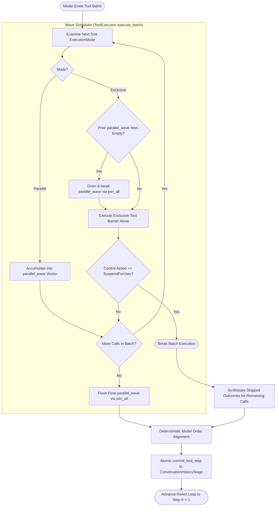
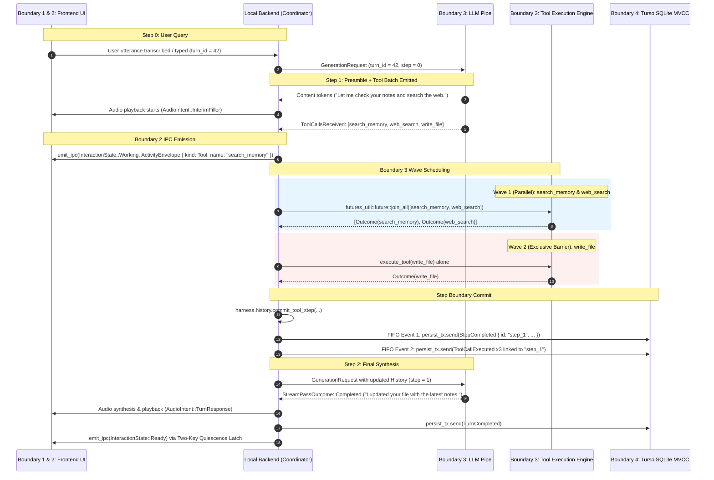

# Domain 2 Architecture & Specification: ReAct Step Loop, Concurrency Barriers & Step Commits (v2)

This document provides the authoritative system architecture, formal code trace, database schema migration, and specification contracts for **Domain 2 (ReAct Step Loop, Concurrency Barriers & Immediate Step Commits)** of the Vox Harness v2 transformation.

---

## 1. Executive Summary & Core Objectives

In Domain 1, the streaming foundation established the **3-Stream Demuxer**, quarantined reasoning/thinking tokens away from speech generation, preserved natural spoken preambles, and locked the **Two-Key Quiescence Latch** to coordinate speech and tool execution cleanly.

**Domain 2** engineers the reentrant **ReAct Cognitive Engine** that executes on top of that demuxed streaming foundation. It addresses five critical architectural vulnerabilities in the current v1 implementation:

1. **Elimination of Ephemeral Scratchpad State:** The v1 harness stores intermediate assistant messages and tool observations in a volatile in-memory `scratchpad: Vec<ChatMessage>`. If a turn is cancelled or interrupted mid-flight, this scratchpad is dropped, erasing all tool execution history and observations from conversational memory. In v2, completed steps commit immediately to `ConversationHistoryStage` at the step boundary (`commit_tool_step`).
2. **Harness-Owned Concurrency Wave Scheduler:** The v1 harness iterates through model-emitted tool calls serially (`for call in calls`), incurring an $O(\sum T_i)$ latency penalty. In v2, `ToolExecutor::execute_batch` schedules calls using Harness-owned barriers: consecutive read-only/idempotent tools (`ToolExecutionMode::Parallel`, including `set_title`) execute concurrently via `futures_util::future::join_all`, while mutating tools (`ToolExecutionMode::Exclusive`) form strict sequential barriers that drain preceding waves before running alone.
3. **Deterministic Order & 1:1 Bijection Preservation:** Even when parallel tools complete out of order on the Tokio thread pool, `execute_batch` reassembles all tool execution outcomes into the exact order declared by the model before committing to history. Furthermore, if batch execution is cancelled or suspended mid-batch, fallback observations (`"Tool execution cancelled"`) are synthesized for all unexecuted calls, maintaining a strict 1:1 `tool_calls` $\leftrightarrow$ `Role::Tool` bijection that prevents provider HTTP 400 errors.
4. **Relational Step Tracking in Turso DB (Option B):** The v1 database schema stores isolated `session_tool_calls` without any relational model of cognitive steps or trajectory progression. In v2, a dedicated `session_steps` table establishes a clean 1:N hierarchy (`sessions` $\to$ `turns` $\to$ `session_steps` $\to$ `session_tool_calls`), recording step indices, spoken preamble text, tool counts, and execution durations under MVCC guarantees. `PersistenceEvent::StepCompleted` is dispatched strictly *before* child `PersistenceEvent::ToolCallExecuted` events to guarantee foreign key referential integrity in FIFO processing.
5. **Reentrant Step Ceiling & Mandatory Summary Pass:** The v1 coordinator loops up to 20 times, but if the limit is breached, it aborts with a raw error. In v2, reaching `MAX_TOOL_STEPS` triggers an intentional, tool-free summary generation pass (`allow_tools = false`), forcing the model to synthesize its findings into a clear spoken answer for the user (`AudioIntent::TurnResponse`).
6. **Object-Safe, Forward-Compatible Tool Trait:** `ToolDefinition` self-declares its `execution_mode(&self, args: &Value)`. Adding new tools requires zero changes to the barrier scheduler or loop coordinator.

---

## 2. Trace: Current v1 Tool Execution & Failure Modes

Entry point: Reception of tool calls from the LLM stream via `StreamPassOutcome::ToolCallsReceived` in `app/src-tauri/src/services/harness/loop.rs:337`
Exit point(s):
- Success Exit: Terminal turn completion in `app/src-tauri/src/services/harness/steps.rs:652` (`step7_commit_completed`)
- Cancellation Exit: Turn cancelled / user barge-in in `app/src-tauri/src/services/harness/steps.rs:570` (`step7_handle_cancelled`)
- Error Exit: Turn error in `app/src-tauri/src/services/harness/steps.rs:621` (`step7_handle_error`)
Depth: Deep trace of tool batch handling, serial iteration, scratchpad accumulation, token budgeting, and persistence handoff.

### Phase 1 — Tool Batch Interception & Scratchpad Initialization

1. **What:** The turn coordinator receives a stream pass outcome containing the extracted spoken preamble text and a list of requested tool calls.
   **Who:** `StreamRoutingStage` delivers `StreamPassOutcome::ToolCallsReceived` to `handle_pass_outcome` in `services::harness::loop`.
   **Trigger:** The streaming demuxer encounters end-of-stream with buffered tool call invocations.
   **Grounding:** Traced — [app/src-tauri/src/services/harness/loop.rs:337-341](file:///home/addy/projects/apps/vox/app/src-tauri/src/services/harness/loop.rs#L337-L341)
   **Owner:** `services::harness::loop`

2. **What:** The coordinator checks whether tool execution is permitted; if tools are disabled, it discards all tool calls and commits only the preamble text.
   **Who:** `handle_pass_outcome` in `services::harness::loop`.
   **Trigger:** `allow_tools == false` during a forced final summary pass.
   **Grounding:** Traced — [app/src-tauri/src/services/harness/loop.rs:342-353](file:///home/addy/projects/apps/vox/app/src-tauri/src/services/harness/loop.rs#L342-L353)
   **Owner:** `services::harness::loop`

3. **What:** The coordinator delegates the tool list, preamble text, and the mutable scratchpad reference to the batch execution step function.
   **Who:** `handle_pass_outcome` calls `step6_handle_tool_batch` in `services::harness::steps`.
   **Trigger:** `allow_tools == true` with non-empty `calls`.
   **Grounding:** Traced — [app/src-tauri/src/services/harness/loop.rs:355-356](file:///home/addy/projects/apps/vox/app/src-tauri/src/services/harness/loop.rs#L355-L356)
   **Owner:** `services::harness::steps`

4. **What:** The execution step clears the stream accumulator's assistant response buffer to prepare for subsequent generation passes.
   **Who:** `step6_execute_tools` in `services::harness::steps`.
   **Trigger:** Entry into `step6_execute_tools`.
   **Grounding:** Traced — [app/src-tauri/src/services/harness/steps.rs:441-445](file:///home/addy/projects/apps/vox/app/src-tauri/src/services/harness/steps.rs#L441-L445)
   **Owner:** `services::harness::steps`

5. **What:** The step function pushes a synthetic assistant message containing the preamble text and the cloned list of tool calls into the in-memory scratchpad.
   **Who:** `step6_execute_tools` mutates `scratchpad: &mut Vec<ChatMessage>`.
   **Trigger:** Requirement to represent the tool invocation in LLM context.
   **Grounding:** Traced — [app/src-tauri/src/services/harness/steps.rs:448-454](file:///home/addy/projects/apps/vox/app/src-tauri/src/services/harness/steps.rs#L448-L454)
   **Owner:** `services::harness::steps`

6. **What:** The step function emits a non-terminal pipeline phase notification using exclusively the name of the first tool in the batch.
   **Who:** `step6_execute_tools` calls `enter_non_terminal_phase`.
   **Trigger:** Beginning tool batch execution.
   **Grounding:** Traced — [app/src-tauri/src/services/harness/steps.rs:456-468](file:///home/addy/projects/apps/vox/app/src-tauri/src/services/harness/steps.rs#L456-L468)
   **Owner:** `services::harness::steps`

### Phase 2 — Serial Tool Execution & Budget Clamping

7. **What:** The step function calculates the maximum allowed observation tokens by inspecting conversation history, the ephemeral scratchpad, and active tool definitions.
   **Who:** `ContextBudgetStage::calculate_max_observation_tokens` in `services::harness::stages::budget`.
   **Trigger:** Calculation prior to iterating tool calls.
   **Grounding:** Traced — [app/src-tauri/src/services/harness/steps.rs:470-492](file:///home/addy/projects/apps/vox/app/src-tauri/src/services/harness/steps.rs#L470-L492), [app/src-tauri/src/services/harness/stages/budget.rs:83-93](file:///home/addy/projects/apps/vox/app/src-tauri/src/services/harness/stages/budget.rs#L83-L93)
   **Owner:** `services::harness::stages::budget`

8. **What:** The step function enters a sequential loop over every tool call in the emitted batch.
   **Who:** `step6_execute_tools` executes a standard Rust `for call in calls` loop.
   **Trigger:** Beginning iteration over the batch.
   **Grounding:** Traced — [app/src-tauri/src/services/harness/steps.rs:494](file:///home/addy/projects/apps/vox/app/src-tauri/src/services/harness/steps.rs#L494)
   **Owner:** `services::harness::steps`

9. **What:** At the beginning of each iteration, the loop checks the cancellation token; if cancelled, it logs a notice and immediately exits the loop, returning true.
   **Who:** `step6_execute_tools` checks `ctx.req.cancel.is_cancelled()`.
   **Trigger:** External cancellation or user barge-in signal.
   **Grounding:** Traced — [app/src-tauri/src/services/harness/steps.rs:495-502](file:///home/addy/projects/apps/vox/app/src-tauri/src/services/harness/steps.rs#L495-L502)
   **Owner:** `services::harness::steps`

10. **What:** The step function constructs a single-tool execution context containing app state, session ID, turn ID, cancellation token, and observation budget.
    **Who:** `step6_execute_tools` instantiates `ToolExecutionContext`.
    **Trigger:** Preparation for single tool invocation.
    **Grounding:** Traced — [app/src-tauri/src/services/harness/steps.rs:504-511](file:///home/addy/projects/apps/vox/app/src-tauri/src/services/harness/steps.rs#L504-L511)
    **Owner:** `services::harness::steps`

11. **What:** The step function invokes the tool executor asynchronously for the single tool call and awaits its completion before moving to the next call.
    **Who:** `ToolExecutor::execute_tool` in `services::harness::stages::tools::executor`.
    **Trigger:** Serial loop execution step.
    **Grounding:** Traced — [app/src-tauri/src/services/harness/steps.rs:513-519](file:///home/addy/projects/apps/vox/app/src-tauri/src/services/harness/steps.rs#L513-L519)
    **Owner:** `services::harness::stages::tools::executor`

12. **What:** The tool executor looks up the tool in the registry, records metrics, runs the tool with timeout and cancellation races, and dispatches a persistence event.
    **Who:** `ToolExecutor::execute_tool` calls `run_with_guards` and `dispatch_persistence`.
    **Trigger:** Execution of a single tool.
    **Grounding:** Traced — [app/src-tauri/src/services/harness/stages/tools/executor.rs:87-156](file:///home/addy/projects/apps/vox/app/src-tauri/src/services/harness/stages/tools/executor.rs#L87-L156)
    **Owner:** `services::harness::stages::tools::executor`

13. **What:** The persistence dispatcher queues a `PersistenceEvent::ToolCallExecuted` to the asynchronous database worker channel without step index or step identifier.
    **Who:** `dispatch_persistence` in `services::harness::stages::tools::executor`.
    **Trigger:** Tool execution finish.
    **Grounding:** Traced — [app/src-tauri/src/services/harness/stages/tools/executor.rs:21-52](file:///home/addy/projects/apps/vox/app/src-tauri/src/services/harness/stages/tools/executor.rs#L21-L52)
    **Owner:** `services::harness::stages::tools::executor`

14. **What:** If the executed tool is `set_title` and succeeded without error, the step function acquires the harness lock and marks `title_set = true`.
    **Who:** `step6_execute_tools` mutates `harness.title_set`.
    **Trigger:** Successful `set_title` tool outcome.
    **Grounding:** Traced — [app/src-tauri/src/services/harness/steps.rs:521-526](file:///home/addy/projects/apps/vox/app/src-tauri/src/services/harness/steps.rs#L521-L526)
    **Owner:** `services::harness::steps`

15. **What:** The step function pushes the tool result content into the scratchpad as a message with role `Role::Tool` and the tool call ID.
    **Who:** `step6_execute_tools` mutates `scratchpad`.
    **Trigger:** Receipt of tool execution outcome.
    **Grounding:** Traced — [app/src-tauri/src/services/harness/steps.rs:528-534](file:///home/addy/projects/apps/vox/app/src-tauri/src/services/harness/steps.rs#L528-L534)
    **Owner:** `services::harness::steps`

### Phase 3 — Cancellation Failure Mode (Dropped Scratchpad & State Erasure)

16. **What:** If cancellation was detected during or immediately after the tool batch, the coordinator branches to terminal cancellation handling.
    **Who:** `handle_pass_outcome` calls `step7_handle_cancelled` in `services::harness::steps`.
    **Trigger:** `cancelled == true` from `step6_handle_tool_batch`.
    **Grounding:** Traced — [app/src-tauri/src/services/harness/loop.rs:357-359](file:///home/addy/projects/apps/vox/app/src-tauri/src/services/harness/loop.rs#L357-L359)
    **Owner:** `services::harness::loop`

17. **What:** The cancellation handler constructs `CancelledTurnContext` with an empty string for `partial_text` and omits the `scratchpad` entirely.
    **Who:** `cancelled_ctx` in `services::harness::loop`.
    **Trigger:** Invocation of cancellation finalization.
    **Grounding:** Traced — [app/src-tauri/src/services/harness/loop.rs:358](file:///home/addy/projects/apps/vox/app/src-tauri/src/services/harness/loop.rs#L358), [app/src-tauri/src/services/harness/loop.rs:367-381](file:///home/addy/projects/apps/vox/app/src-tauri/src/services/harness/loop.rs#L367-L381)
    **Owner:** `services::harness::loop`

18. **What:** In `step7_handle_cancelled`, because `partial_text` is empty, the handler executes the `else if` branch and calls `rollback_last_user_turn()`.
    **Who:** `step7_handle_cancelled` in `services::harness::steps`.
    **Trigger:** `ctx.partial_text.trim().is_empty()`.
    **Grounding:** Traced — [app/src-tauri/src/services/harness/steps.rs:607-609](file:///home/addy/projects/apps/vox/app/src-tauri/src/services/harness/steps.rs#L607-L609)
    **Owner:** `services::harness::steps`

19. **What:** The history stage checks if the last message in working memory has role `Role::User`; because scratchpad messages were never committed to `ConversationHistoryStage`, the last message is indeed the initial user query, which is popped and permanently deleted from memory.
    **Who:** `ConversationHistoryStage::rollback_last_user_turn` in `services::harness::stages::history`.
    **Trigger:** Rollback call on cancelled turn with empty assistant text.
    **Grounding:** Traced — [app/src-tauri/src/services/harness/stages/history.rs:86-96](file:///home/addy/projects/apps/vox/app/src-tauri/src/services/harness/stages/history.rs#L86-L96)
    **Owner:** `services::harness::stages::history`

20. **What:** The scratchpad vector allocated in `execute_loop_iterations` is dropped at function exit, resulting in complete loss of all executed tool calls and observations from the ongoing session.
    **Who:** Rust memory deallocation of `scratchpad: Vec<ChatMessage>`.
    **Trigger:** Function return from `execute_loop_iterations`.
    **Grounding:** Traced — [app/src-tauri/src/services/harness/loop.rs:153](file:///home/addy/projects/apps/vox/app/src-tauri/src/services/harness/loop.rs#L153), [app/src-tauri/src/services/harness/loop.rs:220](file:///home/addy/projects/apps/vox/app/src-tauri/src/services/harness/loop.rs#L220)
    **Owner:** `services::harness::loop`

### Phase 4 — Reentrant Prompt Assembly Coupling & Delayed Commit

21. **What:** If execution was not cancelled, the coordinator increments the iteration counter and checks context budget, passing `scratchpad` as a separate slice.
    **Who:** `execute_loop_iterations` calls `check_loop_budget`.
    **Trigger:** Reentrant loop continuation (`LoopAction::Continue`).
    **Grounding:** Traced — [app/src-tauri/src/services/harness/loop.rs:169-170](file:///home/addy/projects/apps/vox/app/src-tauri/src/services/harness/loop.rs#L169-L170), [app/src-tauri/src/services/harness/loop.rs:259-299](file:///home/addy/projects/apps/vox/app/src-tauri/src/services/harness/loop.rs#L259-L299)
    **Owner:** `services::harness::loop`

22. **What:** The request assembly stage concatenates `harness.history.messages()` with `scratchpad` to construct the next LLM conversation input.
    **Who:** `step4_assemble_request` delegates to `PromptBuilderStage::build_generation_request`.
    **Trigger:** Re-dispatch of generation request for step $K + 1$.
    **Grounding:** Traced — [app/src-tauri/src/services/harness/steps.rs:366-371](file:///home/addy/projects/apps/vox/app/src-tauri/src/services/harness/steps.rs#L366-L371), [app/src-tauri/src/services/harness/stages/prompt.rs:156-175](file:///home/addy/projects/apps/vox/app/src-tauri/src/services/harness/stages/prompt.rs#L156-L175)
    **Owner:** `services::harness::stages::prompt`

23. **What:** Only after a stream pass completes with zero tool calls does the coordinator finally commit the scratchpad messages and final assistant text into `harness.history`.
    **Who:** `step7_commit_completed` in `services::harness::steps`.
    **Trigger:** Receipt of `StreamPassOutcome::Completed`.
    **Grounding:** Traced — [app/src-tauri/src/services/harness/loop.rs:323-329](file:///home/addy/projects/apps/vox/app/src-tauri/src/services/harness/loop.rs#L323-L329), [app/src-tauri/src/services/harness/steps.rs:660-669](file:///home/addy/projects/apps/vox/app/src-tauri/src/services/harness/steps.rs#L660-L669)
    **Owner:** `services::harness::steps`

24. **What:** If the loop reaches `MAX_TOOL_STEPS` (20 passes) without receiving a terminal completion, the coordinator does not generate a summary; it aborts the turn with an error.
    **Who:** `execute_loop_iterations` calls `step7_handle_error`.
    **Trigger:** Exceeding loop iteration limit.
    **Grounding:** Traced — [app/src-tauri/src/services/harness/loop.rs:248-256](file:///home/addy/projects/apps/vox/app/src-tauri/src/services/harness/loop.rs#L248-L256)
    **Owner:** `services::harness::loop`

---

## 3. Proposed v2 Architecture: Concurrency Barriers & Wave Scheduling

The proposed Harness v2 architecture introduces deterministic, harness-owned concurrency scheduling. It eliminates serial bottlenecks while preventing race conditions or conflicting side-effects across tools.

### 3.1 Self-Declaring Concurrency Modes (`ToolExecutionMode`)

Tools declare their execution profile via an object-safe trait method. Concurrency classification is an intrinsic property of the tool's side-effect profile—never an LLM parameter:

```rust
#[derive(Debug, Clone, Copy, PartialEq, Eq)]
pub enum ToolExecutionMode {
    /// Read-only or idempotent operations safe to run concurrently with other Parallel calls.
    Parallel,
    /// Mutating, stateful, or control-flow operations that form strict sequential barriers.
    Exclusive,
}
```

The updated `ToolDefinition` trait contract:

```rust
pub trait ToolDefinition: Send + Sync {
    fn name(&self) -> &str;
    fn domain(&self) -> ToolDomain { ToolDomain::All }
    fn description(&self, mode: PipelineMode) -> &str;
    fn parameters_schema(&self, mode: PipelineMode) -> Value;

    /// Harness-owned concurrency barrier mode.
    /// Inspects parsed arguments to support dynamic isolation (e.g. read vs write actions).
    fn execution_mode(&self, _args: &Value) -> ToolExecutionMode {
        ToolExecutionMode::Parallel
    }

    /// Whether this tool manages its own internal timeout promotion (e.g. bash auto-backgrounding).
    fn handles_own_timeout(&self) -> bool {
        false
    }

    fn execute<'a>(
        &'a self,
        mode: PipelineMode,
        args: Value,
        ctx: &'a ToolExecutionContext,
    ) -> BoxFuture<'a, Result<ToolResult, ToolError>>;

    fn to_canonical(&self, mode: PipelineMode) -> CanonicalToolDefinition;
}
```

#### Canonical Tool Concurrency Matrix:

| Tool Name | Concurrency Mode | Rationale |
| :--- | :--- | :--- |
| `search_memory` | `Parallel` | Read-only vector/FTS search against local Turso database. |
| `web_search` | `Parallel` | Read-only external HTTP request; safe to execute concurrently (e.g. 3 queries in 1 step). |
| `read_file` | `Parallel` | Read-only filesystem access. Concurrent reads cannot collide. |
| `set_title` | `Parallel` | Sets title asynchronously via persistence channel and flips atomic flag. Does NOT mutate files or environment. Keeping it `Parallel` ensures batches like `[set_title, web_search, search_memory]` execute concurrently without barrier fragmentation. |
| `write_file` | `Exclusive` | Mutates filesystem; must form a barrier to prevent read-after-write races. |
| `bash` | `Exclusive` | Arbitrary process execution with potential environment and filesystem side effects. |
| `manage_task` | Dynamic | `action == "status"` or `"list"` $\to$ `Parallel`; `action == "kill"` $\to$ `Exclusive`. |
| `ask_user` | `Exclusive` | Suspends cognitive loop to prompt the user; must be executed alone. |

---

### 3.2 Wave Scheduler Algorithm & 1:1 Bijection Guarantee

When the LLM emits a batch of `1..N` tool calls in one step, `ToolExecutor::execute_batch` partitions the batch into alternating waves of parallel groups and exclusive barriers:



#### Exact Wave Scheduling Logic with Early-Exit Bijection Synthesis:

```rust
pub async fn execute_batch(
    registry: &ToolRegistry,
    mode: PipelineMode,
    calls: Vec<CanonicalToolCall>,
    base_ctx: &ToolExecutionContext,
) -> (Vec<ToolExecutionOutcome>, Option<String>) {
    let mut outcomes = Vec::with_capacity(calls.len());
    let mut parallel_wave: Vec<CanonicalToolCall> = Vec::new();
    let mut suspended_question: Option<String> = None;
    let mut executed_indices = std::collections::HashSet::new();

    for (call_idx, call) in calls.iter().enumerate() {
        if base_ctx.cancel.is_cancelled() {
            break;
        }

        let exec_mode = registry
            .get(&call.name)
            .map(|t| t.execution_mode(&call.arguments))
            .unwrap_or(ToolExecutionMode::Exclusive);

        match exec_mode {
            ToolExecutionMode::Parallel => {
                parallel_wave.push(call.clone());
            }
            ToolExecutionMode::Exclusive => {
                // Drain any accumulated parallel wave before executing the exclusive barrier
                if !parallel_wave.is_empty() {
                    let wave = std::mem::take(&mut parallel_wave);
                    let wave_outcomes =
                        Self::run_parallel_wave(registry, mode, wave, base_ctx).await;
                    for wo in &wave_outcomes {
                        executed_indices.insert(wo.call_id.clone());
                    }
                    outcomes.extend(wave_outcomes);
                }

                if base_ctx.cancel.is_cancelled() {
                    break;
                }

                let mut call_ctx = base_ctx.clone();
                call_ctx.call_id = call.id.clone();
                let outcome = Self::execute_tool(registry, mode, call.clone(), call_ctx).await;
                executed_indices.insert(call.id.clone());
                if let ToolControlAction::SuspendForUser { ref question, .. } =
                    outcome.result.control
                {
                    suspended_question = Some(question.clone());
                }
                outcomes.push(outcome);

                if suspended_question.is_some() {
                    break;
                }
            }
        }
    }

    // Flush any trailing parallel wave
    if !parallel_wave.is_empty() && !base_ctx.cancel.is_cancelled() && suspended_question.is_none() {
        let wave = std::mem::take(&mut parallel_wave);
        let wave_outcomes =
            Self::run_parallel_wave(registry, mode, wave, base_ctx).await;
        for wo in &wave_outcomes {
            executed_indices.insert(wo.call_id.clone());
        }
        outcomes.extend(wave_outcomes);
    }

    // CRITICAL (Defect 2 Fix): Synthesize fallback outcomes for any tool call not reached
    // due to cancellation or SuspendForUser to prevent orphaned tool_call_id HTTP 400 errors.
    if outcomes.len() < calls.len() {
        for call in &calls {
            if !executed_indices.contains(&call.id) {
                let reason = if base_ctx.cancel.is_cancelled() {
                    "Tool execution cancelled due to turn interruption"
                } else {
                    "Tool execution skipped due to user interaction suspension"
                };
                outcomes.push(ToolExecutionOutcome {
                    call_id: call.id.clone(),
                    tool_name: call.name.clone(),
                    arguments: call.arguments.clone(),
                    result: ToolResult::new(reason),
                    is_error: true,
                    duration_ms: 0,
                });
            }
        }
    }

    // Enforce model declaration order: sort outcomes to match calls sequence
    let call_id_to_index: std::collections::HashMap<_, _> = calls
        .iter()
        .enumerate()
        .map(|(idx, c)| (c.id.as_str(), idx))
        .collect();
    outcomes.sort_by_key(|o| call_id_to_index.get(o.call_id.as_str()).copied().unwrap_or(usize::MAX));

    (outcomes, suspended_question)
}

async fn run_parallel_wave(
    registry: &ToolRegistry,
    mode: PipelineMode,
    wave: Vec<CanonicalToolCall>,
    base_ctx: &ToolExecutionContext,
) -> Vec<ToolExecutionOutcome> {
    if wave.len() == 1 {
        let call = wave.into_iter().next().expect("non-empty wave");
        let mut call_ctx = base_ctx.clone();
        call_ctx.call_id = call.id.clone();
        return vec![Self::execute_tool(registry, mode, call, call_ctx).await];
    }

    log::info!(
        "[ToolExecutor] Running parallel wave of {} read-only tools",
        wave.len()
    );
    let futs = wave.into_iter().map(|call| {
        let mut call_ctx = base_ctx.clone();
        call_ctx.call_id = call.id.clone();
        Self::execute_tool(registry, mode, call, call_ctx)
    });
    join_all(futs).await
}
```

---

## 4. Immediate Step-Boundary Commits & Cognitive History Invariants

### 4.1 Eradication of the Scratchpad & 1:1 Bijection Invariant

In v2, the ephemeral `scratchpad: Vec<ChatMessage>` parameter is completely removed. At the completion of every cognitive step, results are committed immediately to `ConversationHistoryStage`:

```rust
// services/harness/stages/history.rs
impl ConversationHistoryStage {
    pub fn commit_tool_step(
        &mut self,
        preamble_text: String,
        calls: Vec<CanonicalToolCall>,
        tool_results: Vec<(String, String)>, // (call_id, observation_content)
    ) {
        // Enforce 1:1 tool_calls to Role::Tool message bijection invariant
        assert_eq!(
            calls.len(),
            tool_results.len(),
            "FATAL: Tool call count mismatch. Expected {} tool results for {} tool calls.",
            calls.len(),
            tool_results.len()
        );

        let now = current_timestamp_ms();
        
        // 1. Commit assistant message with preamble and structured tool calls
        self.messages.push(ChatMessage {
            role: Role::Assistant,
            content: preamble_text,
            timestamp_ms: now,
            tool_call_id: None,
            tool_calls: Some(calls),
        });

        // 2. Commit each tool observation in exact declaration order
        for (call_id, content) in tool_results {
            self.messages.push(ChatMessage {
                role: Role::Tool,
                content,
                timestamp_ms: current_timestamp_ms(),
                tool_call_id: Some(call_id),
                tool_calls: None,
            });
        }

        self.kv_synced_index = self.messages.len();
        log::debug!(
            "[Harness::History] Committed tool step to history. Total messages: {}",
            self.messages.len()
        );
    }
}
```

### 4.2 Protected Turn History Rollback Invariant

Under v1, user barge-in on Step 1 erased the user turn from history if `partial_text` was empty. Under v2:
1. `step6_execute_tool_batch` **always** executes `commit_tool_step` before returning—even if cancelled mid-batch (using the synthesized `"Tool execution cancelled"` outcomes).
2. Because `commit_tool_step` has run, `last.role` in `ConversationHistoryStage` is `Role::Tool`.
3. `rollback_last_user_turn()` verifies `last.role == Role::User` and cleanly no-ops:

```rust
// services/harness/stages/history.rs
pub fn rollback_last_user_turn(&mut self) -> Option<ChatMessage> {
    if let Some(last) = self.messages.last() {
        if last.role == Role::User {
            let popped = self.messages.pop();
            self.kv_synced_index = self.messages.len();
            log::info!("[Harness::History] Unanswered user turn rolled back");
            return popped;
        }
    }
    // If last message is Role::Assistant or Role::Tool, rollback is strictly forbidden!
    None
}
```

- **Step 0 Interruption (Zero Tools Run, Zero Preamble Committed):** If user barges in while assistant is generating thinking tokens before preamble or tool execution begins, `last.role == Role::User`. The unanswered query is popped cleanly.
- **Step $\ge 1$ Interruption (Preamble Committed or Tools Run):** Preceding tool steps and user input remain permanent in history. The follow-up turn retains full cognitive context.

---

## 5. Database Architecture & Turso Schema Migration (Option B)

### 5.1 Relational Hierarchy & Foreign Key Ordering

```
┌────────────────────────────────────────────────────────┐
│ sessions (id, project_id, title, created_at, ...)      │
└───────────────────────────┬────────────────────────────┘
                            │ 1:N
┌───────────────────────────▼────────────────────────────┐
│ turns (id, session_id, turn_id, user_text, ...)        │
└───────────────────────────┬────────────────────────────┘
                            │ 1:N
┌───────────────────────────▼────────────────────────────┐
│ session_steps                                          │
│ (id, session_id, turn_id, step_index, preamble, ...)   │
└───────────────────────────┬────────────────────────────┘
                            │ 1:N
┌───────────────────────────▼────────────────────────────┐
│ session_tool_calls                                     │
│ (id, session_id, turn_id, step_id, step_index, ...)     │
└────────────────────────────────────────────────────────┘
```

#### Defect 1 Resolution (FIFO Foreign Key Ordering):
In v1, `ToolExecutor::execute_tool` called `dispatch_persistence` directly inside each individual tool execution. Because `session_tool_calls.step_id REFERENCES session_steps(id)` is strictly enforced (`PRAGMA foreign_keys = ON`), calling persistence inside `execute_tool` causes a guaranteed crash because `session_steps` does not exist yet!

**In v2, persistence dispatching is moved exclusively to `step6_execute_tool_batch` after `execute_batch` completes:**
1. Generate `step_id = uuid::Uuid::new_v4().to_string()`.
2. Dispatch `PersistenceEvent::StepCompleted` containing `step_id`, `step_index`, `preamble_text`, `tool_count`, and `duration_ms`.
3. Dispatch `PersistenceEvent::ToolCallExecuted` for each tool outcome, passing `step_id` and `step_index`.
4. Because `PersistenceWorker` processes events sequentially from a FIFO queue, the parent `session_steps` row is guaranteed to be inserted before child `session_tool_calls` rows!

```rust
// services/harness/steps.rs
// Dispatch persistence events in strict parent-then-child sequence:
let now = current_timestamp_ms();
let step_duration_ms = step_start.elapsed().as_millis() as u64;

// 1. Dispatch parent step record
if let Some(ref tx) = *ctx.req.app_state.persist_tx.lock() {
    let _ = tx.try_send(PersistenceEvent::StepCompleted {
        id: step_id.clone(),
        session_id: ctx.session_id,
        turn_id,
        step_index: step_index as u32,
        preamble_text: Some(preamble_text.to_string()),
        tool_count: outcomes.len() as u32,
        duration_ms: Some(step_duration_ms),
        created_at: now,
    });

    // 2. Dispatch child tool call records with valid foreign key
    for (idx, outcome) in outcomes.iter().enumerate() {
        let _ = tx.try_send(PersistenceEvent::ToolCallExecuted {
            id: outcome.call_id.clone(),
            session_id: ctx.session_id,
            turn_id,
            step_id: Some(step_id.clone()),
            step_index: step_index as u32,
            tool_name: outcome.tool_name.clone(),
            arguments: outcome.arguments.clone(),
            result: outcome.result.content.clone(),
            is_error: outcome.is_error,
            duration_ms: outcome.duration_ms,
            created_at: now,
        });
    }
}
```

### 5.2 Turso Schema Migration (v17 Table-Rebuild Pattern)

SQLite/Turso requires a table rebuild pattern with `PRAGMA foreign_keys = OFF` to safely alter foreign key constraints on populated tables:

```rust
// persistence/schema.rs (Migration v16 -> v17)
pub const SCHEMA_VERSION: u32 = 17;

if current_version < 17 {
    log::info!("[Persistence::Schema] Migrating schema to v17: adding session_steps and linking session_tool_calls");
    conn.execute("PRAGMA foreign_keys = OFF;", ()).await?;

    // 1. Create session_steps table
    conn.execute(
        "CREATE TABLE IF NOT EXISTS session_steps (
            id TEXT PRIMARY KEY,
            session_id INTEGER NOT NULL REFERENCES sessions(id) ON DELETE CASCADE,
            turn_id INTEGER NOT NULL,
            step_index INTEGER NOT NULL,
            preamble_text TEXT,
            tool_count INTEGER NOT NULL DEFAULT 0,
            duration_ms INTEGER,
            created_at INTEGER NOT NULL
        );",
        (),
    ).await?;

    conn.execute(
        "CREATE INDEX IF NOT EXISTS idx_session_steps_lookup ON session_steps(session_id, turn_id, step_index);",
        (),
    ).await?;
    conn.execute(
        "CREATE INDEX IF NOT EXISTS idx_session_steps_created ON session_steps(created_at DESC);",
        (),
    ).await?;

    // 2. Rebuild session_tool_calls table to attach step_id foreign key
    conn.execute(
        "CREATE TABLE IF NOT EXISTS session_tool_calls_v17 (
            id TEXT PRIMARY KEY,
            session_id INTEGER NOT NULL REFERENCES sessions(id) ON DELETE CASCADE,
            turn_id INTEGER NOT NULL,
            step_id TEXT REFERENCES session_steps(id) ON DELETE CASCADE,
            step_index INTEGER NOT NULL DEFAULT 0,
            tool_name TEXT NOT NULL,
            arguments TEXT NOT NULL,
            result TEXT,
            is_error INTEGER NOT NULL DEFAULT 0,
            duration_ms INTEGER,
            created_at INTEGER NOT NULL
        );",
        (),
    ).await?;

    conn.execute(
        "INSERT INTO session_tool_calls_v17 (id, session_id, turn_id, step_id, step_index, tool_name, arguments, result, is_error, duration_ms, created_at)
         SELECT id, session_id, turn_id, NULL, 0, tool_name, arguments, result, is_error, duration_ms, created_at
         FROM session_tool_calls;",
        (),
    ).await?;

    conn.execute("DROP TABLE session_tool_calls;", ()).await?;
    conn.execute("ALTER TABLE session_tool_calls_v17 RENAME TO session_tool_calls;", ()).await?;

    conn.execute(
        "CREATE INDEX IF NOT EXISTS idx_tool_calls_session_turn ON session_tool_calls(session_id, turn_id);",
        (),
    ).await?;
    conn.execute(
        "CREATE INDEX IF NOT EXISTS idx_tool_calls_step_lookup ON session_tool_calls(step_id, step_index);",
        (),
    ).await?;
    conn.execute(
        "CREATE INDEX IF NOT EXISTS idx_tool_calls_created ON session_tool_calls(created_at DESC);",
        (),
    ).await?;

    conn.execute("PRAGMA foreign_keys = ON;", ()).await?;
}
```

---

## 6. The 4-Boundary End-to-End Sequence Trace



---

## 7. Comprehensive Failure & Asymmetry Matrix

| Failure Scenario | Exact Trigger Condition | Observed Behavior in v1 | Deterministic Behavior in v2 |
| :--- | :--- | :--- | :--- |
| **Single Tool Error in Parallel Wave** | One tool in a parallel wave fails (e.g. `web_search` returns 429 Rate Limited), while sibling tools succeed. | In v1, tools ran serially; if tool 1 failed, tool 2 still ran, but both remained in volatile scratchpad. | **Error Isolation:** Sibling tools in the `join_all` wave run to normal completion. The failed tool produces `is_error = true` with error description. Both outcomes commit to history in exact declaration order. |
| **Mid-Batch User Barge-in / Cancellation** | User speaks while a wave or barrier tool is actively executing (`cancel.is_cancelled() == true`). | **Severe Bug:** Loop exits; scratchpad is dropped; `step7_handle_cancelled` calls `rollback_last_user_turn()`, erasing the user prompt and losing all executed tools. | **Protected History & Bijection:** In-flight futures abort. Fallback outcomes (`"Tool execution cancelled"`) are synthesized for unexecuted calls. Step commits immediately to history. `rollback_last_user_turn()` sees `last.role == Role::Tool` and safely no-ops. |
| **Step Ceiling Breach (`MAX_TOOL_STEPS = 20`)** | Model engages in reentrant tool looping without emitting a terminal text completion for 20 steps. | Coordinator aborts with `step7_handle_error("Exceeded max tool iterations without terminal response")`. User hears silence or error toast. | **Forced Summary Pass:** Coordinator sets `allow_tools = false` and triggers a final generation pass. The model synthesizes all observations collected across prior 20 steps into a spoken conclusion (`AudioIntent::TurnResponse`). |
| **Tool Execution Timeout (13s)** | Tool hangs or stalls on network I/O or deadlock. | Outer `tokio::time::timeout` hard-kills the future after 15s, returning timeout string. | `run_with_guards` checks `tool.handles_own_timeout()`. If false, clamps at `TOOL_EXECUTION_TIMEOUT` (13s). If true (e.g. `bash` auto-backgrounding), yields control to tool's internal task manager. |
| **Database Persistence Channel Full / Dropped** | `persist_tx` buffer fills due to disk contention or heavy write load. | `try_send` fails; warning logged; turn continues. | `try_send` failure is logged as a warning; execution hot-path never stalls. Turso MVCC connection retries transient busy errors on worker thread. |
| **Model Emits Unknown Tool Name** | LLM hallucinates an unregistered tool name. | Serial loop returns `ToolExecutionOutcome` with error; pushes to scratchpad. | `execute_tool` immediately returns `is_error = true` ("Tool not found in registry"), records metrics, and feeds error observation back to model to prompt recovery. |

---

## 8. Formal Specification Rules for `docs/specs/harness-spec.md`

### RULE-HARN-11 (ZBC Universal Tool Interface & Concurrency Mode)
Cognitive tool definitions MUST NOT declare execution flow categories (`Terminal` vs `NonTerminal`) and MUST NOT include synthetic speech parameters (`spoken_filler` or `spoken_response`). All tools adhere to a single canonical contract: name, description, JSON schema, and asynchronous execution returning `ToolResult`. Tools self-declare concurrency mode via `execution_mode(&self, args: &Value) -> ToolExecutionMode { Parallel, Exclusive }`. Read-only tools (`search_memory`, `web_search`, `read_file`) and metadata tools (`set_title`) declare `ToolExecutionMode::Parallel`. Mutating tools (`write_file`, `bash`) declare `ToolExecutionMode::Exclusive`.

### RULE-HARN-11A (Multi-Tool Batch Collection & Barrier Wave Scheduling)
The streaming demuxer collects all tool call requests emitted during a generation pass into a single batch. The tool execution engine (`ToolExecutor::execute_batch`) schedules batch execution using Harness-owned barriers: contiguous `Parallel` tools run concurrently via `futures_util::future::join_all`, while `Exclusive` tools form strict sequential barriers that drain preceding waves before executing alone. Outcomes MUST be committed to history in the exact sequence declared by the model, preserving deterministic declaration order across concurrent completions.

### RULE-HARN-11B (Coordinator State Machine Authority & Immediate Step Commits)
The Harness coordinator (`loop.rs`) exclusively owns state machine transitions (`Thinking` $\to$ `Working` $\to$ `Speaking` $\to$ `Ready`). Intermediate cognitive ReAct iterations MUST NOT be accumulated in volatile turn-scoped scratchpads. At each step boundary, the assistant preamble message and all associated tool observations MUST be committed immediately to `ConversationHistoryStage` via `commit_tool_step`. If batch execution is cancelled or suspended mid-batch (`cancel.is_cancelled()` or `SuspendForUser`), `commit_tool_step` MUST synthesize `"Tool execution cancelled"` fallback observations for all unexecuted calls in the batch, guaranteeing a strict 1:1 `tool_calls` $\leftrightarrow$ `Role::Tool` bijection and preventing provider HTTP 400 errors on subsequent turns.

### RULE-HARN-11C (Reentrant Step Loop Ceiling & Mandatory Summary Pass)
The coordinator supports iterative ReAct execution up to `MAX_TOOL_STEPS = 20`. If step 20 is reached without a terminal answer, the coordinator disables tools (`allow_tools = false`) and executes a mandatory final summary generation pass, producing a complete spoken summary (`AudioIntent::TurnResponse`). The coordinator MUST NOT abort with an unhandled error unless the summary pass itself fails.

### RULE-HARN-11D (Relational Trajectory SSOT in Turso DB)
Cognitive trajectories MUST be persisted relationally in the local Turso database engine under a 1:N hierarchy:
`sessions (1)` $\to$ `turns (N)` $\to$ `session_steps (M)` $\to$ `session_tool_calls (K)`.
`PersistenceWorker` processes events in FIFO order. `PersistenceEvent::StepCompleted` MUST be dispatched before the batch's `PersistenceEvent::ToolCallExecuted` events to guarantee the foreign key parent row exists before child rows are inserted.

### RULE-HARN-12 (Interruption, Cancellation & Non-Rollback Invariant)
When a turn is interrupted (barge-in):
1. Active tool execution tasks and child futures MUST be aborted via `CancellationToken`.
2. User turn rollback (`rollback_last_user_turn`) is strictly restricted to Step 0 interruptions where zero assistant speech and zero tool executions have occurred (`last.role == Role::User`).
3. Once Step 1 tools have commenced execution or spoken a preamble, `commit_tool_step` has run (`last.role == Role::Tool`), and rollback is strictly forbidden. Preceding tool observations remain permanently preserved in history.

---

## 9. Blast Radius Ledger & ZBC Checklist

| File Path | Nature | Specific Modifications |
| :--- | :--- | :--- |
| `app/src-tauri/src/services/harness/stages/tools/mod.rs` | Contract | Add `ToolExecutionMode { Parallel, Exclusive }`, `ToolControlAction`, and update `ToolDefinition` trait. |
| `app/src-tauri/src/services/harness/stages/tools/executor.rs` | Implementation | Implement `execute_batch` and `run_parallel_wave` using `join_all`. Support early-exit bijection synthesis. |
| `app/src-tauri/src/services/harness/stages/history.rs` | Implementation | Add `commit_tool_step` with `assert_eq!(calls.len(), tool_results.len())`. Update `rollback_last_user_turn` to protect committed tool steps. |
| `app/src-tauri/src/services/harness/stages/budget.rs` | Cleanup (ZBC) | Remove `scratchpad: &[ChatMessage]` from `calculate_tracked_tokens_with_extras` and `calculate_max_observation_tokens`. |
| `app/src-tauri/src/services/harness/stages/prompt.rs` | Cleanup (ZBC) | Remove `scratchpad: &[ChatMessage]` from `build_generation_request`; assemble prompt directly from unified history. |
| `app/src-tauri/src/services/harness/steps.rs` | Replacement | Replace serial loop with `step6_execute_tool_batch`. Commit step to history immediately. Dispatch `StepCompleted` before `ToolCallExecuted`. |
| `app/src-tauri/src/services/harness/loop.rs` | Replacement | Implement reentrant loop with configurable `max_steps`. Force `allow_tools = false` summary pass on ceiling breach. |
| `app/src-tauri/src/persistence/schema.rs` | Database | Increment `SCHEMA_VERSION = 17`. Add `session_steps` table and rebuild `session_tool_calls` table with foreign key. |
| `app/src-tauri/src/persistence/mod.rs` | Persistence | Add `PersistenceEvent::StepCompleted` and update `PersistenceEvent::ToolCallExecuted` with `step_id` and `step_index`. |
| `app/src-tauri/src/persistence/steps.rs` | Persistence | New module: implement `persist_step` for inserting into `session_steps`. |
| `app/src-tauri/src/persistence/tool_calls.rs` | Persistence | Update `persist_tool_call` to store `step_id` and `step_index`. |
| `app/src-tauri/src/persistence/worker.rs` | Persistence | Wire `PersistenceEvent::StepCompleted` in `process_event`. |
| `docs/specs/harness-spec.md` | Specification | Update RULE-HARN-11, 11A..D, and RULE-HARN-12. |
| `docs/specs/db-spec.md` | Specification | Add Section 5.11 `session_steps`, update 5.12 `session_tool_calls`, update `RULE-DB-10`. |

---

## 10. Black-Box Seam Test Blueprint & Concurrency Proofs

Per `testing-style-guide.md` §1 ("One binary per seam, 10–20 subtests. Do not create a new file per behavior"), we add Subtests 1–5 to `app/src-tauri/tests/harness_loop_test.rs` and Subtests 6–7 to `app/src-tauri/tests/database_persistence_boundary_test.rs`.

### Deterministic Concurrency Seam: `BarrierTraceTool` in `tests/common/harness.rs`

Per `testing-style-guide.md` §5.4 ("No wall-clock latency assertion belongs in the default tier"), we prove `Parallel` vs. `Exclusive` execution without wall-clock sleeps by using a deterministic rendezvous barrier:

```rust
// tests/common/harness.rs
pub struct BarrierTraceTool {
    name: String,
    mode: ToolExecutionMode,
    barrier: Option<Arc<tokio::sync::Barrier>>,
    trace: Arc<parking_lot::Mutex<Vec<String>>>,
}

#[async_trait]
impl ToolDefinition for BarrierTraceTool {
    fn name(&self) -> &str { &self.name }
    fn description(&self, _: PipelineMode) -> &str { "Test barrier tool" }
    fn parameters_schema(&self, _: PipelineMode) -> Value { json!({}) }
    fn execution_mode(&self, _: &Value) -> ToolExecutionMode { self.mode }

    async fn execute(&self, _: PipelineMode, _: Value, _: &ToolExecutionContext) -> Result<ToolResult, ToolError> {
        self.trace.lock().push(format!("start:{}", self.name));
        if let Some(ref b) = self.barrier {
            tokio::time::timeout(std::time::Duration::from_secs(2), b.wait())
                .await
                .map_err(|_| ToolError::Timeout)?;
        }
        self.trace.lock().push(format!("end:{}", self.name));
        Ok(ToolResult::new(format!("done:{}", self.name)))
    }
}
```

If two `Parallel` tools share a `Barrier::new(2)`, the barrier **only** resolves if both futures are polled concurrently inside `join_all`. If execution regresses to serial `for call in calls`, Tool 1 blocks at the barrier forever and hits the timeout—providing a 100% deterministic, zero-flake proof of concurrency on any CPU load.

---

### Seam Binary 1: `app/src-tauri/tests/harness_loop_test.rs` (5 Subtests)

#### Subtest 1: `parallel_tool_wave_executes_concurrently_and_commits_in_declaration_order`

```rust
/// PURPOSE:  Catch serial execution regression or out-of-order observation commits when parallel tools finish out of order.
/// SCENARIO: A single ReAct step emits 3 Parallel tools [P1, P2, P3] that rendezvous at a 3-party barrier, where P3 finishes fastest and P1 finishes slowest.
/// ASSERTS:  All 3 tools pass the concurrency rendezvous without timing out; trace log records all 3 "start:*" entries before any "end:*" entry; ConversationHistoryStage records Role::Tool messages in exact [P1, P2, P3] declaration order.
/// CLASS:    happy-path
/// REQUIRES: none
/// MUTANT:   In `ToolExecutor::run_parallel_wave` (`executor.rs`), replace `join_all(futs).await` with a sequential `for call in wave` loop.
```

#### Subtest 2: `exclusive_tool_acts_as_strict_barrier_between_parallel_waves`

```rust
/// PURPOSE:  Catch read-after-write race conditions if an Exclusive tool runs concurrently with preceding or succeeding Parallel tools.
/// SCENARIO: Model emits [P1 (Parallel), P2 (Parallel), E1 (Exclusive), P3 (Parallel), P4 (Parallel)] in Step 1.
/// ASSERTS:  Trace log proves P1 and P2 both complete ("end:P1", "end:P2") before "start:E1" is recorded, and "end:E1" is recorded before either "start:P3" or "start:P4" is recorded; all 5 observations commit in [P1, P2, E1, P3, P4] order.
/// CLASS:    edge-case
/// REQUIRES: none
/// MUTANT:   In `ToolExecutor::execute_batch` (`executor.rs`), return `ToolExecutionMode::Parallel` unconditionally instead of querying `t.execution_mode(&call.arguments)`.
```

#### Subtest 3: `mid_turn_cancellation_on_step_two_preserves_step_one_history_and_forbids_user_rollback`

```rust
/// PURPOSE:  Catch loss of completed tool observations or accidental deletion of the user prompt when a turn is cancelled after Step 1 completes.
/// SCENARIO: Step 1 executes [set_title, search_memory] and commits; during Step 2 tool execution, `cancel_token.cancel()` fires.
/// ASSERTS:  TurnOutcome is Cancelled; `harness.messages()` retains the User message, Step 1 Assistant(tool_calls) + 2 Tool observations, and Step 2 Assistant(tool_calls) + synthesized cancelled Tool observation (zero orphaned tool_call_ids); `state.pipeline.is_turn_open()` is false after router processes VoxEvent::Cancelled.
/// CLASS:    regression
/// REQUIRES: none
/// MUTANT:   In `ConversationHistoryStage::rollback_last_user_turn` (`history.rs`), remove the `if last.role == Role::User` guard so it pops unconditionally, OR move `commit_tool_step` back to `step7_commit_completed`.
```

#### Subtest 4: `step_zero_cancellation_before_speech_or_tools_rolls_back_unanswered_user_turn`

```rust
/// PURPOSE:  Catch stale unanswered Role::User turns polluting history when the user barges in during Step 0 thinking before any preamble speech or tool execution.
/// SCENARIO: Model streams Thinking tokens in Step 0 and `cancel_token.cancel()` triggers before any Token or ToolCall is emitted.
/// ASSERTS:  TurnOutcome is Cancelled; `rollback_last_user_turn` pops the unanswered Role::User message leaving only Role::System in `harness.messages()`; `turn_open` is false.
/// CLASS:    suppression
/// REQUIRES: none
/// MUTANT:   In `step7_handle_cancelled` (`steps.rs`), delete the call to `harness.rollback_last_user_turn()`.
```

#### Subtest 5: `step_ceiling_breach_disables_tools_and_forces_spoken_summary_pass`

```rust
/// PURPOSE:  Catch hard turn abort on reaching MAX_TOOL_STEPS instead of synthesizing a final tool-free spoken answer.
/// SCENARIO: Configure Harness with `max_steps = 3`; scripted LLM emits a tool call on Steps 0, 1, and 2, then on the forced summary pass (`allow_tools == false`) emits final spoken text.
/// ASSERTS:  LLM worker receives 4 requests total; requests 0..=2 have non-empty `tools`, request 3 has `tools.is_empty()` (or `None`); TurnOutcome is Completed with the final summary text dispatched to TTS as `AudioIntent::TurnResponse`; all 3 tool steps (6 messages) + final Assistant message are in `harness.messages()`.
/// CLASS:    edge-case
/// REQUIRES: none
/// MUTANT:   In `execute_loop_iterations` (`loop.rs`), return `TurnOutcome::Error` when `step_index >= max_steps` instead of setting `allow_tools = false`.
```

---

### Seam Binary 2: `app/src-tauri/tests/database_persistence_boundary_test.rs` (2 Subtests)

#### Subtest 6: `multi_step_turn_persists_session_steps_and_foreign_key_linked_tool_calls`

```rust
/// PURPOSE:  Catch foreign key constraint failures (`step_id REFERENCES session_steps(id)`) or missing step trajectories in Turso DB during multi-step tool execution.
/// SCENARIO: Execute a 2-step turn through `PersistenceWorker` where Step 0 runs 2 tools (`search_memory`, `web_search`) with preamble "Checking notes." and Step 1 runs 1 tool (`set_title`).
/// ASSERTS:  `session_steps` contains 2 rows for `(session_id, turn_id)` with `step_index = 0` (`tool_count = 2`, `preamble_text = "Checking notes."`) and `step_index = 1` (`tool_count = 1`); `session_tool_calls` contains 3 rows whose `step_id` foreign keys match the respective `session_steps.id` rows.
/// CLASS:    contract
/// REQUIRES: none
/// MUTANT:   In `step6_execute_tool_batch` (`steps.rs`), dispatch `PersistenceEvent::ToolCallExecuted` before `PersistenceEvent::StepCompleted` so the foreign key lookup fails.
```

#### Subtest 7: `session_hard_delete_cascades_to_session_steps_and_session_tool_calls`

```rust
/// PURPOSE:  Catch orphaned rows in `session_steps` or `session_tool_calls` when a parent session is hard-deleted (`RULE-DB-10`).
/// SCENARIO: Persist a session with 1 turn, 2 `session_steps`, and 3 `session_tool_calls`, then execute hard session deletion.
/// ASSERTS:  `SELECT COUNT(*) FROM session_steps WHERE session_id = ?` is 0, and `SELECT COUNT(*) FROM session_tool_calls WHERE session_id = ?` is 0.
/// CLASS:    regression
/// REQUIRES: none
/// MUTANT:   In `persistence/schema.rs`, omit `ON DELETE CASCADE` from `session_steps.session_id` or `session_tool_calls.step_id`.
```
