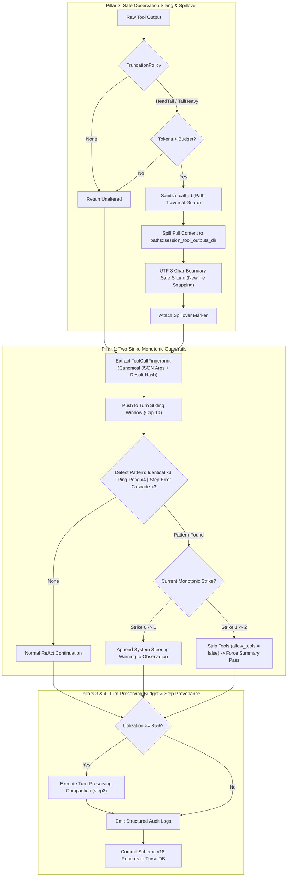
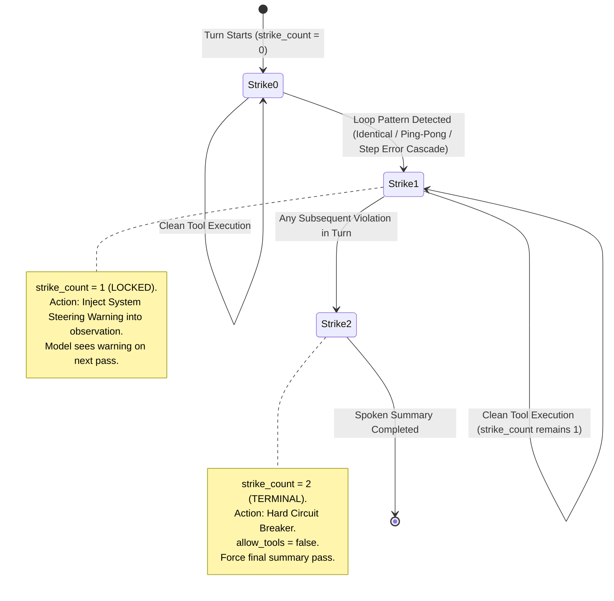

# Domain 3 Architecture & Specification: Loop Guardrails, Observation Truncation & Step Provenance (v2)

This document provides the authoritative system architecture, ground-truth code trace, Turso database schema migration, and specification contracts for **Domain 3 (Loop Guardrails, Observation Truncation & Step Provenance)** of the Vox Harness v2 transformation.

---

## 1. Executive Summary & Core Objectives

In Domain 1, Vox established the 3-stream demuxer and quarantined reasoning tokens.
In Domain 2, Vox built the reentrant ReAct step loop with concurrency barriers.
Domain 3 establishes runtime safety guardrails, observation boundary controls, and granular step-level audit provenance.

Without guardrails and observation sizing, multi-step agent loops suffer from four critical failure modes:
1. **The Doom Loop Trap**: Models repeat identical tool calls or oscillate between two tools ($A \to B \to A \to B$).
2. **Context Window Blowout**: Unbounded tool observations (large files, command logs, web dumps) exhaust context limits.
3. **Mid-Loop State Erasure & Silent Drops**: Saturated context mid-turn either wipes active-turn tool steps during compaction or silently drops historical turns without user visibility.
4. **Opaque Execution Trajectories**: Missing token counts, strike counts, and latency records prevent post-mortem debugging.

Domain 3 introduces four core pillars:
- **Two-Strike Monotonic Guardrail Engine**: In-memory sliding window ($\le 1\text{ KB}$) tracking call signatures. Detects identical calls ($\ge 3$), ping-pongs ($A \to B \to A \to B$), and step-boundary error cascades ($\ge 3$). Strike 1 injects a system steering warning. Strike 2 strips tools (`allow_tools = false`) and forces a spoken summary pass.
- **Head/Tail Truncation with Tier 4 Disk Spillover**: Clamps oversized observations and writes unabridged outputs to `paths::session_tool_outputs_dir(session_id).join("<sanitized_call_id>.txt")`. Slicing is UTF-8 character-boundary safe and handles single-line payloads without panics.
- **Dynamic Mid-Loop Budget & Turn-Preserving Compaction**: Triggers memory compaction mid-turn at $\ge 85\%$ context utilization. Preserves the active turn's in-flight tool steps intact while compacting prior history. Eliminates silent FIFO turn drops.
- **Granular Step Provenance & Relational Compaction Ledger**: Persists tokens, strikes, and spillover paths in Turso DB with downward relational foreign keys in `session_compactions` (`RULE-HARN-17`) and structured audit logs (`[StepAudit]`, `[TruncationAudit]`, `[GuardrailAudit]`).

---

## 2. Deep Ground-Truth Recon & Execution Trace

This trace details the current execution path for tokens, tool outputs, and steps in the Harness runtime, identifying exact code locations and failure modes.

### 2.1 Trace Entry & Exit Points
- **Entry Point 1 (Turn Intake & Staging)**: `step1_intake` in [app/src-tauri/src/harness/steps.rs:125](file:///home/addy/projects/apps/vox/app/src-tauri/src/harness/steps.rs#L125).
- **Entry Point 2 (Tool Output Ingress)**: `step6_execute_tool_batch` in [app/src-tauri/src/harness/steps.rs:662](file:///home/addy/projects/apps/vox/app/src-tauri/src/harness/steps.rs#L662).
- **Exit Point 1 (Terminal Completion)**: `step7_commit_completed` in [app/src-tauri/src/harness/steps.rs:969](file:///home/addy/projects/apps/vox/app/src-tauri/src/harness/steps.rs#L969).
- **Exit Point 2 (Turn Interruption)**: `step7_handle_cancelled` in [app/src-tauri/src/harness/steps.rs:895](file:///home/addy/projects/apps/vox/app/src-tauri/src/harness/steps.rs#L895).
- **Exit Point 3 (Fatal Turn Error)**: `step7_handle_error` in [app/src-tauri/src/harness/steps.rs:940](file:///home/addy/projects/apps/vox/app/src-tauri/src/harness/steps.rs#L940).

---

### 2.2 End-to-End Execution Trace

```mermaid
sequenceDiagram
    autonumber
    participant Loop as Harness::Loop (loop.rs)
    participant Budget as ContextBudgetStage
    participant Dispatch as step5_dispatch_llm
    participant Stream as StreamRoutingStage
    participant Exec as ToolExecutor
    participant Trunc as TruncationStage (New)
    participant Guard as GuardrailsStage (New)
    participant Hist as HistoryStage
    participant Worker as PersistenceWorker

    Loop->>Budget: check_loop_budget(iteration)
    alt Context Utilization >= 85%
        Loop->>Loop: step3_execute_compaction (Preserve active turn steps!)
    end
    Loop->>Dispatch: Dispatch GenerationRequest
    Dispatch-->>Stream: Stream tokens and tool calls
    Stream-->>Loop: StreamPassOutcome::ToolCallsReceived(preamble, calls)
    Loop->>Exec: execute_batch(calls)
    Exec->>Trunc: Apply TruncationPolicy
    alt Observation > max_tokens
        Trunc->>Trunc: Spill full text to paths::session_tool_outputs_dir(session_id)
        Trunc-->>Exec: Return UTF-8 safe Head/Tail preview
    else Observation <= max_tokens
        Trunc-->>Exec: Return raw content
    end
    Exec-->>Loop: ToolExecutionOutcome batch
    Loop->>Guard: Evaluate Fingerprint Window across steps
    alt Loop Pattern Detected (Strike 1)
        Guard-->>Loop: Inject System Steering Warning into Observation
    else Loop Pattern Detected (Strike 2)
        Guard-->>Loop: Strip Tools (allow_tools = false) -> Force Summary Pass
    end
    Loop->>Hist: commit_tool_step(preamble, calls, results)
    Loop->>Worker: try_send(StepCompleted with prompt_tokens, completion_tokens, strike)
    Loop->>Worker: try_send(ToolCallExecuted with truncated, spillover_path)
```

#### Step 1: Pre-Iteration Budget Check & Turn-Preserving Compaction
1. **What:** The coordinator evaluates context utilization before request assembly.
   **Who:** `step3_check_and_run_loop_budget` and `step3_execute_compaction` in `harness::steps` / `harness::loop`.
   **Trigger:** Start of each reentrant iteration.
   **Grounding:** Traced — [app/src-tauri/src/harness/loop.rs:150-170](file:///home/addy/projects/apps/vox/app/src-tauri/src/harness/loop.rs#L150-L170).
   **Defect in v1:** Budget evaluation only logged debug messages or naively wiped active turn steps upon compaction.
   **Fix in v2:** When utilization reaches $\ge 85\%$, compaction executes while preserving the active turn's in-flight steps (`pending_user_query` or trailing `[Role::User, Role::Assistant(tool_calls), Role::Tool, ...]`). Compaction events record downward foreign keys in `session_compactions` (`RULE-HARN-17`).

#### Step 2: Generation Request Assembly & Duplex Pipe Dispatch
2. **What:** The coordinator assembles `GenerationRequest` and sends it to the LLM worker.
   **Who:** `step4_assemble_request` and `step5_dispatch_llm` in `harness::steps`.
   **Trigger:** Iteration loop continuation.
   **Grounding:** Traced — [app/src-tauri/src/harness/steps.rs:360-450](file:///home/addy/projects/apps/vox/app/src-tauri/src/harness/steps.rs#L360-L450).
   **Cancellation:** Dispatched with `gen_cancel` bridged to `turn_cancel_token` and `stream_cancel_token`. Aborts instantly on user interruption.

#### Step 3: Stream Demuxing & Tool Call Interception
3. **What:** The stream router demuxes tokens into spoken clauses and tool calls.
   **Who:** `step6_run_stream_pass` calling `StreamRoutingStage::route_stream`.
   **Trigger:** LLM actor yields response tokens.
   **Grounding:** Traced — [app/src-tauri/src/harness/steps.rs:470-520](file:///home/addy/projects/apps/vox/app/src-tauri/src/harness/steps.rs#L470-L520).
   **Owner:** `harness::stages::streaming`.

#### Step 4: Batch Tool Execution & Observation Sizing
4. **What:** The executor runs tool calls across parallel waves and exclusive barriers.
   **Who:** `ToolExecutor::execute_batch` in `harness::tools::executor`.
   **Trigger:** `StreamPassOutcome::ToolCallsReceived`.
   **Grounding:** Traced — [app/src-tauri/src/harness/tools/executor.rs:111-217](file:///home/addy/projects/apps/vox/app/src-tauri/src/harness/tools/executor.rs#L111-L217).
   **Defect in v1:** Tools return unbounded strings directly into `ToolResult::content`. Tools ignore `max_observation_tokens`.
   **Fix in v2:** `TruncationStage` slices oversized outputs based on `TruncationPolicy`. It snaps to UTF-8 character boundaries and nearby newlines, sanitizes `call_id`, and writes unabridged text to `paths::session_tool_outputs_dir(session_id)`.

#### Step 5: Guardrail Evaluation & Loop Detection
5. **What:** The coordinator evaluates the tool call sequence for repetitive loops.
   **Who:** `GuardrailsStage` in `harness::stages::guardrails`.
   **Trigger:** Ingress of completed `ToolExecutionOutcome` batch.
   **Defect in v1:** No guardrails exist. Repetitive loops run until `MAX_TOOL_STEPS = 20`. False positive error cascades trigger on Step 0 parallel calls. Strikes reset on clean calls.
   **Fix in v2:** Monotonic per-turn strike counter (`strike_count: u8`). Identical calls check both `args_hash` and `result_hash`. Error cascades evaluate across step boundaries. Strike 1 injects a warning; Strike 2 strips tools and forces a spoken summary.

#### Step 6: Step Commit, Staging Flush & Relational Persistence Handoff
6. **What:** The coordinator commits step boundaries to history and queues database persistence events.
   **Who:** `step6_execute_tool_batch` calling `Harness::commit_tool_step`.
   **Trigger:** Batch execution completion.
   **Grounding:** Traced — [app/src-tauri/src/harness/steps.rs:662-780](file:///home/addy/projects/apps/vox/app/src-tauri/src/harness/steps.rs#L662-L780).
   **Invariant Enforcement:** `commit_tool_step` flushes `pending_user_query` to history on the first tool commit. `prompt_tokens` and `completion_tokens` are computed deterministically. Relational Direction Invariant (`RULE-HARN-17`) ensures `session_steps` does not carry `is_compacted`. `[StepAudit]`, `[TruncationAudit]`, and `[GuardrailAudit]` logs are emitted. Persistence failures dispatch `VoxEvent::Error(PipelineError { impact: PipelineImpact::TurnAborted })`.

---

## 3. Architecture Pillars & Component Specifications



---

### 3.1 Pillar 1: Two-Strike Monotonic Doom-Loop & Ping-Pong Stall Detector (`guardrails.rs`)

The guardrails engine protects the ReAct loop against non-productive iteration cycles while eliminating false positives on parallel searches.

#### 3.1.1 Tool Call Fingerprint
Each tool call produces a 56-byte fingerprint in memory:
```rust
#[derive(Debug, Clone, PartialEq, Eq)]
pub struct ToolCallFingerprint {
    pub step_index: u32,
    pub tool_name: String,
    pub args_hash: u64,
    pub result_hash: u64,
    pub is_error: bool,
}
```

#### 3.1.2 Canonical Hashing Algorithm
`args_hash` hashes the canonicalized JSON representation to ensure key ordering invariance (`serde_json::to_string` on `serde_json::Value` uses `BTreeMap` sorting for object keys):
```rust
pub fn compute_canonical_json_hash(val: &serde_json::Value) -> u64 {
    use std::hash::{Hash, Hasher};
    let mut hasher = std::collections::hash_map::DefaultHasher::new();
    let canonical = serde_json::to_string(val).unwrap_or_else(|_| "{}".to_string());
    canonical.hash(&mut hasher);
    hasher.finish()
}

pub fn compute_str_hash(data: &str) -> u64 {
    use std::hash::{Hash, Hasher};
    let mut hasher = std::collections::hash_map::DefaultHasher::new();
    data.hash(&mut hasher);
    hasher.finish()
}
```

#### 3.1.3 Sliding Window Memory Footprint Proof
- The engine retains a sliding window of the last 10 tool call fingerprints.
- Size per fingerprint: 4 bytes (`step_index`) + 24 bytes (`String`) + 8 bytes (`args_hash`) + 8 bytes (`result_hash`) + 1 byte (`is_error`) + 11 bytes padding/capacity $\approx 56$ bytes.
- Total memory for 10 fingerprints: $10 \times 56\text{ bytes} = 560\text{ bytes}$.
- **Result:** Active working set is strictly $< 1\text{ KB}$. This satisfies the low-memory guarantee.

#### 3.1.4 Detection Patterns
1. **Identical Call Loop**: The same tool is invoked with matching `args_hash` AND matching `result_hash` 3 times within the sliding window across distinct steps:
   $$t_{i}.tool = t_{j}.tool = t_{k}.tool \quad \wedge \quad t_{i}.args\_hash = t_{j}.args\_hash = t_{k}.args\_hash \quad \wedge \quad t_{i}.result\_hash = t_{j}.result\_hash = t_{k}.result\_hash$$
   *(Note: If `result_hash` changes, e.g. polling a background task whose status advances, this indicates progress and does NOT trigger a stall).*
2. **Ping-Pong Loop**: Alternating 4-step sequence between two tools with matching argument hashes:
   $$t_0.tool = t_2.tool \quad \wedge \quad t_1.tool = t_3.tool \quad \wedge \quad t_0.args\_hash = t_2.args\_hash \quad \wedge \quad t_1.args\_hash = t_3.args\_hash \quad \wedge \quad t_0.tool \neq t_1.tool$$
3. **Step-Boundary Error Cascade**: 3 consecutive distinct steps where all tool calls executed in that step failed (`is_error == true`). Parallel tool failures within a single step (such as Step 0) count as 1 failing step, preventing false positives on multi-search requests.

#### 3.1.5 Monotonic Guardrail State Machine
Unlike volatile counters that reset on successful calls, `strike_count: u8` is strictly monotonic per turn:


#### 3.1.6 System Steering Warning Payload (Strike 1)
When Strike 1 triggers, the warning is appended directly to the tool observation string:
```text
[SYSTEM WARNING: Repetitive tool call pattern detected ({pattern_type}). Do not repeat this exact tool call. Pivot to a different tool, use different parameters, or explain the roadblock to the user.]
```

---

### 3.2 Pillar 2: Head/Tail Observation Truncation & Tier 4 Disk Spillover (`truncation.rs`)

Observation truncation prevents tool outputs from exhausting provider context limits, using character-safe slicing and centralized paths.

#### 3.2.1 `TruncationPolicy` on `ToolDefinition`
In [app/src-tauri/src/harness/tools/mod.rs](file:///home/addy/projects/apps/vox/app/src-tauri/src/harness/tools/mod.rs), the `ToolDefinition` trait declares:
```rust
#[derive(Debug, Clone, Copy, PartialEq)]
pub enum TruncationPolicy {
    /// Never truncate (used by metadata tools like set_title).
    None,
    /// Preserves head and tail slices based on head_ratio (e.g. 0.8 for search_memory and web_search).
    HeadTail { head_ratio: f32 },
    /// Preserves tail-heavy slice (e.g. 0.8 for terminal commands and test logs).
    TailHeavy { tail_ratio: f32 },
}

pub trait ToolDefinition: Send + Sync {
    // ... existing methods ...

    /// Declares the observation truncation policy for this tool. Defaults to HeadTail (0.8).
    fn truncation_policy(&self) -> TruncationPolicy {
        TruncationPolicy::HeadTail { head_ratio: 0.8 }
    }
}
```

#### 3.2.2 Policy Assignments across Built-in Tools
- `SetTitleTool`: `TruncationPolicy::None`.
- `MemorySearchTool`: `TruncationPolicy::HeadTail { head_ratio: 0.8 }`.
- `WebSearchTool`: `TruncationPolicy::HeadTail { head_ratio: 0.8 }`.

#### 3.2.3 Tier 4 Disk Cache Layout & Path Gateway
In accordance with `RULE-STORAGE-01`, all paths resolve through `crate::utils::paths`:
```rust
// app/src-tauri/src/utils/paths.rs
pub fn tool_outputs_dir() -> PathBuf {
    cache_dir().join("tool_outputs")
}

pub fn session_tool_outputs_dir(session_id: i64) -> PathBuf {
    tool_outputs_dir().join(session_id.to_string())
}
```
Spillover file path:
`paths::session_tool_outputs_dir(session_id).join(format!("{}.txt", sanitized_call_id))`

`call_id` sanitization guards against directory traversal:
```rust
let sanitized_id: String = call_id
    .chars()
    .map(|c| if c.is_ascii_alphanumeric() || c == '-' || c == '_' { c } else { '_' })
    .collect();
```

#### 3.2.4 UTF-8 Character-Boundary & Single-Line Safe Slicing
To eliminate string slice panics and support minified single-line payloads:
1. Estimate total tokens: `total_tokens = estimate_tokens(raw_output)`.
2. If `total_tokens <= max_tokens`, return unaltered raw string.
3. If `total_tokens > max_tokens`:
   - Compute character budget: `char_budget = max_tokens * 4`.
   - Format spillover marker:
     ```rust
     let marker = format!(
         "\n\n[... Output truncated: showing {} of {} tokens. Full output saved to {}. Use read_file to view specific sections ...]\n\n",
         preview_tokens, total_tokens, spillover_path.display()
     );
     ```
   - Subtract marker characters from `char_budget` to obtain `content_char_budget`.
   - Calculate `head_bytes_target = (content_char_budget as f32 * head_ratio) as usize`.
   - Calculate `tail_bytes_target = content_char_budget.saturating_sub(head_bytes_target)`.
   - **Head Cut Point**:
     - Check if a newline `\n` exists within 200 bytes of `head_bytes_target`. If found, cut at that newline.
     - Otherwise, snap to nearest valid UTF-8 boundary using `raw_output.floor_char_boundary(head_bytes_target)`.
   - **Tail Cut Point**:
     - Tail starts at `raw_output.len() - tail_bytes_target`.
     - Check if a newline `\n` exists within 200 bytes of target. If found, start immediately after that newline.
     - Otherwise, snap to nearest valid UTF-8 boundary using `raw_output.ceil_char_boundary(...)`.
   - Splice: `{head_slice}{marker}{tail_slice}`. Never panics; slices single-line 10,000-token payloads cleanly.

#### 3.2.5 Cache Lifecycle & Sweep Invariants
- **Session Deletion**: In `persistence::sessions::delete_session`, invoke `let _ = std::fs::remove_dir_all(paths::session_tool_outputs_dir(session_id));`.
- **Boot Sweep**: In `persistence::worker::run_startup_sweeps`:
  1. Sweep `paths::tool_outputs_dir()`: check each child folder `session_id`; if `session_id` does not exist in `sessions` table (or `deleted_at IS NOT NULL`), delete folder.
  2. Purge files with `mtime > 7 days`.
  3. Enforce 100MB LRU directory ceiling.

---

### 3.3 Pillar 3: Dynamic Mid-Loop Budget & Turn-Preserving Compaction

#### 3.3.1 Token Check Before Every Pass
In `loop.rs:178`, before calling `step4_assemble_request`, the coordinator calculates token usage:
```rust
let total_tokens = budget.calculate_tracked_tokens_with_extras(
    harness.history.messages(),
    tools.as_deref(),
);
let (utilization, status) = budget.evaluate_utilization(total_tokens);
```

#### 3.3.2 Turn-Preserving Compaction Algorithm (`apply_session_context`)
When `status == ContextStatus::Critical` ($\ge 85\%$), inline compaction triggers.
In [app/src-tauri/src/harness/chassis.rs](file:///home/addy/projects/apps/vox/app/src-tauri/src/harness/chassis.rs), `apply_session_context` is updated to preserve active turn steps and staged queries:
```rust
pub fn apply_session_context(&mut self, session_context: &str, active_query: &str) {
    self.prompt
        .set_session_context(Some(session_context.to_string()));
    if let Some(ref mut compaction) = self.compaction {
        compaction.apply_session_context(session_context);
    }
    let assembled_prompt = self.prompt.assemble();

    // 1. Extract the active turn's trailing slice. A staged query is not in
    // canonical history yet, so it is the entire active tail before Step 0 commits.
    let active_turn_tail: Vec<ChatMessage> =
        if let Some((_, staged)) = self.pending_user_query.as_ref() {
            vec![ChatMessage::new(Role::User, staged.clone())]
        } else {
            let msgs = self.history.messages();
            msgs.iter()
                .rposition(|m| m.role == Role::User)
                .map(|idx| msgs[idx..].to_vec())
                .unwrap_or_default()
        };

    // 2. Reset conversation history with the newly compacted system prompt
    self.history.clear();
    self.history.reset(assembled_prompt);

    // 3. Re-push the active turn's messages intact (preserving intermediate tool steps)
    if !active_turn_tail.is_empty() {
        for msg in active_turn_tail {
            self.history.push_message(msg);
        }
    } else if !active_query.trim().is_empty() {
        self.history.push_user_turn(active_query.to_string());
    }

    log::info!(
        "[Harness::Chassis] History rebuilt with session context. Active turn preserved. Total messages: {}",
        self.history.messages().len()
    );
}
```

#### 3.3.3 Atomic-Turn-Unit FIFO Fallback & Relational Compaction Ledger
If compaction fails or `provider` is `None`, the degraded FIFO shift in `budget.rs` drops complete turn units from the start of history:
- Identifies the boundaries of the oldest turn: starts at `Role::User`, includes subsequent `Role::Assistant` and all matching `Role::Tool` messages.
- Drops the entire unit atomically. Never drops between an assistant tool call and its tool observation.
- Never drops the active turn's messages (stops when reaching the last `Role::User` or staged query).
- **Relational Ledger Invariant (`RULE-HARN-17`)**: `step3_execute_compaction` records the FIFO fallback compaction into `session_compactions` via `record_compaction_start` and `record_compaction_finish`, ensuring zero silent untracked drops.

---

### 3.4 Pillar 4: Granular Step Provenance & Structured Auditing

#### 3.4.1 Token Calculation Formulas for `session_steps`
In `step6_execute_tool_batch`, tokens are computed deterministically before dispatching `PersistenceEvent::StepCompleted`:
- `prompt_tokens`:
  ```rust
  let prompt_tokens = {
      let guard = ctx.harness_arc.lock();
      guard.as_ref().map(|h| {
          let filter = ToolFilter {
              mode: PipelineMode::Modular,
              title_is_unset: !h.title_set,
              memory_retrieval_enabled: h.memory_retrieval_enabled,
              web_search_enabled: h.web_search_enabled,
          };
          let active_tools = h.tool_registry.active_definitions(&filter);
          h.budget.as_ref().map(|b| {
              b.calculate_tracked_tokens_with_extras(h.history.messages(), Some(&active_tools)) as u32
          }).unwrap_or(0)
      }).unwrap_or(0)
  };
  ```
- `completion_tokens`:
  ```rust
  let completion_tokens = {
      let preamble_tok = estimate_tokens(preamble_text);
      let thinking_tok = 0usize; // captured in StreamPassOutcome if present
      let tool_calls_tok: usize = calls.iter().map(|c| {
          estimate_tokens(&c.name) + estimate_tokens(&c.arguments.to_string())
      }).sum();
      (preamble_tok + thinking_tok + tool_calls_tok) as u32
  };
  ```

#### 3.4.2 Turso Database Schema & Relational Direction Invariant (`RULE-HARN-17`)
In accordance with `RULE-HARN-17` (Relational Direction Invariant), child execution records (`session_steps`) must not store status booleans (`is_compacted`) tracking operations performed on them by parent lifecycle processes. Parent lifecycle ledger tables (`session_compactions`) reference child rows downward via foreign keys (`step_id`).

Canonical Turso schema statements in [app/src-tauri/src/persistence/schema.rs](file:///home/addy/projects/apps/vox/app/src-tauri/src/persistence/schema.rs):
```sql
CREATE TABLE IF NOT EXISTS session_steps (
    id TEXT PRIMARY KEY,
    session_id INTEGER NOT NULL REFERENCES sessions(id) ON DELETE CASCADE,
    turn_id INTEGER NOT NULL,
    step_index INTEGER NOT NULL,
    content TEXT,
    tool_count INTEGER NOT NULL DEFAULT 0,
    duration_ms INTEGER,
    prompt_tokens INTEGER,
    completion_tokens INTEGER,
    guardrail_strike INTEGER NOT NULL DEFAULT 0,
    created_at INTEGER NOT NULL
);

CREATE TABLE IF NOT EXISTS session_tool_calls (
    id TEXT PRIMARY KEY,
    session_id INTEGER NOT NULL REFERENCES sessions(id) ON DELETE CASCADE,
    turn_id INTEGER NOT NULL,
    step_id TEXT REFERENCES session_steps(id) ON DELETE CASCADE,
    step_index INTEGER NOT NULL DEFAULT 0,
    tool_name TEXT NOT NULL,
    arguments TEXT NOT NULL,
    result TEXT,
    is_error INTEGER NOT NULL DEFAULT 0,
    duration_ms INTEGER,
    truncated INTEGER NOT NULL DEFAULT 0,
    spillover_path TEXT,
    created_at INTEGER NOT NULL
);

CREATE TABLE IF NOT EXISTS session_compactions (
    id INTEGER PRIMARY KEY AUTOINCREMENT,
    session_id INTEGER NOT NULL REFERENCES sessions(id) ON DELETE CASCADE,
    turn_id INTEGER,
    step_id TEXT REFERENCES session_steps(id) ON DELETE SET NULL,
    trigger_kind TEXT NOT NULL,
    from_turn_id INTEGER NOT NULL,
    to_turn_id INTEGER NOT NULL,
    compaction_output TEXT NOT NULL,
    status TEXT NOT NULL,
    error_msg TEXT,
    created_at INTEGER NOT NULL,
    finished_at INTEGER
);
```

#### 3.4.3 Structured Audit Log Formats
Standardized logs use key-value format for log parsing:
- **Step Audit**:
  ```text
  [StepAudit] session_id={session_id} turn_id={turn_id} step_index={step_index} duration_ms={duration_ms} prompt_tokens={prompt_tokens} completion_tokens={completion_tokens} tool_count={tool_count} guardrail_strike={guardrail_strike}
  ```
- **Truncation Audit**:
  ```text
  [TruncationAudit] call_id={call_id} tool={tool_name} policy={policy} original_tokens={original_tokens} preview_tokens={preview_tokens} spillover_path={spillover_path}
  ```
- **Guardrail Audit**:
  ```text
  [GuardrailAudit] turn_id={turn_id} step_index={step_index} pattern={identical|ping_pong|error_cascade} strike={strike} tool={tool_name}
  ```

---

## 4. Four-Boundary Trace & Failure Matrix

### 4.1 Boundary Analysis

1. **Boundary 1 (UI $\to$ Local Backend)**:
   - User speaks or types query $\to$ `execute_turn`.
   - UI receives state updates via `state_changed` and `sessions_changed`.
2. **Boundary 2 (Local Backend $\to$ UI)**:
   - Spoken tokens emitted as `IpcEvent::LlmToken`.
   - Activity notifications emitted as `IpcEvent::Activity`.
   - Turn latency and token telemetry emitted as `IpcEvent::TurnMetrics`.
3. **Boundary 3 (Backend $\leftrightarrow$ Provider Pipe)**:
   - Request dispatched to provider via `step5_dispatch_llm`.
   - Provider responses demuxed into thinking, content, and tools via `step6_run_stream_pass`.
4. **Boundary 4 (Backend $\leftrightarrow$ Durable Storage)**:
   - Unabridged tool outputs written to `paths::session_tool_outputs_dir(session_id).join("<sanitized_call_id>.txt")`.
   - Trajectory records committed to `session_steps` and `session_tool_calls` in Turso DB.

---

### 4.2 Failure & Edge-Case Matrix

| Failure Mode | Root Cause | System Response | Architectural Guarantee |
| :--- | :--- | :--- | :--- |
| **Model repeats tool call 3x** | Stochastic model hallucination or stuck prompt | Guardrail triggers Strike 1 warning, then Strike 2 circuit break | Loop terminates in $\le 2$ duplicate passes. No infinite billing. |
| **Tool returns 500KB single-line JSON** | Minified API dump with zero `\n` characters | `TruncationStage` slices by UTF-8 char boundary, spills raw to disk | Zero thread panics. History stays within budget. |
| **Context reaches 88% mid-loop** | Multiple tool steps accumulate observations | Coordinator runs inline compaction preserving active turn steps | Zero silent drops. Completed steps of current turn preserved. |
| **Spillover disk full / read-only** | Disk quota exhausted or permission denied | Catch error, log warning, return clamped output without path | Voice turn does not crash. System continues gracefully. |
| **Turn cancelled during truncation** | User barge-in while writing cache file | Honor `turn_cancel_token`, abort disk writer task, finalize turn via `step7_handle_cancelled` | Audio cuts immediately. No stale disk corruption. Staged query dropped if no partial speech. |
| **Voice barge-in during cognitive phase** | Acoustic onset / STT speech detected during Working or Thinking | Pipeline router invokes `cancel_active_turn()` and advances turn (`RULE-EVT-08 §2b`). Voice tokens never enter `StepInbox`. | Active turn terminates cleanly. Working envelope preserved on false barge-in. Zero token pollution. |

---

## 5. Formal Architectural Invariants for Domain 3

These invariants extend `docs/specs/harness-spec.md` with rules `RULE-HARN-13` through `RULE-HARN-18`:

- **RULE-HARN-13 (Zero Unbounded Observations & Safe Truncation)**:
  No tool execution outcome may inject content exceeding `max_observation_tokens` into conversation history. All oversized outputs must write full content to `paths::session_tool_outputs_dir(session_id).join(format!("{}.txt", sanitized_call_id))` and return a character-boundary-safe head/tail preview containing the spillover marker.
- **RULE-HARN-14 (Two-Strike Monotonic Guardrail & Step-Boundary Error Cascades)**:
  The coordinator must maintain a monotonic per-turn strike counter (`strike_count: u8`). Strike 1 never resets back to 0 within the same turn. Any subsequent violation in that turn advances to Strike 2, which strips tools (`allow_tools = false`) and forces a final spoken summary pass without tools. Error cascades evaluate across step boundaries rather than intra-batch calls on Step 0.
- **RULE-HARN-15 (Scoped Tier 4 Disk Cache Isolation & TTL)**:
  Tool spillover files must reside exclusively under `paths::session_tool_outputs_dir(session_id)`. Cache directories must be purged on session deletion. Startup sweeps must remove deleted session directories, purge files older than 7 days, and enforce a 100MB LRU directory ceiling.
- **RULE-HARN-16 (Transparent Compaction Over Silent Drops)**:
  The coordinator must evaluate context budget before each reentrant pass. When utilization reaches $\ge 85\%$, inline compaction must trigger transparently with user-visible activity events while preserving the active turn's completed tool steps. Silent FIFO turn drops are forbidden while an LLM provider is available.
- **RULE-HARN-17 (Granular Step Provenance & Relational Direction Invariant)**:
  Every ReAct step must persist its latency, `prompt_tokens`, `completion_tokens`, `content`, and `guardrail_strike` to `session_steps` in Turso DB. Compaction events must be recorded in the parent ledger `session_compactions` via downward foreign keys (`step_id`), never as child status flags (`is_compacted`). Every tool invocation must record `truncated` and `spillover_path` in `session_tool_calls`.
- **RULE-HARN-18 (StepInbox Programmatic-Only Invariant)**:
  `StepInbox` is reserved exclusively for external programmatic control events (`InboxMessage::Steer` from UI/remote IPC) and transient speech-hold synchronization (`wait_if_speech_held`). Voice barge-in must never enqueue voice tokens into `StepInbox`; acoustic onset and speech transcription during active cognitive phases trigger immediate turn cancellation (`turn_cancel_token`) and router turn advancement (`RULE-EVT-08 §2b`).

---

## 6. Black-Box Seam Test Blueprint & Verification Matrix

Per `testing-style-guide.md`, 8 new subtests are assigned across two existing seam test binaries:

### 6.1 Seam Binary 1: `app/src-tauri/tests/harness_loop_test.rs` (6 Subtests)

1. **`identical_tool_call_loop_triggers_strike_one_warning_then_strike_two_circuit_breaker` (`VERIFY-D3-01`)**:
   - *PURPOSE:* Catch infinite or 20-step runaway loops when the model repeats the exact same tool call and arguments.
   - *SCENARIO:* Model calls `search_memory({"query": "same"})` repeatedly; Strike 1 triggers on the 3rd identical call, injecting `[SYSTEM WARNING:` into the observation; model calls `search_memory({"query": "same"})` a 4th time (Strike 2), forcing `allow_tools = false` and synthesizing a spoken summary on Pass 5.
   - *ASSERTS:* Total LLM dispatches is 5 (not 21); requests 0..=3 have tools enabled, request 4 has `allow_tools == false`; the 3rd `Role::Tool` message in `harness.messages()` contains `[SYSTEM WARNING:` and `identical`; TurnOutcome is Completed with final summary text.
   - *MUTANT:* In `GuardrailsStage`, return `GuardrailAction::Proceed` unconditionally without checking identical fingerprints.

2. **`ping_pong_alternating_tool_loop_triggers_two_strike_circuit_breaker` (`VERIFY-D3-02`)**:
   - *PURPOSE:* Catch alternating $A \to B \to A \to B$ tool oscillation loops.
   - *SCENARIO:* Model alternates `search_memory({"query": "alpha"})` and `web_search({"query": "beta"})` across steps ($A, B, A, B \to$ Strike 1 warning on 4th call; followed by $A \to$ Strike 2 circuit break $\to$ forced tool-free summary pass).
   - *ASSERTS:* The 4th `Role::Tool` observation contains `[SYSTEM WARNING:` and `ping_pong`; the pass following Strike 2 is dispatched with `allow_tools == false`; TurnOutcome is Completed.
   - *MUTANT:* In `GuardrailsStage`, disable the ping-pong pattern matcher.

3. **`consecutive_error_steps_trigger_two_strike_guardrail_and_force_summary` (`VERIFY-D3-03`)**:
   - *PURPOSE:* Catch cascading tool failure loops across consecutive steps without recovery.
   - *SCENARIO:* Model invokes a failing tool across 3 consecutive steps (Strike 1 warning on Step 2), and fails a 4th time on Step 3 (Strike 2 forces summary pass on Step 4).
   - *ASSERTS:* Step 2 observation contains `[SYSTEM WARNING:` and `error_cascade`; request 4 has `allow_tools == false`; TurnOutcome is Completed.
   - *MUTANT:* In `GuardrailsStage`, ignore `is_error` when evaluating error cascade strikes.

4. **`oversized_tool_observation_spills_to_tier4_cache_and_commits_head_tail_preview` (`VERIFY-D3-04`)**:
   - *PURPOSE:* Catch context window blowout when a tool returns a massive payload exceeding `max_observation_tokens`.
   - *SCENARIO:* Register custom tool with `TruncationPolicy::HeadTail { head_ratio: 0.8 }` returning a 10,000-token multi-line string ("HEAD_SENTINEL_LINE_1 ... MIDDLE_SECRET_PAYLOAD ... TAIL_SENTINEL_LINE_500"); execute a 1-tool turn.
   - *ASSERTS:* Committed `Role::Tool` message is $\le$ `max_observation_tokens` (+ marker overhead), contains `"HEAD_SENTINEL_LINE_1"`, `"TAIL_SENTINEL_LINE_500"`, `"Output truncated"`, and does NOT contain `"MIDDLE_SECRET_PAYLOAD"`; spillover file at `paths::session_tool_outputs_dir(rig.session_id).join("<call_id>.txt")` exists on disk and its full UTF-8 content equals the original 10,000-token string.
   - *MUTANT:* In `ToolExecutor::execute_tool`, bypass `TruncationStage` and return raw `ToolResult`.

5. **`truncation_policy_none_preserves_full_output_without_disk_spillover` (`VERIFY-D3-05`)**:
   - *PURPOSE:* Ensure tools declaring `TruncationPolicy::None` bypass truncation and do not create unnecessary spillover files.
   - *SCENARIO:* Register tool with `TruncationPolicy::None` returning a payload larger than `max_observation_tokens`.
   - *ASSERTS:* Committed `Role::Tool` observation equals the unmodified string; zero files created under `paths::session_tool_outputs_dir(rig.session_id)`.
   - *MUTANT:* In `TruncationStage`, apply `HeadTail` truncation regardless of `TruncationPolicy::None`.

6. **`mid_loop_critical_budget_triggers_compaction_while_preserving_active_turn_steps` (`VERIFY-D3-06`)**:
   - *PURPOSE:* Catch mid-loop context overflow and prevent erasure of in-flight active turn steps during inline compaction.
   - *SCENARIO:* Seed prior turns to ~80% context budget; on Turn N Step 0, model executes a tool whose observation pushes context $\ge 85\%$ (Critical); before Step 1 LLM dispatch, `check_loop_budget` triggers inline compaction.
   - *ASSERTS:* `IpcEvent::Activity` records `ActivityKind::Compaction`; older prior turns are compacted into `<session_context>`, while Turn N's `Role::User` query, Step 0 `Role::Assistant(tool_calls)`, and Step 0 `Role::Tool` observation remain intact in working memory for Step 1's LLM request.
   - *MUTANT:* In `apply_session_context` (`chassis.rs`), wipe the active turn's committed tool steps during mid-loop reset.

---

### 6.2 Seam Binary 2: `app/src-tauri/tests/database_persistence_boundary_test.rs` (2 Subtests)

7. **`schema_v18_persists_step_tokens_strikes_compaction_and_tool_spillover_metadata` (`VERIFY-D3-07`)**:
   - *PURPOSE:* Catch dropped provenance columns across the persistence worker boundary.
   - *SCENARIO:* Execute a turn through `PersistenceWorker` with `StepCompleted` (`prompt_tokens = Some(420)`, `completion_tokens = Some(85)`, `guardrail_strike = 1`, `content = Some("Analyzing query".to_string())`) and `ToolCallExecuted` (`truncated = true`, `spillover_path = Some("/tmp/spill.txt")`).
   - *ASSERTS:* Querying `session_steps` returns `(420, 85, 1, "Analyzing query")` for `(prompt_tokens, completion_tokens, guardrail_strike, content)`; querying `session_tool_calls` returns `(1, "/tmp/spill.txt")` for `(truncated, spillover_path)`. Relational Direction Invariant (`RULE-HARN-17`) verified (compactions link downward in `session_compactions(step_id)` rather than storing boolean flags on child step rows).
   - *MUTANT:* In `persistence/steps.rs` or `tool_calls.rs`, hardcode `0` or `NULL` for the provenance columns.

8. **`session_deletion_and_startup_sweep_purge_tier4_tool_output_cache_directories` (`VERIFY-D3-08`)**:
   - *PURPOSE:* Catch disk space leaks in tool output cache when sessions are deleted or orphaned on disk (`RULE-HARN-15`).
   - *SCENARIO:* Create spillover files under `paths::session_tool_outputs_dir(session_a)` and `paths::session_tool_outputs_dir(orphan_b)`; call `delete_session(&conn, session_a, true)` and `run_startup_sweeps(&conn)`.
   - *ASSERTS:* Both directories no longer exist on disk.
   - *MUTANT:* In `delete_session` (`sessions.rs`), omit the `remove_dir_all` call.

---

## 7. Section 9 Blast Radius Ledger

This ledger details every file modified, created, or audited for Domain 3:

| File | Nature of Change | Purpose / Invariant Enforced |
| :--- | :--- | :--- |
| `app/src-tauri/src/utils/paths.rs` | Modification | Add `tool_outputs_dir()` and `session_tool_outputs_dir(session_id)`. Enforces `RULE-STORAGE-01`. |
| `app/src-tauri/src/persistence/schema.rs` | Modification | Add provenance columns to `session_steps` (`prompt_tokens`, `completion_tokens`, `guardrail_strike`, `content`) and `session_tool_calls` (`truncated`, `spillover_path`). Link compactions downward in `session_compactions` (`step_id`). Enforces `RULE-HARN-17`. |
| `app/src-tauri/src/persistence/mod.rs` | Modification | Add provenance fields to `StepCompleted` and `ToolCallExecuted` variants of `PersistenceEvent`. |
| `app/src-tauri/src/persistence/steps.rs` | Modification | Insert `prompt_tokens`, `completion_tokens`, `guardrail_strike`, `content` in `persist_step`. Return `Result<()>`. |
| `app/src-tauri/src/persistence/tool_calls.rs` | Modification | Insert `truncated` and `spillover_path` in `persist_tool_call`. |
| `app/src-tauri/src/persistence/sessions.rs` | Modification | Purge `paths::session_tool_outputs_dir(session_id)` on `delete_session`. |
| `app/src-tauri/src/persistence/worker.rs` | Modification | Forward provenance fields in `process_event`. Add startup sweep for orphaned tool output directories and 7-day TTL. |
| `app/src-tauri/src/harness/tools/mod.rs` | Modification | Define `TruncationPolicy` enum. Add `fn truncation_policy` to `ToolDefinition`. Add `truncated` and `spillover_path` to `ToolResult` and `ToolExecutionOutcome`. |
| `app/src-tauri/src/harness/tools/set_title.rs` | Modification | Set `truncation_policy` to `TruncationPolicy::None`. |
| `app/src-tauri/src/harness/tools/search_memory.rs` | Modification | Set `truncation_policy` to `TruncationPolicy::HeadTail { head_ratio: 0.8 }`. |
| `app/src-tauri/src/harness/tools/web_search.rs` | Modification | Set `truncation_policy` to `TruncationPolicy::HeadTail { head_ratio: 0.8 }`. |
| `app/src-tauri/src/harness/stages/truncation.rs` | **New File** | Implement `TruncationStage`: UTF-8 char-boundary-safe head/tail slicing with newline snapping, `call_id` sanitization, and Tier 4 disk cache writer. |
| `app/src-tauri/src/harness/tools/executor.rs` | Modification | Invoke `TruncationStage` after tool completion. Populate `truncated` and `spillover_path`. |
| `app/src-tauri/src/harness/stages/guardrails.rs` | **New File** | Implement `GuardrailsStage`, `ToolCallFingerprint`, monotonic `TurnGuardrailsState`, and loop detection algorithms. |
| `app/src-tauri/src/harness/stages/mod.rs` | Modification | Export `guardrails` and `truncation` modules. |
| `app/src-tauri/src/harness/chassis.rs` | Modification | Add query staging (`stage_user_query`, `pending_user_query`), atomic flush on tool commit (`commit_tool_step`) and turn completion (`commit_completed_turn`), and turn discard (`discard_pending_turn`). Update `apply_session_context` to preserve active turn trailing slice. |
| `app/src-tauri/src/harness/stages/budget.rs` | Modification | Update degraded FIFO shift to drop atomic turn units without separating `Role::Assistant(tool_calls)` and `Role::Tool`. Record into `session_compactions` ledger (`RULE-HARN-17`). |
| `app/src-tauri/src/harness/steps.rs` | Modification | Compute `prompt_tokens` and `completion_tokens`. Append Strike 1 warning. Emit `[StepAudit]`, `[TruncationAudit]`, `[GuardrailAudit]`. Check `persist_step_and_tools` result and emit `VoxEvent::Error` on failure. Transition phases via `transition_harness_phase`. Enforce `StepInbox` programmatic-only invariant (`RULE-HARN-18`). |
| `app/src-tauri/src/harness/loop.rs` | Modification | Maintain `TurnGuardrailsState` across loop iterations. Trigger mid-loop compaction when $\ge 85\%$. Handle Strike 2 tool stripping (`allow_tools = false`). Cancel bridge with `turn_cancel_token` and `stream_cancel_token`. Handle `StreamPassOutcome::PausedForSpeech` and `Superseded`. |
| `app/src-tauri/tests/harness_loop_test.rs` | Extension | Implement Subtests 1–6. |
| `app/src-tauri/tests/database_persistence_boundary_test.rs` | Extension | Implement Subtests 7–8. |
