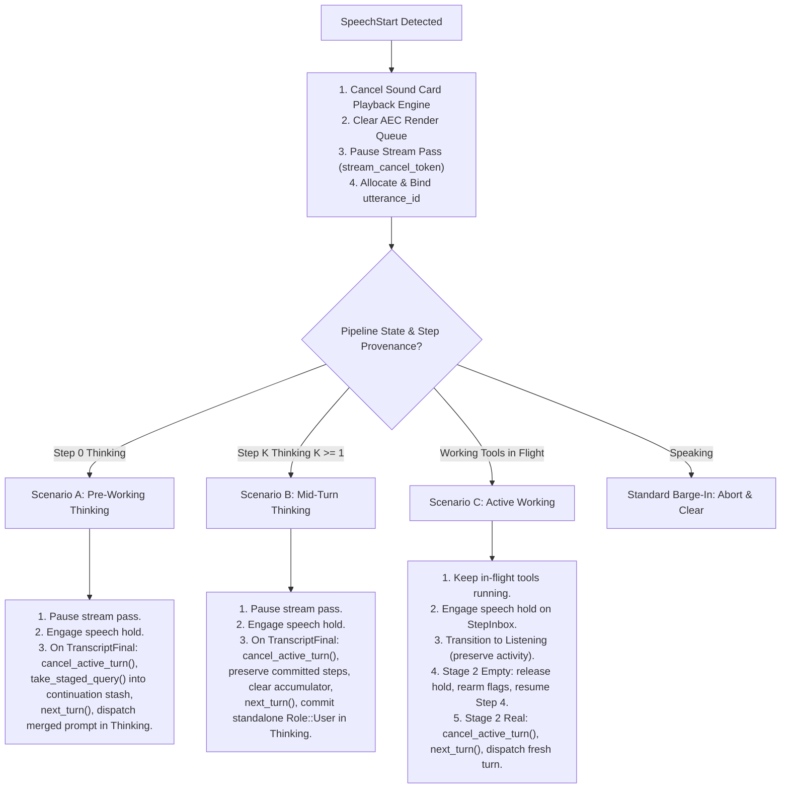
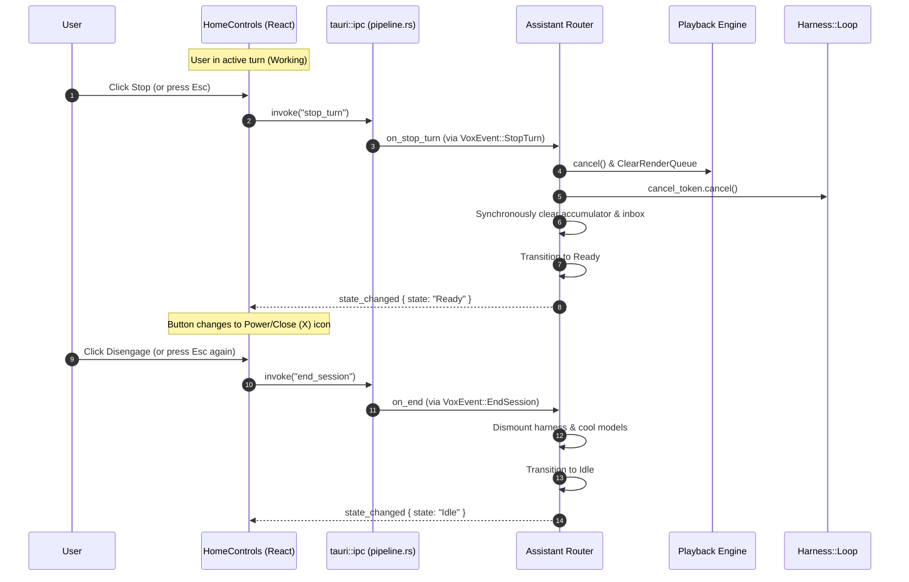

# Domain 4 Architecture, Execution Trace & Specification: Two-Phase Mid-Work Interruption, Step Steering & Architectural Clean Boundaries

This document provides the authoritative system architecture, ground-truth code trace, and specification contracts for **Domain 4 (Two-Phase Mid-Work Interruption, Step Steering & Architectural Clean Boundaries)** of the Vox Harness v2 transformation.

---

## 1. Executive Summary & Core Objectives

In Domain 1, Vox established 3-stream demuxing and quarantined reasoning tokens.
In Domain 2, Vox built the reentrant ReAct step loop with concurrency barrier waves.
In Domain 3, Vox established loop guardrails, observation truncation, and step provenance.
Domain 4 completes the Harness v2 core runtime by resolving the **Interaction Boundary** and the **4-Tier Architectural Layering Contract**.

Without Domain 4, multi-step agent runtimes suffer from six critical defects:
1. **The Fast-Tool / In-Flight Speech Race**: When tools complete at $t = 400\text{ms}$ while the user speaks for $2.5\text{s}$, the coordinator drains an empty inbox and launches Step $K+1$ while the user is still speaking.
2. **Double-Loop Race on Mid-Work Steering**: If `turn_token` is kept open in `Working`, `on_transcript_final` naively spawns a second concurrent `execute_turn` task, causing state-machine split-brain.
3. **Mid-Turn History Corruption (Scenario B Prompt Duplication)**: Calling `stash_for_continuation()` during Step $K \ge 1$ re-prepends Step 0's query into the continuation prefix, committing `"Query 1 Also check lockfile"` instead of a standalone steering utterance.
4. **Async Cancellation Race**: An async `TurnOutcome::Cancelled` task executing off-thread races `vox-router`, overwriting new state transitions or popping subsequent turns.
5. **Leaky Layer Boundaries (`RULE-HARN-01`)**: `steps.rs` and `loop.rs` directly construct and send raw actor commands (`TtsCommand`, `LlmCommand`, `PersistenceEvent`), and `loop.rs` directly reaches into `stages/` and `tools/`.
6. **Coupled Turn Abort and Session Teardown**: Pressing `Esc` or clicking disengage ends the entire session to `Idle`, destroying warm models and releasing the audio engine.

Domain 4 introduces four core pillars:
- **The 4-Tier Architectural Layering Contract (`RULE-HARN-01`)**:
  - Promotes `stages/tools/` to sibling directory `services/harness/tools/`.
  - Slims `loop.rs` to a pure ~150-line turn coordinator importing ONLY `steps.rs`, `chassis.rs`, and `mod.rs`.
  - Slims `steps.rs` to a pure ~350-line step sequencer delegating to `stages/` and `tools/`.
  - Encapsulates actor message dispatch inside dedicated Tier 4 stage dispatchers: `stages/speech.rs`, `stages/dispatch.rs`, and `stages/persistence.rs`.
  - Deterministically enforced by `./scripts/lint-arch.sh`.
- **Two-Step `Esc` & Disengage UX (`RULE-HARN-18`)**:
  - Step 1: Active turn (`Thinking`, `Working`, `Speaking`, `Listening`) aborts cleanly to `Ready` via discrete `stop_turn` IPC command. Audio mutes; active work cancels; session remains engaged; models stay warm in RAM.
  - Step 2: `Ready` state disengages cleanly to `Idle` via `end_session`.
- **Three-Scenario Steering & Interruption Protocol (Two-Stage Lifecycle)**:
  - **Stage 1 (Acoustic Pause / SpeechStart / PTT)**: Audio playback mutes; active token stream pauses via `stream_cancel_token`; speech segment binds to monotonic `utterance_id` (`VadCommand::BindUtterance`); speech hold engages on `StepInbox`; pipeline enters `Listening` preserving `current_activity`. `turn_cancel_token` remains armed; `hardware_cancel_flag` remains false; tools continue running.
  - **Stage 2 (Transcript Resolution / TranscriptFinal)**:
    - **False Barge-In (Empty Transcript / Cough / False VAD)**: Re-arms `hardware_cancel_flag`; releases speech hold (`inbox.release_speech_hold()`). If `llm_done` -> `Ready`; if `current_activity.is_some()` -> `Working`; else re-arms `stream_cancel_token`, transitions to `Thinking`, and cognitive loop resumes at Step 4 with zero lost work.
    - **Scenario A (Pre-Working Thinking — Step 0 Real Barge-In)**: In-flight stream pauses; prior turn cancels via `cancel_active_turn()`; staged Step 0 query extracts via `take_staged_query` into continuation stash; dialogue advances via `next_turn()`; new speech merges with stashed prefix; model prompts in `Thinking`.
    - **Scenario B (Mid-Turn Thinking — Step $K \ge 1$ Real Barge-In)**: Prior turn cancels via `cancel_active_turn()`; committed tool steps remain permanently in history; accumulator clears; dialogue advances via `next_turn()`; new speech commits as standalone `Role::User(new_speech)`; model prompts in `Thinking`.
    - **Scenario C (Active Working Real Barge-In)**: In-flight tools finish or receive clean cancellation placeholders (`"Tool execution cancelled"`); speech hold releases; prior turn cancels via `cancel_active_turn()`; dialogue advances via `next_turn()`; model prompts in `Thinking`. **Voice barge-in is never pushed into `StepInbox`** (`StepInbox` is strictly for external programmatic events).
- **`StepInbox` Role & Speech-Hold Latch**:
  - Carries `speech_hold_active: AtomicBool` and `notify: tokio::sync::Notify`.
  - Serves as the step-boundary synchronization barrier (`wait_if_speech_held`) for both tool execution and token streaming.
  - Buffers strictly external programmatic events (`QueuedMessageDelivery::{Immediate, TurnBoundary}`). Voice speech is never pushed to `StepInbox`.

---

## 2. Deep Ground-Truth Recon & Execution Trace

This trace details the runtime flow across UI, IPC commands, event router, and Harness coordinator.
It follows the `/trace` protocol to expose structural defects and ownership gaps.

### 2.1 Trace Scoping
- **Entry Points**:
  1. User speech onset: `SpeechStart` in [app/src-tauri/src/pipeline/assistant/speech.rs:14](file:///home/addy/projects/apps/vox/app/src-tauri/src/pipeline/assistant/speech.rs#L14).
  2. Final speech transcript: `TranscriptFinal` in [app/src-tauri/src/pipeline/assistant/transcript.rs:208](file:///home/addy/projects/apps/vox/app/src-tauri/src/pipeline/assistant/transcript.rs#L208).
  3. User manual abort: `Escape` key event in [app/src/pages/Home.tsx:297](file:///home/addy/projects/apps/vox/app/src/pages/Home.tsx#L297) or disengage button click in [app/src/shared/components/home/HomeControls.tsx:173](file:///home/addy/projects/apps/vox/app/src/shared/components/home/HomeControls.tsx#L173).
  4. User text submission: `submit_text_input` in [app/src-tauri/src/ipc/pipeline.rs:252](file:///home/addy/projects/apps/vox/app/src-tauri/src/ipc/pipeline.rs#L252).
- **Exit Points**:
  1. Steered turn advancing to Step $K+1$ (`InteractionState::Thinking`).
  2. Active turn aborted to `Ready` (`InteractionState::Ready`).
  3. Full session disengagement to `Idle` (`InteractionState::Idle`).
  4. Terminal turn completion (`TurnOutcome::Completed`).
- **Depth**: Boundary calls across React frontend, Tauri IPC, pipeline router, assistant handlers, and Harness cognitive loop.

---

### 2.2 Phased Execution Walkthrough

#### Phase 1 — User Input & Disengage Signal Ingress

1. **What:** The user presses the `Escape` key while an assistant turn is running.
   **Who:** Initiated by the user browser DOM, handled by `Home.tsx`.
   **Trigger:** Keydown event with `e.key === "Escape"`.
   **Grounding:** Traced — [app/src/pages/Home.tsx:297-300](file:///home/addy/projects/apps/vox/app/src/pages/Home.tsx#L297-L300).
   **Owner:** Frontend UI layer (`app/src/pages/Home.tsx`).
   *Defect in current code:* Line 299 calls `void pause()`. Pausing the session is not aborting the turn. It leaves the turn open in background memory.

2. **What:** The user clicks the main disengage button in the home controls.
   **Who:** Initiated by the user mouse/touch, handled by `HomeControls.tsx`.
   **Trigger:** Click event on disengage button.
   **Grounding:** Traced — [app/src/shared/components/home/HomeControls.tsx:173](file:///home/addy/projects/apps/vox/app/src/shared/components/home/HomeControls.tsx#L173).
   **Owner:** Frontend UI layer (`app/src/shared/components/home/HomeControls.tsx`).
   *Defect in current code:* Clicking disengage calls `disengageSession()` unconditionally, invoking `end_session` and tearing down the session even when the user only wanted to cancel the active turn.

3. **What:** Voice activity detection flags incoming user speech while the pipeline is in `Thinking`, `Working`, or `Speaking`.
   **Who:** `speech.rs` receives `VoxEvent::SpeechStart`.
   **Trigger:** Audio engine VAD indicates positive speech onset.
   **Grounding:** Traced — [app/src-tauri/src/pipeline/assistant/speech.rs:33-37](file:///home/addy/projects/apps/vox/app/src-tauri/src/pipeline/assistant/speech.rs#L33-L37).
   **Owner:** Backend pipeline router (`app/src-tauri/src/pipeline/assistant/speech.rs`).

---

#### Phase 2 — State Branching & Interruption Handling

4. **What:** The pipeline cancels audio playback and evaluates the prior state.
   **Who:** `on_interrupt` in `interrupt.rs`.
   **Trigger:** `on_speech_start` detects active turn state (`Thinking`, `Working`, or `Speaking`).
   **Grounding:** Traced — [app/src-tauri/src/pipeline/assistant/interrupt.rs:20-37](file:///home/addy/projects/apps/vox/app/src-tauri/src/pipeline/assistant/interrupt.rs#L20-L37).
   **Owner:** Assistant pipeline lifecycle (`app/src-tauri/src/pipeline/assistant/interrupt.rs`).

5. **What:** When speech occurs during `Working` (Scenario C), the current code unconditionally cancels `turn_token()`.
   **Who:** `on_interrupt` in `interrupt.rs`.
   **Trigger:** State evaluation of `prior_state`.
   **Grounding:** Traced — [app/src-tauri/src/pipeline/assistant/interrupt.rs](file:///home/addy/projects/apps/vox/app/src-tauri/src/pipeline/assistant/interrupt.rs).
   **Owner:** Assistant pipeline lifecycle (`app/src-tauri/src/pipeline/assistant/interrupt.rs`).
   *Defect in legacy code (Scenario C Defect):* Cancelling `turn_token()` kills in-flight tools immediately. Mutating tools (`bash`, `write_file`) leave half-written files.
   *Fix:* Stage 1 mutes playback, pauses active stream pass via `cancel_active_stream()`, allocates fresh `utterance_id` via `next_utterance_id()`, binds via `VadCommand::BindUtterance`, engages speech hold via `harness.inbox().engage_speech_hold()`, preserves `current_activity`, and transitions to `Listening`. `turn_cancel_token` and `hardware_cancel_flag` remain armed; background tools continue running to completion.

6. **What:** When speech occurs during `Thinking`, the legacy code called `stash_for_continuation()` unconditionally.
   **Who:** `on_interrupt` and `transcript.rs`.
   **Trigger:** Speech interruption during cognitive generation.
   **Grounding:** Traced — [app/src-tauri/src/pipeline/assistant/transcript.rs](file:///home/addy/projects/apps/vox/app/src-tauri/src/pipeline/assistant/transcript.rs).
   **Owner:** Assistant pipeline lifecycle and transcription router.
   *Defect in legacy code (Scenario B Defect):* If Step 0 tools have already committed, `pipeline_accumulator.user_transcript` still holds `"Query 1"`. Calling `stash_for_continuation()` moves `"Query 1"` into `continuation_prefix`, merging the new utterance into `"Query 1 <new_speech>"` and corrupting history.
   *Fix:* In Stage 2 real barge-in, `harness.take_staged_query(turn_id)` extracts the staged query into continuation stash for Step 0 (Scenario A). If committed tool steps exist (Scenario B / Scenario C), preceding steps are preserved, accumulator is cleared, and new speech is committed as a standalone dialogue turn.

---

#### Phase 3 — Step Boundary Execution & Fast-Tool Race

7. **What:** In-flight tools finish executing while the user is still speaking in `Listening`.
   **Who:** `step6_execute_tool_batch` in `steps.rs`.
   **Trigger:** Tool batch future completes.
   **Grounding:** Traced — [app/src-tauri/src/harness/steps.rs](file:///home/addy/projects/apps/vox/app/src-tauri/src/harness/steps.rs).
   **Owner:** Step sequencing (`app/src-tauri/src/harness/steps.rs`).
   *Defect in legacy code (P0 Defect 1):* Tools finish at $t = 400\text{ms}$. User speaks until $t = 2900\text{ms}$. Without a hold latch, `loop.rs` drains an empty inbox at $t = 401\text{ms}$, advances to Step $K+1$, and generates speech while the user is still talking.
   *Fix:* `steps.rs` awaits `inbox.wait_if_speech_held(&ctx.req.cancel).await` at the step boundary before proceeding.

8. **What:** `TranscriptFinal` arrives from the STT worker for the steering utterance.
   **Who:** `on_transcript_final` in `transcript.rs`.
   **Trigger:** STT worker finishes audio transcription.
   **Grounding:** Traced — [app/src-tauri/src/pipeline/assistant/transcript.rs](file:///home/addy/projects/apps/vox/app/src-tauri/src/pipeline/assistant/transcript.rs).
   **Owner:** Assistant transcription router (`app/src-tauri/src/pipeline/assistant/transcript.rs`).
   *Resolution (RULE-EVT-08 §2b & RULE-HARN-18)*:
   - **Empty Transcript (False Barge-In / Cough / False VAD)**: Releases speech hold (`inbox.release_speech_hold()`), re-arms `hardware_cancel_flag`. If `llm_done` -> `Ready`; if `current_activity.is_some()` -> `Working`; else re-arms `stream_cancel_token`, transitions to `Thinking`, and cognitive loop resumes at Step 4 without aborting.
   - **Non-Empty Transcript (Real Voice Barge-In)**: Releases speech hold, finalizes prior turn, aborts active turn via `cancel_active_turn()`, advances dialogue via `next_turn()`, transitions to `Thinking`, and dispatches a fresh turn. **Voice is never pushed into `StepInbox`**.

---

#### Phase 4 — Layer Boundary Leaks (`RULE-HARN-01` Violations)

9. **What:** `steps.rs` and `loop.rs` directly construct and send raw actor commands.
   **Who:** `steps.rs:206` (`TtsCommand`), `steps.rs:387` (`LlmCommand`), `steps.rs:622, 639, 714` (`PersistenceEvent`), `loop.rs:397` (`TtsCommand`).
   **Trigger:** Step execution and turn finalization.
   **Grounding:** Traced — [app/src-tauri/src/services/harness/steps.rs](file:///home/addy/projects/apps/vox/app/src-tauri/src/services/harness/steps.rs), [app/src-tauri/src/services/harness/loop.rs](file:///home/addy/projects/apps/vox/app/src-tauri/src/services/harness/loop.rs).
   **Owner:** Step sequencing and turn coordinator.
   *Defect:* Violates `RULE-HARN-01`.
   *Fix:* Extract actor communication into dedicated Tier 4 stage dispatchers: `stages/speech.rs`, `stages/dispatch.rs`, and `stages/persistence.rs`.

10. **What:** `loop.rs` directly reaches into `stages/` and `tools/` domain logic.
    **Who:** `loop.rs:10-20` (imports `stages::*` and `tools::*`), `loop.rs:272-334` (`check_loop_budget`).
    **Trigger:** Context budget evaluation.
    **Grounding:** Traced — [app/src-tauri/src/services/harness/loop.rs:272-334](file:///home/addy/projects/apps/vox/app/src-tauri/src/services/harness/loop.rs#L272-L334).
    **Owner:** Turn loop coordinator.
    *Defect:* Violates Tier 2 / Tier 3 boundary.
    *Fix:* Move `check_loop_budget` to `steps::step3_check_and_run_loop_budget`. `loop.rs` talks exclusively to `steps.rs`.

---

## 3. Architecture Specification & The 5 Pivot Gates

### Gate 1: Lifecycle & Command Orthogonality Check
- **The Turn Lifecycle**: Represents a single interactive exchange or multi-step cognitive task. States: `Listening`, `Thinking`, `Working`, `Speaking`. Resting state: `Ready`. Controlled by: `submit_text_input`, `speech.rs`, and the discrete command `stop_turn`.
- **The Session Lifecycle**: Represents overall session engagement. States: `Idle`, `Ready`, `Paused`. Controlled by: `start_session`, `end_session`, `pause_session`, `resume_session`.
- **Orthogonality Invariant**: Stopping an active turn MUST NOT terminate the session. Disengaging a session MUST first abort any active turn before shutting down hardware.

### Gate 2: State Space Bijection & Invariant Audit
Every distinct domain condition is mapped bijectively to canonical state without boolean shadowing:
- Unengaged / Powered Down: `InteractionState::Idle`.
- Engaged & Idle (Waiting for User): `InteractionState::Ready`.
- User Speaking / Recording: `InteractionState::Listening`.
- LLM Thinking / Assembling: `InteractionState::Thinking`.
- Tools Executing / Compacting: `InteractionState::Working` (with typed `ActivityEnvelope`).
- Synthesizing & Playing Audio: `InteractionState::Speaking`.
- Pipeline Paused: `InteractionState::Paused`.

### Gate 3: The 4-Boundary Trace Matrix

| User Action | Boundary 1: UI $\to$ Backend (IPC) | Boundary 2: Internal Mutation | Boundary 3: Worker Channels | Boundary 4: Backend $\to$ UI (IPC Event) |
| :--- | :--- | :--- | :--- | :--- |
| **Stop Active Turn (Esc Step 1)** | `invoke("stop_turn")` | Cancel `turn_cancel_token`, set `hardware_cancel_flag`, mute audio, clear accumulator & `StepInbox` synchronously on router thread | `playback_engine.cancel()`, `ClearRenderQueue` | `state_changed { state: "Ready" }` |
| **Disengage Session (Esc Step 2)** | `invoke("end_session")` | Tear down harness, purge session cache | `VadCommand::StopRealtime`, stop actors | `state_changed { state: "Idle" }` |
| **Speech in Step 0 Thinking (Scenario A)** | Audio VAD `SpeechStart` | Stage 1 pause stream (`stream_cancel_token`), bind `utterance_id`, engage speech hold; Stage 2 cancel active turn, `take_staged_query` into continuation stash, `next_turn()` | `VadCommand::BindUtterance` | `state_changed { state: "Listening" }` |
| **Speech in Step K Thinking (Scenario B)** | Audio VAD `SpeechStart` | Stage 1 pause stream, bind `utterance_id`, engage speech hold; Stage 2 cancel active turn, keep committed steps, clear accumulator, `next_turn()` | `VadCommand::BindUtterance` | `state_changed { state: "Listening" }` |
| **Speech in Working (Scenario C)** | Audio VAD `SpeechStart` | Stage 1 mute audio, pause stream, bind `utterance_id`, engage speech hold; in-flight tools keep running; Stage 2 resolve empty or real barge-in | `VadCommand::BindUtterance`, `ClearRenderQueue` | `state_changed { state: "Listening" }` |

### Gate 4: Asymmetry & Worst-Case Failure Matrix
- **Fast-Tool Completion During Long Utterance**: Tools complete at $t=400\text{ms}$; user speaks until $t=2900\text{ms}$. `wait_if_speech_held` holds at step boundary. On `TranscriptFinal`, real barge-in finalizes prior turn, advances `next_turn()`, and starts a fresh dialogue turn.
- **Empty Speech / False VAD in Scenario C**: Cough or sigh during `Working` triggers VAD. `TranscriptFinal("")` lands. `transcript.rs` calls `inbox.release_speech_hold()`, re-arms `hardware_cancel_flag`, restores `Working` (or `Thinking`), and cognitive loop resumes Step 4 with zero lost work.
- **Rapid Double-Esc**: First press aborts turn to `Ready`. Second press disengages session to `Idle`. Synchronous state cleanup on the `vox-router` thread prevents async task races.

### Gate 5: Spec-Wide Referential Integrity
Updates apply cleanly across `harness-spec.md`, `ipc-spec.md`, and `events-spec.md`. Zero orphaned terms or legacy aliases.

---

## 4. Part I: The Pure 4-Tier Architectural Boundary (`RULE-HARN-01`)

### 4.1 Layer Definitions & Pure Separation

Cognitive execution adheres strictly to four discrete tiers:

```
┌────────────────────────────────────────────────────────────────────────┐
│ Tier 1: Upstream Consumers                                             │
│ Components: speech.rs, transcript.rs, text.rs, UI IPC                  │
│ Rule: Interacts exclusively via Harness::execute_turn                  │
└───────────────────────────────────┬────────────────────────────────────┘
                                    │
┌───────────────────────────────────▼────────────────────────────────────┐
│ Tier 2: Turn Loop Coordinator (loop.rs — ~150 lines)                   │
│ Scope: Turn state machine, max_steps ceiling, loop iterations          │
│ Rule: Imports ONLY steps.rs, chassis.rs, mod.rs.                       │
│ FORBIDDEN: Direct imports of stages::*, tools::*, or actor commands.   │
└───────────────────────────────────┬────────────────────────────────────┘
                                    │
┌───────────────────────────────────▼────────────────────────────────────┐
│ Tier 3: Step Sequencing (steps.rs — ~350 lines)                        │
│ Scope: Pure step sequencing (intake, assemble, dispatch, finalize)     │
│ Rule: Delegates strictly to stages/ and tools/.                        │
│ FORBIDDEN: Direct sends of TtsCommand, LlmCommand, PersistenceEvent.   │
└───────────────────────────────────┬────────────────────────────────────┘
                                    │
┌───────────────────────────────────▼────────────────────────────────────┐
│ Tier 4: Processing Stages & Tool Chassis (stages/ and tools/)          │
│ Scope: Domain algorithms, tool execution, and ALL actor channels       │
│ Downstream: Exclusively owns LlmCommand, TtsCommand, PersistenceEvent  │
└────────────────────────────────────────────────────────────────────────┘
```

### 4.2 Module Restructuring
1. **Sibling Hierarchy**:
   - `app/src-tauri/src/services/harness/stages/`: Pure pipeline data stages (`prompt.rs`, `budget.rs`, `compaction.rs`, `guardrails.rs`, `truncation.rs`, `inbox.rs`, `speech.rs`, `dispatch.rs`, `persistence.rs`, `streaming/`).
   - `app/src-tauri/src/services/harness/tools/`: Modular agentic tool chassis (`mod.rs`, `registry.rs`, `executor.rs`, `search_memory.rs`, `set_title.rs`, `web_search.rs`).
2. **Dedicated Tier 4 Stage Dispatchers**:
   - `stages/speech.rs`: Owns `TtsCommand::Generate` dispatch for interim filler and suspended questions.
   - `stages/dispatch.rs`: Owns `LlmCommand::Generate` dispatch for generation requests.
   - `stages/persistence.rs`: Owns `PersistenceEvent` dispatch for steps, tools, and completed/cancelled turns.

### 4.3 Deterministic Verification Gate in `lint-arch.sh`
`scripts/lint-arch.sh` statically enforces all three invariants of `RULE-HARN-01`:
1. `services/harness/stages/tools` directory MUST NOT exist (`tools/` must be at `services/harness/tools/`).
2. Neither `services/harness/loop.rs` nor `services/harness/steps.rs` may reference `TtsCommand`, `LlmCommand`, or `PersistenceEvent`.
3. `services/harness/loop.rs` (Tier 2) MUST NOT import `services::harness::stages::` or `services::harness::tools::` directly.

---

## 5. Part II: Two-Step `Esc` & Disengage UX

```
[Active Turn: Listening / Thinking / Working / Speaking]
     │
     │  Press 'Esc' or Click Stop Button (Step 1)
     ▼
[InteractionState::Ready]  <── Turn aborted; audio muted; session STAYS ENGAGED in Ready.
     │
     │  Press 'Esc' or Click Disengage Button (Step 2)
     ▼
[InteractionState::Idle]   <── Session disengages; models cool down; audio engine stops.
```

### 5.1 New Discrete IPC Command: `stop_turn`
- **Command Signature**: `pub async fn stop_turn<R: Runtime>(app: AppHandle<R>, state: State<'_, Arc<AppState>>) -> Result<(), VoxIpcError>`
- **Behavior**:
  1. Inspects `state.pipeline.state()`.
  2. If `Idle` or `Ready`: no-op.
  3. If `Listening`, `Thinking`, `Working`, or `Speaking`:
     - Dispatches `VoxEvent::StopTurn` to `vox-router`.
     - Router thread executes `session::on_stop_turn`:
       - Cancels playback engine and clears AEC render queue.
       - Cancels active turn token (`state.pipeline.turn_token().cancel()`).
       - Sets `cancel_flag = true` and resets turn guards.
       - Synchronously clears `pipeline_accumulator` and `harness.inbox`.
       - If Step 0 had zero committed steps and zero spoken response, rolls back user query via `harness.history.rollback_last_user_turn()`.
       - Transitions pipeline to `InteractionState::Ready`.

### 5.2 UI Controls & Icons (`HomeControls.tsx` & `Home.tsx`)
- **During Active Turn (`Thinking`, `Working`, `Speaking`, `Listening`)**:
  - Main button icon: `Square` (Stop).
  - Tooltip: `"Stop current turn (Esc)"`.
  - Action: Invokes `stop_turn()`.
- **During `Ready`**:
  - Main button icon: `X` (Close / Disengage).
  - Tooltip: `"Disengage session (Esc)"`.
  - Action: Invokes `disengageSession()` (`end_session`).
- **Keyboard Shortcut (`Escape`)**:
  - If text mode bar is open: closes text mode bar.
  - Else if turn is active: calls `stop_turn()`.
  - Else if in `Ready`: calls `disengageSession()`.

---

## 6. Part III: The Three Interruption & Mid-Turn Steering Scenarios



### 6.1 `Harness` Provenance Flags, Utterance Binding & Idempotent Rollback Guard
`Harness` and `PipelineAtomics` carry:
```rust
pub(crate) has_committed_steps_this_turn: bool,
pub(crate) uncommitted_user_turn_id: Option<u32>,
```
- `has_committed_steps_this_turn`: reset to `false` in `intake_recorded_turn`, set to `true` in `commit_tool_step`. Provides 100% deterministic knowledge of whether the active turn is in Step 0 (Scenario A) or Step $K \ge 1$ (Scenario B) without guessing.
- `uncommitted_user_turn_id`: set to `Some(req.turn_id)` in `intake_recorded_turn`, cleared to `None` in `commit_tool_step`, `step7_commit_completed`, and `rollback_user_turn(turn_id)`.
- **Utterance vs Turn Identity**:
  `utterance_id` tracks discrete physical audio segments (VAD speech bursts). `turn_id` tracks monotonic conversational turns in the dialogue ledger. Late-final detection is keyed deterministically on `acc.bound_utterance_id.map(|bound| bound < state.pipeline.peek_utterance_id())` (`RULE-EVT-01A`), completely decoupling audio segment correlation from conversational turn adjacency (`turn_id + 1 == peek_turn_id()`).
- **Idempotent Turn Rollback (`rollback_user_turn(turn_id)`)**:
  Both `on_interrupt` (Scenario A) / `on_stop_turn` (on the `vox-router` thread) and `step7_handle_cancelled` (on the async Tokio task) call `harness.rollback_user_turn(turn_id)`. Because the first caller clears `uncommitted_user_turn_id` to `None`, if Turn $N+1$ starts 2ms later and pushes a new `Role::User` before Turn $N$'s async task finishes cancelling, Turn $N$'s `step7_handle_cancelled` is guaranteed to be a no-op rather than popping Turn $N+1$'s user message.
- **Single-Writer State Transitions (`RULE-EVT-01`)**:
  In `transcript.rs::spawn_harness_turn_task`, when `Harness::execute_turn` returns `TurnOutcome::Cancelled`, it MUST NOT call `transition(InteractionState::Ready, ...)` directly from the background Tokio task. `on_interrupt` (`Listening`) and `on_stop_turn` (`Ready`) already own the synchronous state transition on the `vox-router` thread.

### 6.2 Scenario A: Pre-Working Thinking (Step 0 LLM Pass)
- **Context**: Model is generating its initial response. Zero tools have executed (`has_committed_steps_this_turn == false`).
- **Mechanics**:
  1. Stage 1 pauses token stream immediately via `stream_cancel_token`.
  2. Speech segment is bound to a fresh `utterance_id` via `VadCommand::BindUtterance`.
  3. Speech hold engages on `StepInbox` (`harness.inbox().engage_speech_hold()`).
  4. Pipeline transitions to `Listening`.
  5. Upon `TranscriptFinal` (Stage 2):
     - Prior turn is cancelled via `cancel_active_turn()` (`turn_cancel_token.cancel()`, `hardware_cancel_flag = true`).
     - Staged Step 0 query is extracted via `harness.take_staged_query(turn_id)` into `stash_for_continuation()`.
     - Dialogue advances via `next_turn()`.
     - New speech merges with stashed prefix and fresh `execute_turn` dispatches in `Thinking`.

### 6.3 Scenario B: Mid-Turn Thinking (Step $K \ge 1$ between tool steps)
- **Context**: Prior tools have completed and committed to history: `[User, Assistant(calls), Tool(results)]`. Model is generating Step $K$ (`has_committed_steps_this_turn == true`).
- **Mechanics**:
  1. Stage 1 pauses token stream immediately via `stream_cancel_token`.
  2. Speech segment is bound to fresh `utterance_id`.
  3. Speech hold engages on `StepInbox`.
  4. Pipeline transitions to `Listening`.
  5. Upon `TranscriptFinal` (Stage 2):
     - Prior turn is cancelled via `cancel_active_turn()`.
     - Committed tool steps remain permanently in history (`RULE-HARN-12`).
     - Accumulator is cleared (does NOT call `stash_for_continuation()`, preventing prompt duplication).
     - Dialogue advances via `next_turn()`.
     - New speech commits as standalone `Role::User(new_speech)` and re-prompts model in `Thinking`.

### 6.4 Scenario C: Active Working (Tools In Flight)
- **Context**: Model invoked tools (`bash`, `web_search`). Tools are executing in background OS processes.
- **Mechanics**:
  1. **Stage 1 (Acoustic Pause)**:
     - Mute audio playback immediately and clear AEC render queue.
     - Pause token stream pass via `cancel_active_stream()`.
     - Allocate and bind `utterance_id` via `next_utterance_id()`.
     - Engage speech hold: `harness.inbox().engage_speech_hold()`.
     - Pipeline enters `Listening`, preserving `current_activity`.
     - `turn_cancel_token` and `hardware_cancel_flag` remain armed; background tools continue running to step completion.
  2. **Step Boundary Hold**:
     - When tools finish executing, `steps.rs` awaits `inbox.wait_if_speech_held(&cancel)`.
  3. **Stage 2 (`TranscriptFinal`)**:
     - **False Barge-In (Empty Text / Cough / False VAD)**:
       - Calls `inbox.release_speech_hold()`.
       - Re-arms `hardware_cancel_flag = false` via `rearm_turn_cancel_token()`.
       - If `llm_done == true` $\to$ `Ready`.
       - Else if `current_activity.is_some()` $\to$ `Working` (tool envelope restored).
       - Else $\to$ re-arms `stream_cancel_token`, transitions $\to$ `Thinking`, and cognitive loop resumes at Step 4 with zero lost work.
     - **Real Voice Barge-In (Non-Empty Text)**:
       - In-flight tools receive `cancel.cancelled()` in `tools/executor.rs` and record `"Tool execution cancelled due to turn interruption"` placeholders for unexecuted calls.
       - Releases speech hold (`inbox.release_speech_hold()`).
       - Cancels active turn via `cancel_active_turn()` (`turn_cancel_token.cancel()`, `hardware_cancel_flag = true`).
       - Advances dialogue via `next_turn()`.
       - Transitions $\to$ `Thinking` and dispatches new dialogue turn.
       - **Voice barge-in is never pushed into `StepInbox`** (`StepInbox` is strictly for external programmatic events).

---

## 7. Part IV: `StepInbox` with Speech-Hold Latch

### 7.1 Rust Data Structures (`stages/inbox.rs`)

```rust
use std::sync::atomic::{AtomicBool, Ordering};
use parking_lot::Mutex;
use serde::{Deserialize, Serialize};
use tokio::sync::Notify;
use tokio_util::sync::CancellationToken;

#[derive(Debug, Clone, Copy, PartialEq, Eq, Serialize, Deserialize, Default)]
pub enum QueuedMessageDelivery {
    #[default]
    Immediate,    // Inject at the next step boundary (mid-turn steering)
    TurnBoundary, // Hold until the active multi-step turn finishes (turn queuing)
}

#[derive(Debug, Clone, PartialEq, Eq, Serialize, Deserialize)]
pub struct InboxMessage {
    pub text: String,
    pub delivery: QueuedMessageDelivery,
    pub received_at: u64,
}

#[derive(Default)]
pub struct StepInbox {
    messages: Mutex<Vec<InboxMessage>>,
    speech_hold_active: AtomicBool,
    notify: Notify,
}

impl StepInbox {
    pub fn new() -> Self {
        Self::default()
    }

    /// Pushes a message, releases any active speech hold, and wakes the step boundary.
    pub fn push(&self, message: InboxMessage) {
        self.messages.lock().push(message);
        self.speech_hold_active.store(false, Ordering::Release);
        self.notify.notify_waiters();
    }

    /// Engages the step-boundary hold when SpeechStart/PttStart occurs during Working.
    pub fn engage_speech_hold(&self) {
        self.speech_hold_active.store(true, Ordering::Release);
    }

    /// Releases the step-boundary hold (e.g., on empty speech / false VAD or PttCancel) and wakes waiters.
    pub fn release_speech_hold(&self) {
        self.speech_hold_active.store(false, Ordering::Release);
        self.notify.notify_waiters();
    }

    pub fn is_speech_held(&self) -> bool {
        self.speech_hold_active.load(Ordering::Acquire)
    }

    /// Waits at the step boundary if the user is currently speaking (Listening/Thinking STT)
    /// until TranscriptFinal pushes a message, empty speech releases the hold, or the turn is cancelled.
    pub async fn wait_if_speech_held(&self, cancel: &CancellationToken) {
        while self.is_speech_held() {
            tokio::select! {
                _ = cancel.cancelled() => break,
                _ = self.notify.notified() => {
                    if !self.is_speech_held() {
                        break;
                    }
                }
            }
        }
    }

    pub fn drain_immediate(&self) -> Vec<InboxMessage> {
        let mut guard = self.messages.lock();
        let (immediate, remaining): (Vec<_>, Vec<_>) = guard
            .drain(..)
            .partition(|m| m.delivery == QueuedMessageDelivery::Immediate);
        *guard = remaining;
        immediate
    }

    pub fn drain_all(&self) -> Vec<InboxMessage> {
        self.messages.lock().drain(..).collect()
    }

    pub fn clear(&self) {
        self.messages.lock().clear();
        self.speech_hold_active.store(false, Ordering::Release);
        self.notify.notify_waiters();
    }

    pub fn is_empty(&self) -> bool {
        self.messages.lock().is_empty()
    }

    pub fn len(&self) -> usize {
        self.messages.lock().len()
    }
}
```

### 7.2 Chassis & Step Integration
- `Harness` struct contains `pub(crate) inbox: Arc<StepInbox>`.
- In `steps.rs`, after tool execution completes:
  ```rust
  pub async fn step6_await_and_drain_inbox(
      ctx: &TurnLoopContext<'_>,
  ) -> Result<Vec<InboxMessage>, TurnOutcome> {
      let inbox = {
          let guard = ctx.harness_arc.lock();
          guard.as_ref().map(|h| Arc::clone(&h.inbox))
      };
      let Some(inbox) = inbox else {
          return Ok(Vec::new());
      };

      // 1. Await speech hold if user is currently speaking in Listening
      inbox.wait_if_speech_held(&ctx.req.cancel).await;

      if ctx.req.cancel.is_cancelled() {
          return Err(step7_handle_cancelled(cancelled_ctx(ctx, String::new())));
      }

      // 2. Drain immediate messages and inject into history
      let immediate = inbox.drain_immediate();
      if !immediate.is_empty() {
          let mut guard = ctx.harness_arc.lock();
          if let Some(ref mut harness) = *guard {
              for msg in &immediate {
                  log::info!("[Harness::Steps] Injected steering message: '{}'", msg.text);
                  harness.history.push_user_turn(msg.text.clone());
              }
          }
      }
      Ok(immediate)
  }
  ```

---

## 8. Authoritative Specification Contracts

### RULE-HARN-01 (Single Cognitive Orchestrator & 4-Tier Boundary)
Cognitive execution adheres strictly to a 4-tier unidirectional boundary:
1. **Tier 1 (Upstream Consumers)**: External pipeline handlers (`speech.rs`, `transcript.rs`, `text.rs`) interact exclusively through `Harness::execute_turn`.
2. **Tier 2 (Coordinator — `loop.rs`)**: Pure ~150-line turn coordinator. Exclusively coordinates turn state transitions and ReAct loop iterations. Directly importing `stages::*`, `tools::*`, or dispatching raw actor commands (`TtsCommand`, `LlmCommand`, `PersistenceEvent`) is strictly forbidden.
3. **Tier 3 (Step Sequencing — `steps.rs`)**: Pure ~350-line step sequencer. Sequences discrete turn phases. Delegates strictly to `stages/` and `tools/`. Direct actor channel sending from `steps.rs` is strictly forbidden.
4. **Tier 4 (Stages & Tools — `stages/` and `tools/`)**: Sibling modules under `services/harness/`. They encapsulate domain algorithms and exclusively own all downstream actor and persistence message dispatch.
*Enforcement:* Deterministically enforced by `./scripts/lint-arch.sh`.

### RULE-HARN-18 (Two-Phase Mid-Work Interruption, Step Steering & Disengage UX)
1. **Two-Step Disengage UX**:
   - Step 1: Active turn (`Thinking`, `Working`, `Speaking`, `Listening`) aborts cleanly to `Ready` via `stop_turn`. Active work cancels; sound card playback mutes; session remains engaged; models stay warm in RAM.
   - Step 2: `Ready` state disengages cleanly to `Idle` via `end_session`. Audio hardware stops; models cool down.
2. **Three-Scenario Steering Protocol**:
   - Scenario A (Pre-Working Thinking — Step 0): Stage 1 pauses stream pass; Stage 2 cancels prior turn via `cancel_active_turn()`; Step 0 query extracts via `take_staged_query` into continuation stash; dialogue advances via `next_turn()`; model prompts in `Thinking`.
   - Scenario B (Mid-Turn Thinking — Step $K \ge 1$): Stage 1 pauses stream pass; Stage 2 cancels prior turn via `cancel_active_turn()`; committed tool steps remain in history; accumulator clears; dialogue advances via `next_turn()`; new speech commits as standalone `Role::User`; model prompts in `Thinking`.
   - Scenario C (Active Working): Stage 1 mutes sound card, pauses stream pass, binds `utterance_id`, engages speech hold on `StepInbox`, transitions to `Listening` (preserving `current_activity`). In-flight tools continue to step completion.
     - On empty transcript (false barge-in / cough): releases speech hold, re-arms `hardware_cancel_flag`, restores `Working` (or `Thinking`), and resumes Step 4 with zero lost work.
     - On real voice barge-in (non-empty transcript): releases speech hold, cancels active turn via `cancel_active_turn()`, advances dialogue via `next_turn()`, and dispatches new turn in `Thinking`. Voice barge-in is never pushed to `StepInbox`.
3. **`StepInbox` Delivery SSOT**:
   - `StepInbox` holds the synchronization barrier (`wait_if_speech_held`) for in-flight tools and stream pauses.
   - External programmatic events buffer with `QueuedMessageDelivery::{Immediate, TurnBoundary}` in `stages/inbox.rs`.
   - `Immediate` programmatic messages drain at step boundaries into `ConversationHistoryStage`.
   - `TurnBoundary` programmatic messages drain upon terminal turn completion to trigger the next conversational turn.
   - Voice transcripts are strictly processed by the pipeline router and never enter `StepInbox`.

---

## 9. Sequence Diagrams

### 9.1 Scenario C: Fast Tool Finishes While User Is Still Speaking
```mermaid
sequenceDiagram
    autonumber
    participant User
    participant VAD as VAD Engine
    participant Speech as speech.rs
    participant Router as Assistant Router
    participant Loop as Harness::Loop (loop.rs)
    participant Steps as Harness::Steps (steps.rs)
    participant Exec as ToolExecutor
    participant Inbox as StepInbox
    participant Hist as HistoryStage
    participant LLM as LLM Provider

    Loop->>Steps: step6_execute_tool_batch(calls)
    Steps->>Exec: execute_batch (bash/search)
    Note over Exec: Tool in flight (takes 400ms)
    User->>VAD: at t=100ms: "Wait, also check lockfile"
    VAD->>Speech: SpeechStart
    Speech->>Router: on_speech_start (Working detected)
    Router->>Router: Mute audio playback engine
    Router->>Router: cancel_active_stream()
    Router->>Router: next_utterance_id() & BindUtterance
    Router->>Inbox: engage_speech_hold()
    Router->>Router: Transition to Listening (preserve activity)
    Note over User: User speaking for 2.0s...
    Exec-->>Steps: at t=400ms: Tool finishes
    Steps->>Hist: commit_tool_step(results)
    Steps->>Inbox: wait_if_speech_held()
    Note over Steps: Held at step boundary waiting for user speech!
    User->>VAD: at t=2100ms: Speech ends
    VAD->>Router: TranscriptFinal("also check lockfile")
    Router->>Inbox: release_speech_hold()
    Router->>Router: cancel_active_turn() & next_turn()
    Router->>Router: Transition to Thinking
    Router->>LLM: Dispatch new turn task for Turn N+1
    Inbox-->>Steps: wait_if_speech_held unblocks
    Note over Steps: Prior turn cancelled; steps exit cleanly
```

### 9.2 Two-Step Disengage Sequence


---

## 10. Verification Criteria & Observable Gates

1. **Deterministic Layering Gate**: `./scripts/lint-arch.sh` reports 0 violations.
   - `services/harness/stages/tools` does not exist.
   - Zero occurrences of `TtsCommand`, `LlmCommand`, or `PersistenceEvent` in `loop.rs` and `steps.rs`.
   - `loop.rs` contains zero direct imports of `stages::` or `tools::`.
2. **Two-Step Disengage Verification**:
   - In `Thinking`, `Working`, or `Speaking`, pressing `Esc` transitions to `Ready`. Active turn stops; session remains engaged; models stay loaded.
   - In `Ready`, pressing `Esc` transitions to `Idle`. Session ends; hardware releases.
3. **Scenario A Verification**: User barge-in during Step 0 generation aborts LLM, rolls back Step 0 user turn synchronously, merges new speech into prompt, and re-prompts model.
4. **Scenario B Verification**: User barge-in during Step $K \ge 1$ generation aborts LLM, preserves preceding tool steps, clears accumulator, pushes new speech as standalone `Role::User`, and re-prompts model without duplicating Step 0's prompt.
5. **Scenario C Verification**: User speech during tool execution mutes audio, lets tools finish running, holds at step boundary via `wait_if_speech_held`, releases hold on `TranscriptFinal`, cancels active turn, advances `next_turn()`, and dispatches new dialogue turn.
6. **Empty Speech Recovery Verification**: False VAD or cough during `Working` releases the speech hold via `release_speech_hold()`, re-arms `hardware_cancel_flag`, resumes Step 4 in `Working`/`Thinking`, and does NOT abort to `Ready`.
7. **False-Green Mutation Proof**: All 10 deliberate mutants in the Phase 2b mutation table fail RED before being reverted to GREEN.
