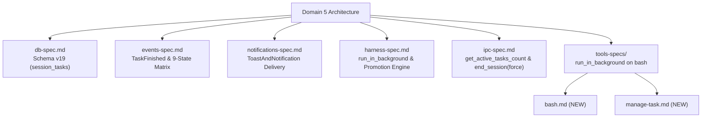

# Domain 5: Background Tasks, Timeout Promotion & Router Wake-Up
## Authoritative Architecture, Ground-Truth Trace & Hybrid Specification Contract

---

## 1. Executive Summary & System Objectives

In voice-driven agent runtimes, long-running operations (>5s) cause conversational dead air and break user engagement.
Domain 5 establishes the background task execution architecture for Vox Harness v2:
1. **`BackgroundTaskManager`**: Supervises asynchronous OS child process groups detached from the ReAct loop inside the Tokio runtime, mounted on `AppState`.
2. **Harness-Owned Timeout Auto-Promotion**: Replaces monolithic hard timeouts with harness-governed execution boundaries. Promotable tools (`bash`) specify an optional `run_in_background: boolean` parameter (default `true`). The harness automatically promotes any promotable tool taking longer than 5 seconds (`HARNESS_AUTO_PROMOTE_TIMEOUT`) to background execution, returning `is_error: false` without triggering guardrail strikes.
3. **Foreground Override & Second-Layer Ceiling**: When the model explicitly sets `run_in_background: false`, the tool runs strictly in the foreground, bound by a 120-second hard ceiling (`HARNESS_FOREGROUND_HARD_TIMEOUT`) to prevent permanent hangs.
4. **Single-Spawn Lifecycle Contract**: Spawns the child process once and immediately hands the handle to a supervisor task in `BackgroundTaskManager`, avoiding future-drop cancellation bugs during auto-promotion.
5. **OS Kernel Stream Redirection & Cross-Platform Shell**: Streams stdout and stderr directly to disk via kernel file descriptors (`Stdio::from(file)`) with `.stdin(Stdio::null())`. Resolves `/system/bin/sh` on Android and process group creation flags on Windows.
6. **Process Group Isolation & Zombie Reaping**: Spawns processes in isolated process groups (`setpgid(0, 0)` on Unix, `CREATE_NEW_PROCESS_GROUP` on Windows) and guarantees full process tree teardown via `SIGKILL` to negative PGID (`-pid`), actively awaiting child exit to reap OS zombie processes.
7. **Router Wake-Up & The 9-State Handling Matrix**: Serializes background task completion events through `vox-router` across all 9 canonical interaction states (`Idle`, `Ready`, `Listening`, `Thinking`, `Working`, `Speaking`, `Paused`, `Sleeping`, `Error`), evaluating active conversational presence (<5m) in `Ready` with zero-latency immediate dispatch when single tasks complete, and buffering into `StepInbox` without clearing the speech-hold latch during `Listening`, `Thinking`, and `Working`.
8. **Sleep Standby Inhibition (`RULE-EVT-12`)**: Inhibits the 5-minute standby sleep transition in `spawn_idle_monitor` while background tasks remain active, re-arming the timer loop upon task completion.
9. **Two-Step Disengage UX (`ConfirmModal`) & Backend Force Guard (`RULE-EVT-13`)**: Guards session termination with modal confirmation in UI and strict `force: bool` validation in the Rust backend before terminating active child process groups.
10. **Built-in `bash` & `manage_task` Tools**: Minimal, robust execution primitives providing authentic agent capabilities and black-box verification.
11. **Turso DB Schema v19 & Tier 4 Cache Parity**: Relational persistence of task lifecycle and provenance in `session_tasks`, with automated cleanup of `~/.vox/cache/tasks/<session_id>/` on session deletion and startup sweeps (`RULE-HARN-15`).

---

## 2. Ground-Truth Trace: Mapping the Existing Flow

This trace reconstructs the exact runtime control flow for tool execution, timeout, sleep standby, and session teardown across the current codebase using the `/trace` protocol.

### 2.1 Trace Scoping
- **Entry Points**:
  1. Language model emits tool call batch via `StreamPassOutcome::ToolCallsReceived` in [app/src-tauri/src/harness/loop.rs:291](file:///home/addy/projects/apps/vox/app/src-tauri/src/harness/loop.rs#L291).
  2. Inactivity monitor timer expires in [app/src-tauri/src/pipeline/lifecycle.rs:49](file:///home/addy/projects/apps/vox/app/src-tauri/src/pipeline/lifecycle.rs#L49).
  3. User presses `Esc` or clicks disengage in [app/src/shared/context/VoiceSessionContext.tsx:291](file:///home/addy/projects/apps/vox/app/src/shared/context/VoiceSessionContext.tsx#L291).
- **Exit Points**:
  1. Synchronous tool completion committed to history in [app/src-tauri/src/harness/steps.rs:614](file:///home/addy/projects/apps/vox/app/src-tauri/src/harness/steps.rs#L614).
  2. Tool execution times out after 13 seconds in [app/src-tauri/src/harness/tools/executor.rs:305](file:///home/addy/projects/apps/vox/app/src-tauri/src/harness/tools/executor.rs#L305).
  3. Session offloads models to `Sleeping` in [app/src-tauri/src/pipeline/lifecycle.rs:60](file:///home/addy/projects/apps/vox/app/src-tauri/src/pipeline/lifecycle.rs#L60).
  4. Session teardown unmounts harness in [app/src-tauri/src/pipeline/assistant/session.rs:611](file:///home/addy/projects/apps/vox/app/src-tauri/src/pipeline/assistant/session.rs#L611).
- **Depth**: Traced across Frontend UI, Tauri IPC, Event Router, Harness Loop, Tool Executor, and Persistence layer.

---

### 2.2 Phased Walkthrough of Current Code

#### Phase 1 — Tool Invocation & Monolithic Timeout

1. **What:** The Harness coordinator intercepts tool calls emitted by the language model and delegates batch execution to the step sequencer.
   **Who:** `loop.rs` invokes `step6_execute_tool_batch`.
   **Trigger:** Streaming pass returns `StreamPassOutcome::ToolCallsReceived`.
   **Grounding:** Traced — [app/src-tauri/src/harness/loop.rs:291-312](file:///home/addy/projects/apps/vox/app/src-tauri/src/harness/loop.rs#L291-L312).
   **Owner:** Cognitive ReAct Loop (`harness/loop.rs`).

2. **What:** The step sequencer builds a `ToolExecutionContext` and invokes `ToolExecutor::execute_batch`.
   **Who:** `steps.rs` invokes `ToolExecutor`.
   **Trigger:** Entry into `step6_execute_tool_batch`.
   **Grounding:** Traced — [app/src-tauri/src/harness/steps.rs:587-620](file:///home/addy/projects/apps/vox/app/src-tauri/src/harness/steps.rs#L587-L620).
   **Owner:** Step Sequencer (`harness/steps.rs`).

3. **What:** The tool executor runs the tool future wrapped inside a monolithic 13-second `tokio::time::timeout`.
   **Who:** `executor.rs` inside `run_with_guards`.
   **Trigger:** Tool does not return `handles_own_timeout() == true`.
   **Grounding:** Traced — [app/src-tauri/src/harness/tools/executor.rs:298-311](file:///home/addy/projects/apps/vox/app/src-tauri/src/harness/tools/executor.rs#L298-L311) and [app/src-tauri/src/harness/mod.rs:38](file:///home/addy/projects/apps/vox/app/src-tauri/src/harness/mod.rs#L38).
   **Owner:** Tool Execution Engine (`harness/tools/executor.rs`).
   *Defect in current code:* If any command or retrieval takes longer than 13 seconds, `tokio::time::timeout` expires, returning `is_error: true`. This increments `guardrail_strike` on `session_steps` and causes the model to hallucinate or panic, even when the command was legitimately compiling or downloading.

---

#### Phase 2 — Inactivity & Unconditional Sleep Offload

4. **What:** The session inactivity monitor watches pipeline state transitions. When in `Paused`, it awaits `INACTIVITY_PAUSED_TIMEOUT` (5 minutes).
   **Who:** `spawn_idle_monitor` in `lifecycle.rs`.
   **Trigger:** Pipeline enters `InteractionState::Paused`.
   **Grounding:** Traced — [app/src-tauri/src/pipeline/lifecycle.rs:47-51](file:///home/addy/projects/apps/vox/app/src-tauri/src/pipeline/lifecycle.rs#L47-L51).
   **Owner:** Pipeline Lifecycle Supervisor (`pipeline/lifecycle.rs`).

5. **What:** When 5 minutes elapse in `Paused`, the monitor offloads LLM and TTS weights from RAM and transitions state to `Sleeping`.
   **Who:** `spawn_idle_monitor` invokes `cool_down_llm` and `cool_down_tts`, then sets state to `Sleeping`.
   **Trigger:** 5-minute timer completes without state change.
   **Grounding:** Traced — [app/src-tauri/src/pipeline/lifecycle.rs:52-76](file:///home/addy/projects/apps/vox/app/src-tauri/src/pipeline/lifecycle.rs#L52-L76).
   **Owner:** Pipeline Lifecycle Supervisor (`pipeline/lifecycle.rs`).
   *Defect in current code:* The monitor has zero visibility into active child processes. If a 10-minute compilation is running in the background, the monitor offloads model weights after 5 minutes, transitioning to `Sleeping` and preventing the assistant from announcing completion when the build finishes.

---

#### Phase 3 — Disengage & Orphan Process Leaks

6. **What:** The user presses the `Escape` key or clicks Disengage in the UI.
   **Who:** User initiates via DOM in `VoiceSessionContext.tsx`.
   **Trigger:** `disengage()` called in frontend context.
   **Grounding:** Traced — [app/src/shared/context/VoiceSessionContext.tsx:291-313](file:///home/addy/projects/apps/vox/app/src/shared/context/VoiceSessionContext.tsx#L291-L313).
   **Owner:** Frontend Voice Session Context (`shared/context/VoiceSessionContext.tsx`).

7. **What:** The frontend directly calls `disengageSession()`, which immediately issues the `end_session` IPC command.
   **Who:** `pipelineService.ts` invokes Tauri command `end_session`.
   **Trigger:** Disengage handler executed.
   **Grounding:** Traced — [app/src/services/pipelineService.ts:192-197](file:///home/addy/projects/apps/vox/app/src/services/pipelineService.ts#L192-L197).
   **Owner:** Frontend Pipeline Service Bridge (`services/pipelineService.ts`).
   *Defect in current code:* The frontend issues `end_session` with zero validation of active background work, immediately tearing down state even if background processes are actively executing.

8. **What:** The backend handles `end_session`, cancels active turn tokens (`turn_cancel_token`), drops the session harness, and halts the audio engine.
   **Who:** `session.rs` inside `on_end`.
   **Trigger:** Router receives `VoxEvent::EndSession`.
   **Grounding:** Traced — [app/src-tauri/src/pipeline/assistant/session.rs:600-669](file:///home/addy/projects/apps/vox/app/src-tauri/src/pipeline/assistant/session.rs#L600-L669).
   **Owner:** Assistant Session Manager (`pipeline/assistant/session.rs`).
   *Defect in current code:* `on_end` unmounts the harness via `state.harness.lock().take()`, but contains zero logic to kill spawned child processes. Any background processes continue running as orphaned zombies in the background.

---

## 3. Blast Radius & Specification Impact Analysis

Domain 5 introduces cross-cutting modifications across data persistence, event routing, notifications, cognitive harness contracts, tool specifications, and user interface dialogs.



### 3.1 Sibling Specifications Impact Matrix

| Specification | Section / Clause | Required Modification | Rationale |
| :--- | :--- | :--- | :--- |
| **`docs/specs/db-spec.md`** | Database Schemas & Migrations | Add **Migration v19**: create `session_tasks` table, add foreign key cascade to `sessions(id)`, and indices `idx_session_tasks_session_id`, `idx_session_tasks_status`. Update schema version constant to 19. | Authoritative relational persistence of background task lifecycle, exit codes, and log paths. |
| **`docs/specs/events-spec.md`** | §4 Interaction State Machine & §5 Matrix | Add `VoxEvent::TaskFinished { task_id, session_id, status }`. Add the **Complete 9-State Handling Matrix** for task completions. Add **`RULE-EVT-12 (Sleep Standby Inhibition)`** and **`RULE-EVT-13 (Two-Step Disengage Protocol)`**. Add 2-second speech coalescing window. | Single-writer event router owns all task completion state transitions without race conditions. |
| **`docs/specs/notifications-spec.md`** | Alerting & Routing Matrix | Map background task completions to `DeliveryChannel::ToastAndNotification`. Define OS toast alert shape and Notification Drawer card payload (`category: "task"`, `group_key: "task:{task_id}"`). | Guarantees non-intrusive visual notification across all states, with or without audio synthesis. |
| **`docs/specs/harness-spec.md`** | §4.5 Agentic Tool Execution Chassis | Replace 13-second constant with **Harness-Owned Timeout Promotion Engine**. Add `run_in_background: boolean` parameter to promotable tools (`bash`). Add `HARNESS_AUTO_PROMOTE_TIMEOUT` (5s) and `HARNESS_FOREGROUND_HARD_TIMEOUT` (120s). Add `StepInbox::push_task_notification` ingestion. | Protects conversational fluency while preventing false guardrail strikes on slow operations. |
| **`docs/specs/ipc-spec.md`** | §4.5 Pipeline & Audio Domain | Add commands `get_active_tasks_count(sessionId?: number) -> number` and `list_tasks(sessionId?: number) -> Array<TaskRecord>`. Update `end_session` to accept `force?: boolean`. | Allows UI to check active tasks and issue confirmed force-teardown. |
| **`docs/specs/tools-specs/lld.md`** | §4 Universal Tool Interface | Update universal tool contract: document background promotion capability and harness timing constants. | SSOT for tool promotion mechanics. |
| **`docs/specs/tools-specs/bash.md`** | New Specification | Create comprehensive specification for the `bash` tool (command, `run_in_background: boolean` default `true`, kernel stream redirection, process group isolation). | SSOT for OS command execution. |
| **`docs/specs/tools-specs/manage-task.md`** | New Specification | Create comprehensive specification for `manage_task` (actions `list`, `status`, `kill`, `kill_all`). | SSOT for process supervision and monitoring. |

---

### 3.2 Codebase File Manifest

```
app/src-tauri/src/
├── core/
│   ├── events.rs                   # VoxEvent::TaskFinished, TaskStatus, TaskDto
│   └── state.rs                    # pub tasks: Arc<BackgroundTaskManager>
├── persistence/
│   ├── schema.rs                   # Migration v19: session_tasks table & indices
│   ├── sessions.rs                 # delete_session: purge session_tasks_dir
│   └── worker.rs                   # run_startup_sweeps: sweep_tasks_dir
├── pipeline/
│   ├── atomics.rs                  # pub last_user_activity_ms: AtomicU64
│   ├── router.rs                   # Route VoxEvent::TaskFinished to assistant domain
│   ├── lifecycle.rs                # RULE-EVT-12: Inhibit sleep if tasks active & loop re-arm
│   └── assistant/
│       ├── mod.rs                  # Dispatch VoxEvent::TaskFinished
│       ├── session.rs              # on_end: enforce force check & kill_all running tasks
│       ├── llm.rs                  # evaluate_synthesis_latch: check undrained inbox tasks
│       └── tasks.rs (NEW)          # 9-state handling implementation & proactive turn
├── services/
│   └── tasks/ (NEW)
│       ├── mod.rs                  # Module exports
│       └── manager.rs              # BackgroundTaskManager (OS process group, log files)
├── harness/
│   ├── stages/
│   │   └── inbox.rs                # push_task_notification (preserves speech_hold_active)
│   └── tools/
│       ├── mod.rs                  # ToolDefinition::supports_background_promotion
│       ├── executor.rs             # 5s auto-promotion & 120s foreground ceiling
│       ├── registry.rs             # Register bash and manage_task
│       ├── bash.rs (NEW)           # Minimal bash tool implementation
│       └── manage_task.rs (NEW)    # Minimal manage_task tool implementation
├── utils/
│   └── paths.rs                    # task_log_path, session_tasks_dir
└── ipc/
    └── pipeline.rs                 # end_session(force), get_active_tasks_count, list_tasks

app/src/
├── services/
│   └── pipelineService.ts          # Updated disengageSession with active task query
├── shared/
│   ├── context/
│   │   └── VoiceSessionContext.tsx # Two-step disengage integration with ConfirmModal
│   └── ui/
│       └── ConfirmModal.tsx        # Reuse pre-existing single-surface modal component
└── store/
    └── sessionStore.ts             # Track activeTasksCount
```

---

## 4. The 5 Mandatory Pivot Gates

### 4.1 Gate 1: Lifecycle & Command Orthogonality Check
Three distinct operational lifecycles must remain decoupled:
1. **Foreground Turn ReAct Loop**: Owned by `Harness` coordinator (`loop.rs`). Identified by `turn_id`. Lifecycle ends when model speaks or awaits user.
2. **Background Task Lifecycle**: Owned by `BackgroundTaskManager`. Identified by `task_id`. Outlives individual turns; runs as long as the OS process executes.
3. **Session Lifecycle**: Owned by `AppState` / `session.rs`. Identified by `session_id`. Persists conversation context and models in RAM.

**Invariants**:
- Finishing or aborting a foreground turn (`stop_turn`) MUST NOT terminate background tasks.
- Background task promotion MUST return an observation with `is_error: false`. It MUST NOT trigger guardrail strikes or turn failures.
- Ending a session (`end_session`) with `force: true` terminates all background tasks associated with that session to prevent orphan process leaks. Calling `end_session` with `force: false` while tasks run returns a warning/error and keeps the session active.

### 4.2 Gate 2: State Space Bijection (Zero-State & Role Occupancy Audit)

#### Canonical `TaskStatus` Enum
A task transitions only across bijective states. It is born in `Running`:
```rust
#[derive(Debug, Clone, PartialEq, Eq, Serialize, Deserialize)]
#[serde(tag = "status", rename_all = "snake_case")]
pub enum TaskStatus {
    Running {
        pid: u32,
        started_at: u64,
    },
    Completed {
        exit_code: i32,
        duration_ms: u64,
        completed_at: u64,
    },
    Failed {
        error: String,
        duration_ms: u64,
        failed_at: u64,
    },
    Killed {
        killed_at: u64,
    },
}

impl TaskStatus {
    pub fn is_terminal(&self) -> bool {
        !matches!(self, TaskStatus::Running { .. })
    }

    pub fn as_str(&self) -> &'static str {
        match self {
            Self::Running { .. } => "running",
            Self::Completed { .. } => "completed",
            Self::Failed { .. } => "failed",
            Self::Killed { .. } => "killed",
        }
    }
}
```

#### Task DTO for UI & Remote Projections
```rust
#[derive(Debug, Clone, Serialize, Deserialize)]
#[serde(rename_all = "camelCase")]
pub struct TaskDto {
    pub taskId: String,
    pub sessionId: i64,
    pub command: String,
    pub status: String,
    pub exitCode: Option<i32>,
    pub error: Option<String>,
    pub logPath: String,
    pub startedAt: u64,
    pub completedAt: Option<u64>,
    pub durationMs: Option<u64>,
}
```

#### Single Projection Rule
The frontend NEVER queries SQLite or joins local arrays to determine if tasks are active. `BackgroundTaskManager::active_tasks_count(session_id)` provides the canonical count.

---

### 4.3 Gate 3: The 4-Boundary End-to-End Traces

```
[Boundary 1: UI -> Backend IPC]
[Boundary 2: Backend Internal -> Event Router / Harness]
[Boundary 3: Backend -> OS Kernel / Process Group]
[Boundary 4: Backend -> Turso MVCC Storage]
```

#### Trace 1: Fast Command Execution (`run_in_background: true`, completes in < 5s)
1. **Boundary 1**: User asks assistant to run `echo "hello"`.
2. **Boundary 2**: Model emits `bash(command="echo 'hello'")` with implicit `run_in_background: true`.
3. **Boundary 3**: `BashTool` spawns process in dedicated process group and immediately registers child with `BackgroundTaskManager`, getting a `TaskHandle`.
4. **Boundary 3**: Child process exits in 15ms with code 0.
5. **Boundary 2**: `handle.completion_rx` yields completed status before the 5s promotion timeout.
6. **Boundary 2**: `bash` reads stdout tail synchronously from log file. Returns `ToolResult` with exit code and output inline (`is_error: false`). Task is pruned from tracking without firing `VoxEvent::TaskFinished`.

#### Trace 2: Long Command Execution & Auto-Promotion (`run_in_background: true`, takes > 5s)
1. **Boundary 1**: User asks assistant to run `cargo test --release`.
2. **Boundary 2**: Model emits `bash(command="cargo test --release")` (implicit `run_in_background: true`).
3. **Boundary 3**: `BashTool` spawns process group. Output streams directly to kernel file descriptor. Child is held by `BackgroundTaskManager`.
4. **Boundary 2**: Harness 5-second `HARNESS_AUTO_PROMOTE_TIMEOUT` timer expires in `BashTool::execute`.
5. **Boundary 4**: `state.tasks.mark_promoted(&task_id)` inserts `session_tasks` table row as `running`.
6. **Boundary 2**: `BashTool::execute` returns immediate success observation with `is_error: false`:
   ```json
   {
     "status": "running_in_background",
     "task_id": "task_1001_a9f1",
     "command": "cargo test --release",
     "log_path": "/home/user/.vox/cache/tasks/1001/task_1001_a9f1.log",
     "message": "Process running in background. Use manage_task to monitor or kill."
   }
   ```
7. **Boundary 2**: ReAct loop treats observation as normal tool output (`is_error: false`, no guardrail strike).
8. **Boundary 1**: Model speaks: *"I started the tests in the background. I will notify you when finished."* State transitions `Working` $\to$ `Speaking` $\to$ `Ready`.

#### Trace 3: Foreground Override Execution (`run_in_background: false`)
1. **Boundary 1**: User asks assistant to run a migration and verify it immediately.
2. **Boundary 2**: Model emits `bash(command="cargo migrate", run_in_background=false)`.
3. **Boundary 2**: `BashTool::execute` detects `run_in_background == false`. It disables the 5-second auto-promotion timer and arms the 120-second `HARNESS_FOREGROUND_HARD_TIMEOUT`.
4. **Boundary 3**: Command executes in foreground for 12 seconds. Pipeline remains in `Working` state; interim activity envelope stays active.
5. **Boundary 3**: Command exits at 12s with exit code 0.
6. **Boundary 2**: Result returns synchronously in the active turn. ReAct loop proceeds to Step 2.

#### Trace 4: Background Task Finishes in `Ready` (Immediate Proactive Announcement)
1. **Boundary 3**: Child process exits with code 0.
2. **Boundary 2**: Tokio supervisor detects exit. Computes duration. Calls `let _ = child.wait().await;` to reap OS process.
3. **Boundary 4**: Updates `session_tasks` table: `status = 'completed'`, `exit_code = 0`, `duration_ms = 42150`.
4. **Boundary 2**: Removes task from active memory registry.
5. **Boundary 2**: Emits `VoxEvent::TaskFinished { task_id, session_id, status }` to central event queue.
6. **Boundary 1**: Router emits `IpcEvent::NotificationCreated` (OS toast + drawer card).
7. **Boundary 2**: Router inspects `InteractionState`. State is `Ready`. Checks `now - last_user_activity_ms < 5 * 60 * 1000`. Active window is valid!
8. **Boundary 2**: Checks `active_tasks_count(session_id)`. Count is 0 (no other tasks running). Zero delay (0ms)! Initiates proactive turn: transitions `Ready` $\to$ `Thinking`.
9. **Boundary 1**: Input query includes `task_id={task_id}` to avoid history duplicate drops. Model streams spoken response: *"Your background cargo test has finished successfully with zero errors."* State transitions `Thinking` $\to$ `Speaking` $\to$ `Ready`.

#### Trace 5: Session Disengage with Active Tasks (Two-Step Protection & Force Guard)
1. **Boundary 1**: User clicks Disengage or presses `Esc` while assistant is `Ready`.
2. **Boundary 1**: Frontend checks `active_tasks_count`. Count is 2 (>0).
3. **Boundary 1**: Frontend opens `ConfirmModal` (*"Disengage Session? You have 2 background process(es) running. Disengaging will terminate them."*).
4. **Boundary 1**: User clicks *"Terminate & Disengage"*.
5. **Boundary 1**: Frontend invokes `end_session(force=true)`.
6. **Boundary 2**: Backend validates `force == true`. Router receives `VoxEvent::EndSession { force: true }`.
7. **Boundary 2**: Router calls `BackgroundTaskManager::kill_all(session_id)`.
8. **Boundary 3**: Manager sends `libc::kill(-pgid, SIGKILL)` to all active process groups and reaps children.
9. **Boundary 4**: Manager marks records as `killed` in `session_tasks`.
10. **Boundary 2**: Router unmounts harness, cools down models, transitions to `Idle`.

---

### 4.4 Gate 4: Asymmetry & Worst-Case Failure Matrix

| Failure Mode | Root Cause | Architectural Defense |
| :--- | :--- | :--- |
| **Grandchild Process Leak** | `bash` spawns subshells or child binaries (`cargo` -> `rustc` -> `linker`). Killing parent PID leaves children orphaned. | **Process Group Isolation**: Spawns child with `setpgid(0, 0)`. Termination sends `libc::SIGKILL` to negative PGID (`-pid`), nuking the entire tree. Supervisor calls `child.wait().await` to reap zombies. |
| **Pipe Buffer Deadlock & Interactive Hang** | Child process fills 64KB OS stdout pipe buffer or waits on interactive stdin. Process freezes. | **Kernel Stream Redirection & Null Stdin**: Process stdout/stderr write directly to disk file descriptors via `Stdio::from(file)`. Stdin set to `Stdio::null()`. |
| **Simultaneous Task Exits** | Multiple background tasks exit within milliseconds of each other. | **Single-Writer MPSC Queue & Coalescing**: All completions funnel through `vox-router`. If `active_tasks_count > 0`, router arms 500ms-2000ms coalescing timer; if 0, dispatches immediately. |
| **Mid-Speech Speech-Hold Clobber** | Task completes while user speaks in held `Working` turn (`Listening`). Calling `inbox.push()` would clear speech hold. | **Dedicated Ingestion (`push_task_notification`)**: Injects message into `StepInbox` without touching `speech_hold_active`. Hold released strictly by user speech resolution. |
| **Sustained Idle Sleep Drift** | System attempts to offload models from RAM while a background task compiles code. | **Sleep Invalidation (`RULE-EVT-12`)**: `spawn_idle_monitor` checks `BackgroundTaskManager::has_running_tasks()`. Transition to `Sleeping` is inhibited; timer re-arms without deadlocking on `state_rx.changed()`. |
| **Log Disk Exhaustion & Leaks** | Runaway command writes gigabytes of logs, or logs linger after session deletion. | **100MB File Ceiling & Tier 4 Purge (`RULE-HARN-15`)**: Task log writes snap to session cache ceiling. Wiped on session deletion in `persistence/sessions.rs` and startup sweep in `worker.rs`. |

---

### 4.5 Gate 5: Spec-Wide Referential Integrity Sweep
- No legacy 13-second constants in harness loop for promotable tools.
- Non-promotable tools retain 13-second timeout and do not expose `run_in_background`.
- State machine aligns with `events-spec.md` 9-state Duplex State Machine model.
- Tool schemas conform to `harness-spec.md §4.5`.
- Database schema matches `db-spec.md` conventions.

---

## 5. Part I: Universal Parameter Contract & Single-Spawn Promotion Engine

### 5.1 Promotable Tool Contract (`run_in_background`)
Only tools implementing `supports_background_promotion() == true` (in Domain 5, `bash`) expose `run_in_background`:
```json
"run_in_background": {
  "type": "boolean",
  "description": "Whether this command can run in the background if execution takes time. Defaults to true. Set to false only when you strictly require the output before proceeding in this turn.",
  "default": true
}
```

### 5.2 Harness Timing Constants & Seam Injection
```rust
/// Time to await tool completion synchronously before auto-promoting to background.
pub const HARNESS_AUTO_PROMOTE_TIMEOUT: Duration = Duration::from_secs(5);

/// Hard safety ceiling for foreground execution when run_in_background is false.
pub const HARNESS_FOREGROUND_HARD_TIMEOUT: Duration = Duration::from_secs(120);
```
To support sub-100ms deterministic execution in integration tests (`TEST-D5-02`, `TEST-D5-03`), `Harness` carries:
```rust
pub auto_promote_timeout: Duration,
pub foreground_hard_timeout: Duration,
```
which propagate through `ToolExecutionContext`.

### 5.3 Single-Spawn Supervisor Architecture
To eliminate the future-drop bug:
1. `BashTool::execute` spawns the child process and immediately registers it with `BackgroundTaskManager::spawn_supervised_task`.
2. A Tokio supervisor task in `BackgroundTaskManager` holds the `tokio::process::Child` and monitors exit.
3. `BashTool::execute` awaits `completion_rx` with a timeout:
```rust
let timeout_duration = if run_in_background {
    ctx.auto_promote_timeout
} else {
    ctx.foreground_hard_timeout
};

tokio::select! {
    _ = ctx.cancel.cancelled() => {
        state.tasks.kill_task(&task_id).await;
        (ToolResult::new("Tool execution cancelled"), true)
    }
    status = &mut completion_rx => {
        match status {
            Ok(TaskStatus::Completed { exit_code, duration_ms, .. }) => {
                let tail = state.tasks.read_log_tail(&log_path, 50).await.unwrap_or_default();
                state.tasks.prune_unpromoted(&task_id); // Not promoted: do not emit TaskFinished
                let is_error = exit_code != 0;
                (ToolResult::new(format!("Exit code: {}\nOutput:\n{}", exit_code, tail)), is_error)
            }
            Ok(TaskStatus::Failed { error, .. }) => {
                state.tasks.prune_unpromoted(&task_id);
                (ToolResult::new(format!("Execution failed: {}", error)), true)
            }
            _ => (ToolResult::new("Execution terminated"), true),
        }
    }
    _ = tokio::time::sleep(timeout_duration) => {
        if run_in_background {
            log::info!("[BashTool] Exceeded {:?}; auto-promoting task {}", timeout_duration, task_id);
            state.tasks.mark_promoted(&task_id).await; // Inserts DB row & arms TaskFinished emission
            let payload = json!({
                "status": "running_in_background",
                "task_id": task_id,
                "command": command,
                "log_path": log_path.to_string_lossy(),
                "message": "Process running in background. Use manage_task to monitor or kill."
            });
            (ToolResult::new(payload.to_string()), false) // is_error: false prevents guardrail strike!
        } else {
            log::warn!("[BashTool] Exceeded 120s foreground limit; forcing background promotion for task {}", task_id);
            state.tasks.mark_promoted(&task_id).await;
            let payload = json!({
                "status": "running_in_background",
                "task_id": task_id,
                "command": command,
                "log_path": log_path.to_string_lossy(),
                "message": "Process exceeded 120s foreground limit and was promoted to background."
            });
            (ToolResult::new(payload.to_string()), false)
        }
    }
}
```

#### Cancellation Token Hierarchy & Stage 1 Interruption Invariant
- `ctx.cancel` is cloned from `state.pipeline.turn_cancel_token()`.
- **Stage 1 Interruption (`SpeechStart`)**: When the user speaks or coughs while a tool executes, `on_interrupt` invokes `state.pipeline.cancel_active_stream()`. This trips `stream_cancel_token` to pause token generation, parks the cognitive loop at `StepInbox::wait_if_speech_held()`, and preserves `current_activity`. Crucially, `turn_cancel_token` remains **armed**, and `hardware_cancel_flag` remains **false**. The tool continues running undisturbed.
- **Stage 2 Interruption (`TranscriptFinal`)**:
  - *False barge-in (empty transcript)*: Speech hold releases. State resumes `Working` (restoring `current_activity`), with tool execution having progressed uninterrupted.
  - *Real barge-in (non-empty transcript)*: `cancel_active_turn()` trips `turn_cancel_token` and sets `hardware_cancel_flag = true`. `ctx.cancel.cancelled()` fires in `BashTool::execute`, killing the foreground process group and recording a cancelled placeholder before `next_turn()` rotates `turn_id` and binds the new `utterance_id`.

---

## 6. Part II: `BackgroundTaskManager` Architecture

### 6.1 System Placement & Threading Model
`BackgroundTaskManager` lives inside the **Tokio async runtime** within `AppState`:
```rust
pub struct BackgroundTaskManager {
    active_tasks: Arc<parking_lot::RwLock<HashMap<String, ActiveTaskRecord>>>,
    db: Arc<VoxDb>,
    event_tx: parking_lot::Mutex<Option<std::sync::mpsc::Sender<VoxEvent>>>,
}
```

```rust
pub struct ActiveTaskRecord {
    pub task_id: String,
    pub session_id: i64,
    pub tool_call_id: Option<String>,
    pub command: String,
    pub pid: u32,
    pub log_path: PathBuf,
    pub started_at: u64,
    pub is_promoted: bool,
    pub cancel_token: tokio_util::sync::CancellationToken,
}
```

### 6.2 OS Kernel Log Redirection & Cross-Platform Shell
```rust
pub fn resolve_shell_command(command: &str) -> (String, Vec<String>) {
    #[cfg(target_os = "android")]
    {
        ("sh".to_string(), vec!["-c".to_string(), command.to_string()])
    }
    #[cfg(all(unix, not(target_os = "android")))]
    {
        ("bash".to_string(), vec!["-c".to_string(), command.to_string()])
    }
    #[cfg(windows)]
    {
        ("cmd".to_string(), vec!["/C".to_string(), command.to_string()])
    }
}
```

Spawning configuration:
```rust
let (shell, args) = resolve_shell_command(&command);
let mut cmd = tokio::process::Command::new(shell);
cmd.args(args)
   .stdin(std::process::Stdio::null()) // Prevent interactive stdin hang
   .stdout(std::process::Stdio::from(log_file))
   .stderr(std::process::Stdio::from(log_file_err));

#[cfg(unix)]
unsafe {
    cmd.pre_exec(|| {
        libc::setpgid(0, 0);
        Ok(())
    });
}
#[cfg(windows)]
{
    const CREATE_NEW_PROCESS_GROUP: u32 = 0x00000200;
    cmd.creation_flags(CREATE_NEW_PROCESS_GROUP);
}

let mut child = cmd.spawn()?;
let pid = child.id().unwrap_or(0);
```

### 6.3 Process Tree Teardown & Zombie Reaping
```rust
#[cfg(unix)]
pub fn kill_process_group(pid: u32) {
    unsafe {
        libc::kill(-(pid as i32), libc::SIGKILL);
    }
}

#[cfg(windows)]
pub fn kill_process_group(pid: u32) {
    let _ = std::process::Command::new("taskkill")
        .args(["/PID", &pid.to_string(), "/T", "/F"])
        .output();
}
```
In the Tokio supervisor:
```rust
let status = child.wait().await; // Kernel reaps the process, zero zombie entries!
```

---

## 7. Part III: Minimal `bash` & `manage_task` Tools

### 7.1 Minimal `bash` Tool
- **Canonical Identifier**: `"bash"`
- **Domain**: `ToolDomain::Modular`
- **Concurrency Mode**: `ToolExecutionMode::Exclusive` (system mutation barrier)
- **Supports Background Promotion**: `true`
- **Truncation Policy**: `TruncationPolicy::TailHeavy { tail_ratio: 0.8 }`
- **Parameters Schema**:
  ```json
  {
    "type": "object",
    "properties": {
      "command": {
        "type": "string",
        "description": "The exact shell command line string to execute."
      },
      "run_in_background": {
        "type": "boolean",
        "description": "Whether this command can run in the background if it takes longer than 5 seconds. Defaults to true. Set to false only when you strictly require the output before proceeding in this turn.",
        "default": true
      }
    },
    "required": ["command"]
  }
  ```

### 7.2 `manage_task` Tool
- **Canonical Identifier**: `"manage_task"`
- **Domain**: `ToolDomain::Modular`
- **Concurrency Mode**:
  - `ToolExecutionMode::Parallel` for read-only actions (`list`, `status`).
  - `ToolExecutionMode::Exclusive` for mutating actions (`kill`, `kill_all`).
- **Truncation Policy**:
  - `TruncationPolicy::TailHeavy { tail_ratio: 0.8 }` for `status`.
  - `TruncationPolicy::None` for `list`, `kill`, `kill_all`.
- **Parameters Schema**:
  ```json
  {
    "type": "object",
    "properties": {
      "action": {
        "type": "string",
        "enum": ["list", "status", "kill", "kill_all"],
        "description": "Action to perform on background tasks."
      },
      "task_id": {
        "type": "string",
        "description": "Unique task identifier (required for 'status' and 'kill')."
      }
    },
    "required": ["action"]
  }
  ```

---

## 8. Part IV: Turso DB Schema (Migration v19) & Tier 4 Purge

### 8.1 DDL Migration
```sql
CREATE TABLE IF NOT EXISTS session_tasks (
    task_id TEXT PRIMARY KEY,
    session_id INTEGER NOT NULL REFERENCES sessions(id) ON DELETE CASCADE,
    tool_call_id TEXT,
    command TEXT NOT NULL,
    status TEXT NOT NULL CHECK (status IN ('running', 'completed', 'failed', 'killed')),
    exit_code INTEGER,
    error TEXT,
    log_path TEXT NOT NULL,
    started_at INTEGER NOT NULL,
    completed_at INTEGER,
    duration_ms INTEGER,
    created_at INTEGER NOT NULL,
    updated_at INTEGER NOT NULL
);

CREATE INDEX IF NOT EXISTS idx_session_tasks_session_id ON session_tasks(session_id);
CREATE INDEX IF NOT EXISTS idx_session_tasks_status ON session_tasks(session_id, status);
```

### 8.2 Tier 4 Log Purge Integration (`RULE-HARN-15`)
In `persistence/sessions.rs::delete_session`:
```rust
let tasks_dir = crate::utils::paths::session_tasks_dir(session_id);
if tasks_dir.exists() {
    let _ = std::fs::remove_dir_all(&tasks_dir);
}
```
In `persistence/worker.rs::run_startup_sweeps`:
Sweep `paths::tasks_dir()` for orphaned session folders and enforce the 100MB directory ceiling.

---

## 9. Part V: Event Router & The Complete 9-State Matrix

### 9.1 `VoxEvent::TaskFinished`
```rust
pub enum VoxEvent {
    // ...
    TaskFinished {
        task_id: String,
        session_id: i64,
        status: TaskStatus,
    },
}
```

### 9.2 The 9-State Handling Matrix
All events pass through the single-writer `vox-router` channel.

| State | Router Action on `TaskFinished` | Audio / Voice Action | Alerts (`ToastAndNotification`) |
| :--- | :--- | :--- | :--- |
| **`Idle`** | Updates Turso DB record. | Zero audio. Assistant remains `Idle`. | Emits OS toast and Notification Drawer card. |
| **`Ready`** | Evaluates active window (`now - last_user_activity_ms < 5m`). | If active (<5m): transitions `Ready` $\to$ `Thinking` $\to$ `Speaking` to speak status. If quiet (>5m): audio suppressed. | Emits OS toast and Notification Drawer card. |
| **`Listening`** | Calls `inbox.push_task_notification()` as `Immediate`. | Zero audio interruption. Does NOT clear `speech_hold_active`. | Emits OS toast and Notification Drawer card. |
| **`Thinking`** | Calls `inbox.push_task_notification()` as `Immediate`. | Zero audio interruption. Does not abort in-flight model stream. | Emits OS toast and Notification Drawer card. |
| **`Working`** | Calls `inbox.push_task_notification()` as `Immediate`. | Active tools continue running. Injected into context at step boundary without clobbering speech hold. | Emits OS toast and Notification Drawer card. |
| **`Speaking`** | Calls `inbox.push_task_notification()`. | Zero audio interruption. Evaluated when playback completes and state returns to `Ready` or `Working`. | Emits OS toast and Notification Drawer card. |
| **`Paused`** | Updates Turso DB record. | Zero audio. Never speaks while session is paused by user. | Emits OS toast and Notification Drawer card. |
| **`Sleeping`** | State invalid under `RULE-EVT-12`. Fallback: updates DB. | Zero audio. | Emits OS toast and Notification Drawer card. |
| **`Error`** | Updates Turso DB record. | Zero audio. Assistant remains in `Error`. | Emits OS toast and Notification Drawer card. |

### 9.3 Smart Coalescing in `Ready`
When `TaskFinished` arrives in `Ready`:
- If `state.tasks.active_tasks_count(session_id) == 0`: dispatches proactive turn immediately (0ms delay).
- If `state.tasks.active_tasks_count(session_id) > 0`: arms a coalescing window (500ms-2000ms) to batch imminent completions into a single spoken announcement.

### 9.4 Sleep Invalidation Rule (`RULE-EVT-12`)
In `pipeline/lifecycle.rs`:
```rust
} else if current == InteractionState::Paused {
    tokio::select! {
        _ = tokio::time::sleep(paused_timeout) => {
            if state.pipeline.state() == InteractionState::Paused {
                if state.tasks.has_running_tasks(state.conversation_id.load(Relaxed) as i64) {
                    log::info!("[Pipeline] Inactive sleep suppressed by RULE-EVT-12: background tasks running");
                    continue; // Loop re-arms the sleep timer without blocking on state_rx.changed()!
                }
                // Transition to Sleeping & cool down models...
            }
        }
        res = state_rx.changed() => { ... }
    }
}
```

---

## 10. Part VI: Two-Step Disengage UX (`ConfirmModal`) & Backend Force Guard

### 10.1 Backend Force Guard (`RULE-EVT-13`)
In `pipeline/assistant/session.rs::on_end`:
```rust
pub fn on_end<R: Runtime>(app: &AppHandle<R>, state: &AppState, ctx: &RoutingContext, force: bool) {
    let session_id = state.conversation_id.load(Ordering::Relaxed) as i64;
    let active_count = state.tasks.active_tasks_count(session_id);
    if !force && active_count > 0 {
        log::warn!("[Pipeline::Session] Cannot end session: {} tasks running and force=false", active_count);
        return; // Guard holds session in Ready!
    }

    // Terminate all child process groups and mark DB records killed
    state.tasks.kill_all(session_id);

    // Proceed to unmount harness and transition to Idle...
}
```

### 10.2 User Interaction Flow
1. User presses `Esc` or clicks Disengage in `Ready` state.
2. Frontend queries `active_tasks_count`.
3. If `0`: invokes `end_session(force=false)` -> transitions to `Idle`.
4. If `> 0`: opens `ConfirmModal`:
   - **Title**: *"Disengage Session?"*
   - **Description**: *"You have {N} background process(es) running. Disengaging will terminate them."*
   - **Confirm Label**: *"Terminate & Disengage"* (destructive styling)
   - **Cancel Label**: *"Keep Running"*
5. On confirm: invokes `end_session(force=true)` -> kills process groups, reaches `Idle`.

---

## 11. Complete 12-Subtest Black-Box Seam Matrix & Mutation Specifications

### 11.1 Seam Binary 1: `app/src-tauri/tests/harness_loop_test.rs` (10 Subtests)

#### TEST-D5-01: `bash_tool_executes_fast_command_synchronously_without_backgrounding`
- **PURPOSE**: Catch premature background promotion or dropped stdout when a fast shell command completes within the auto-promotion window.
- **SCENARIO**: Model invokes `bash({"command": "printf 'FAST_SYNC_OK'", "run_in_background": true})` on a Harness with default 5s auto-promote timeout; command exits in <20ms with code 0.
- **ASSERTS**: Committed `Role::Tool` observation contains `"FAST_SYNC_OK"` and exit code `0`, and does NOT contain `"running_in_background"`; `state.tasks.active_tasks_count(session_id) == 0`; `SELECT COUNT(*) FROM session_tasks WHERE status = 'running'` is 0; `TurnOutcome::Completed` returns final spoken response.
- **CLASS**: `happy-path`
- **MUTANT**: In `BashTool::execute` / `BackgroundTaskManager`, promote all commands unconditionally without awaiting the synchronous `auto_promote_timeout` window.

#### TEST-D5-02: `bash_tool_auto_promotes_long_running_command_to_background_without_guardrail_strike`
- **PURPOSE**: Catch foreground turn stalls, double-spawned processes, or false guardrail error strikes when a shell command exceeds `auto_promote_timeout`.
- **SCENARIO**: Configure `harness.auto_promote_timeout = Duration::from_millis(80)`. Model invokes `bash({"command": "echo 'BOOT_LINE' && sleep 10"})` (default `run_in_background: true`).
- **ASSERTS**: Step 0 finishes in <500ms while child process is still running; committed `Role::Tool` observation parses as JSON with `"status": "running_in_background"`, non-empty `"task_id"`, and existing `"log_path"`; `session_steps` row has `guardrail_strike == 0` and `session_tool_calls` row has `is_error == 0`; `state.tasks.active_tasks_count(session_id) == 1`; `session_tasks` table has 1 row with `status = 'running'`.
- **CLASS**: `happy-path`
- **MUTANT**: In `ToolExecutor` / `steps.rs`, mark auto-promoted tool outcomes with `is_error: true` (or drop the child process handle when the promotion timer expires).

#### TEST-D5-03: `bash_tool_foreground_override_waits_past_auto_promote_window_until_completion`
- **PURPOSE**: Catch ignored `run_in_background: false` overrides that prematurely detach synchronous prerequisite commands to the background.
- **SCENARIO**: Configure `harness.auto_promote_timeout = Duration::from_millis(50)` and `foreground_hard_timeout = Duration::from_secs(5)`. Model invokes `bash({"command": "sleep 0.15 && printf 'MIGRATION_DONE'", "run_in_background": false})`.
- **ASSERTS**: Tool execution does NOT promote at 50ms; it waits ~150ms for the process to exit synchronously; committed `Role::Tool` observation contains `"MIGRATION_DONE"` and does NOT contain `"running_in_background"`; `state.tasks.active_tasks_count(session_id) == 0`.
- **CLASS**: `edge-case`
- **MUTANT**: In `BashTool::execute` / `ToolExecutor`, ignore the `run_in_background: false` argument and always use `auto_promote_timeout`.

#### TEST-D5-04: `background_task_streams_stdout_and_stderr_directly_to_disk_log_without_buffering`
- **PURPOSE**: Catch pipe buffer deadlocks or missing stderr redirection when a promoted background task writes incremental output streams.
- **SCENARIO**: Configure `auto_promote_timeout = Duration::from_millis(50)`. Spawn a command via `bash` that writes `"STDOUT_LINE_1\n"` to stdout and `"STDERR_LINE_1\n"` to stderr, then waits on a temp file flag before exiting.
- **ASSERTS**: While the task is still `Running`, reading `log_path` directly from disk under `paths::session_tasks_dir(session_id)` contains both `"STDOUT_LINE_1"` and `"STDERR_LINE_1"`.
- **CLASS**: `contract`
- **MUTANT**: In `BackgroundTaskManager::spawn_command`, redirect only `stdout` to `log_file` and leave `stderr` as `Stdio::null()`.

#### TEST-D5-05: `manage_task_list_and_status_read_live_state_and_log_tail_from_disk`
- **PURPOSE**: Catch stale task status reporting or full-file memory reads when inspecting a multi-hundred-line background task log via `manage_task`.
- **SCENARIO**: Promote a `bash` command that writes 120 numbered lines (`LINE_001` .. `LINE_120`) to its log file and stays running; in the next step, model calls `manage_task({"action": "list"})` and `manage_task({"action": "status", "task_id": task_id})` in a single parallel wave.
- **ASSERTS**: Both `manage_task` calls execute in `ToolExecutionMode::Parallel`; `list` returns the active `task_id` with `status: "running"`; `status` returns the last 50 lines (containing `"LINE_120"` and `"LINE_071"`, excluding `"LINE_001"`).
- **CLASS**: `happy-path`
- **MUTANT**: In `ManageTaskTool`, return only the first 50 lines (head) instead of seeking the last 50 lines (tail) of `log_path`.

#### TEST-D5-06: `manage_task_kill_terminates_entire_process_group_including_grandchildren`
- **PURPOSE**: Catch orphaned grandchild processes when `manage_task(action="kill")` kills only the parent shell PID (`+pid`) instead of the negative process group ID (`-pgid`).
- **SCENARIO**: Promote a `bash` command that spawns a detached subshell grandchild (`sh -c 'sleep 60 & echo $! > <tmp>/grandchild.pid; wait'`). Wait until `grandchild.pid` is written on disk and parse `grandchild_pid: i32`. Model invokes `manage_task({"action": "kill", "task_id": task_id})`.
- **ASSERTS**: `manage_task` returns `status: "killed"`; `state.tasks.active_tasks_count(session_id) == 0`; `session_tasks` row in Turso DB has `status = 'killed'`; polling `unsafe { libc::kill(grandchild_pid, 0) }` returns `-1` (`ESRCH`, proving the grandchild process was reaped along with the parent shell).
- **CLASS**: `regression`
- **MUTANT**: In `kill_process_group` (`services/tasks/manager.rs`), change `libc::kill(-(pid as i32), libc::SIGKILL)` to `libc::kill(pid as i32, libc::SIGKILL)` (positive PID).

#### TEST-D5-07: `task_finished_in_ready_within_active_window_triggers_proactive_spoken_turn`
- **PURPOSE**: Catch dropped `VoxEvent::TaskFinished` events in `Ready` state where a background task finishes while the user is active (<5m) but the assistant stays silent.
- **SCENARIO**: Session is in `InteractionState::Ready` with `last_user_activity_ms` within 5 minutes. A promoted background task exits with code 0.
- **ASSERTS**: Supervisor updates `session_tasks.status = 'completed'` (`exit_code = 0`) and sends `VoxEvent::TaskFinished` to `vox-router`; router emits `IpcEvent::NotificationCreated` (`category: "task"`) AND initiates a proactive turn (`Ready` -> `Thinking` -> `Speaking` -> `Ready`); TTS receives the model's spoken completion summary.
- **CLASS**: `happy-path`
- **MUTANT**: In `pipeline/assistant/tasks.rs` (`on_task_finished`), omit the proactive `execute_turn` dispatch when `state == InteractionState::Ready`.

#### TEST-D5-08: `task_finished_in_ready_after_quiet_window_or_in_paused_suppresses_speech_and_emits_notification_only`
- **PURPOSE**: Catch unsolicited voice wake-ups when a background task finishes after the user has been quiet for >5 minutes in `Ready` or while the session is `Paused`.
- **SCENARIO**: Set `last_user_activity_ms` to `now - 6 minutes` in `InteractionState::Ready` (and repeat in `InteractionState::Paused`). Trigger `VoxEvent::TaskFinished` through `vox-router`.
- **ASSERTS**: `session_tasks` row is updated to `'completed'`; `IpcEvent::NotificationCreated` is emitted; pipeline state remains in `Ready` (or `Paused`) with zero LLM dispatches (`llm_dispatch_count == 0`) and zero TTS commands dispatched.
- **CLASS**: `suppression`
- **MUTANT**: In `pipeline/assistant/tasks.rs`, bypass the 5-minute `last_user_activity_ms` check in `Ready` (or allow proactive turn dispatch in `Paused`).

#### TEST-D5-09: `task_finished_in_working_buffers_in_step_inbox_without_releasing_active_speech_hold`
- **PURPOSE**: Catch premature step-boundary release (`speech_hold_active` clobber) when a background task finishes while a foreground tool is running AND the user is mid-speech (`Listening`).
- **SCENARIO**: Step 0 runs a tool in `Working`; user starts speaking (`SpeechStart` engages `inbox.engage_speech_hold()` and transitions to `Listening`); while `speech_hold_active == true`, a background task finishes (`VoxEvent::TaskFinished`), and then the user finishes speaking (`TranscriptFinal("Also check the logs")`).
- **ASSERTS**: When `VoxEvent::TaskFinished` arrives, `inbox.is_speech_held()` remains `true` (step boundary does NOT advance before `TranscriptFinal`); once `TranscriptFinal` arrives, Step 1 LLM request contains BOTH the background task completion notice AND the user's steering message `"Also check the logs"`.
- **CLASS**: `regression`
- **MUTANT**: In `pipeline/assistant/tasks.rs`, call `inbox.push(...)` (which sets `speech_hold_active = false`) instead of `inbox.push_task_notification(...)`.

#### TEST-D5-10: `running_background_task_inhibits_paused_to_sleeping_offload_and_disengage_enforces_force_guard`
- **PURPOSE**: Catch premature model weight offload (`Sleeping`) while background tasks are running (`RULE-EVT-12`) or unconfirmed session teardown leaving orphan processes (`RULE-EVT-13`).
- **SCENARIO**: Start `spawn_idle_monitor_with_timeouts` with `paused_timeout = Duration::from_millis(60)`. Promote a long-running background task (recording `grandchild.pid`), pause session (`VoxEvent::PauseSession`), and wait 120ms past `paused_timeout`. Then resume to `Ready`, send `VoxEvent::EndSession { force: false }`, verify rejection, and send `VoxEvent::EndSession { force: true }`.
- **ASSERTS**: While the background task is running, pipeline remains in `Paused` past 120ms and NEVER transitions to `Sleeping`; in `Ready`, `EndSession { force: false }` leaves pipeline in `Ready` with task still running; `EndSession { force: true }` kills the process group (`libc::kill(grandchild_pid, 0) == -1`), marks the task `killed`, and transitions pipeline to `Idle`.
- **CLASS**: `regression`
- **MUTANT**: In `lifecycle.rs`, remove the `!state.tasks.has_running_tasks()` guard before transitioning to `InteractionState::Sleeping` (or in `session.rs` `on_end`, ignore `force == false` when active tasks exist).

---

### 11.2 Seam Binary 2: `app/src-tauri/tests/database_persistence_boundary_test.rs` (2 Subtests)

#### TEST-D5-11: `schema_v19_persists_session_tasks_lifecycle_and_enforces_status_check_constraint`
- **PURPOSE**: Catch broken Schema v19 migrations, missing `session_tasks` columns, or invalid task status writes in Turso DB.
- **SCENARIO**: Run `migrate_schema` to v19; insert a `'running'` task in `session_tasks`, transition it to `'completed'` (`exit_code = 0`, `duration_ms = 4200`), and attempt to insert an invalid status `'unknown_state'`.
- **ASSERTS**: `SCHEMA_VERSION == 19`; queried task record matches all persisted fields (`task_id`, `session_id`, `tool_call_id`, `command`, `status = "completed"`, `exit_code = Some(0)`, `log_path`, `duration_ms = Some(4200)`); inserting `'unknown_state'` fails with a SQLite `CHECK` constraint error.
- **CLASS**: `contract`
- **MUTANT**: In `persistence/schema.rs`, omit the `CHECK (status IN ('running', 'completed', 'failed', 'killed'))` constraint from `session_tasks`.

#### TEST-D5-12: `session_hard_delete_kills_running_tasks_cascades_session_tasks_rows_and_purges_log_cache_dir`
- **PURPOSE**: Catch orphaned `session_tasks` DB rows or leaked `~/.vox/cache/tasks/<session_id>/` log files when a session is deleted (`RULE-HARN-15`).
- **SCENARIO**: Create a session with 1 `session_tasks` row and a populated log file under `paths::session_tasks_dir(session_id)`, plus an orphaned task log directory `paths::session_tasks_dir(orphan_session_id)`; invoke `delete_session(&conn, session_id, true)` and `run_startup_sweeps(&conn)`.
- **ASSERTS**: `SELECT COUNT(*) FROM session_tasks WHERE session_id = ?` is 0; both `paths::session_tasks_dir(session_id)` and `paths::session_tasks_dir(orphan_session_id)` are removed from disk.
- **CLASS**: `regression`
- **MUTANT**: In `delete_session` (`persistence/sessions.rs`), omit `std::fs::remove_dir_all(paths::session_tasks_dir(session_id))` or omit `ON DELETE CASCADE` on `session_tasks.session_id`.

---

## 12. Human Sign-Off Gate

🛑 **ATTENTION DOMAIN 5 LEAD**:
This fully updated Specification & Architectural Trace document incorporates all 7 fixes from your audit:
1. Single-spawn lifecycle eliminating future-drop cancellation.
2. Universal `run_in_background` parameter strictly scoped to promotable tools (`bash`).
3. Dedicated `push_task_notification` preventing speech-hold clobber.
4. Runtime `last_user_activity_ms` tracking and immediate 0ms dispatch when no other tasks run.
5. Cross-platform shell (`sh` on Android), `.stdin(Stdio::null())`, and active zombie reaping.
6. Sleep monitor re-arming without deadlock.
7. Backend force enforcement and Tier 4 disk log cleanup.
8. Complete 12-subtest black-box seam matrix with exact intent blocks and deliberate mutants.
