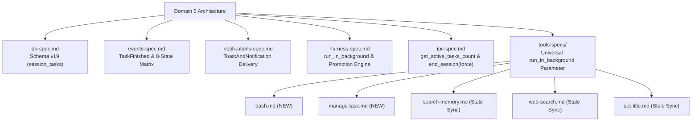

# Domain 5: Background Tasks, Timeout Promotion & Router Wake-Up
## Authoritative Architecture, Ground-Truth Trace & Hybrid Specification Contract

---

## 1. Executive Summary & System Objectives

In voice-driven agent runtimes, long-running operations (>5s) cause conversational dead air and break user engagement.
Domain 5 establishes the background task execution architecture for Vox Harness v2:
1. **`BackgroundTaskManager`**: Supervises asynchronous OS child processes detached from the ReAct loop inside the Tokio runtime.
2. **Harness-Owned Timeout Auto-Promotion**: Replaces monolithic hard timeouts with harness-governed execution boundaries. Models specify only an optional `run_in_background: boolean` parameter (default `true`). The harness automatically promotes any tool taking longer than 5 seconds (`HARNESS_AUTO_PROMOTE_TIMEOUT`) to background execution, returning `is_error: false` without triggering guardrail strikes.
3. **Foreground Override & Second-Layer Ceiling**: When the model explicitly sets `run_in_background: false`, the tool runs strictly in the foreground, bound by a 120-second hard ceiling (`HARNESS_FOREGROUND_HARD_TIMEOUT`) to prevent permanent hangs.
4. **OS Kernel Stream Redirection**: Streams standard output and standard error directly to disk via kernel file descriptors (`Stdio::from(file)`) with zero userspace memory buffering or pipe deadlock risks.
5. **Process Group Isolation**: Spawns processes in isolated process groups (`setpgid(0, 0)` on Unix, `CREATE_NEW_PROCESS_GROUP` on Windows) and guarantees full process tree teardown via `SIGKILL` to negative PGID (`-pid`).
6. **Router Wake-Up & The 8-State Handling Matrix**: Serializes background task completion events through `vox-router` across all 8 interaction states, evaluating active conversational presence (<5m) in `Ready` and buffering into `StepInbox` during `Listening`, `Thinking`, and `Working`.
7. **Sleep Standby Inhibition (`RULE-EVT-12`)**: Inhibits the 5-minute standby sleep transition in `spawn_idle_monitor` while background tasks remain active.
8. **Two-Step Disengage UX (`ConfirmModal`)**: Guards session termination with modal confirmation before terminating active child process groups.
9. **Built-in `bash` & `manage_task` Tools**: Minimal, robust execution primitives providing authentic agent capabilities and black-box verification.
10. **Turso DB Schema v19**: Relational persistence of task lifecycle and provenance in `session_tasks`.

---

## 2. Ground-Truth Trace: Mapping the Existing Flow

This trace reconstructs the exact runtime control flow for tool execution, timeout, sleep standby, and session teardown across the current codebase using the `/trace` protocol.

### 2.1 Trace Scoping
- **Entry Points**:
  1. Language model emits tool call batch via `StreamPassOutcome::ToolCallsReceived` in [app/src-tauri/src/services/harness/loop.rs:291](file:///home/addy/projects/apps/vox/app/src-tauri/src/services/harness/loop.rs#L291).
  2. Inactivity monitor timer expires in [app/src-tauri/src/pipeline/lifecycle.rs:49](file:///home/addy/projects/apps/vox/app/src-tauri/src/pipeline/lifecycle.rs#L49).
  3. User presses `Esc` or clicks disengage in [app/src/shared/context/VoiceSessionContext.tsx:291](file:///home/addy/projects/apps/vox/app/src/shared/context/VoiceSessionContext.tsx#L291).
- **Exit Points**:
  1. Synchronous tool completion committed to history in [app/src-tauri/src/services/harness/steps.rs:614](file:///home/addy/projects/apps/vox/app/src-tauri/src/services/harness/steps.rs#L614).
  2. Tool execution times out after 13 seconds in [app/src-tauri/src/services/harness/tools/executor.rs:305](file:///home/addy/projects/apps/vox/app/src-tauri/src/services/harness/tools/executor.rs#L305).
  3. Session offloads models to `Sleeping` in [app/src-tauri/src/pipeline/lifecycle.rs:60](file:///home/addy/projects/apps/vox/app/src-tauri/src/pipeline/lifecycle.rs#L60).
  4. Session teardown unmounts harness in [app/src-tauri/src/pipeline/assistant/session.rs:611](file:///home/addy/projects/apps/vox/app/src-tauri/src/pipeline/assistant/session.rs#L611).
- **Depth**: Traced across Frontend UI, Tauri IPC, Event Router, Harness Loop, Tool Executor, and Persistence layer.

---

### 2.2 Phased Walkthrough of Current Code

#### Phase 1 — Tool Invocation & Monolithic Timeout

1. **What:** The Harness coordinator intercepts tool calls emitted by the language model and delegates batch execution to the step sequencer.
   **Who:** `loop.rs` invokes `step6_execute_tool_batch`.
   **Trigger:** Streaming pass returns `StreamPassOutcome::ToolCallsReceived`.
   **Grounding:** Traced — [app/src-tauri/src/services/harness/loop.rs:291-312](file:///home/addy/projects/apps/vox/app/src-tauri/src/services/harness/loop.rs#L291-L312).
   **Owner:** Cognitive ReAct Loop (`services/harness/loop.rs`).

2. **What:** The step sequencer builds a `ToolExecutionContext` and invokes `ToolExecutor::execute_batch`.
   **Who:** `steps.rs` invokes `ToolExecutor`.
   **Trigger:** Entry into `step6_execute_tool_batch`.
   **Grounding:** Traced — [app/src-tauri/src/services/harness/steps.rs:587-620](file:///home/addy/projects/apps/vox/app/src-tauri/src/services/harness/steps.rs#L587-L620).
   **Owner:** Step Sequencer (`services/harness/steps.rs`).

3. **What:** The tool executor runs the tool future wrapped inside a monolithic 13-second `tokio::time::timeout`.
   **Who:** `executor.rs` inside `run_with_guards`.
   **Trigger:** Tool does not return `handles_own_timeout() == true`.
   **Grounding:** Traced — [app/src-tauri/src/services/harness/tools/executor.rs:298-311](file:///home/addy/projects/apps/vox/app/src-tauri/src/services/harness/tools/executor.rs#L298-L311) and [app/src-tauri/src/services/harness/mod.rs:38](file:///home/addy/projects/apps/vox/app/src-tauri/src/services/harness/mod.rs#L38).
   **Owner:** Tool Execution Engine (`services/harness/tools/executor.rs`).
   *Defect in current code:* If any command or retrieval takes longer than 13 seconds, `tokio::time::timeout` expires, returning `is_error: true`. This increments `guardrail_strike` on `session_steps` and causes the model to hallucinate or panic, even when the command was legitimately compiling or downloading.

---

#### Phase 2 — Inactivity & Unconditional Sleep Offload

4. **What:** The session inactivity monitor watches pipeline state transitions. When in `Paused`, it awaits `INACTIVITY_PAUSED_TIMEOUT` (5 minutes).
   **Who:** `spawn_idle_monitor` in `lifecycle.rs`.
   **Trigger:** Pipeline enters `InteractionState::Paused`.
   **Grounding:** Traced — [app/src-tauri/src/pipeline/lifecycle.rs:47-51](file:///home/addy/projects/apps/vox/app/src-tauri/src/pipeline/lifecycle.rs#L47-L51).
   **Owner:** Pipeline Lifecycle Supervisor (`pipeline/lifecycle.rs`).

5. **What:** When 5 minutes elapse in `Paused`, the monitor offloads LLM and TTS weights from RAM and transitions state to `Sleeping`.
   **Who:** `spawn_idle_monitor` invokes `cool_down_llm` and `cool_down_tts`, then sets state to `Sleeping`.
   **Trigger:** 5-minute timer completes without state change.
   **Grounding:** Traced — [app/src-tauri/src/pipeline/lifecycle.rs:52-76](file:///home/addy/projects/apps/vox/app/src-tauri/src/pipeline/lifecycle.rs#L52-L76).
   **Owner:** Pipeline Lifecycle Supervisor (`pipeline/lifecycle.rs`).
   *Defect in current code:* The monitor has zero visibility into active child processes. If a 10-minute compilation is running in the background, the monitor offloads model weights after 5 minutes, transitioning to `Sleeping` and preventing the assistant from announcing completion when the build finishes.

---

#### Phase 3 — Disengage & Orphan Process Leaks

6. **What:** The user presses the `Escape` key or clicks Disengage in the UI.
   **Who:** User initiates via DOM in `VoiceSessionContext.tsx`.
   **Trigger:** `disengage()` called in frontend context.
   **Grounding:** Traced — [app/src/shared/context/VoiceSessionContext.tsx:291-313](file:///home/addy/projects/apps/vox/app/src/shared/context/VoiceSessionContext.tsx#L291-L313).
   **Owner:** Frontend Voice Session Context (`shared/context/VoiceSessionContext.tsx`).

7. **What:** The frontend directly calls `disengageSession()`, which immediately issues the `end_session` IPC command.
   **Who:** `pipelineService.ts` invokes Tauri command `end_session`.
   **Trigger:** Disengage handler executed.
   **Grounding:** Traced — [app/src/services/pipelineService.ts:192-197](file:///home/addy/projects/apps/vox/app/src/services/pipelineService.ts#L192-L197).
   **Owner:** Frontend Pipeline Service Bridge (`services/pipelineService.ts`).
   *Defect in current code:* The frontend issues `end_session` with zero validation of active background work, immediately tearing down state even if background processes are actively executing.

8. **What:** The backend handles `end_session`, cancels active turn tokens, drops the session harness, and halts the audio engine.
   **Who:** `session.rs` inside `on_end`.
   **Trigger:** Router receives `VoxEvent::EndSession`.
   **Grounding:** Traced — [app/src-tauri/src/pipeline/assistant/session.rs:600-669](file:///home/addy/projects/apps/vox/app/src-tauri/src/pipeline/assistant/session.rs#L600-L669).
   **Owner:** Assistant Session Manager (`pipeline/assistant/session.rs`).
   *Defect in current code:* `on_end` unmounts the harness via `state.harness.lock().take()`, but contains zero logic to kill spawned child processes. Any background processes continue running as orphaned zombies in the background.

---

## 3. Blast Radius & Specification Impact Analysis

Domain 5 introduces cross-cutting modifications across data persistence, event routing, notifications, cognitive harness contracts, tool specifications, and user interface dialogs.



### 3.1 Sibling Specifications Impact Matrix

| Specification | Section / Clause | Required Modification | Rationale |
| :--- | :--- | :--- | :--- |
| **`docs/specs/db-spec.md`** | Database Schemas & Migrations | Add **Migration v19**: create `session_tasks` table, add foreign key cascade to `sessions(id)`, and indices `idx_session_tasks_session_id`, `idx_session_tasks_status`. Update schema version constant to 19. | Authoritative relational persistence of background task lifecycle, exit codes, and log paths. |
| **`docs/specs/events-spec.md`** | §4 Interaction State Machine & §5 Matrix | Add `VoxEvent::TaskFinished { task_id, session_id, status }`. Add the **Complete 8-State Handling Matrix** for task completions. Add **`RULE-EVT-12 (Sleep Standby Inhibition)`** and **`RULE-EVT-13 (Two-Step Disengage Protocol)`**. Add 2-second speech coalescing window. | Single-writer event router owns all task completion state transitions without race conditions. |
| **`docs/specs/notifications-spec.md`** | Alerting & Routing Matrix | Map background task completions to `DeliveryChannel::ToastAndNotification`. Define OS toast alert shape and Notification Drawer card payload (`category: "task"`, `group_key: "task:{task_id}"`). | Guarantees non-intrusive visual notification across all states, with or without audio synthesis. |
| **`docs/specs/harness-spec.md`** | §4.5 Agentic Tool Execution Chassis | Replace 13-second constant with **Harness-Owned Timeout Promotion Engine**. Add universal `run_in_background: boolean` parameter (default `true`). Add `HARNESS_AUTO_PROMOTE_TIMEOUT` (5s) and `HARNESS_FOREGROUND_HARD_TIMEOUT` (120s). Add `StepInbox` task completion ingestion. | Protects conversational fluency while preventing false guardrail strikes on slow operations. |
| **`docs/specs/ipc-spec.md`** | §4.5 Pipeline & Audio Domain | Add commands `get_active_tasks_count(sessionId?: number) -> number` and `list_tasks(sessionId?: number) -> Array<TaskRecord>`. Update `end_session` to accept `force?: boolean`. | Allows UI to check active tasks and issue confirmed force-teardown. |
| **`docs/specs/tools-specs/lld.md`** | §4 Universal Tool Interface | Update universal tool contract: add `run_in_background: boolean` (default `true`) to all tool definitions. Define harness promotion rules. | All tools share a clean, uniform interface without model-specified timing hacks. |
| **`docs/specs/tools-specs/bash.md`** | New Specification | Create comprehensive specification for the `bash` tool (parameters, schema, execution modes, log redirection). | SSOT for OS command execution. |
| **`docs/specs/tools-specs/manage-task.md`** | New Specification | Create comprehensive specification for `manage_task` (actions `list`, `status`, `kill`, `kill_all`). | SSOT for process supervision and monitoring. |
| **`docs/specs/tools-specs/search-memory.md`**, `web-search.md`, `set-title.md` | §2 Parameter Schema | Add optional `run_in_background` boolean parameter to bring stale tool specs into alignment with Harness v2. | Uniform schema parity across all registered tools. |

---

### 3.2 Codebase File Manifest

```
app/src-tauri/src/
├── core/
│   ├── events.rs                   # VoxEvent::TaskFinished, TaskStatus, TaskDto
│   └── state.rs                    # pub tasks: Arc<BackgroundTaskManager>
├── persistence/
│   └── schema.rs                   # Migration v19: session_tasks table & indices
├── pipeline/
│   ├── router.rs                   # Route VoxEvent::TaskFinished to assistant domain
│   ├── lifecycle.rs                # RULE-EVT-12: Inhibit sleep if tasks active
│   └── assistant/
│       ├── mod.rs                  # Dispatch VoxEvent::TaskFinished
│       ├── session.rs              # on_end: kill_all running tasks
│       └── tasks.rs (NEW)          # 8-state handling implementation & proactive turn
├── services/
│   ├── tasks/ (NEW)
│   │   ├── mod.rs                  # Module exports
│   │   └── manager.rs              # BackgroundTaskManager (OS process group, log files)
│   └── harness/
│       └── tools/
│           ├── mod.rs              # ToolDefinition updates for promotion
│           ├── executor.rs         # 5s auto-promotion & 120s foreground ceiling
│           ├── registry.rs         # Register bash and manage_task
│           ├── bash.rs (NEW)       # Minimal bash tool implementation
│           └── manage_task.rs (NEW)# Minimal manage_task tool implementation
├── utils/
│   └── paths.rs                    # task_log_path, session_tasks_dir
└── ipc/
    └── pipeline.rs                 # end_session(force), get_active_tasks_count, list_tasks

app/src/
├── services/
│   └── pipelineService.ts          # Updated disengageSession with active task query
├── shared/
│   ├── context/
│   │   └── VoiceSessionContext.tsx # Two-step disengage integration with ConfirmModal
│   └── ui/
│       └── ConfirmModal.tsx        # Reuse pre-existing single-surface modal component
└── store/
    └── sessionStore.ts             # Track activeTasksCount
```

---

## 4. The 5 Mandatory Pivot Gates

### 4.1 Gate 1: Lifecycle & Command Orthogonality Check
Three distinct operational lifecycles must remain decoupled:
1. **Foreground Turn ReAct Loop**: Owned by `Harness` coordinator (`loop.rs`). Identified by `turn_id`. Lifecycle ends when model speaks or awaits user.
2. **Background Task Lifecycle**: Owned by `BackgroundTaskManager`. Identified by `task_id`. Outlives individual turns; runs as long as the OS process executes.
3. **Session Lifecycle**: Owned by `AppState` / `session.rs`. Identified by `session_id`. Persists conversation context and models in RAM.

**Invariants**:
- Finishing or aborting a foreground turn (`stop_turn`) MUST NOT terminate background tasks.
- Background task promotion MUST return an observation with `is_error: false`. It MUST NOT trigger guardrail strikes or turn failures.
- Ending a session (`end_session`) terminates all background tasks associated with that session to prevent orphan process leaks.

### 4.2 Gate 2: State Space Bijection (Zero-State & Role Occupancy Audit)

#### Canonical `TaskStatus` Enum
A task transitions only across bijective states. It is born in `Running`:
```rust
#[derive(Debug, Clone, PartialEq, Eq, Serialize, Deserialize)]
#[serde(tag = "status", rename_all = "snake_case")]
pub enum TaskStatus {
    Running {
        pid: u32,
        started_at: u64,
    },
    Completed {
        exit_code: i32,
        duration_ms: u64,
        completed_at: u64,
    },
    Failed {
        error: String,
        duration_ms: u64,
        failed_at: u64,
    },
    Killed {
        killed_at: u64,
    },
}

impl TaskStatus {
    pub fn is_terminal(&self) -> bool {
        !matches!(self, TaskStatus::Running { .. })
    }

    pub fn as_str(&self) -> &'static str {
        match self {
            Self::Running { .. } => "running",
            Self::Completed { .. } => "completed",
            Self::Failed { .. } => "failed",
            Self::Killed { .. } => "killed",
        }
    }
}
```

#### Task DTO for UI & Remote Projections
```rust
#[derive(Debug, Clone, Serialize, Deserialize)]
#[serde(rename_all = "camelCase")]
pub struct TaskDto {
    pub taskId: String,
    pub sessionId: i64,
    pub command: String,
    pub status: String,
    pub exitCode: Option<i32>,
    pub error: Option<String>,
    pub logPath: String,
    pub startedAt: u64,
    pub completedAt: Option<u64>,
    pub durationMs: Option<u64>,
}
```

#### Single Projection Rule
The frontend NEVER queries SQLite or joins local arrays to determine if tasks are active. `BackgroundTaskManager::active_tasks_count(session_id)` provides the canonical count.

---

### 4.3 Gate 3: The 4-Boundary End-to-End Traces

```
[Boundary 1: UI -> Backend IPC]
[Boundary 2: Backend Internal -> Event Router / Harness]
[Boundary 3: Backend -> OS Kernel / Process Group]
[Boundary 4: Backend -> Turso MVCC Storage]
```

#### Trace 1: Fast Command Execution (`run_in_background: true`, completes in < 5s)
1. **Boundary 1**: User asks assistant to run `echo "hello"`.
2. **Boundary 2**: Model emits `bash(command="echo 'hello'")` with implicit `run_in_background: true`.
3. **Boundary 3**: `ToolExecutor` launches execution future; `bash` opens log file descriptor and spawns child process with `setpgid(0, 0)`.
4. **Boundary 3**: Child process exits in 15ms with code 0.
5. **Boundary 2**: `bash` reads stdout tail synchronously from log file.
6. **Boundary 2**: `ToolExecutor` receives synchronous result within the 5s window.
7. **Boundary 2**: Returns `ToolResult` with exit code and output inline. Turn proceeds to answer user.

#### Trace 2: Long Command Execution & Auto-Promotion (`run_in_background: true`, takes > 5s)
1. **Boundary 1**: User asks assistant to run `cargo test --release`.
2. **Boundary 2**: Model emits `bash(command="cargo test --release")` (implicit `run_in_background: true`).
3. **Boundary 3**: `bash` spawns child process in new process group. Kernel streams output directly to log file.
4. **Boundary 2**: Harness 5-second `HARNESS_AUTO_PROMOTE_TIMEOUT` timer expires while child process still executes.
5. **Boundary 4**: Task registered in `session_tasks` table as `running`.
6. **Boundary 2**: Child process handle transferred to `BackgroundTaskManager`. Background Tokio task spawned to await exit.
7. **Boundary 2**: `ToolExecutor` synthesizes immediate success observation:
   ```json
   {
     "status": "running_in_background",
     "task_id": "task_1001_a9f1",
     "command": "cargo test --release",
     "log_path": "/home/user/.vox/cache/tasks/1001/task_1001_a9f1.log",
     "message": "Process running in background. Use manage_task to monitor or kill."
   }
   ```
8. **Boundary 2**: ReAct loop treats observation as normal tool output (`is_error: false`, no guardrail strike).
9. **Boundary 1**: Model speaks: *"I started the tests in the background. I will notify you when finished."* State transitions `Working` $\to$ `Speaking` $\to$ `Ready`.

#### Trace 3: Foreground Override Execution (`run_in_background: false`)
1. **Boundary 1**: User asks assistant to run a migration and verify it immediately.
2. **Boundary 2**: Model emits `bash(command="cargo migrate", run_in_background=false)`.
3. **Boundary 2**: `ToolExecutor` detects `run_in_background == false`. It disables the 5-second auto-promotion timer and arms the 120-second `HARNESS_FOREGROUND_HARD_TIMEOUT`.
4. **Boundary 3**: Command executes in foreground for 12 seconds. Pipeline remains in `Working` state; interim activity envelope stays active.
5. **Boundary 3**: Command exits at 12s with exit code 0.
6. **Boundary 2**: Result returns synchronously in the active turn. ReAct loop proceeds to Step 2.

#### Trace 4: Background Task Finishes in `Ready` (Proactive Announcement)
1. **Boundary 3**: Child process exits with code 0.
2. **Boundary 2**: Tokio supervisor detects exit. Computes duration.
3. **Boundary 4**: Updates `session_tasks` table: `status = 'completed'`, `exit_code = 0`, `duration_ms = 42150`.
4. **Boundary 2**: Removes task from active memory registry.
5. **Boundary 2**: Emits `VoxEvent::TaskFinished { task_id, session_id, status }` to central event queue.
6. **Boundary 1**: Router emits `IpcEvent::NotificationCreated` (OS toast + drawer card).
7. **Boundary 2**: Router inspects `InteractionState`. State is `Ready`. Quiet debounce window (<5m) is valid.
8. **Boundary 2**: Router initiates proactive turn: transitions `Ready` $\to$ `Thinking`.
9. **Boundary 1**: Model streams spoken response: *"Your background cargo test has finished successfully with zero errors."* State transitions `Thinking` $\to$ `Speaking` $\to$ `Ready`.

#### Trace 5: Session Disengage with Active Tasks (Two-Step Protection)
1. **Boundary 1**: User clicks Disengage or presses `Esc` while assistant is `Ready`.
2. **Boundary 1**: Frontend checks `active_tasks_count`. Count is 2 (>0).
3. **Boundary 1**: Frontend opens `ConfirmModal` (*"Disengage Session? You have 2 background process(es) running. Disengaging will terminate them."*).
4. **Boundary 1**: User clicks *"Terminate & Disengage"*.
5. **Boundary 1**: Frontend invokes `end_session(force=true)`.
6. **Boundary 2**: Router receives `VoxEvent::EndSession`.
7. **Boundary 2**: Router calls `BackgroundTaskManager::kill_all(session_id)`.
8. **Boundary 3**: Manager sends `libc::kill(-pgid, SIGKILL)` to all active process groups.
9. **Boundary 4**: Manager marks records as `killed` in `session_tasks`.
10. **Boundary 2**: Router unmounts harness, cools down models, transitions to `Idle`.

---

### 4.4 Gate 4: Asymmetry & Worst-Case Failure Matrix

| Failure Mode | Root Cause | Architectural Defense |
| :--- | :--- | :--- |
| **Grandchild Process Leak** | `bash` spawns subshells or child binaries (`cargo` -> `rustc` -> `linker`). Killing parent PID leaves children orphaned. | **Process Group Isolation**: Spawns child with `setpgid(0, 0)`. Termination sends `libc::SIGKILL` to negative PGID (`-pid`), nuking the entire tree. |
| **Pipe Buffer Deadlock** | Child process fills 64KB OS stdout pipe buffer because userspace is not actively reading. Process freezes. | **Kernel Stream Redirection**: Process stdout/stderr write directly to disk file descriptors via `Stdio::from(file)`. Zero pipe buffers in userspace. |
| **Simultaneous Task Exits** | Multiple background tasks exit within milliseconds of each other. | **Single-Writer MPSC Queue**: All completions funnel through `vox-router` channel. Router handles one exit at a time with a 2-second speech coalescing window. |
| **Barge-in on Proactive Speech** | User begins speaking (`SpeechStart`) just as assistant announces task completion. | **Standard Barge-in Protocol (`RULE-EVT-08`)**: Assistant audio mutes immediately (<30ms). Turn token cancels. State transitions cleanly to `Listening`. |
| **Sustained Idle Sleep Drift** | System attempts to offload models from RAM while a background task compiles code. | **Sleep Invalidation (`RULE-EVT-12`)**: `spawn_idle_monitor` checks `BackgroundTaskManager::has_running_tasks()`. Transition to `Sleeping` is inhibited. |
| **Log Disk Exhaustion** | Runaway command writes gigabytes of infinite loop output to log file. | **100MB File Ceiling & Startup LRU Sweep (`RULE-HARN-15`)**: Task log writes snap to session cache ceiling. Wiped on session deletion. |

---

### 4.5 Gate 5: Spec-Wide Referential Integrity Sweep
- No legacy 13-second constants in harness loop.
- No direct database queries from React components.
- State machine aligns with `events-spec.md` 8-state model.
- Tool schemas conform to `harness-spec.md §4.5`.
- Database schema matches `db-spec.md` conventions.

---

## 5. Part I: Universal Parameter Contract & Timeout Promotion Engine

### 5.1 The Universal `run_in_background` Parameter
Every tool schema exposed to the language model includes an optional boolean parameter:
```json
"run_in_background": {
  "type": "boolean",
  "description": "Whether this tool can run in the background if execution takes time. Defaults to true. Set to false only when you strictly require the output before proceeding in this turn.",
  "default": true
}
```

**Governing Law**:
- The model NEVER specifies timeouts or durations in milliseconds.
- Timing thresholds are owned exclusively by the Harness runtime.

### 5.2 Harness Timing Constants
```rust
/// Time to await tool completion synchronously before auto-promoting to background.
pub const HARNESS_AUTO_PROMOTE_TIMEOUT: Duration = Duration::from_secs(5);

/// Hard safety ceiling for foreground execution when run_in_background is false.
pub const HARNESS_FOREGROUND_HARD_TIMEOUT: Duration = Duration::from_secs(120);
```

### 5.3 Promotion Execution Logic (`ToolExecutor`)
```rust
let run_in_background = call.arguments
    .get("run_in_background")
    .and_then(|v| v.as_bool())
    .unwrap_or(true);

if run_in_background && tool.supports_background_promotion() {
    tokio::select! {
        _ = ctx.cancel.cancelled() => {
            (ToolResult::new("Tool execution cancelled"), true)
        }
        res = tool.execute(mode, call.arguments.clone(), ctx) => {
            match res {
                Ok(result) => (result, false),
                Err(err) => (ToolResult::new(err.to_string()), true),
            }
        }
        _ = tokio::time::sleep(HARNESS_AUTO_PROMOTE_TIMEOUT) => {
            log::info!("[ToolExecutor] Tool {} exceeded 5s; auto-promoting to background", call.name);
            let promo_result = tool.promote_to_background(call.arguments.clone(), ctx).await;
            (promo_result, false) // is_error: false prevents guardrail strike!
        }
    }
} else {
    // Strictly foreground execution up to 120s safety ceiling
    tokio::select! {
        _ = ctx.cancel.cancelled() => {
            (ToolResult::new("Tool execution cancelled"), true)
        }
        res = tool.execute(mode, call.arguments.clone(), ctx) => {
            match res {
                Ok(result) => (result, false),
                Err(err) => (ToolResult::new(err.to_string()), true),
            }
        }
        _ = tokio::time::sleep(HARNESS_FOREGROUND_HARD_TIMEOUT) => {
            log::warn!("[ToolExecutor] Tool {} exceeded 120s foreground limit; forcing background promotion", call.name);
            let promo_result = tool.promote_to_background(call.arguments.clone(), ctx).await;
            (promo_result, false)
        }
    }
}
```

---

## 6. Part II: `BackgroundTaskManager` Architecture

### 6.1 System Placement & Threading Model
Per `architectural-invariants.md §3.3`, background process supervision is asynchronous I/O.
`BackgroundTaskManager` lives inside the **Tokio async runtime** within `AppState`:
```rust
pub struct BackgroundTaskManager {
    active_tasks: Arc<parking_lot::RwLock<HashMap<String, ActiveTaskRecord>>>,
    db: Arc<VoxDb>,
    event_tx: parking_lot::Mutex<Option<std::sync::mpsc::Sender<VoxEvent>>>,
}
```

```rust
pub struct ActiveTaskRecord {
    pub task_id: String,
    pub session_id: i64,
    pub tool_call_id: Option<String>,
    pub command: String,
    pub pid: u32,
    pub log_path: PathBuf,
    pub started_at: u64,
    pub cancel_token: tokio_util::sync::CancellationToken,
}
```

### 6.2 OS Kernel Log Redirection & Process Trees
Standard Unix file redirection avoids userspace byte-copying and buffer allocation:
```rust
let log_file = std::fs::OpenOptions::new()
    .create(true)
    .append(true)
    .open(&log_path)?;
let log_file_err = log_file.try_clone()?;

let mut cmd = tokio::process::Command::new("bash");
cmd.args(["-c", &command])
   .stdout(std::process::Stdio::from(log_file))
   .stderr(std::process::Stdio::from(log_file_err));

#[cfg(unix)]
unsafe {
    cmd.pre_exec(|| {
        libc::setpgid(0, 0);
        Ok(())
    });
}
#[cfg(windows)]
{
    const CREATE_NEW_PROCESS_GROUP: u32 = 0x00000200;
    cmd.creation_flags(CREATE_NEW_PROCESS_GROUP);
}

let mut child = cmd.spawn()?;
let pid = child.id().unwrap_or(0);
```

### 6.3 Process Tree Teardown (`kill_process_group`)
```rust
#[cfg(unix)]
pub fn kill_process_group(pid: u32) {
    unsafe {
        libc::kill(-(pid as i32), libc::SIGKILL);
    }
}

#[cfg(windows)]
pub fn kill_process_group(pid: u32) {
    let _ = std::process::Command::new("taskkill")
        .args(["/PID", &pid.to_string(), "/T", "/F"])
        .output();
}
```

---

## 7. Part III: Minimal `bash` & `manage_task` Tools

### 7.1 Minimal `bash` Tool
- **Canonical Identifier**: `"bash"`
- **Domain**: `ToolDomain::Modular`
- **Concurrency Mode**: `ToolExecutionMode::Exclusive` (system mutation barrier)
- **Supports Background Promotion**: `true`
- **Truncation Policy**: `TruncationPolicy::TailHeavy { tail_ratio: 0.8 }`
- **Parameters Schema**:
  ```json
  {
    "type": "object",
    "properties": {
      "command": {
        "type": "string",
        "description": "The exact shell command line string to execute."
      },
      "run_in_background": {
        "type": "boolean",
        "description": "Whether this command can run in the background if it takes longer than 5 seconds. Defaults to true. Set to false only when you strictly require the output before proceeding in this turn.",
        "default": true
      }
    },
    "required": ["command"]
  }
  ```

### 7.2 `manage_task` Tool
- **Canonical Identifier**: `"manage_task"`
- **Domain**: `ToolDomain::Modular`
- **Concurrency Mode**:
  - `ToolExecutionMode::Parallel` for read-only actions (`list`, `status`).
  - `ToolExecutionMode::Exclusive` for mutating actions (`kill`, `kill_all`).
- **Truncation Policy**:
  - `TruncationPolicy::TailHeavy { tail_ratio: 0.8 }` for `status`.
  - `TruncationPolicy::None` for `list`, `kill`, `kill_all`.
- **Parameters Schema**:
  ```json
  {
    "type": "object",
    "properties": {
      "action": {
        "type": "string",
        "enum": ["list", "status", "kill", "kill_all"],
        "description": "Action to perform on background tasks."
      },
      "task_id": {
        "type": "string",
        "description": "Unique task identifier (required for 'status' and 'kill')."
      }
    },
    "required": ["action"]
  }
  ```

---

## 8. Part IV: Turso DB Schema (Migration v19)

### 8.1 DDL Migration
```sql
CREATE TABLE IF NOT EXISTS session_tasks (
    task_id TEXT PRIMARY KEY,
    session_id INTEGER NOT NULL REFERENCES sessions(id) ON DELETE CASCADE,
    tool_call_id TEXT,
    command TEXT NOT NULL,
    status TEXT NOT NULL CHECK (status IN ('running', 'completed', 'failed', 'killed')),
    exit_code INTEGER,
    error TEXT,
    log_path TEXT NOT NULL,
    started_at INTEGER NOT NULL,
    completed_at INTEGER,
    duration_ms INTEGER,
    created_at INTEGER NOT NULL,
    updated_at INTEGER NOT NULL
);

CREATE INDEX IF NOT EXISTS idx_session_tasks_session_id ON session_tasks(session_id);
CREATE INDEX IF NOT EXISTS idx_session_tasks_status ON session_tasks(session_id, status);
```

### 8.2 Schema Constants & Persistence Integration
- Update `pub const SCHEMA_VERSION: u32 = 19;` in `persistence/schema.rs`.
- Add table creation statement to `SCHEMA_TABLE_STATEMENTS`.
- Add conditional migration in `migrate_schema` for `current_version < 19`.
- Direct async updates from Tokio supervisor to ensure zero race conditions on fast task completions.

---

## 9. Part V: Event Router & The Complete 8-State Matrix

### 9.1 `VoxEvent::TaskFinished`
```rust
pub enum VoxEvent {
    // ...
    TaskFinished {
        task_id: String,
        session_id: i64,
        status: TaskStatus,
    },
}
```

### 9.2 The 8-State Handling Matrix
All events pass through the single-writer `vox-router` channel.

| State | Router Action on `TaskFinished` | Audio / Voice Action | Alerts (`ToastAndNotification`) |
| :--- | :--- | :--- | :--- |
| **`Idle`** | Updates Turso DB record. | Zero audio. Assistant remains `Idle`. | Emits OS toast and Notification Drawer card. |
| **`Ready`** | Evaluates 5m quiet debounce window. | If user active (<5m): transitions `Ready` $\to$ `Thinking` $\to$ `Speaking` to speak status. If quiet (>5m): audio suppressed. | Emits OS toast and Notification Drawer card. |
| **`Listening`** | Injects event into `StepInbox` as `Immediate`. | Zero audio interruption. Does not interrupt user speech. | Emits OS toast and Notification Drawer card. |
| **`Thinking`** | Injects event into `StepInbox` as `Immediate`. | Zero audio interruption. Does not abort in-flight model stream. | Emits OS toast and Notification Drawer card. |
| **`Working`** | Injects event into `StepInbox` as `Immediate`. | Active tools continue running. Injected into context at step boundary. | Emits OS toast and Notification Drawer card. |
| **`Speaking`** | Holds event in router queue or coalesces. | Zero audio interruption. Never interrupts assistant voice. Evaluated when playback completes. | Emits OS toast and Notification Drawer card. |
| **`Paused`** | Updates Turso DB record. | Zero audio. Never speaks while session is paused by user. | Emits OS toast and Notification Drawer card. |
| **`Sleeping`** | State invalid under `RULE-EVT-12`. Fallback: updates DB. | Zero audio. | Emits OS toast and Notification Drawer card. |

### 9.3 Sleep Invalidation Rule (`RULE-EVT-12`)
- **RULE-EVT-12 (Sleep Standby Inhibition)**: While `BackgroundTaskManager::has_running_tasks(session_id)` is `true`, transition from `Paused` to `Sleeping` is strictly inhibited. The pipeline MUST NOT offload language model or speech synthesis weights from RAM while background processes are running.

### 9.4 Two-Second Speech Coalescing Window in `Ready`
When multiple background tasks finish simultaneously (e.g. parallel batch jobs), the router coalesces completions arriving within 2000ms into a single spoken announcement rather than spawning competing turn loops.

---

## 10. Part VI: Two-Step Disengage UX (`ConfirmModal`)

### 10.1 User Interaction Flow
1. User presses `Esc` or clicks the Disengage button in `Ready` state.
2. Frontend queries `active_tasks_count` (tracked in store or via `get_active_tasks_count`).
3. If `active_tasks_count == 0`:
   - Frontend invokes `end_session()`.
   - Pipeline transitions immediately to `Idle`.
4. If `active_tasks_count > 0`:
   - Frontend renders `ConfirmModal`:
     - **Title**: *"Disengage Session?"*
     - **Description**: *"You have {N} background process(es) running. Disengaging will terminate them."*
     - **Confirm Label**: *"Terminate & Disengage"* (destructive styling)
     - **Cancel Label**: *"Keep Running"*
5. User clicks *"Terminate & Disengage"*:
   - Frontend invokes `end_session(force=true)`.
   - Backend calls `BackgroundTaskManager::kill_all(session_id)` sending `SIGKILL` to all process groups.
   - Pipeline unmounts harness and transitions to `Idle`.
6. User clicks *"Keep Running"*:
   - Modal closes. Session remains in `Ready`. Tasks continue executing.

---

## 11. Verification & Seam Test Matrix (Pattern A / TDD)

The Test Engineer validates Domain 5 using 10 black-box seam tests in `tests/harness_loop_test.rs`:

| Test ID | Seam Test Function Name | Tested Assertion | Expected Output |
| :--- | :--- | :--- | :--- |
| **TEST-D5-01** | `bash_tool_executes_fast_command_synchronously_without_backgrounding` | Command `< 5s` completes inside synchronous window. | Exit code 0, stdout returned inline, task not registered in background. |
| **TEST-D5-02** | `bash_tool_auto_promotes_long_running_command_to_background` | Command `> 5s` with default `run_in_background: true` auto-promotes to background. | `status: "running_in_background"`, valid `task_id`, `is_error: false`. |
| **TEST-D5-03** | `bash_tool_foreground_override_waits_for_completion_up_to_hard_ceiling` | Command `> 5s` with `run_in_background: false` remains in foreground until exit. | Returns synchronous result without background promotion. |
| **TEST-D5-04** | `background_task_streams_output_directly_to_disk_log` | Child writes stdout to kernel file descriptor. | Log file contains real-time stdout lines; zero userspace heap leaks. |
| **TEST-D5-05** | `manage_task_status_reads_log_tail_from_disk` | `manage_task(action="status")` reads backward seek from log file. | Returns last 50 lines of log file and current status. |
| **TEST-D5-06** | `manage_task_kill_terminates_entire_process_group` | Child spawns grandchild; `kill` terminates entire process tree. | Negative PGID receives `SIGKILL`; both parent and grandchild terminate; status `Killed`. |
| **TEST-D5-07** | `task_finished_in_ready_triggers_proactive_spoken_announcement` | Task completes while pipeline is `Ready` within active window. | Pipeline transitions `Ready` $\to$ `Thinking` $\to$ `Speaking`; model speaks completion. |
| **TEST-D5-08** | `task_finished_in_working_buffers_in_step_inbox_and_injects_at_step_boundary` | Task completes while tools run in `Working`. | Active tools complete; completion injected into context for Step $K+1$. |
| **TEST-D5-09** | `running_background_task_inhibits_sleep_state_transition` | Session paused with active background task for >5 minutes. | `RULE-EVT-12` prevents `Sleeping`; models remain warm in RAM. |
| **TEST-D5-10** | `disengage_with_running_tasks_requires_confirmation_and_kills_process_group` | Session disengage triggered while tasks run. | Rejects unconfirmed disengage; on confirm kills all process groups and reaches `Idle`. |

---

## 12. Human Sign-Off Gate

🛑 **ATTENTION DOMAIN 5 LEAD**:
This enriched Hybrid Specification & Architectural Trace document incorporates:
1. The exact `/trace` phased execution walkthrough grounded in code citations.
2. Complete blast radius mapping across sibling specifications (`db-spec.md`, `events-spec.md`, `notifications-spec.md`, `harness-spec.md`, `ipc-spec.md`, and all `tools-specs/`).
3. Harness-owned timeout promotion: replacing model-specified durations with a universal boolean `run_in_background` parameter (default `true`), a 5-second auto-promotion constant (`HARNESS_AUTO_PROMOTE_TIMEOUT`), and a 120-second foreground hard ceiling (`HARNESS_FOREGROUND_HARD_TIMEOUT`).
4. Two-step disengage protection with [ConfirmModal](file:///home/addy/projects/apps/vox/app/src/shared/ui/ConfirmModal.tsx) and process group cleanup.

Per the `/architect` protocol, System Architect work halts here.
**Awaiting your formal review and sign-off before proceeding to `/create-plan`.**
