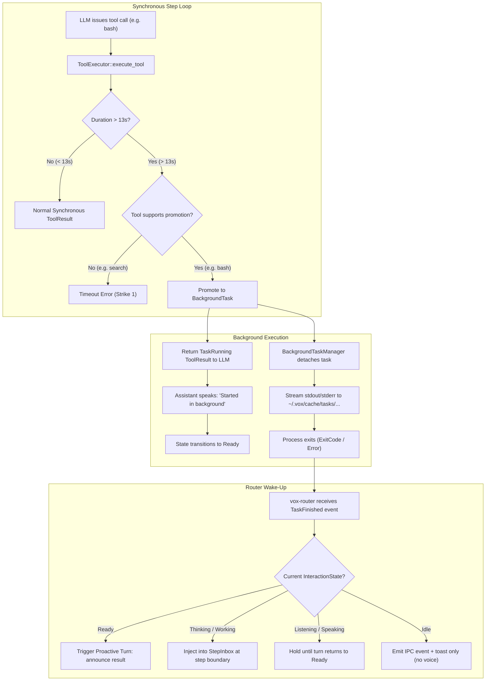

# Domain 5: Background Tasks, Timeout Promotion & Router Wake-Up

---

## 1. Executive Summary

In voice-driven agent runtimes, long-running operations (>13s) create unacceptable dead air.
Freezing the ReAct loop while waiting for builds, downloads, or scripts breaks conversational fluency.
Domain 5 introduces three decoupled capabilities:
1. **`BackgroundTaskManager`**: Tracks running processes, PIDs, log streams, and cancellation across sessions.
2. **13-Second Timeout Promotion**: Auto-promotes long-running commands to background tasks instead of hard timeouts.
3. **Event Router Proactive Wake-Up**: Wakes the assistant on `Ready` to announce task completion naturally.

---

## 2. The Three Architectural Pillars



---

## 3. Pillar 1: `BackgroundTaskManager` Chassis

### 3.1 Task Lifecycle & State Enum
```rust
#[derive(Debug, Clone, Serialize, Deserialize)]
pub enum TaskStatus {
    Running {
        pid: Option<u32>,
        started_at: u64,
    },
    Completed {
        exit_code: i32,
        duration_ms: u64,
        completed_at: u64,
    },
    Failed {
        error: String,
        duration_ms: u64,
        failed_at: u64,
    },
    Killed {
        killed_at: u64,
    },
}

pub struct BackgroundTask {
    pub task_id: String,
    pub session_id: i64,
    pub command: String,
    pub log_path: PathBuf,
    pub status: TaskStatus,
    pub cancel: CancellationToken,
}
```

### 3.2 Storage Layout & Invariant
- Task logs reside under `~/.vox/cache/tasks/<session_id>/<task_id>.log`.
- Log files persist for the session duration; purged on session deletion.
- In-memory ring buffer keeps the last 100 lines for instant status inspection.

---

## 4. Pillar 2: 13-Second Timeout Promotion

### 4.1 Auto-Promotion Contract
1. When a promotable tool executes, `ToolExecutor` races between completion and `TOOL_EXECUTION_TIMEOUT` (13 seconds).
2. If 13 seconds elapse before completion:
   - The process future is transferred to `BackgroundTaskManager`.
   - The tool returns a successful (non-error) observation:
     ```json
     {
       "status": "running_in_background",
       "task_id": "task_1001_abc",
       "command": "cargo test --release",
       "log_file": "~/.vox/cache/tasks/1001/task_1001_abc.log",
       "message": "Command running in background. Use manage_task to inspect or kill."
     }
     ```
   - **Crucial Invariant**: This observation is **NOT an error** (`is_error: false`). It does NOT trigger a Doom-Loop strike.
   - The LLM summarizes naturally and the voice turn completes cleanly to `Ready`.

---

## 5. Pillar 3: Event Router Wake-Up (`Ready` Proactive Voice)

### 5.1 The Wake-Up Matrix
| Current State | Router Action | Voice Behavior |
| :--- | :--- | :--- |
| **`Ready`** | Dispatches proactive `execute_turn` | Assistant speaks task completion summary. |
| **`Working` / `Thinking`** | Buffers event into `StepInbox` | Injected into model context at next step boundary. |
| **`Speaking` / `Listening`** | Holds notification in queue | Evaluates when turn returns to `Ready`. |
| **`Idle` (Disengaged)** | Emits IPC event & system toast | Silent; no voice synthesized while disengaged. |

---

## 6. Open Architectural Decisions for User Alignment

1. **Turso DB Persistence**:
   - Option A: Ephemeral in-memory tracking only (dies on app restart).
   - Option B: Add `session_tasks` table to Turso DB (Schema v19) for full provenance and audit history.
2. **Proactive Voice Policy on `Ready`**:
   - Should Vox *always* speak when a background task finishes on `Ready`?
   - Or should it respect an idle quiet timeout (e.g. if user is silent >5 minutes, emit chime/toast without spoken audio)?
3. **Disengage Behavior**:
   - When user clicks Disengage (`Ready` $\to$ `Idle`), should running background tasks be killed immediately (`kill_all`), or keep running as headless daemons?
