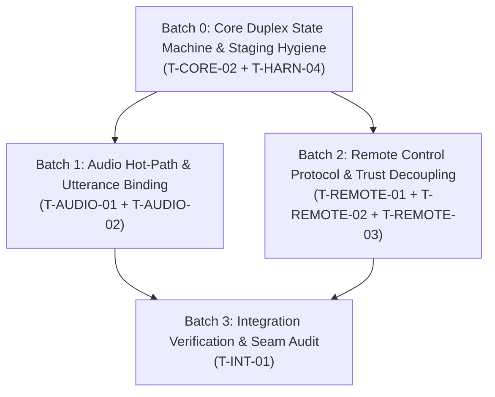

# Phase 14 Master Implementation Plan: Pipeline Atomics, Duplex State Machine & Upstream Refactor

**Status:** READY FOR LEAD VALIDATION & TICKET EXECUTION  
**Author:** Principal System Architect  
**Scope:** Core Pipeline, Interaction State Machine, Cognitive Harness, Audio Hot-Path, Remote Session Protocol  
**Authoritative Specs:** `docs/specs/events-spec.md`, `docs/specs/harness-spec.md`, `docs/specs/remote-control-spec.md`  
**Invariants Enforced:** Zero Backward Compatibility (ZBC), Spec-First SSOT, Zero Shadow Booleans, Sacred Audio Hot-Path, Single-Writer Event Router, Bijective State Space  

---

## 1. Executive Summary & Target End-State

The Vox runtime previously carried systemic technical debt where downstream components babysat upstream race conditions and overloaded primitives. Tickets 1–4 laid the groundwork by separating `turn_id` from `utterance_id` and introducing staged user queries, but left 6 concrete defects in the working tree (off-thread transitions, premature `Ready` drops, broken hardware cancellation, TOCTOU query staging races, and stale sink occupancy).

This master plan resolves all 6 defects and formalizes the **Duplex State Machine** (`(Thinking | Working) <==> Speaking`), eliminating `AudioIntent` from state gating and establishing a deterministic single-writer quiescence lifecycle.

### Target End-State Plainly Stated

1. **Deterministic Duplex Interaction State Machine (`events-spec.md §3, §4.3`)**:
   - `InteractionState` retains its canonical 8 variants (`Idle`, `Ready`, `Listening`, `Thinking`, `Working`, `Speaking`, `Paused`, `Sleeping`, `Error`). Zero new synthetic state variants (`Finalizing` or `Briefing`).
   - `PlaybackStarted` transitions `Thinking` or `Working` $\to$ `Speaking`, preserving `current_activity` intact.
   - `PlaybackFinished` evaluates the **Duplex Quiescence Law**:
     - If `llm_done == true`: transitions `Speaking` $\to$ `Ready`.
     - If `llm_done == false` AND `current_activity.is_some()`: transitions `Speaking` $\to$ `Working` (restoring active tool envelope).
     - If `llm_done == false` AND `current_activity.is_none()`: transitions `Speaking` $\to$ `Thinking`.
   - `LlmFinished` marks `llm_done = true` for the active turn epoch. If audio is already completely drained (`pending_tts_jobs == 0 && !sink_occupied`), it transitions immediately to `Ready`.
   - `AudioIntent` is permanently removed from the playback completion contract.

2. **Cognitive Staging & Transition Hygiene (`harness-spec.md §4.1, §4.4, §4.5`)**:
   - User queries are staged in `pending_user_query: Option<(u32, String)>` on the Harness during Step 0 and committed to history only upon assistant speech or tool artifact emission.
   - Redundant shadow enum `TurnPhase` is completely deleted. `pending_user_query.is_some()` is the sole check for Step 0 uncommitted state. Positional history rollback (`rollback_last_user_turn`) is permanently eliminated.
   - Off-thread state transitions in `steps.rs` are replaced by `transition_harness_phase` enforcing an **Epoch & Cancel Guard** (never overwrites `Listening`) and a **Duplex Audio Priority Guard** (leaves `Speaking` intact while preamble audio plays).

3. **Hardware Cancellation Authority (`engine.rs`, `pipeline/atomics.rs`)**:
   - Disconnected anonymous `cancel_flag` instances in `engine.rs:184, 417, 586` are replaced by a shared `hardware_cancel_flag: Arc<AtomicBool>` owned by `PipelineAtomics`.
   - `cancel_active_turn()` atomically cancels `turn_cancel_token` and sets `hardware_cancel_flag = true`.
   - `rearm_turn_cancel_token()` resets `hardware_cancel_flag = false`. C++ loops in STT, TTS, and Playback cancel deterministically on barge-in.

4. **Audio Hot-Path & Inference (`vad/`, `stt/`, `sink.rs`)**:
   - Router allocates monotonic `utterance_id` on `SpeechStart`. VAD and STT bind physical chunks to `utterance_id` via `VadCommand::BindUtterance`. All `wrapping_add(1)` prediction hacks in VAD/STT are deleted.
   - Scenario C non-destructive speech hold preserves `turn_id` while issuing a fresh `utterance_id`.
   - Mutexes, allocations, and string logging are removed from the real-time CPAL output callback. `sink_occupied` is published lock-free.

5. **Remote Control Protocol & Trust Decoupling (`services/remote/`)**:
   - Controller admission uses an atomic `ControllerLease` to eliminate TOCTOU connection races.
   - `AttachSnapshot` carries canonical `StateChangedPayload` from the router's last state cache.
   - Tier 1 trust (`paired_devices` DB) is decoupled from Tier 2 transport rejections (`UnknownPeer` never erases pairing rows).

---

## 2. Grill-Me Resolution Ledger (All Open Decisions Settled)

Every design branch and question raised during architectural exploration is settled below. No open assumptions remain:

| Question / Fork | Alternatives Considered | Settled Decision | Rationale |
| :--- | :--- | :--- | :--- |
| **Quiescence Authority** | A. Re-add `turn_open: AtomicBool`<br/>B. Re-introduce `llm_finished_this_turn` atomic across files<br/>C. Router-owned `llm_done` flag + Duplex state machine | **Option C: Router-owned `llm_done` flag in Duplex state machine** | `llm_done` is written exclusively on the `vox-router` OS thread upon receiving `VoxEvent::LlmFinished`. Zero shadow booleans across worker threads. |
| **State Machine Topology** | A. Add `Finalizing` state to `InteractionState`<br/>B. Add `Briefing` state to `InteractionState`<br/>C. Duplex `(Thinking \| Working) <==> Speaking` | **Option C: Duplex Model** | Keeps `InteractionState` at canonical 8 states. Reflects physical speaker audio truthfully. Eliminates silent `Speaking` state when LLM pauses between sentences. Zero frontend CSS churn. |
| **Audio Intent Redundancy** | A. Keep `AudioIntent` discriminator in `PlaybackFinished`<br/>B. Drop `AudioIntent` from playback completion gating | **Option B: Eliminate `AudioIntent` from state gating** | If audio drains and `llm_done == false`, router drops to `Working` (if tool active) or `Thinking`. Intent tagging is unnecessary when the state machine itself tracks active activity. |
| **`chassis.rs` TurnPhase** | A. Keep `TurnPhase { Idle, Thinking, Committed }`<br/>B. Delete `TurnPhase` | **Option B: Delete `TurnPhase`** | `pending_user_query.is_some()` already encodes whether Step 0 is uncommitted. `TurnPhase` is 100% duplicate shadow state. |
| **Off-Thread Transitions** | A. Add `VoxEvent::TurnWorking`<br/>B. Direct `transition()` calls on Tokio<br/>C. Guarded `transition_harness_phase` helper | **Option C: Guarded `transition_harness_phase` helper** | Avoids channel allocation overhead while enforcing Epoch & Cancel guard (stops overwriting `Listening`) and Duplex Audio Priority guard (preserves active preamble speech). |
| **Worker Cancellation** | A. Keep anonymous `AtomicBool::new(false)` in `engine.rs`<br/>B. Wire `turn_cancel_token` into C++ threads<br/>C. Shared `hardware_cancel_flag` in `PipelineAtomics` | **Option C: Shared `hardware_cancel_flag`** | C++ inference loops (Whisper/ONNX/CPAL) need lock-free atomic reads without mutex contention. Flipped in lockstep with `turn_cancel_token`. |
| **TOCTOU Query Staging** | A. Stage on Tokio task in `step1_intake`<br/>B. Stage synchronously on `vox-router` thread | **Option B: Stage synchronously on `vox-router`** | Calling `harness.stage_user_query()` on the router thread in `transcript.rs` and `text.rs` guarantees the query is staged before any barge-in `take_staged_query` can execute. |

---

## 3. Blast-Radius & Dependency Clustering

Work is sequenced into **4 strictly ordered batches** based on real structural and verification dependencies:



### Why this boundary exists:
- **Batch 0** MUST land first. It fixes the broken cancellation flag in `engine.rs`, eliminates premature `Ready` drops in `playback.rs`, implements Duplex transitions in `router.rs`, and deletes `TurnPhase`. Without Batch 0, neither audio tests nor remote session tests can pass reliably.
- **Batch 1 (Audio)** and **Batch 2 (Remote)** are structurally independent of each other and depend solely on Batch 0. They can be implemented in parallel or sequentially.
- **Batch 3 (Verification)** verifies full cross-target compilation and runs the entire integration test suite.

---

## 4. Detailed Batch Specifications

### Batch 0: Core Duplex State Machine, Hardware Cancellation & Staging Hygiene

**Tickets:** `T-CORE-02`, `T-HARN-04`  
**Dependencies:** None (builds directly on checkpoint commit).  
**Build Health:** In-progress builds may be red until all call sites in `router.rs`, `playback.rs`, and `steps.rs` are aligned. Once Batch 0 completes, `cargo check --lib --release` must pass 100% green.  
**Completion Gate:** `cargo test --test playback_test --test transcript_ingestion_test --release -- --test-threads=1` passes 100% green.

#### Components & Changes:

1. **`pipeline/atomics.rs`**:
   - Add `pub hardware_cancel_flag: Arc<AtomicBool>` to `PipelineAtomics`.
   - Add `pub llm_done: Arc<AtomicBool>` to `PipelineAtomics`.
   - Add `pub stream_cancel_token: Arc<parking_lot::Mutex<tokio_util::sync::CancellationToken>>` to `PipelineAtomics`.
   - In `cancel_active_turn()`: cancel `turn_cancel_token` AND store `hardware_cancel_flag.store(true, Ordering::SeqCst)`.
   - In `rearm_turn_cancel_token()`: store `hardware_cancel_flag.store(false, Ordering::SeqCst)`.
   - Add `pub fn stream_cancel_token(&self) -> tokio_util::sync::CancellationToken` and `pub fn cancel_active_stream(&self)`.
   - Add `pub fn rearm_stream_cancel_token(&self) -> tokio_util::sync::CancellationToken`.
   - In `next_turn()`: reset `llm_done.store(false, Ordering::SeqCst)`, rearm `turn_cancel_token`, and rearm `stream_cancel_token`.
   - Add `pub fn is_llm_done(&self) -> bool` and `pub fn set_llm_done(&self, done: bool)`.
   - **Call Site Sweep**: Replace all direct `state.pipeline.turn_cancel_token().cancel()` calls in `error.rs` (lines 52, 62), `interrupt.rs` (lines 81, 132), `ptt.rs` (line 232), and `session.rs` (lines 411, 573, 598) with `state.pipeline.cancel_active_turn()`.

2. **`core/engine.rs`**:
   - In `create_playback_engine`, `init_audio_stream`, and `spawn_stt_worker`:
   - Replace disconnected `Arc::new(AtomicBool::new(false))` with `Arc::clone(&state.pipeline.hardware_cancel_flag)`.

3. **`pipeline/router.rs`**:
   - In `transition()`: When `target == InteractionState::Speaking`, do NOT clear `current_activity`. Only clear `current_activity` when transitioning to `Thinking`, `Listening`, `Ready`, `Paused`, or `Idle`.
   - Add `pub fn transition_harness_phase(...)`:
     - Guard 1 (Epoch & Cancel): If `turn_id != state.pipeline.peek_turn_id() || state.pipeline.turn_cancel_token().is_cancelled() || state.pipeline.state() == InteractionState::Listening { return; }`.
     - Guard 2 (Duplex Audio Priority): Always update `state.pipeline.set_current_activity(activity)`. If `state.pipeline.state() == InteractionState::Speaking`, return early without forcing state change (audio is actively playing on speakers).
     - Otherwise, call `transition(new_state, activity, ...)`.

4. **`pipeline/assistant/playback.rs` & AudioIntent Clean Sweep**:
   - `on_playback_started`: Transitions `Thinking` or `Working` $\to$ `Speaking`. Does not inspect `AudioIntent`. Does not clear `current_activity`. If already `Speaking` (e.g. fast turn where `LlmFinished` transitioned early), still record TTFA metrics via `record_playback_started`.
   - `on_playback_finished`: Only processes if `current_state == InteractionState::Speaking`. If `pending_tts_jobs > 0 || state.pipeline.sink_occupied.load(Ordering::Relaxed)`, return early. When `pending_tts_jobs == 0` and sink drained:
     - If `state.pipeline.is_llm_done()`: transition `Speaking` $\to$ `InteractionState::Ready`.
     - Else if let Some(act) = `state.pipeline.current_activity()`: transition `Speaking` $\to$ `InteractionState::Working` with `act`.
     - Else: transition `Speaking` $\to$ `InteractionState::Thinking`.
   - **AudioIntent Elimination Scope**: Remove `AudioIntent` from `core/events.rs`, `services/audio/sink.rs`, `services/audio/playback.rs`, `harness/stages/streaming/router.rs`, `harness/stages/speech.rs`, and `services/tts/actor.rs`.

5. **`pipeline/assistant/llm.rs`**:
   - In `on_llm_finished`: Set `state.pipeline.set_llm_done(true)`.
   - In `evaluate_synthesis_latch`:
     - If `pending_jobs > 0 || sink_active`: if state != `Speaking`, transition to `Speaking`.
     - If `pending_jobs == 0 && !sink_active`: transition immediately to `Ready`.

6. **`harness/chassis.rs`**:
   - Delete `pub enum TurnPhase` completely.
   - Delete `turn_phase: TurnPhase` from `struct Harness`.
   - `take_staged_query(turn_id)`: takes `pending_user_query`. If matches, returns `Some(text)`.
   - `discard_pending_turn(turn_id)`: clears `pending_user_query` if turn matches.
   - Delete `has_played_filler: bool` from `Harness`; move to `NonTerminalContext`.

7. **`harness/steps.rs` & `stages/step5_dispatch_llm.rs`**:
   - Replace all off-thread `pipeline::router::transition(...)` calls at lines 144, 265, 766 with `transition_harness_phase`.
   - In `step5_dispatch_llm.rs` and `step6_run_stream_pass.rs`: select on `stream_cancel_token.cancelled()` in addition to `turn_cancel_token.cancelled()`, allowing mid-turn acoustic pauses to halt in-flight model generation without aborting the turn.

8. **`pipeline/assistant/transcript.rs` & `text.rs`**:
   - Call `harness.stage_user_query(turn_id, query.clone())` synchronously under `state.harness.lock()` on `vox-router` *before* calling `spawn_harness_turn_task`.

9. **`pipeline/assistant/interrupt.rs` & `transcript.rs` (Two-Stage Interruption)**:
   - **Stage 1 (`on_interrupt` on `SpeechStart`)**:
     - Mute sound card audio immediately via `playback_engine.cancel()`.
     - Cancel in-flight model stream pass via `state.pipeline.cancel_active_stream()`.
     - Transition state immediately to `InteractionState::Listening`.
     - Do NOT cancel `turn_cancel_token`. Do NOT call `next_turn()`. Background tools remain active.
   - **Stage 2 (`on_transcript_final` in `transcript.rs`)**:
     - **Empty Transcript (Cough / Noise / Breath)**:
       - Turn is NOT cancelled.
       - If `state.pipeline.is_llm_done()`: transition `Listening` $\to$ `Ready`.
       - Else if `state.pipeline.current_activity().is_some()`: transition `Listening` $\to$ `Working` with existing activity.
       - Else: rearm `stream_cancel_token`, transition `Listening` $\to$ `Thinking`, and resume the cognitive loop.
     - **Non-Empty Transcript (Real User Words)**:
       - Cancel prior active turn cleanly via `state.pipeline.cancel_active_turn()`.
       - Check Step 0 rapid burst concatenation (`RULE-EVT-08A`): if `let Some(staged) = harness.take_staged_query(interrupted_turn_id)`, prepend to new query (`format!("{} {}", staged, query)`).
       - Allocate new turn via `state.pipeline.next_turn()`.
       - Transition to `Thinking` and dispatch query as `user_text` of a brand new dialogue turn.

10. **`services/audio/playback.rs` & `sink.rs`**:
    - In `PlaybackEngine::ingest_chunk`: `sink_occupied.store(true, Ordering::Relaxed)`.
    - In `PlaybackEngine::cancel`: `sink_occupied.store(false, Ordering::Relaxed)`.

11. **`persistence/steps.rs` & `harness/steps.rs` (Trajectory Provenance & Relational Ledger)**:
    - `session_steps` relationally stores strictly assistant thoughts, tool calls, and LLM text generation steps. User utterances are strictly stored in `turns` table.
    - Note: `step6_execute_tool_batch` already persists `llm` steps; do NOT add redundant persistence in `step6_run_stream_pass`.

12. **`persistence/compactions.rs` & `harness/steps.rs` (Compaction Step Linkage)**:
    - In `step3_execute_compaction`: pass `turn_id` and `step_id` to `record_compaction_start` so `session_compactions` links directly to the triggering step (`step_id`), eliminating upward-reaching boolean flags from `session_steps`.

---

### Batch 1: Audio Hot-Path Hygiene & Utterance Binding

**Tickets:** `T-AUDIO-01`, `T-AUDIO-02`, `T-AUDIO-03`  
**Dependencies:** Batch 0.  
**Build Health:** Must maintain green build across `services/vad/`, `services/stt/`, and `services/audio/`.  
**Completion Gate:** `cargo test --test vad_segmentation_test --test audio_capture_aec_test --release -- --test-threads=1` passes 100% green.

#### Components & Changes:

1. **`core/events.rs`**:
   - Add `VadCommand::BindUtterance { turn_id: u32, utterance_id: u32 }`.

2. **`services/vad/actor.rs` & `segmenter.rs`**:
   - Handle `VadCommand::BindUtterance`: store `binding: Option<(u32, u32)>` and flush held pre-roll as first `SttCommand::StreamChunk`.
   - Delete turn prediction at lines 176–196 and atomic re-syncs at lines 251–254 and 388–392. No chunk leaves without an explicit binding.

3. **`services/stt/actor.rs`**:
   - Add `utterance_id` to `StreamChunk`, `Partial`, and `Final`.
   - Delete `wrapping_add(1)` branches at lines 134 and 206. Unknown IDs trigger provider reset.

4. **`pipeline/assistant/speech.rs` & `dictation/speech.rs`**:
   - Send `VadCommand::BindUtterance { turn_id, utterance_id }` after allocating `utterance_id`.

5. **`services/audio/device.rs` & `sink.rs`**:
   - Delete `Mutex` in `SharedRingProducer`. CPAL callback uses single-writer `HeapProd`.
   - Remove string formatting and logging from `process_output_buffer`.

6. **`services/tts/actor.rs` (Duplicate PlaybackFinished Elimination — T-AUDIO-02)**:
   - Delete lines 132–140 in `tts/actor.rs` where TTS worker emits `VoxEvent::PlaybackFinished`. Audio sink (`sink.rs`) MUST be the sole logical emitter of playback completion.

7. **`services/tts/actor.rs` & `services/tts/mod.rs` (TTS Shutdown Hygiene — T-AUDIO-03)**:
   - In `spawn_tts_worker`: respect `engine_shutdown: Arc<AtomicBool>` in the worker loop.
   - In `cool_down_tts`: join the worker thread handle stored in `handles.tts_handle`.

---

### Batch 2: Remote Control Protocol, Leasing & Trust Decoupling

**Tickets:** `T-REMOTE-01`, `T-REMOTE-02`, `T-REMOTE-03`  
**Dependencies:** Batch 0.  
**Build Health:** Builds cleanly; touches `services/remote/` and `app/src/services/remoteService.ts`.  
**Completion Gate:** `cargo test --test remote_connection_test --test remote_link_test --release -- --test-threads=1` passes 100% green.

#### Components & Changes:

1. **`services/remote/session/manager.rs` & `listener.rs`**:
   - Add `ControllerLease { device_id, lease_id }` with atomic reservation before `build_attach_snapshot`.
   - Send `LinkRefused(controller_attached)` if lease is held.

2. **`services/remote/session/dialer.rs`**:
   - Remove `delete_paired_device` on `UnknownPeer`. Emit `RemoteFailureKind::UnknownPeer` without touching database trust rows.

3. **`services/remote/session/supervisor.rs`**:
   - Replace `current_pipeline_state: RwLock<String>` with `current_pipeline_view: RwLock<PipelineView { state, turn_id }>`.
   - On disconnect/link-loss, emit `state_changed { state: "Paused", turn_id: view.turn_id }`.

4. **`services/remote/audio/controller_runtime.rs`**:
   - Replace detached `tauri::async_runtime::spawn` calls with `blocking_send` on dedicated VAD OS thread to guarantee FIFO wire ordering.

---

### Batch 3: Verification & Cross-Target Regression Gate

**Ticket:** `T-INT-01`  
**Dependencies:** Batches 0, 1, 2.  
**Build Health:** Global workspace must compile with 0 warnings across all targets.  
**Completion Gate:** `./scripts/verify-targets.sh` succeeds; full nextest suite passes 100% green.

#### Execution:
1. Run `./scripts/lint-arch.sh` to enforce `RULE-HARN-01` and layering invariants.
2. Run desktop release compile: `cargo clippy --bin Vox --lib --release --no-default-features -D warnings`.
3. Run Android cross-compile: `cargo clippy --target aarch64-linux-android --lib --release -D warnings -D clippy::disallowed_methods`.
4. Run full integration test suite:
   ```bash
   RAYON_NUM_THREADS=$(nproc) OMP_NUM_THREADS=$(nproc) cargo nextest run --release --test-threads=1 --no-fail-fast
   ```

---

## 5. Risk & Inference Matrix

| Risk / Inference | Impact | Mitigation Strategy |
| :--- | :--- | :--- |
| **Synthetic Tests Bypassing LlmFinished** | `playback_test.rs` sets `Speaking` manually and expects `Ready` on `PlaybackFinished` without sending `LlmFinished`. | Update the 4 headless tests to emit `VoxEvent::LlmFinished` before asserting `Ready`, matching production wiring. |
| **CPAL Hot-Path Ingestion Latch** | `sink_occupied` read in `on_llm_finished` could be stale if written only on CPAL ticks. | `PlaybackEngine::ingest_chunk` sets `sink_occupied = true` on sample push; `cancel()` sets `false`. |
| **Preamble Barge-In Echo** | If state transitions out of `Speaking` while audio plays, echo cancellation is disabled. | Duplex Audio Priority Guard in `transition_harness_phase` guarantees state remains `Speaking` until playback drains. |
