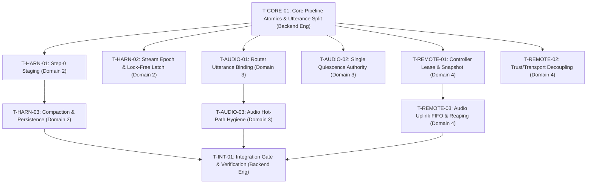

# Phase 14 Master Implementation Plan: Pipeline Atomics & Architectural Upstream Refactor

**Status:** APPROVED FOR EXECUTION  
**Author:** Senior Backend Engineer & System Architect  
**Scope:** Core Pipeline, Cognitive Harness, Audio Hot-Path, Remote Session Protocol  
**Invariants Enforced:** Zero Backward Compatibility (ZBC), Spec-First SSOT, Zero Shadow Booleans, Sacred Audio Hot-Path, Single-Writer Event Router  

---

## 1. Executive Summary & Target End-State

The Vox runtime previously carried systemic technical debt where downstream components babysat upstream race conditions and overloaded primitives.

### Target End-State
1. **Atomics & Primitives**:
   - `turn_id` is decoupled from physical audio capture. Physical microphone chunks correlate on `utterance_id`. Conversational user/assistant ledger records correlate on `turn_id`.
   - Shadow booleans (`cancel_flag`, `turn_open`, `drained_while_open`) are deleted.
   - `turn_cancel_token` (`CancellationToken`) is the sole cancellation authority.
   - Atomics are renamed to explicit, layman identifiers (`pending_tts_jobs`, `assistant_state_atomic`, `current_activity`).
2. **Cognitive Harness**:
   - User queries are staged in memory during Step 0 Thinking and committed atomically to history only when assistant speech or tools are produced.
   - All rollback hacks (`rollback_user_turn`, `rollback_last_user_turn`, `uncommitted_user_turn_id`, `has_committed_steps_this_turn`) are deleted.
3. **Audio Hot-Path & Inference**:
   - The single-writer event router (`vox-router`) is the sole allocator of turn and utterance IDs. VAD and STT never guess or increment IDs (`wrapping_add(1)` is deleted).
   - Audio sink is a pure renderer with zero mutex locks, zero string formatting, and zero channel sends in the active CPAL callback.
   - Quiescence is governed by a single authority; duplicate `PlaybackFinished` emissions are eliminated.
4. **Remote Session & IPC**:
   - Controller admission uses an atomic `ControllerLease` to prevent concurrent controller connection races (TOCTOU eliminated).
   - `AttachSnapshot` carries canonical `StateChangedPayload` rather than synthetic `turn_open as u32`.
   - Tier 1 trust (`paired_devices` DB) is decoupled from Tier 2 transport rejections (`UnknownPeer` never erases pairing).

---

## 2. Defect Taxonomy: Why Tests Pass & How Findings Classify

A critical question is: **If there are so many findings, why does the test suite currently pass?**

The answer is twofold:
1. **Compensating Band-Aids Mask Upstream Flaws**: When an upstream race broke a test, developers historically added downstream conditionals (e.g. `turn_id + 1 == peek_turn_id()`, `rollback_user_turn`, `current_turn_id() != turn_id`) to make the test green. The tests pass *because* the band-aids are babysitting the flaws.
2. **Synthetic Single-Threaded Test Timing**: Unit tests run sequentially in microseconds. Real-world concurrency bugs (Wi-Fi packet reordering, Bluetooth buffer underruns, human barge-in jitter) only surface under real asynchronous timing.

### The 4 Finding Classes

* **[Type 1] Latent Concurrency & Edge-Case Bugs**: True defects that cause misbehavior, state stalls, or data loss under specific asynchronous timing.
* **[Type 2] Compensating Band-Aids**: Downstream hacks added to appease broken tests by babysitting upstream flaws.
* **[Type 3] Architectural Anti-Patterns & Shadow State**: Dead state, duplicate booleans, or SSOT violations that degrade system maintainability.
* **[Type 4] Real-Time Hot-Path Violations**: Mutex locks, logging, or allocations inside real-time CPAL callbacks that risk audio glitches.

---

## 3. Master Defect Catalog: Classification, Priority & Blast Radius

| Ticket ID | Domain | Structural Finding | Defect Type | Priority | Complexity | Blast Radius | Assigned Owner |
| :--- | :--- | :--- | :--- | :--- | :--- | :--- | :--- |
| **T-CORE-01** | Pipeline | Atomics cleanup (`cancel_flag`, `turn_open`, `drained_while_open`), `utterance_id` split, router epoch gate, `transcript.rs:233` regression | **Type 1 & Type 3** | **P0 (Blocker)** | High | Wide (Pipeline, Router, Core) | **Senior Backend Engineer** |
| **T-HARN-01** | Harness | Eager intake & 3-site rollback cluster (`rollback_user_turn`, `uncommitted_user_turn_id`, positional rollback in `llm.rs`) | **Type 2 (Band-Aid)** | **P0 (Blocker)** | Medium | Localized (`harness/`, `llm.rs`) | **Domain 2 Subagent** |
| **T-HARN-02** | Harness | Router engine blocking lock in `llm.rs:111`, stream routing epoch verification, lock-free `sink_occupied` | **Type 4 (Hot-Path)** | **P1 (High)** | Medium | Localized (`harness/`, `router.rs`) | **Domain 2 Subagent** |
| **T-HARN-03** | Harness | Compaction `JoinHandle` ownership, cross-session epoch leak prevention, bounded persistence backpressure | **Type 1 (Latent Bug)**| **P1 (High)** | Medium | Localized (`harness/stages/`) | **Domain 2 Subagent** |
| **T-AUDIO-01** | Audio | VAD/STT guessing turn IDs via `wrapping_add(1)`, router-issued `utterance_id` / `turn_id` binding | **Type 2 (Band-Aid)** | **P0 (Blocker)** | High | Medium (`vad/`, `stt/`, `actor.rs`) | **Domain 3 Subagent** |
| **T-AUDIO-02** | Audio | Split-brain quiescence: duplicate `PlaybackFinished` from TTS actor and audio sink, dead `drained_while_open` | **Type 1 & Type 3** | **P0 (Blocker)** | Medium | Medium (`sink.rs`, `tts/actor.rs`) | **Domain 3 Subagent** |
| **T-AUDIO-03** | Audio | Sacred hot-path violations: `SharedRingProducer` mutex in CPAL callback, TTS ignoring `engine_shutdown` | **Type 4 (Hot-Path)** | **P1 (High)** | Medium | Medium (`device.rs`, `tts/actor.rs`) | **Domain 3 Subagent** |
| **T-REMOTE-01**| Remote | TOCTOU controller admission race, `AttachSnapshot` serializing `turn_open as u32`, `HostAdmission` evaluator | **Type 1 & Type 3** | **P0 (Blocker)** | High | Medium (`services/remote/`) | **Domain 4 Subagent** |
| **T-REMOTE-02**| Remote | Tier 2 `UnknownPeer` wiping Tier 1 `paired_devices`, fabricated `state_changed { turn_id: 0 }`, advertiser poll | **Type 1 (Latent Bug)**| **P1 (High)** | Medium | Localized (`dialer.rs`, `manager.rs`) | **Domain 4 Subagent** |
| **T-REMOTE-03**| Remote | Detached per-chunk task spawns in `controller_runtime.rs`, bridge tasks ignoring cancel token, event queue gaps | **Type 1 & Type 4** | **P1 (High)** | Medium | Localized (`remote/audio/`) | **Domain 4 Subagent** |
| **T-INT-01**   | Cross | Cross-target compilation gate (`verify-targets.sh`), test suite validation, regression audit | **Gate** | **P0 (Gate)** | High | Global Workspace | **Senior Backend Engineer** |

---

## 3. Dependency Graph & Sequencing

---

## 4. Work Delegation & Ownership Matrix

### Batch 1: Core Foundation (Owner: Senior Backend Engineer)
* **Ticket**: `T-CORE-01`
* **Files**: `pipeline/atomics.rs`, `pipeline/router.rs`, `core/state.rs`, `core/events.rs`, `pipeline/assistant/{transcript.rs, interrupt.rs, speech.rs, session.rs, ptt.rs, playback.rs}`
* **Deliverable**:
  - Delete `cancel_flag`, `turn_open`, `drained_while_open`.
  - Add `utterance_id: Arc<AtomicU32>`.
  - Rename atomics to clean layman names (`turn_cancel_token`, `pending_tts_jobs`, `assistant_state_atomic`, `current_activity`).
  - Revert `transcript.rs:233` gate to `current_state != InteractionState::Thinking`.
  - Remove `turn_id + 1 == peek_turn_id()` arithmetic in `transcript.rs:222`.
  - Router drops stale events where `event.turn_id != active_turn_id`.

### Batch 2: Cognitive Harness (Owner: Domain 2 Subagent)
* **Tickets**: `T-HARN-01`, `T-HARN-02`, `T-HARN-03`
* **Files**: `app/src-tauri/src/harness/` (`chassis.rs`, `loop.rs`, `steps.rs`, `stages/history.rs`, `stages/compaction.rs`, `stages/persistence.rs`), `pipeline/assistant/llm.rs`
* **Deliverable**:
  - Replace eager intake with `stage_user_query` / `commit_turn_artifact`. Delete all `rollback_user_turn` calls and fields.
  - Delete `engine.blocking_lock()` from `llm.rs:111`; read lock-free `sink_occupied`.
  - Retain `JoinHandle` in `QuietCompactionWatcher`; gate summary application on `session_id`.
  - Use bounded blocking send in `persistence.rs` to guarantee parent step rows precede child tool call rows.

### Batch 3: Audio Hot-Path & Inference (Owner: Domain 3 Subagent)
* **Tickets**: `T-AUDIO-01`, `T-AUDIO-02`, `T-AUDIO-03`
* **Files**: `app/src-tauri/src/services/audio/` (`sink.rs`, `playback.rs`, `device.rs`), `services/vad/` (`segmenter.rs`, `actor.rs`), `services/stt/actor.rs`, `services/tts/actor.rs`
* **Deliverable**:
  - Remove `wrapping_add(1)` turn guessing from VAD and STT. Bind speech frames via router-issued `utterance_id` and `turn_id`.
  - Delete duplicate `PlaybackFinished` from `tts/actor.rs:132-140`; audio sink is sole completion emitter.
  - Remove mutex from `SharedRingProducer` in CPAL input callback.
  - Respect `engine_shutdown` in TTS worker loop and join handle in `cool_down_tts`.

### Batch 4: Remote Session & IPC Protocol (Owner: Domain 4 Subagent)
* **Tickets**: `T-REMOTE-01`, `T-REMOTE-02`, `T-REMOTE-03`
* **Files**: `app/src-tauri/src/services/remote/` (`session/listener.rs`, `session/dialer.rs`, `session/manager.rs`, `session/supervisor.rs`, `audio/controller_runtime.rs`, `audio/sender.rs`), `app/src-tauri/src/ipc/`
* **Deliverable**:
  - Implement `ControllerLease` to make admission atomic. Delete `turn_open` checks in `listener.rs`.
  - Update `AttachSnapshot` wire type to carry canonical `StateChangedPayload`.
  - Remove `paired_devices` deletion on `UnknownPeer` in `dialer.rs:143-160`.
  - Remove fabricated `state_changed { turn_id: 0 }` on transport disconnect.
  - Replace per-chunk `tokio::spawn` in `controller_runtime.rs` with sequential blocking sends.

### Batch 5: Integration & Verification (Owner: Senior Backend Engineer)
* **Ticket**: `T-INT-01`
* **Files**: Full Workspace
* **Deliverable**:
  - Run compile gate: `cd app/src-tauri && ./scripts/verify-targets.sh`.
  - Run full test suite: `RAYON_NUM_THREADS=$(nproc) OMP_NUM_THREADS=$(nproc) cargo nextest run --release --test-threads=1 --no-fail-fast`.
  - Audit git diff across all four domains to ensure zero residual shadow booleans or shims.

---

## 5. Verification Gate & Success Metrics

1. **Compile Gate**: `./scripts/verify-targets.sh` builds green across desktop and mobile targets in `--release`.
2. **Zero Shadow Booleans**: `git grep -E "cancel_flag|turn_open|drained_while_open"` returns 0 hits in `src/`.
3. **Zero Turn Guessing**: `git grep "wrapping_add(1)"` returns 0 hits in `services/vad/` and `services/stt/`.
4. **Zero Rollback Band-Aids**: `git grep "rollback_user_turn"` returns 0 hits in `harness/` and `pipeline/`.
5. **Deterministic Hot-Path**: Zero mutexes and zero allocations in CPAL audio callbacks.
