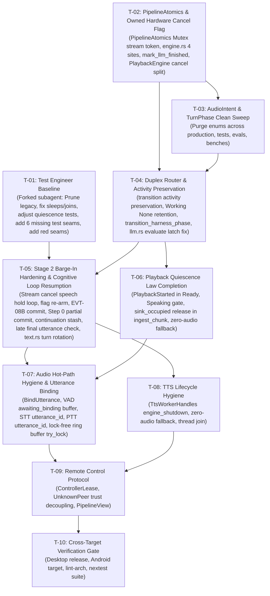

# Phase 14 — Pipeline Atomics, Duplex State Machine & Upstream Refactor
## Master Implementation Plan & Ticket Ledger

**Status:** APPROVED FOR TICKET CREATION (Lead review incorporated)  
**Author:** Principal System Architect  
**Revised:** 2026-11-17 (Patched with lead review: C-01–C-04, A-01–A-02, E-01–E-03, Traps 1–4)  
**Authoritative Specs:** `docs/specs/events-spec.md`, `docs/specs/harness-spec.md`, `docs/specs/remote-control-spec.md`, `docs/specs/db-spec.md`  
**Invariants Enforced:** Zero Backward Compatibility (ZBC), Spec-First SSOT, Zero Shadow Booleans, Sacred Audio Hot-Path, Single-Writer Event Router, Bijective State Space

---

## 1. Why This Refactor Exists

Harness V2 implementation exposed critical defects and architectural anti-patterns in the working tree. Left unresolved, they produce:

- **Permanent Mute After First Interruption**: Anonymous cancel flags in `engine.rs` are latched `true` on cancellation and never re-armed.
- **Silent Resumed Turn on False Barge-In**: Empty transcript paths do not clear `hardware_cancel_flag`, dropping synthesized audio chunks at ingest.
- **Deadlock on Stream Cancellation (C-01)**: Cancelling `stream_cancel_token` terminates the Tokio task, wedging the cognitive loop in `Thinking` permanently when a false barge-in occurs.
- **Premature Audio Drop on Stage 1 (C-02)**: `PlaybackEngine::cancel()` setting `cancel_flag` drops in-flight TTS chunks synthesized while the user coughs.
- **Incomplete Symbol Sweeps**: `AudioIntent` and `TurnPhase` deletions in the prior plan missed live producers, consumers, tests, evals, and benches, causing compile failures.
- **Wiped Activity State**: Clearing `current_activity` on `Listening` or passing `None` on return to `Working` prevents restoring tool context on Stage 2 false barge-in recovery.
- **Invalid Test Assumptions**: Missing `LlmFinished` emissions in tests assert `Ready` when the new quiescence law requires `Thinking`/`Working`.

---

## 2. Resolved Spec Defects (SSOT Hardening)

Authoritative specifications in `docs/specs/events-spec.md` and `docs/specs/harness-spec.md` have been hardened and locked:

| ID | Issue & Root Cause | Spec Resolution |
|:---|:-------------------|:----------------|
| **S-01** | `RULE-EVT-03` unconditionally routed empty transcripts to `Ready`, contradicting `RULE-EVT-08 §2a`. | Reconciled `RULE-EVT-03`: Defers to `RULE-EVT-08 §2a` Stage 2 resolution (`Ready`, `Working`, or `Thinking`). |
| **S-02** | Spec defined set paths for `llm_done` and `hardware_cancel_flag` but had no authoritative reset lifecycle. | Added §4.3 `RULE-EVT-09 §4`: `llm_done` reset exclusively by `next_turn()`; `hardware_cancel_flag` set by `cancel_active_turn()` and reset by `next_turn()`, Stage 2 empty-transcript recovery, and `rearm_turn_cancel_token()`. |
| **S-03** | Spec required `current_activity` in Stage 2 recovery, but didn't mandate preservation on `Listening`. | Added explicit clause to `RULE-EVT-08 §1`: `current_activity` is preserved through `Listening` and NOT cleared. |
| **S-04** | State diagram lacked `Thinking --> Listening` edge despite `RULE-EVT-08 §1` allowing interruption in `Thinking`. | Updated state machine diagram and documentation to 9 states, adding `Thinking --> Listening` and discrete empty transcript returns. |
| **S-05** | Domain matrix listed `LlmFinished` preconditions as `Thinking`, `Working`, or `Speaking`, but said "stays in current state (Speaking)". | Fixed matrix row: state remains in its current value (`Speaking`, `Working`, or `Thinking`) without transition until audio drains. |
| **C-01** | `stream_cancel_token` firing wedged cognitive loop permanently on false barge-in. | `RULE-HARN-12` updated: stream token cancellation pauses stream pass and parks at `StepInbox::wait_if_speech_held()`; Stage 2 empty transcript releases hold and resumes model pass at Step 4 without aborting turn task. |
| **C-04** | Voice barge-in during `Working` pushed into `StepInbox`, violating non-voice invariant. | `RULE-EVT-08 §2b` and `RULE-HARN-18` updated: Voice barge-in in `Working` releases speech hold, terminates prior turn cleanly, and advances `next_turn()`. `StepInbox` is strictly for external programmatic events. |
| **A-01** | Late-final detection assumed turn adjacency `turn_id + 1 == peek_turn_id()` which broke when `next_turn()` was deferred to Stage 2. | `RULE-EVT-01A` updated: Late-final detection is keyed on `utterance_id < state.pipeline.peek_utterance_id()`, tracking physical audio segments deterministically. |

---

## 3. Anti-Patterns Eradicated by This Refactor

| Anti-Pattern | Where It Lives Now | What Replaces It |
|:-------------|:------------------|:-----------------|
| **Anonymous cancel flags** (`Arc::new(AtomicBool::new(false))`) | `engine.rs:184, 417, 586` (+ TTS warm-up handles) | Single `hardware_cancel_flag: Arc<AtomicBool>` owned by `PipelineAtomics`; all 4 engine sites take `Arc::clone`. |
| **Cognitive Loop Task Abortion on Stream Cancel** | `streaming/router.rs`, `loop.rs` exiting on `stream_cancel` | Stream routing stage pauses token stream and parks at `StepInbox::wait_if_speech_held()`; Stage 2 empty transcript resumes at Step 4. |
| **PlaybackEngine cancel mutating hardware cancel flag** | `services/audio/playback.rs:290-293` | `PlaybackEngine::cancel()` strictly flushes sound card buffers and resets sink state; only `cancel_active_turn()` sets `hardware_cancel_flag`. |
| **Forcing `Speaking` in `on_llm_finished` before audio starts** | `llm.rs:104-118` | In `evaluate_synthesis_latch`, call `mark_llm_finished(turn_id)`; if audio active, do not force transition; remain in current state until `PlaybackStarted`. |
| **Voice Barge-in polluting `StepInbox`** | `transcript.rs:180-226` pushing into `StepInbox` during `Working` | Non-empty `TranscriptFinal` releases speech hold, calls `cancel_active_turn()`, advances `next_turn()`, and starts standard dialogue turn. |
| **Late-final checking turn adjacency** | `transcript.rs:232` checking `turn_id + 1 == peek_turn_id()` | Check `utterance_id < state.pipeline.peek_utterance_id()` to match physical audio segments. |
| **Loose public setters without epoch guards** | Proposed `set_llm_done(bool)` callable from any thread | Epoch-guarded `mark_llm_finished(turn_id)` on `PipelineAtomics`, called only on router thread on `LlmFinished`. |
| **Duplicate shadow lifecycle enum (`TurnPhase`)** | `harness/chassis.rs`, re-exported in `harness/mod.rs:30`, consumed at `interrupt.rs:88` | Deleted completely. `pending_user_query.is_some()` is the sole check for Step 0 uncommitted state. |
| **AudioIntent state-gating** | `playback.rs`, `sink.rs`, `speech.rs`, `tts/actor.rs`, providers, tests, evals, benches | `AudioIntent` purged everywhere. Router evaluates quiescence strictly via `llm_done`, `current_activity`, and audio drain. |
| **Off-thread router state transitions** | `harness/steps.rs` calling `transition()` on Tokio tasks; `llm.rs:125, 144` calling `set_state()` | `transition_harness_phase` helper enforcing Epoch/Cancel and Duplex Audio Priority guards. Direct `set_state` calls routed through router. |
| **Wiping activity on `Listening` or `Working(None)`** | `interrupt.rs:71` passing `None`; `router.rs:66` overwriting `Working(None)` | `Listening` transition preserves activity. `router.rs::transition(Working, None)` retains existing `current_activity`. |
| **Latched cancel flag on false barge-in** | Empty transcript path only rearms stream token; leaves hardware flag latched `true` | Every Stage 2 return-to-active path (`Working`, `Thinking`, `Ready`) explicitly re-arms `hardware_cancel_flag`. |
| **Quiescence latch deadlock on zero-audio TTS** | `tts/actor.rs` deleting fallback `PlaybackFinished` | Retain fallback `PlaybackFinished` strictly when `remaining_jobs == 0 && !playback.is_armed() && playback.occupied_len() == 0`. |
| **Pre-roll race on `sink_occupied`** | `sink_occupied` only set on CPAL tick after 12,000 samples | Set `sink_occupied = true` inside `ingest_chunk_with_threshold` before `tts/actor.rs` decrements `pending_tts_jobs`. |
| **Missing `engine_shutdown` in `TtsWorkerHandles`** | `tts/actor.rs:34-41` lacks shutdown flag | Add `pub engine_shutdown: Arc<AtomicBool>` to `TtsWorkerHandles` and `TtsWarmUpHandles`; join handles on cooldown. |

---

## 4. Target End-State

### 4.1 Canonical Duplex State Machine (`events-spec.md §3, §4.3`)
- `InteractionState` has **9 variants**: `Idle`, `Ready`, `Listening`, `Thinking`, `Working`, `Speaking`, `Paused`, `Sleeping`, `Error`.
- `PlaybackStarted` transitions `Thinking` or `Working` $\to$ `Speaking`, retaining `current_activity` intact. Also accepted in `Ready` for TTFA latency milestone recording (handles fast turns where LLM finished before playback started).
- `PlaybackFinished` in `Speaking`:
  - If `llm_done == true`: transitions $\to$ `Ready`.
  - If `llm_done == false` AND `current_activity.is_some()`: transitions $\to$ `Working` (restoring active tool envelope).
  - If `llm_done == false` AND `current_activity.is_none()`: transitions $\to$ `Thinking`.
  - In `Thinking` or `Working`: accepted only for zero-audio fallback when `llm_done && pending_tts_jobs == 0 && !sink_occupied` $\to$ `Ready`.
  - In any other state: dropped with structured diagnostic log.
- `LlmFinished`: sets `llm_done = true` via epoch-guarded `mark_llm_finished(turn_id)`. If audio already drained (`pending_tts_jobs == 0 && !sink_occupied`), transitions immediately $\to$ `Ready`. If audio active, stays in current state without forcing `Speaking`.
- `current_activity` is cleared ONLY when transitioning to: `Thinking`, `Ready`, `Paused`, `Idle`, `Error`, `Sleeping`. It is strictly **preserved** through `Listening` and `Speaking`, and retained on `transition(Working, None)`.

### 4.2 Two-Stage Interruption Lifecycle (`events-spec.md §4.3`)
- **Stage 1 (`SpeechStart` / VAD / PTT)**:
  1. Mute sound card: `playback_engine.cancel()` (flushes buffers; does NOT mutate `hardware_cancel_flag`).
  2. Cancel stream pass: `state.pipeline.cancel_active_stream()` (`stream_cancel_token.cancel()`).
  3. Allocate monotonic `utterance_id` and send `VadCommand::BindUtterance`.
  4. Transition immediately to `Listening`, preserving `current_activity`.
  5. Do NOT cancel `turn_cancel_token`; do NOT set `hardware_cancel_flag`; do NOT abort background tools; cognitive loop task parks at speech hold barrier.
- **Stage 2 (`TranscriptFinal`)**:
  - **Empty Transcript (False Barge-In / Noise / Cough)**:
    - Re-arm `hardware_cancel_flag = false` via `rearm_turn_cancel_token()`.
    - Release speech hold barrier (`inbox.release_speech_hold()`).
    - If `llm_done == true` $\to$ `Ready`.
    - Else if `current_activity.is_some()` $\to$ `Working` (tool envelope restored).
    - Else $\to$ re-arm `stream_cancel_token`, transition $\to$ `Thinking`, resume cognitive loop at Step 4.
  - **Non-Empty Transcript (Real Barge-In)**:
    - Release speech hold barrier if active.
    - Finalize prior turn (`RULE-EVT-08B`): commit pending `assistant_text` and completed tool steps. If Step 0 was cancelled with partial text, commit via `commit_completed_turn` (prevents dangling query/orphan assistant).
    - Cancel active turn via `cancel_active_turn()` (`turn_cancel_token.cancel()`, `hardware_cancel_flag = true`), aborting in-flight tools so `commit_tool_step` records cancellation placeholders.
    - Extract staged Step 0 query if present (`take_staged_query`) $\to$ `stash_for_continuation()`.
    - Advance turn via `next_turn()` (allocates `turn_id`, resets `llm_done = false`, re-arms `hardware_cancel_flag = false`, re-arms tokens).
    - Transition $\to$ `Thinking`, dispatch user transcript for new turn.
- **Typed Text (`text.rs`)**:
  - When typed input arrives while `Thinking`, `Speaking`, or `Working`, explicitly invoke `cancel_active_turn()` and `next_turn()` since typed input is semantically resolved on ingress.

---

## 5. Dependency Graph & Master Ticket Ledger



---

### Detailed Ticket Specifications

#### T-01: Test Engineer Baseline (Forked Subagent)
- **Role:** Test Engineer (Clean-room subagent forked from architect).
- **Scope:** `app/src-tauri/tests/`, `evals/`, `benches/`. **Zero production source changes.**
- **Deliverables:**
  1. *Legacy Test Pruning*: Rewrite/prune assertions depending on `TurnPhase` (`harness_loop_test.rs:2646, 2821, 2834`) and Step 0 history rollback (`:2696`). Fix false-green intent blocks in `:793, 959`. Purge `AudioIntent::TurnResponse` match at `:1013`.
  2. *Duplex & Speech Inbox Test Alignment*:
     - `harness_loop_test.rs:584`: Update to assert `Working --> Speaking` on `PlaybackStarted`, and `Speaking --> Working` on `PlaybackFinished` when `llm_done == false`.
     - `harness_loop_test.rs:1388`: Update so voice barge-in in `Working` tests turn advance and cancellation; test `StepInbox` via programmatic push per `RULE-HARN-18`.
     - Update `barge_in.rs:212`, `e2e_voice_pipeline_test.rs:293`, and `harness_loop_test.rs:1244` to assert `utterance_id` increments on `SpeechStart` and `turn_id` increments on non-empty `TranscriptFinal`.
  3. *Infrastructure Violations*:
     - Replace bare sleeps (`barge_in.rs:162`, `common/harness.rs:342`) with `vad_quiescence_barrier` / `assert_channel_empty`.
     - Fix `let _ = handle.join()` swallowing panics (`common/harness.rs:1003, 1006, 1011`, `stt_turn_identity_test.rs:160`).
     - In `AudioSceneRig::drop` (`common/harness.rs:582-593`), assert `!res.is_err()` when `!std::thread::panicking()`.
     - In `E2eVoiceRig` (`common/harness.rs:693, 703, 728, 732`), wire cancel flags to `state.pipeline.hardware_cancel_flag`.
  4. *Quiescence Law Test Adjustments*: Emit `VoxEvent::LlmFinished` before asserting `Ready` in `playback_test.rs:47, 147, 208` and `playback/tts_to_playback.rs:42`.
  5. *Red-Seam Test Creation*: Add failing tests mapping to:
     - Cognitive loop resumption on false barge-in (`Thinking --> Listening --> Thinking`).
     - `llm_done` quiescence lifecycle (returns `Thinking`/`Working` when `llm_done == false`).
     - Guard enforcement: `transition_harness_phase` blocks stale turns and preserves `Speaking`.
     - Cancel flag re-arm: Second turn after barge-in produces audio chunks.
     - Tool-active false barge-in: Stage 2 empty transcript restores `Working` with intact `current_activity`.
     - Zero-audio fallback: Empty TTS synthesis emits fallback `PlaybackFinished` and closes quiescence latch.
     - `BindUtterance` binding enforcement in VAD and STT.
  6. *Baseline Report Artifact*: Publish `docs/plans/phase14/test-baseline-report.md` detailing all pruned, modified, and red-seam tests mapped to exact spec clauses.
- **Blocked By:** None (starts immediately upon plan sign-off).
- **Blocks:** T-05.

#### T-02: PipelineAtomics & Owned Hardware Cancel Flag
- **Scope:** `pipeline/atomics.rs`, `core/engine.rs`, `services/audio/playback.rs`, `interrupt.rs`, `ptt.rs`, `session.rs`, `error.rs`.
- **Deliverables:**
  - Add `hardware_cancel_flag: Arc<AtomicBool>` and `llm_done: Arc<AtomicBool>` to `PipelineAtomics`.
  - Add `stream_cancel_token: parking_lot::Mutex<tokio_util::sync::CancellationToken>` to `PipelineAtomics`, with `cancel_active_stream()` and `rearm_stream_cancel_token()`.
  - In `cancel_active_turn()`: set `hardware_cancel_flag = true` and cancel `turn_cancel_token`.
  - In `rearm_turn_cancel_token()`: reset `hardware_cancel_flag = false`.
  - In `next_turn()`: reset `llm_done = false`, re-arm `turn_cancel_token`, re-arm `stream_cancel_token`, reset `hardware_cancel_flag = false`.
  - Add `mark_llm_finished(turn_id)` on `PipelineAtomics`: validates active `turn_id` before setting `llm_done = true`.
  - Split `PlaybackEngine::cancel()`: remove `self.cancel_flag.store(true)`. Strictly set `discard_request = true`, `turn_armed = false`, `sink_occupied = false`, flush remote sink. Only `cancel_active_turn()` sets `hardware_cancel_flag`.
  - Sweep `core/engine.rs`: Replace all 4 disconnected anonymous flags (`:184, 417, 586` + TTS warm-up) with `Arc::clone(&state.pipeline.hardware_cancel_flag)`.
  - Sweep direct `.turn_cancel_token().cancel()` callers to use `state.pipeline.cancel_active_turn()`.
- **Blocked By:** None (can run in parallel with T-01).
- **Blocks:** T-03, T-04.

#### T-03: AudioIntent & TurnPhase Clean Sweep
- **Scope:** All producers, consumers, tests, evals, and benches referencing `AudioIntent` or `TurnPhase`.
- **Deliverables:**
  - Delete `AudioIntent` enum from `core/events.rs`.
  - Remove `intent` field from `VoxEvent::PlaybackStarted` and `VoxEvent::PlaybackFinished`.
  - Delete `pub playback_intent: Arc<AtomicU8>` from `services/audio/mod.rs`.
  - Remove intent tagging from TTS provider interfaces (`edge_tts.rs`, `chatterbox_remote.rs`, `services/tts/providers/mod.rs`).
  - Delete `TurnPhase` enum from `harness/chassis.rs` and re-export in `harness/mod.rs:30`.
  - Refactor `pipeline/assistant/interrupt.rs:88` to check `harness.pending_user_query.is_some()`.
  - Sweep all evals (`evals/agentic-tool/tts_capture.rs`) and benches (`benches/common/tts_harness.rs`).
- **Blocked By:** T-02.
- **Blocks:** T-04.

#### T-04: Duplex Router & Activity Preservation
- **Scope:** `pipeline/router.rs`, `pipeline/assistant/playback.rs`, `pipeline/assistant/llm.rs`, `harness/steps.rs`.
- **Deliverables:**
  - In `router.rs::transition()`: Do NOT clear `current_activity` when transitioning to `Listening` or `Speaking`. Clear `current_activity` only on transitions to `Thinking`, `Ready`, `Paused`, `Idle`, `Error`, `Sleeping`.
  - In `router.rs::transition()`: When `new_state == InteractionState::Working && activity.is_none()`, retain the existing `state.pipeline.current_activity()` instead of overwriting with `None`.
  - Implement `transition_harness_phase(...)`:
    - Guard 1 (Epoch & Cancel): Ignore if turn cancelled, turn mismatch, or state is `Listening`.
    - Guard 2 (Duplex Audio Priority): Always update `current_activity`; if state is `Speaking`, return early without forcing state change.
  - In `harness/steps.rs`: Replace raw off-thread `transition()` invocations with `transition_harness_phase`.
  - In `pipeline/assistant/llm.rs::evaluate_synthesis_latch`: Invoke `mark_llm_finished(turn_id)`. Delete `if current_state != InteractionState::Speaking { transition(...) }`. If `!audio_active`, transition to `Ready`; if `audio_active`, do not call `transition(...)`. Route any other direct `set_state` calls through router transitions.
- **Blocked By:** T-02, T-03.
- **Blocks:** T-05, T-06.

#### T-05: Stage 2 Barge-In Hardening & Cognitive Loop Resumption
- **Scope:** `pipeline/assistant/interrupt.rs`, `pipeline/assistant/transcript.rs`, `pipeline/assistant/text.rs`, `pipeline/assistant/session.rs`, `harness/stages/streaming/router.rs`, `harness/loop.rs`, `harness/steps.rs`.
- **Deliverables:**
  - Pass both `turn_cancel` and `stream_cancel` tokens into `TurnExecutionRequest`.
  - In `StreamRoutingStage` (`streaming/router.rs`) and `loop.rs`: When `stream_cancel` fires while `turn_cancel` is NOT cancelled, do not emit `VoxEvent::Cancelled` or exit `execute_turn`. Park at `StepInbox::wait_if_speech_held()`. If `turn_cancel` subsequently fires, exit via `step7_handle_cancelled`; if hold is released on empty transcript, loop back to Step 4 with rearmed `stream_cancel` token.
  - In `step7_handle_cancelled`: If `!ctx.partial_text.trim().is_empty()`, commit turn via `harness.commit_completed_turn(ctx.partial_text.clone())` instead of naked history push.
  - In `session.rs::on_stop_turn`: Only discard `pending_user_query` if `assistant_response` in `pipeline_accumulator` is empty.
  - Stage 1 (`on_interrupt`): Mute playback (`playback_engine.cancel()`), cancel stream pass (`cancel_active_stream()`), allocate `utterance_id`, transition to `Listening`. Do NOT cancel turn or set hardware cancel flag.
  - Stage 2 (`on_transcript_final`):
    - *Speech Hold Active (`is_held`)*:
      - If empty: release speech hold (`inbox.release_speech_hold()`), rearm `hardware_cancel_flag`, restore `Working` (or `Speaking` if audio generated).
      - If non-empty: release speech hold, call `cancel_active_turn()` (aborts in-flight tool batch cleanly), advance `next_turn()`, transition to `Thinking`, dispatch user transcript. Never inject voice into `StepInbox`.
    - *Normal Barge-In*:
      - If empty: rearm `hardware_cancel_flag`, release speech hold, transition to `Ready` (if `llm_done`), `Working` (if tool active), or rearm `stream_cancel_token` and resume `Thinking`.
      - If non-empty: finalize prior turn (`RULE-EVT-08B`), cancel active turn (`cancel_active_turn()`), stage query concatenation (`take_staged_query` $\to$ `stash_for_continuation()`), advance `next_turn()`, transition to `Thinking`.
  - In `transcript.rs:232`: Key late-final check on `utterance_id < state.pipeline.peek_utterance_id()`, NOT turn adjacency.
  - In `text.rs::on_text_input`: If interrupting `Thinking`/`Speaking`/`Working`, call `cancel_active_turn()` and `next_turn()` explicitly. Stage query synchronously on router thread before spawning task.
- **Blocked By:** T-04, T-01.
- **Blocks:** T-07, T-08.

#### T-06: Playback Quiescence Law Completion
- **Scope:** `pipeline/assistant/playback.rs`, `services/audio/playback.rs`, `services/audio/sink.rs`.
- **Deliverables:**
  - In `on_playback_started`: Accept `Ready` state (late audio ingress), transition `Ready --> Speaking`, and record TTFA latency milestone.
  - In `on_playback_finished`: Narrow gate to `Speaking`. In `Thinking` or `Working`, accept only when `llm_done && pending_tts_jobs == 0 && !sink_occupied` (zero-audio fallback). Drop other states with structured log.
  - Implement Quiescence Law: Return `Ready` if `llm_done == true`; return `Working` if `current_activity.is_some()`; else return `Thinking`.
  - In `PlaybackEngine::ingest_chunk_with_threshold`: Set `sink_occupied.store(true, Ordering::Release)` before `tts/actor.rs` decrements `pending_tts_jobs`.
  - In `PlaybackEngine::cancel()` and `sink.rs` buffer drain: Set `sink_occupied.store(false, Ordering::Release)`.
- **Blocked By:** T-04.
- **Blocks:** T-07.

#### T-07: Audio Hot-Path Hygiene & Utterance Binding
- **Scope:** `core/events.rs`, `services/vad/`, `services/stt/`, `pipeline/assistant/speech.rs`, `pipeline/assistant/ptt.rs`, `services/audio/`.
- **Deliverables:**
  - Add `VadCommand::BindUtterance { turn_id: u32, utterance_id: u32 }`.
  - In `VadActorState`: Add `awaiting_utterance_binding: bool`. Accumulate pre-roll and live incoming chunks into `utterance_buffer` while true; flush combined buffer in a single `SttCommand::StreamChunk` when `BindUtterance` arrives. Purge speculative `wrapping_add(1)` prediction.
  - In `services/stt/actor.rs`: Add `utterance_id` to `StreamChunk`, `Partial`, `Final`. Purge `wrapping_add(1)` branches; unknown bindings trigger provider reset.
  - In `pipeline/assistant/ptt.rs:64` and `dictation/ptt.rs`: Allocate `utterance_id` in `on_ptt_start`, pass through `StartWindowValidation` and `SttCommand::Final`.
  - `speech.rs` and `dictation/speech.rs`: Dispatch `BindUtterance` upon speech onset.
  - In `engine.rs:223-243`: Update `SharedRingProducer` to use `try_lock()` on input capture frames, dropping on contention rather than acquiring blocking mutex locks.
  - In `services/audio/sink.rs::process_output_buffer`: Delete string formatting and `log::*` macros; use atomic dropped counter.
- **Blocked By:** T-05, T-06.
- **Blocks:** T-09.

#### T-08: TTS Lifecycle Hygiene
- **Scope:** `services/tts/actor.rs`, `services/tts/mod.rs`, `core/engine.rs`.
- **Deliverables:**
  - In `tts/actor.rs:34-41` and `engine.rs`: Add `pub engine_shutdown: Arc<AtomicBool>` to `TtsWorkerHandles` and `TtsWarmUpHandles`, wiring `Arc::clone(&state.pipeline.engine_shutdown)`.
  - In `tts/actor.rs`: Worker loop checks `engine_shutdown`.
  - In `tts/actor.rs:132-140`: Retain fallback `PlaybackFinished` emission strictly when `remaining_jobs == 0 && !playback.is_armed() && playback.occupied_len() == 0` (zero-audio fallback). Purge unconditional emission.
  - In `services/tts/mod.rs::cool_down_tts`: Join worker thread handle stored in `handles.tts_handle`.
  - Update `TtsWorkerHandles` struct literals in `tests/common/harness.rs`, `tests/playback/tts_to_playback.rs`, and `tests/playback_test.rs`.
- **Blocked By:** T-05.
- **Blocks:** T-09.

#### T-09: Remote Control Protocol
- **Scope:** `services/remote/session/`, `services/remote/audio/`, `app/src/services/remoteService.ts`.
- **Deliverables:**
  - Implement `ControllerLease { device_id, lease_id }` with atomic reservation in `manager.rs`.
  - In `drive_tier2_handshake`: Acquire controller lease before snapshot build; return `LinkRefusedReason::ControllerAttached` if leased.
  - In `dialer.rs:150-152`: Remove `delete_paired_device` on `UnknownPeer`. Emit `RemoteFailureKind::UnknownPeer` without mutating pairing rows.
  - In `supervisor.rs`: Upgrade `current_pipeline_state` to `current_pipeline_view: RwLock<PipelineView { state, turn_id }>`. Emit true active `turn_id` on disconnect.
  - In `spawn_controller_audio_runtime`: Replace detached async tasks with `blocking_send` on dedicated VAD OS thread.
  - Extend TypeScript union type with `'UnknownPeer'`.
- **Blocked By:** T-07, T-08.
- **Blocks:** T-10.

#### T-10: Cross-Target Verification Gate
- **Scope:** Clean-room workspace build & test gate.
- **Deliverables:**
  - Run compile gate: `./scripts/verify-targets.sh`.
  - Run Clippy checks:
    ```bash
    cargo clippy --bin Vox --lib --release --no-default-features -D warnings
    cargo clippy --target aarch64-linux-android --lib --release -D warnings -D clippy::disallowed_methods
    ```
  - Run architecture linter: `./scripts/lint-arch.sh`.
  - Run full integration test suite:
    ```bash
    RAYON_NUM_THREADS=$(nproc) OMP_NUM_THREADS=$(nproc) cargo nextest run --release --test-threads=1 --no-fail-fast
    ```
  - Verify all red-seam tests from T-01 have turned 100% green.
- **Blocked By:** T-09.
- **Blocks:** Final lead review & merge.

---

## 6. Subagent Execution & Hand-Off Workflow

1. **Plan & Spec Approval Gate (Lead Sign-Off)**:
   - Lead reviews this updated ledger and the hardened specs.
2. **Phase 1: Test Baseline (T-01)**:
   - Fork a clean-room `test-engineer` subagent.
   - Subagent executes T-01 (prunes dead tests, fixes sleep/join hygiene, aligns quiescence tests, authors red seams).
   - Subagent outputs `docs/plans/phase14/test-baseline-report.md`.
3. **Phase 2: Core Refactor Execution (T-02 through T-09)**:
   - Backend Engineer subagent receives implementation tickets sequentially across dependency frontiers.
   - Implementation turns T-01 red seams green.
4. **Phase 3: Verification & Architectural Review (T-10)**:
   - Full suite and cross-target compile passes.
   - Principal System Architect performs final diff review.
