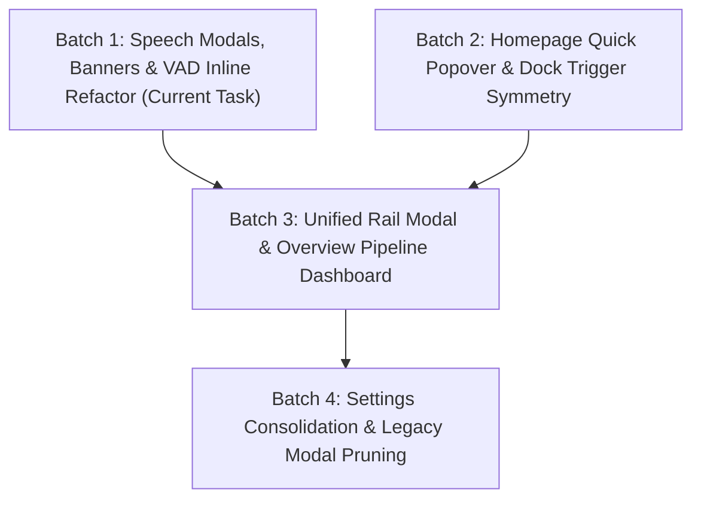

# Unified Model Hub & Speech Modals Implementation Plan

## 1. Target End-State
Unify fragmented model and provider configuration modals (`ModelModal`, `TtsModelsModal`, `ProviderModal`) into a single, cohesive **Unified Model Hub** (`UnifiedModelModal`) accessible both from the Settings page and directly from the Homepage.

### Key Architectural Characteristics
1. **Homepage Integration (Two-Tier Progressive Disclosure)**:
   - **Tier 1 (Quick Popover - `ModelQuickPopover`)**: Floating 386×458px popover anchored to the bottom-right dock above a symmetrical 44×44 round Gear button (`Settings` / `SlidersHorizontal`). Provides 1-click LLM model switching, voice selection, audio previews, temperature, and speech rate sliders.
   - **Tier 2b (Unified Centered Modal - `UnifiedModelModal`)**: Full modal dialog featuring an industry-standard left facet rail:
     - `Overview` (3-column live pipeline summary: Listening, Reasoning, Speaking)
     - `divider`
     - `Speech to Text (STT)`
     - `Speech Engines (TTS)`
     - `Voice Library`
     - `divider`
     - `AI Providers`
     - `Language Models`
     - `Model Parameters (Tuning)`
   - In-place rail navigation with `< Back to Overview` breadcrumb support.
2. **Phase 1 Foundation (Immediate Task)**:
   - Implement dedicated modal surfaces for **Speech-to-Text (`SttModelsModal`)** and **Voice Activity Detection (`VadModelsModal`)**.
   - Generalize `EngineFlowBanner` into `SpeechFlowBanner` with 3 dynamic visual modes (`tts`, `stt`, `vad`).
   - Remove the bottom-right corner toggle button for VAD settings in `SpeechCard`. Embed `VadSettingsPanel` directly beneath `VadModelList` separated by a clean divider.
   - Add expand triggers (`ExpandableList`) to both STT and VAD sections in `SpeechCard`.

---

## 2. Grill-Me Decisions & Requirements Traceability

| Decision Point | Selected Option | Rationale & Architectural Rule |
| :--- | :--- | :--- |
| **Homepage Trigger** | Symmetrical 44×44 Gear button + interactive `ModelStatusOverlay` chips | Symmetrical with left Monitoring button (44×44 Activity). Preserves single-click status readouts. |
| **Trigger Action** | Tier 1 Quick Popover (`ModelQuickPopover`) | Matches left `Monitoring` popover overlay tier (`Tier 1`). Avoids visual dissonance of popping full modal directly from dock. |
| **Popover Controls** | LLM model + Voice + Rate + Temp + STT status | Solves 90% of user adjustments on Home without navigating away. |
| **Modal IA** | Single vertical left rail (`Overview`, `STT`, `TTS`, `Voices`, `Providers`, `LLM`, `Tuning`) | Industry-standard dialog rail (VS Code/Linear). Unifies all fragmented model modals. |
| **Overview Tab** | 3-Column Pipeline Dashboard (`Listening`, `Reasoning`, `Speaking`) | Visual summary of live active pipeline with 1-click jumps to full catalog tabs. |
| **Commit Logic** | Untouched (Existing `draftSettings` + `updateDraft` + `SettingsCommitControls`) | Zero modifications to draft/commit contracts. All selections update draft as usual. |
| **VAD Settings Placement** | Integrated inline catalog view (Models -> Divider -> Knobs) | Eliminates hidden toggle button in corner; single coherent scrollable view. |
| **Banner Architecture** | Generalize `EngineFlowBanner` into multi-mode `SpeechFlowBanner` | Supports dynamic animated SVG representations for TTS, STT, and VAD pipelines. |

---

## 3. Blast Radius & Dependency Sequencing

### Dependency Logic
- **Batch 1** must land first because the Unified Modal requires standard, self-contained views for STT and VAD models that mirror the existing TTS and Voice views. Generalizing `SpeechFlowBanner` and wrapping STT/VAD in `ExpandableList` establishes these components independently with zero disruption to the Settings page.
- **Batch 2** constructs the symmetrical bottom-right dock trigger (44×44 Gear button) and `ModelQuickPopover`, which can initially open the existing modals or preview selections.
- **Batch 3** implements `UnifiedModelModal` with the unified left rail, bringing together the views created in Batch 1 with existing LLM and Voice views, and adding the Overview tab.
- **Batch 4** updates `LanguageCard` and `SpeechCard` expand buttons to route directly to `UnifiedModelModal` and prunes dead modal wrappers.

---

## 4. Batch Definitions & Verification Gates

### Batch 1: Speech Modals, Flow Banners & VAD Inline Refactor (ACTIVE)
- **Scope**:
  - `SpeechFlowBanner.tsx`: Generalize `EngineFlowBanner.tsx` to accept `mode: "tts" | "stt" | "vad"`, rendering tailored SVGs and copy for each domain:
    - `tts`: Text words flow in from left, microphone driver, acoustic waveform out on right.
    - `stt`: Audio waveform in from left, acoustic neural ear/decoder in center, streaming text words out on right.
    - `vad`: PCM waveform in from left, probabilistic gate in center, active speech pulse segments out on right.
  - `SttModelsModal.tsx`: New modal for STT using `CatalogModalShell`:
    - `CatalogFacetRail`: Sources (All, On-device, Cloud).
    - Grid of STT models with download/delete/select interactions.
    - `SpeechFlowBanner` footer (mode: `stt`).
    - `SettingsCommitControls` in header.
  - `VadModelsModal.tsx`: New modal for VAD using `CatalogModalShell`:
    - `CatalogFacetRail`: Categories (All, Built-in, ONNX).
    - Grid of VAD models.
    - Divider followed by `VadSettingsPanel`.
    - `SpeechFlowBanner` footer (mode: `vad`).
    - `SettingsCommitControls` in header.
  - `SpeechCard.tsx`:
    - Remove the bottom-right corner settings toggle button (`vadSettingsOpen`).
    - Render `VadModelList` followed by a subtle divider and `VadSettingsPanel`.
    - Wrap STT in `ExpandableList` with `SttModelsModal`.
    - Wrap VAD in `ExpandableList` with `VadModelsModal`.
  - `settingsCopy.ts`: Add localized copy strings for STT/VAD modal titles, subtitles, expand tooltips, and flow banners.
- **Dependency**: None. Operates directly on existing speech components.
- **Build Expectation**: Holds clean compile (`tsc`, `lint:arch`, `pnpm test`) throughout.
- **Definition of Done**:
  - Speech card STT tab has a working expand button opening `SttModelsModal` with facet filtering and STT flow banner.
  - Speech card VAD tab has a working expand button opening `VadModelsModal` with models, divider, settings, and VAD flow banner.
  - Corner settings toggle button in VAD tab is removed; settings render inline below catalog.

### Batch 2: Homepage Trigger & Quick Popover (`ModelQuickPopover`)
- **Scope**:
  - `ResponsiveLayout.tsx`: Add 44×44 round button with Gear icon (`Settings` from `lucide-react`) at bottom-right, symmetrical to the 44×44 `Activity` button at bottom-left. Make `ModelStatusOverlay` interactive.
  - `ModelQuickPopover.tsx`: Tier 1 floating popover (386×458px) anchored bottom-right.
  - LLM Quick Selector: Active provider badge, model dropdown, temperature slider.
  - Voice Quick Selector: Active engine badge, voice dropdown, audio preview play button, speech rate slider.
  - Listening Status: ASR model + VAD status.
  - Maximize button & full-width footer button to trigger Tier 2b modal.
- **Dependency**: None (can mock or trigger existing modals until Batch 3 lands).
- **Build Expectation**: Holds clean compile throughout.

### Batch 3: Unified Model Hub Shell (`UnifiedModelModal`) & Overview Dashboard
- **Scope**:
  - `UnifiedModelModal.tsx`: Centered modal dialog with left rail navigation:
    - Overview, divider, STT, TTS, Voices, divider, Providers, LLM, Tuning.
    - Rail state persistence and in-place `◀ Back to Overview` breadcrumb.
  - `PipelineOverviewPanel.tsx`: 3-Column pipeline status dashboard (`Listening`, `Reasoning`, `Speaking`).
  - Wire tabs to `SttModelList`, `TtsEngineGrid`, `VoiceCatalogView`, `ProviderGrid`, `RemoteCatalogSection`/`LocalModelsView`, `VadSettingsPanel`/`LlmTuningControls`.
- **Dependency**: Batch 1.
- **Build Expectation**: Holds clean compile throughout.

### Batch 4: Settings Integration & Legacy Pruning
- **Scope**:
  - Update `LanguageCard` and `SpeechCard` expand triggers to launch `UnifiedModelModal` with targeted initial tab.
  - Deprecate isolated `TtsModelsModal`, `ProviderModal`, `ModelModal` in favor of `UnifiedModelModal`.
  - Final visual and architectural audit (`review-ui`, `check_invariants.mjs`).
- **Dependency**: Batch 3.
- **Build Expectation**: Holds clean compile throughout.

---

## 5. Risks & Inferences
1. **Z-Index and Overlay Stacking**:
   - `ModelQuickPopover` must use `z-[200]` and register with `useOverlay` to prevent Escape key leakage or conflicting with `MonitoringPopover`.
2. **Audio Hot-Path & Dormancy**:
   - Audio preview synthesis in `ModelQuickPopover` or modals must cleanly stop on modal close or unmount via `stopPreview()`.
3. **Draft Settings Isolation**:
   - Sliders (temperature, speech rate) inside the popover and modal must write to `draftSettings` via atomic `updateDraft` calls without forcing unnecessary global re-renders.
