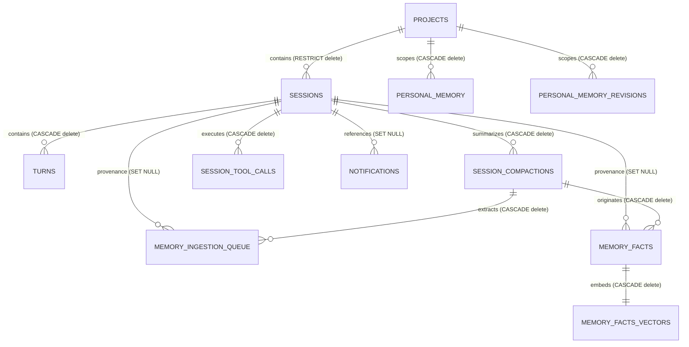
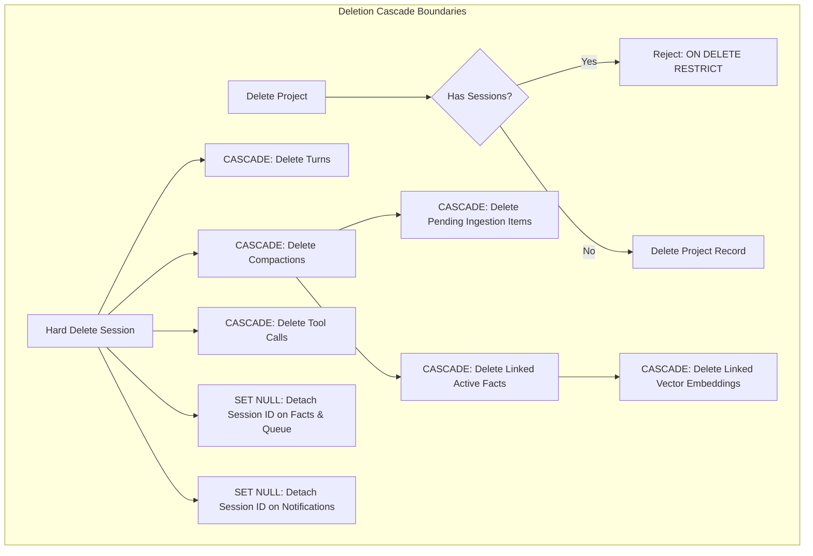
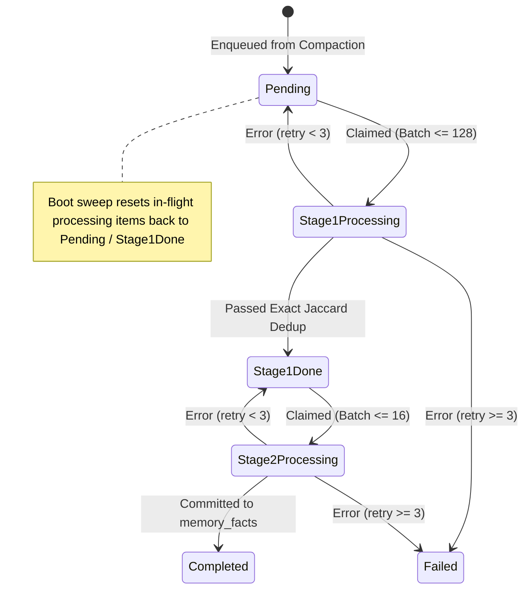

# Database & Persistence Specification

## 1. Intent & Scope

### 1.1 Lane
Data & Persistence Specification. This document specifies the relational data model, transaction guarantees, concurrency patterns, cascade rules, and storage contracts for Vox.

### 1.2 Purpose
Vox requires a zero-latency-penalty persistence layer for real-time voice streaming, transactional safety across multi-turn sessions, persistent memory registries, and atomic background compactions.

### 1.3 Out of Scope
- File system paths and configuration directory resolution (governed by `storage-spec.md`).
- Memory consolidation algorithms and semantic scoring logic (governed by `memory-spec.md`).
- In-memory event routing and pipeline message busses (governed by `events-spec.md`).

### 1.4 Database Engine (Non-Negotiable)
**VOX DOES NOT USE SQLITE.** Vox exclusively uses the **Turso Database Engine** (`turso` crate: pure-Rust rewrite, native Tokio async I/O, native MVCC with concurrent writers via `BEGIN CONCURRENT`, native vector storage `F32_BLOB`). Never introduce C SQLite dependencies, `rusqlite`, or single-writer assumptions. Full technical reference lives in `docs/features/turso-database-engine.md`.

---

## 2. User Stories

| ID | Story |
| :--- | :--- |
| **US-DB-01** | As a user speaking to Vox, I want my conversational turns saved asynchronously without audio stutter or processing delays, so that conversation remains fluid. |
| **US-DB-02** | As a user managing multiple sessions, I want to group them into projects, pin key sessions, and soft-delete unwanted sessions, so that history stays organized. |
| **US-DB-03** | As a background compaction worker, I want atomic mutual exclusion for running compactions, so that concurrent passes do not duplicate or corrupt session summaries. |
| **US-DB-04** | As a memory sub-system, I want deduped observations and personal profile revisions tracked transactionally, so that facts are never lost or corrupted across app restarts. |
| **US-DB-05** | As an auditor or debugger, I want agentic tool execution parameters and outputs recorded alongside turns, so that multi-turn model actions can be reconstructed. |

---

## 3. Entity-Relationship & Cascade Architecture

---

## 4. Architectural Invariants & Behavior Rules

### 4.1 Strict Persistence Boundary
- **RULE-DB-01 (Single Boundary)**: The persistence module MUST serve as the sole gateway for all database interactions. No SQL statements MAY leak into IPC, pipeline, or service layers.
- **RULE-DB-02 (Engine Lifecycle)**: The database engine MUST be initialized exactly once during application startup and held in global application state. Re-opening the database file from disk outside startup or test harnesses is FORBIDDEN.
- **RULE-DB-03 (Connection Vending)**: Handlers and background workers MUST acquire lightweight execution connections from the engine factory (`state.db.connect()`). Connections MUST NOT be shared across concurrent operations to prevent concurrency deadlocks.
- **RULE-DB-04 (Voice Hot-Path Isolation)**: Write operations generated during live voice interactions MUST be offloaded to an asynchronous persistence channel. The audio processing loop MUST NEVER perform synchronous database writes.

### 4.2 Concurrency, MVCC & Transaction Rules
- **RULE-DB-05 (MVCC Mode)**: The persistence engine MUST operate under Multi-Version Concurrency Control (MVCC) with optimistic concurrent writes (`BEGIN CONCURRENT`).
- **RULE-DB-06 (Optimistic Conflict Retry Loop)**: Concurrent write transactions encountering optimistic lock conflicts (`Busy` or `BusySnapshot`) MUST be retried using bounded exponential backoff (e.g. 1ms, 2ms, 4ms up to 100ms) up to a maximum of 3 attempts before returning an operational conflict error.
- **RULE-DB-07 (Atomic Rollback on Failure)**: Any batch mutation or multistep persistence operation that encounters an unrecoverable error MUST execute a full transaction rollback. Partial writes are STRICTLY FORBIDDEN.
- **RULE-DB-08 (Referential Integrity Enforcement)**: Foreign key enforcement MUST be active on all connections. Deleting a parent project with existing sessions MUST be rejected (`ON DELETE RESTRICT`).

### 4.3 Deletion & Cascade Semantics
- **RULE-DB-09 (Session Soft-Delete)**: User-facing session deletion MUST mark the session record with a deletion timestamp (`deleted_at = now()`). Default queries MUST filter out soft-deleted sessions (`WHERE deleted_at IS NULL`).
- **RULE-DB-10 (Hard Cascade Boundaries)**: Hard deletion of a session:
  - MUST cascade delete its `turns`, `session_compactions`, and `session_tool_calls`.
  - MUST detach provenance on `memory_facts`, `memory_ingestion_queue`, and `notifications` by setting `session_id = NULL`.
  - MUST NOT delete extracted observations, vector embeddings, or personal memory entries.

---

## 5. Relational Schema & Entities

### 5.1 `projects` (Session Grouping)
Organizes conversation sessions into workspaces.
- `id` (TEXT, PK): Unique project identifier (default: `'default'`).
- `name` (TEXT, NOT NULL): User-visible display name.
- `created_at` (INTEGER, NOT NULL): Epoch timestamp in milliseconds.
- `updated_at` (INTEGER, NOT NULL): Epoch timestamp in milliseconds.
*Constraint*: A project with existing sessions cannot be deleted (`ON DELETE RESTRICT`).

### 5.2 `sessions` (Conversation Containers)
Represents an ongoing or historical conversation session.
- `id` (INTEGER, PK): Monotonic session identifier.
- `project_id` (TEXT, NOT NULL DEFAULT 'default', FK -> `projects.id` ON DELETE RESTRICT): Associated project.
- `title` (TEXT, NULLABLE): Generated via title tool or user-renamed.
- `is_pinned` (BOOLEAN, NOT NULL DEFAULT FALSE): Priority pin flag.
- `deleted_at` (INTEGER, NULLABLE): Soft-delete epoch millisecond (NULL for active).
- `created_at` (INTEGER, NOT NULL): Session start timestamp in milliseconds.
- `updated_at` (INTEGER, NOT NULL): Last turn timestamp in milliseconds.
*Indexes*: `(project_id, updated_at DESC)`, `(deleted_at)`.

#### Derived Session Projections
The persistence layer exposes the following derived properties for active session queries:
- **`turn_count`**: Total finalized turns in the session:
  $$\text{turn\_count} = \text{COUNT}(\text{turns WHERE session\_id} = s.id)$$
- **`first_message`**: First user utterance for preview rendering:
  $$\text{first\_message} = (\text{SELECT user\_text FROM turns WHERE session\_id} = s.id\text{ ORDER BY turn\_id ASC LIMIT 1})$$
- **`uncompacted_turns`**: Number of finalized turns pending compaction (drives UI compaction indicators):
  $$\text{uncompacted\_turns} = \text{turn\_count} - \max(\text{session\_compactions.to\_turn\_id WHERE status} = \text{'completed'})$$

### 5.3 `turns` (Dialogue Turns)
Finalized user and assistant dialogue exchanges.
- `id` (INTEGER, PK AUTOINCREMENT): Row identifier.
- `session_id` (INTEGER, NOT NULL, FK -> `sessions.id` ON DELETE CASCADE): Parent session.
- `turn_id` (INTEGER, NOT NULL): Monotonic turn counter within session.
- `user_text` (TEXT, NOT NULL): Finalized STT transcript.
- `assistant_text` (TEXT, NOT NULL): Finalized synthesized assistant reply.
- `created_at` (INTEGER, NOT NULL): Millisecond epoch timestamp.
*Constraint*: Unique `(session_id, turn_id)`.

### 5.4 `session_compactions` (Context Compactions)
Tracks rolling contextual compaction runs and retains raw output for audits and context seeding.
- `id` (INTEGER, PK AUTOINCREMENT): Compaction identifier.
- `session_id` (INTEGER, NOT NULL, FK -> `sessions.id` ON DELETE CASCADE): Target session.
- `trigger_kind` (TEXT, NOT NULL): Closed enum (`critical`, `soft`, `manual`, `auto`, `boot_auto`).
- `from_turn_id` (INTEGER, NOT NULL): Initial turn included in slice.
- `to_turn_id` (INTEGER, NOT NULL): Final turn included in slice.
- `compaction_output` (TEXT, NOT NULL): Canonical JSON payload from compaction.
- `status` (TEXT, NOT NULL): State enum (`in_progress`, `completed`, `failed`).
- `error_msg` (TEXT, NULLABLE): Error details if failed.
- `created_at` (INTEGER, NOT NULL): Start timestamp in milliseconds.
- `finished_at` (INTEGER, NULLABLE): Finish timestamp in milliseconds.
*Constraint*: Partial unique index `(status) WHERE status = 'in_progress'` enforces universal global mutual exclusion: at most one running compaction across the entire application and database at any time.

### 5.5 `personal_memory` (Semantic Knowledge Profile)
Append-only historical versions of user knowledge. The canonical representation is structured JSON (`{ "sections": [...] }`).
- `id` (INTEGER, PK AUTOINCREMENT): Revision row identifier.
- `project_id` (TEXT, NULLABLE, FK -> `projects.id` ON DELETE CASCADE): Project scope (NULL for global default).
- `content` (TEXT, NOT NULL): Semantic JSON structure (`{"sections":[]}` when empty).
- `version` (INTEGER, NOT NULL DEFAULT 1): Monotonic revision counter.
- `is_active` (INTEGER, NOT NULL DEFAULT 1): Active flag (1 for active profile, 0 for archive).
- `last_consolidated_at` (INTEGER, NOT NULL): Millisecond epoch of last merge.
- `updated_at` (INTEGER, NOT NULL): Millisecond epoch of last edit.
*Constraints*: Unique `(project_id) WHERE is_active = 1` enforces exactly one active profile per scope. `(project_id, version DESC)` supports historical carousel browsing.

### 5.6 `personal_memory_revisions` (Staged Semantic Operations)
Pending semantic operations proposed by consolidation or comment processing, awaiting user acceptance, auto-apply, or rejection.
- `id` (TEXT, PK): Unique revision identifier (`rev_{timestamp}_{uuid}`).
- `base_memory_version` (INTEGER, NOT NULL): Target memory version baseline (informational provenance only).
- `project_id` (TEXT, NULLABLE, FK -> `projects.id` ON DELETE CASCADE): Associated project scope.
- `op` (TEXT, NOT NULL): Closed enum (`create_section`, `create_block`, `update_block`, `delete_block`).
- `target_id` (TEXT, NOT NULL): Semantic target ID (`sec_*` or `blk_*`).
- `content` (TEXT, NOT NULL): JSON payload describing the mutation.
- `status` (TEXT, NOT NULL DEFAULT 'pending'): Enum (`pending`, `accepted`, `rejected`).
- `created_at` (INTEGER, NOT NULL): Creation epoch millisecond.
- `resolved_at` (INTEGER, NULLABLE): Resolution epoch millisecond.
*Invariant*: Revisions address persistent semantic IDs (`sec_*`, `blk_*`) rather than positional line indices. Accepting or rejecting one revision NEVER requires re-anchoring remaining revisions.

### 5.7 `memory_ingestion_queue` (Observation Staging Queue)
Temporary batch-processing staging queue for extracted observations awaiting deduplication.
- `id` (INTEGER, PK AUTOINCREMENT): Ingestion job identifier.
- `session_id` (INTEGER, NULLABLE, FK -> `sessions.id` ON DELETE SET NULL): Source session provenance.
- `compaction_id` (INTEGER, NOT NULL, FK -> `session_compactions.id` ON DELETE CASCADE): Source compaction provenance.
- `type` (TEXT, NOT NULL): Closed enum (`personal`, `objective`, `workdone`, `blocker`, `next_step`, `pitfall`).
- `text` (TEXT, NOT NULL): Raw extracted fact text.
- `status` (TEXT, NOT NULL DEFAULT 'pending'): Strongly-typed lifecycle state.
- `retry_count` (INTEGER, NOT NULL DEFAULT 0): Max 3 retry attempts per stage.
- `error_msg` (TEXT, NULLABLE): Last error description.
- `created_at` (INTEGER, NOT NULL): Creation epoch millisecond.
- `processed_at` (INTEGER, NULLABLE): Processing completion epoch millisecond.

#### Queue Lifecycle & Boot Reconciliation

### 5.8 `memory_facts` (Observation Registry)
Permanent observation registry storing deduplicated evidence extracted from sessions.
- `id` (TEXT, PK): Observation identifier (`fact_{timestamp}_{uuid}`).
- `session_id` (INTEGER, NULLABLE, FK -> `sessions.id` ON DELETE SET NULL): Source session provenance.
- `compaction_id` (INTEGER, NOT NULL, FK -> `session_compactions.id` ON DELETE CASCADE): Source compaction provenance.
- `type` (TEXT, NOT NULL): Closed enum (`personal`, `objective`, `workdone`, `blocker`, `next_step`, `pitfall`).
- `text` (TEXT, NOT NULL): Deduplicated observation text.
- `status` (TEXT, NOT NULL DEFAULT 'active'): State enum (`active`, `inactive`, `integrated`).
- `created_at` (INTEGER, NOT NULL): Creation epoch millisecond.
- `updated_at` (INTEGER, NOT NULL): Last update epoch millisecond.

### 5.9 `memory_facts_vectors` (Dense Vector Storage)
Dedicated vector storage for semantic retrieval and Stage 2 cosine deduplication.
- `fact_id` (TEXT, PK, FK -> `memory_facts.id` ON DELETE CASCADE): Foreign key to the observation.
- `type` (TEXT, NOT NULL): Denormalized fact category.
- `status` (TEXT, NOT NULL DEFAULT 'active'): Denormalized fact status.
- `project_id` (TEXT, NULLABLE): Denormalized project scope.
- `created_at` (INTEGER, NOT NULL): Denormalized timestamp.
- `embedding` (F32_BLOB(384), NOT NULL): 384-dimensional floating point vector.
*Index*: `(status, type, project_id)`.

### 5.10 `notifications` (Desktop Alert Feed)
Durable notification feed and task receipts (governed by `notifications-spec.md`).
- `id` (TEXT, PK): Unique notification identifier.
- `group_key` (TEXT, NOT NULL): Correlation key for task idempotency and feed rollup.
- `category` (TEXT, NOT NULL): Closed domain category.
- `severity` (TEXT, NOT NULL): Visual severity (`info`, `warning`, `critical`).
- `action_type` (TEXT, NOT NULL): Interaction kind (`receipt`, `interactive`).
- `action_payload` (TEXT, NOT NULL DEFAULT '{}'): JSON parameters for polymorphic action execution.
- `title` (TEXT, NOT NULL): User-visible title.
- `message` (TEXT, NOT NULL): User-visible description.
- `status` (TEXT, NOT NULL DEFAULT 'unread'): Attention state (`unread`, `read`, `dismissed`).
- `session_id` (INTEGER, NULLABLE, FK -> `sessions.id` ON DELETE SET NULL): Optional associated session.
- `metadata` (TEXT, NOT NULL DEFAULT '{}'): Contextual JSON payload.
- `created_at` (INTEGER, NOT NULL): Creation epoch millisecond.
- `updated_at` (INTEGER, NOT NULL): Update epoch millisecond.
*Indexes*: `(status, created_at DESC)`, `(group_key, status)`, `(session_id)`.

### 5.11 `session_tool_calls` (Cognitive Scratchpad Ledger)
Cognitive scratchpad ledger recording agentic tool invocation payloads, results, and timing.
- `id` (TEXT, PK): Unique execution UUID/ULID.
- `session_id` (INTEGER, NOT NULL, FK -> `sessions.id` ON DELETE CASCADE): Associated session.
- `turn_id` (INTEGER, NOT NULL): Monotonic turn counter within session.
- `tool_name` (TEXT, NOT NULL): Tool identifier.
- `tool_kind` (TEXT, NOT NULL): Closed enum (`terminal`, `non_terminal`).
- `arguments` (TEXT, NOT NULL): Serialized JSON parameters provided by model.
- `result` (TEXT, NULLABLE): Serialized JSON output returned by tool.
- `is_error` (BOOLEAN, NOT NULL DEFAULT FALSE): Failure indicator flag.
- `duration_ms` (INTEGER, NULLABLE): Execution latency in milliseconds.
- `created_at` (INTEGER, NOT NULL): Millisecond epoch timestamp of invocation.
*Invariants*:
- Self-healing parent row: Writes to `session_tool_calls` idempotently ensure the parent `sessions` row exists (`INSERT OR IGNORE`) before inserting.
- Separation of concerns: Decoupled from spoken `turns` to allow speech-only replay while supporting full agent audit trails.

### 5.12 `voices` (Voice Catalog)
Consolidated registry for all voice profiles across bundled, custom cloned, and remote providers.
- `id` (TEXT, PK): Canonical voice identifier (e.g., `bella`, `en-US-AriaNeural`, or clone UUID).
- `provider_id` (TEXT, NOT NULL DEFAULT 'kokoro'): TTS provider identifier (`kokoro`, `supertonic`, `chatterbox`, `zipvoice`, `edge_tts`, `azure_tts`, `google_tts`). Cloud rows (`azure_tts`, `google_tts`) are populated exclusively by live provider sync — no bundled manifest rows exist for them (no migration; row keying only).
- `name` (TEXT, NOT NULL): Display voice name.
- `source_kind` (TEXT, NOT NULL): Declared origin (`bundled`, `custom`, `remote`, `pre_baked`, `zipvoice_pack`, `edge`).
- `slug` (TEXT, NULLABLE): Subdirectory pack slug for packaged models.
- `gender` (TEXT, NOT NULL DEFAULT 'neutral'): Normalized gender facet (`female`, `male`, `neutral`).
- `locale` (TEXT, NOT NULL DEFAULT 'en-US'): BCP-47 locale tag (e.g., `en-US`, `ja-JP`).
- `accent` (TEXT, NULLABLE): Descriptive accent tag (e.g., `American`, `British`).
- `description` (TEXT, NULLABLE): Display blurb for catalog modal and selection views.
- `tags` (TEXT, NOT NULL DEFAULT '[]'): JSON-encoded array of metadata tags.
- `sample_text` (TEXT, NOT NULL DEFAULT 'Hello, this is a preview of my voice.'): Default test sentence for preview synthesis.
- `wav_path` (TEXT, NULLABLE): Absolute path to source reference WAV audio.
- `voice_dir` (TEXT, NULLABLE): Absolute path to pre-baked speaker embedding tensors.
- `preview_wav` (TEXT, NULLABLE): Absolute path to cached preview audio WAV.
- `is_favorite` (INTEGER, NOT NULL DEFAULT 0): Starred favorite status (1 = favorited, 0 = default).
- `last_used_at` (INTEGER, NULLABLE): Millisecond epoch timestamp of last selection or preview.
- `created_at` (INTEGER, NOT NULL): Creation timestamp in Unix epoch seconds.
*Indexes*: `(provider_id)`, `(source_kind)`, `(is_favorite)`, `(last_used_at DESC)`, `(created_at DESC)`.
*Invariants*:
- Unified storage: Replaces legacy fragmented tables (`voice_favorites`, `voice_recents`, `remote_voice_cache`) in compliance with Zero Backward Compatibility.
- Offline-first availability: Bundled and manifest voices populate automatically on first run without requiring network connectivity.
- Non-blocking sync: Remote provider voices (Edge TTS) sync asynchronously and merge via `ON CONFLICT(id) DO UPDATE`.

### 5.13 `models` (Model Registry & Parameter Provenance)
Unified registry for model metadata, per-model parameter customization, activation timestamps, and persistent favorites.
- `id` (TEXT, PK): Canonical model identifier (e.g. `meta/llama-3.1-8b-instruct`, `qwen_3_5_0_8b`, `kokoro`).
- `model_type` (TEXT, NOT NULL): Pipeline domain (`stt`, `llm`, `tts`, `realtime`).
- `category` (TEXT, NOT NULL): Deployment tier (`embedded`, `server`, `cloud`).
- `provider` (TEXT, NULLABLE): Provider slug (`nvidia`, `openrouter`), server ID (`ollama`, `home-gpu`), or NULL for embedded local models.
- `parameters` (TEXT, NOT NULL DEFAULT '{}'): JSON dictionary persisting user overrides for this specific model (e.g. `context_window`, `temperature`, `threads`, `speed`).
- `is_favorite` (INTEGER, NOT NULL DEFAULT 0): Starred favorite status (1 = favorited, 0 = default). Deprecates and replaces legacy `favorite_models` table.
- `last_active_at` (INTEGER, NULLABLE): Millisecond epoch timestamp of last runtime activation.
- `created_at` (INTEGER, NOT NULL): Creation millisecond epoch.
- `updated_at` (INTEGER, NOT NULL): Last update millisecond epoch.
*Indexes*: `(model_type, category)`, `(is_favorite)`, `(last_active_at DESC)`.
*Invariants*:
- Sparse on-demand storage: Untouched catalog models create zero database rows and resolve from default manifests. Rows are created only on activation, favorite toggle, or parameter tuning.
- Parameter provenance: Tuning parameters for one model modifies only that model's row, preventing cross-model parameter pollution.

---

## 6. Asynchronous Persistence Event Shapes

Write operations generated by the real-time voice pipeline are communicated via non-blocking channel events:

| Event Shape | Payload Description | Invariant Binding |
| :--- | :--- | :--- |
| **Session Start** | Session ID, start timestamp in milliseconds. | Idempotently creates or activates the target session. |
| **Session End** | Session ID, end timestamp in milliseconds. | Finalizes session duration and updates session timestamp. |
| **Turn Completed** | Session ID, monotonic turn counter, user transcript, assistant response text. | Inserts turn record; updates session `updated_at`. |
| **Tool Execution** | Execution ID, session ID, turn counter, tool name, tool kind (`terminal` \| `non_terminal`), arguments JSON, result JSON, failure flag, execution duration ms, timestamp. | Preserves full audit record; auto-heals session parent row if missing. |
| **Session Metadata Update** | Session ID, key (e.g., `title`, `project_id`), string value. | Atomically updates session properties. |
| **Engine Shutdown** | No payload. | Flushes pending queue and cleanly disconnects. |

---

## 7. Architectural Decisions & Alternatives

| Decision | Choice | Rationale | Rejected Alternative |
| :--- | :--- | :--- | :--- |
| **Embedded Engine** | Turso embedded engine | Async Tokio native runtime, native float vectors (`F32_BLOB`), and MVCC without external C dependencies. | Standard SQLite via `rusqlite` (single-writer locking, lacking native async and vector search). |
| **Concurrency Model** | MVCC (`BEGIN CONCURRENT`) | Enables optimistic non-blocking concurrent writes between ingestion workers, UI queries, and background actors. | Strict serial write mutex (introduces latency spikes during heavy ingestion passes). |
| **Voice Write Offload** | Asynchronous Actor Channel | Keeps database disk I/O off the real-time audio pipeline to preserve sub-200ms latency budgets. | Inline synchronous transactions on the voice turn loop (risks audio dropouts on disk stall). |
| **Personal Memory Format** | Canonical Structured JSON | Enables stable semantic block/section addressing and structured diffing. | Plain Markdown storage (fragile line/regex parsing, high merge collisions). |
| **Global Compaction Exclusion** | Partial Unique Index on `status = 'in_progress'` | Database-level guarantee preventing concurrent compactions regardless of caller thread/actor. | Application-level mutexes (susceptible to bypass in multi-worker or CLI environments). |
| **Revision Addressing** | Semantic entity IDs (`sec_*`, `blk_*`) | Revisions resolve independently; accepts/rejects never alter targets of other pending revisions. | Positional line/index addressing (forced descending index sorts and complex re-anchoring). |

---

## 8. Verification Criteria

- **Boundary Enforcement**: Static architectural tests verify that no files outside `persistence/` import raw database drivers or execute raw SQL queries.
- **Voice Hot-Path Latency**: Turn completion events benchmarked under continuous database write load confirm zero blocking on the voice pipeline channel.
- **Global Compaction Mutual Exclusion**: Inserting a secondary compaction record with `status = 'in_progress'` while another is active MUST fail with a unique constraint violation.
- **Cascade Isolation**: Deleting a session with turns and compactions removes corresponding entries from `turns`, `session_compactions`, and `session_tool_calls`, but leaves `memory_facts` and `personal_memory` intact with detached session IDs.
- **Optimistic Retry Resilience**: Parallel concurrent write benchmarks confirm that MVCC conflicts successfully retry without panicking or losing data up to the 3-attempt retry limit.
- **Queue Boot Recovery**: Simulate an unhandled process termination while queue items are in `Stage1Processing` and `Stage2Processing`. Verify that startup reconciliation resets them back to `Pending` and `Stage1Done`.