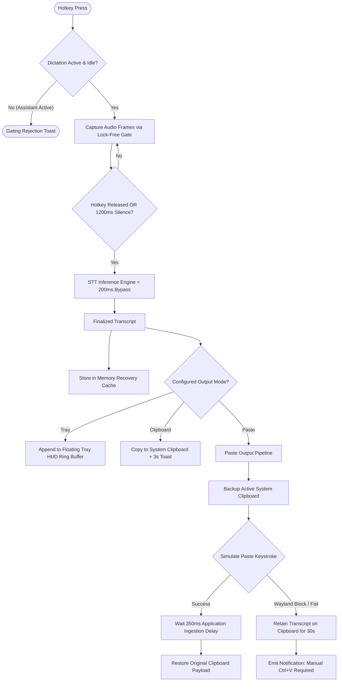
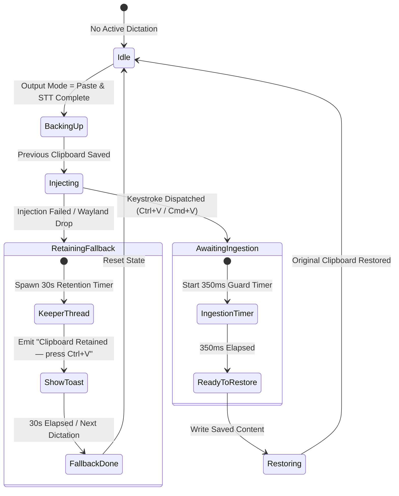

# Dictation Subsystem & Output Architecture Specification

## 1. Intent & Scope

### 1.1 Lane
Subsystem & Platform Interface Specification. This document specifies the audio capture, low-latency STT pipeline bypass, platform virtual keyboard injection, output routing, and clipboard safety contracts for the Dictation subsystem.

### 1.2 Purpose
Dictation serves as an ambient, operating-system-level speech-to-text utility. It transcribes user speech with sub-200ms processing latency and injects text directly into active desktop applications without invoking LLM reasoning or TTS speech synthesis.

### 1.3 Out of Scope
- Global session ownership and assistant track gating (governed by `ownership-spec.md`).
- Notification toast visual formatting and priority ranking (governed by `notifications-spec.md`).
- Deep neural speech refinement models and cursor-anchored overlay UI (reserved for post-v1 releases).

---

## 2. User Stories

| ID | Story |
| :--- | :--- |
| **US-DICT-01** | As a user dictating into an active text editor, I want my spoken words typed directly at my cursor position upon releasing the hotkey, so that speech typing is seamless. |
| **US-DICT-02** | As a user with existing text on my system clipboard, I want simulated paste to preserve my clipboard content, so that pasting dictation does not destroy my copied data. |
| **US-DICT-03** | As a user on a security-restricted Wayland desktop where synthetic keystrokes are blocked, I want the transcript copied to my clipboard with a notification, so that my speech is never lost. |
| **US-DICT-04** | As a user speaking intermittently, I want speech capture to stop automatically after sustained silence, so that dictation turns finalize even if I forget to press the key again. |
| **US-DICT-05** | As a user who accidentally pasted over text, I want to retrieve or re-copy my last dictation transcript via a quick command, so that I can recover what I said. |

---

## 3. Behavior Rules & Lifecycle Invariants

### 3.1 Pipeline Bypass & Latency Budget
- **RULE-DICT-01 (Zero Cognitive Overhead)**: When the dictation track is active, the event router MUST route audio and transcription events directly to the dictation handler, completely bypassing LLM prompt construction, token generation, and TTS audio synthesis.
- **RULE-DICT-02 (State-Driven Readiness)**: Subsystem readiness MUST be determined strictly by the dictation interaction state (`Ready` vs `Idle`), NEVER by reading raw disk configuration files.

### 3.2 Interaction Modes
- **RULE-DICT-03 (Push-To-Talk Toggle & Auto-Stop)**: Under Push-To-Talk mode:
  1. The initial hotkey trigger MUST transition dictation state to `Listening` and begin speech capture.
  2. A secondary hotkey trigger MUST immediately finalize capture and begin transcription (`Thinking`).
  3. If speech has commenced and no further speech frames are detected for 1200ms, the system MUST automatically finalize capture and begin transcription.
- **RULE-DICT-04 (Lazy Resource Allocation)**: Under Push-To-Talk mode, speech-to-text inference weights MUST be loaded on-demand on initial activation. Following 5 minutes of total inactivity, idle resources MAY be evicted from memory.

### 3.3 Output Routing & Clipboard Safety
- **RULE-DICT-05 (Mutually Exclusive Destinations)**: Dictation output MUST be dispatched to exactly one configured destination: `Paste`, `Clipboard`, or `Tray`.
- **RULE-DICT-06 (Clipboard Preservation Contract)**: When using `Paste` output mode:
  1. The system MUST back up existing clipboard text before writing the transcript.
  2. The system MUST dispatch the synthetic paste keystroke (`Ctrl+V` or `Cmd+V`).
  3. On successful keystroke simulation, the system MUST wait 350ms before restoring original clipboard contents.
  4. On simulation failure or on Wayland compositors that swallow synthetic input, the system MUST NOT restore the clipboard. It MUST retain the transcript on the clipboard for 30 seconds and emit a user notification instructing manual paste (`Ctrl+V`).
- **RULE-DICT-07 (Transcript Recovery Cache)**: The system MUST maintain the finalized transcript of the most recent dictation turn in memory. The user MUST be able to query or re-copy this transcript via IPC.

---

## 4. End-to-End Pipeline & Clipboard Safety Architecture

### 4.1 End-to-End Dictation Pipeline Flow

### 4.2 Clipboard Safety State Machine

### 4.3 Platform Virtual Input Injection Matrix

| Platform | Injection Mechanism | Simulated Keystroke | Fallback Tier |
| :--- | :--- | :--- | :--- |
| **Linux Wayland** | Dynamic Accessibility Bus loader (AT-SPI) | `Ctrl+V` | Generic synthetic input $\to$ Clipboard retention with toast |
| **Linux X11** | Direct X11 keyboard event simulation | `Ctrl+V` | Clipboard retention with toast |
| **macOS** | Native Accessibility Event simulation (`CGEvent`) | `Cmd+V` | Clipboard retention with toast |
| **Windows** | Win32 Synthetic Input (`SendInput`) | `Ctrl+V` | Clipboard retention with toast |

### 4.4 Wayland Input Loader Contract
Under Wayland desktop compositors that block synthetic keystrokes for focused non-X11 clients:
1. The input adapter dynamically binds to the Linux accessibility bus (`org.a11y.atspi.Registry`).
2. Synthesizes hardware-level keyboard events directly through the accessibility bus.
3. If accessibility services are unavailable, the adapter attempts standard synthetic input.
4. If input injection fails or the compositor drops the event, execution cleanly downgrades to Clipboard Mode with immediate user notification.

---

## 5. Output Modes

### 5.1 Mode 1: Simulated Paste (`Paste`)
Directly inputs text into the current focused window. Follows the Clipboard Safety Contract (RULE-DICT-06).

### 5.2 Mode 2: System Clipboard Only (`Clipboard`)
Copies the transcript to the system clipboard without generating synthetic keystrokes. Retains the clipboard payload for 30 seconds. Emits an ephemeral receipt toast.

### 5.3 Mode 3: Floating Tray HUD (`Tray`)
Renders transcript turns in an ephemeral desktop overlay window.
- Transcripts append sequentially separated by newlines.
- Buffered in an in-memory ring buffer (up to 15 turns); completely wiped upon application exit.
- Does not inject keystrokes or alter system clipboard contents.

---

## 6. Architectural Decisions & Alternatives

| Decision | Choice | Rationale | Rejected Alternative |
| :--- | :--- | :--- | :--- |
| **Pipeline Bypass** | Zero-latency event fast-path | Eliminates 1–3s LLM reasoning and TTS audio synthesis delays for pure transcription tasks. | Routing dictation through a simplified LLM prompt (unacceptable latency and high resource usage). |
| **Wayland Input Injection** | Dynamic AT-SPI bus loader | Safely bypasses Wayland compositor security restrictions without requiring custom compositor plugins or root privileges. | Direct `/dev/uinput` simulation (requires root/group permissions) or unverified Enigo simulation (silently dropped by Mutter). |
| **Clipboard Safety Window** | 350ms delay with fallback keeper thread | Gives target desktop apps sufficient time to ingest the paste event before clipboard text is restored. | Instant clipboard restoration (causes race condition where original text is pasted instead of the transcript). |
| **Silence Auto-Stop** | 1200ms silence watchdog | Allows hands-free finalization during toggle PTT mode without requiring a second manual keypress. | Infinite recording until manual stop (leads to runaway audio buffers when users forget to release). |

---

## 7. Verification Criteria

- **Bypass Latency Verification**: Benchmarks confirm that from speech boundary detection to transcript delivery, total processing latency is $<200\text{ ms}$ with 0 LLM tokens generated and 0 audio samples synthesized.
- **Clipboard Restoration Check**: Copy `"Original Clip"` to clipboard. Dictate `"Test speech"` in `Paste` mode. Verify that `"Test speech"` is pasted and clipboard contents revert to `"Original Clip"` after 350ms.
- **Wayland Fallback Verification**: In an environment where synthetic input is blocked, trigger dictation. Verify that the transcript remains on the clipboard and an explanatory notification is displayed.
- **Silence Auto-Stop Test**: In PTT mode, trigger speech capture, speak for 2 seconds, and remain silent. Verify that after exactly 1200ms of silence, transcription finalizes automatically.
- **Transcript Cache Retrieval**: Dictate a sentence. Invoke the recovery command and verify that the exact transcript string is returned from memory.
