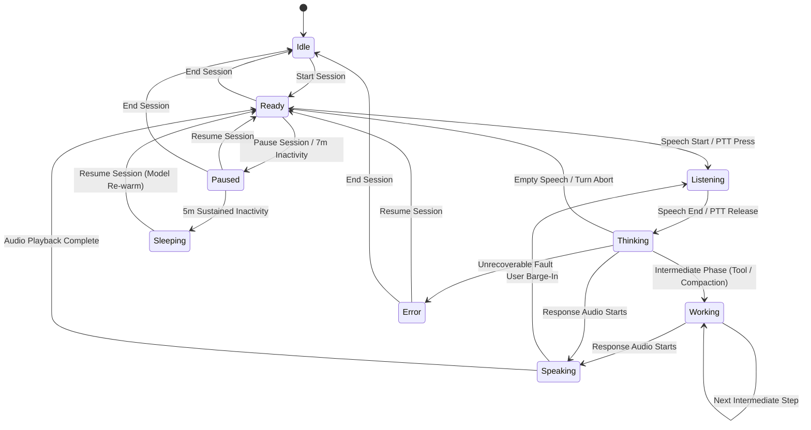
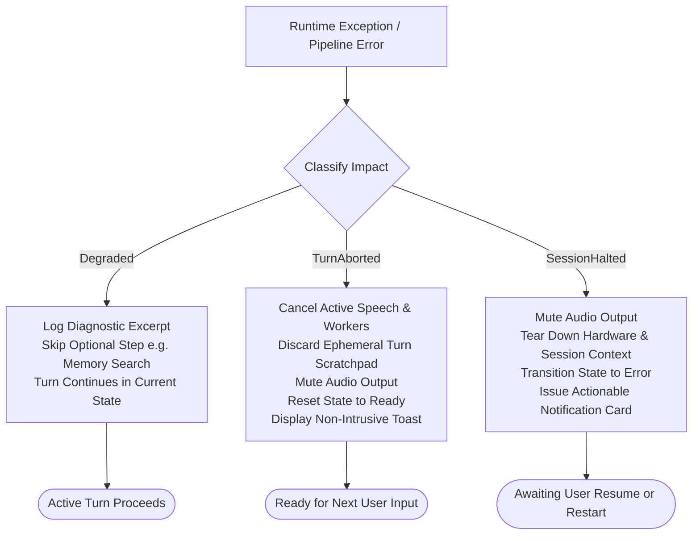

# Target Event-Domain Architectural Specification

## 1. Intent & Scope

### 1.1 Lane
Architecture & Concurrency Specification. This document specifies the event-driven concurrency model, interaction state machines, audio ingestion gating, and barge-in preemption for Vox.

### 1.2 Purpose
Vox coordinates low-latency voice interaction and operating system dictation across multiple parallel tasks. This specification establishes a single-writer event loop that eliminates race conditions, guarantees deterministic state transitions, and isolates high-frequency streaming data from the audio processing path.

### 1.3 Out of Scope
- Prompt assembly, token budgeting, and tool loop iterations (governed by `harness-spec.md`).
- Virtual keyboard simulation and desktop clipboard safety (governed by `dictation-spec.md`).
- Relational storage schemas and database transaction commits (governed by `db-spec.md`).
- Notification delivery and toast visual routing (governed by `notifications-spec.md`).

---

## 2. User Stories

| ID | Story |
| :--- | :--- |
| **US-EVT-01** | As a user speaking to the assistant, I want to interrupt assistant speech at any moment, so that audio playback stops immediately and the assistant listens to my new input. |
| **US-EVT-02** | As a user pausing an assistant session, I want the microphone hardware kept running, so that resuming the conversation takes less than 10 milliseconds without device delays. |
| **US-EVT-03** | As a user stepping away from a paused session for more than 5 minutes, I want large model weights unloaded from memory automatically, so that system RAM is reclaimed while standing by. |
| **US-EVT-04** | As a user experiencing a brief speech decoding glitch, I want the turn to abort cleanly back to ready state without getting stuck in an error state, so that I can speak again immediately. |
| **US-EVT-05** | As a user typing a query instead of speaking, I want my text processed through the same dialogue loop with audio synthesis, so that voice and text interact seamlessly. |
| **US-EVT-06** | As a user running other apps, I want the microphone ingestion gate closed when both assistant and dictation are idle, so that zero CPU is spent on background speech detection. |

---

## 3. Interaction State Machine

The interaction state machine transitions across eight discrete states:

---

## 4. Behavior Rules & Concurrency Invariants

### 4.1 Single-Writer Event Router
- **RULE-EVT-01 (Single Serialization Point)**: The central event router MUST serve as the sole writer for all interaction state transitions. All state-mutating events (user actions, speech boundaries, playback completion) MUST pass through the central FIFO event queue.
- **RULE-EVT-02 (High-Frequency Stream Isolation)**: Real-time text tokens, interim subtitle updates, audio energy levels, and latency milestone metrics MUST bypass the central router queue and stream directly to the user interface. Central event volume MUST remain under 10 events per minute.
- **RULE-EVT-03 (Immediate Speech-End Response)**: When user speech concludes (speech detection silence cutoff or push-to-talk key release), the system MUST transition immediately from `Listening` to `Thinking`.
  - If speech-to-text yields recognized words, processing continues to response generation.
  - If speech-to-text yields empty text, the pipeline MUST recover immediately from `Thinking` to `Ready` and display an informative notice.

### 4.2 Audio Hardware Lifecycle & Sleep Standby
- **RULE-EVT-04 (Warm Pause Contract)**: When a session is paused:
  1. Audio playback MUST be muted immediately and active turn tokens cancelled.
  2. The assistant state MUST transition to `Paused`.
  3. Audio capture hardware MUST remain open and warm, guaranteeing resumption latency under 10ms.
- **RULE-EVT-05 (Complete Engine Teardown)**: When an assistant session ends, the session context MUST be unloaded. Audio capture hardware MUST be completely shut down if and only if the dictation track is also in `Idle` state.
- **RULE-EVT-06 (Deep Sleep Offload)**: When an assistant session remains in `Paused` state for 5 continuous minutes without resumption:
  1. The assistant state MUST transition to `Sleeping`.
  2. Language model and speech synthesis weights MUST be unloaded from memory to free system RAM.
  3. If dictation is enabled, the speech-to-text model MUST remain loaded in memory to allow instant hotkey dictation.
  4. Resuming from `Sleeping` MUST re-warm models in the background before entering `Ready`.
- **RULE-EVT-07 (Lock-Free Ingestion Gating)**: Audio frame ingestion into processing buffers MUST be governed strictly by an atomic gate flag recomputed whenever either track changes state.
  - The gate is OPEN if the assistant is `Ready`, `Listening`, `Thinking`, `Speaking`, or `Working`, OR dictation is `Ready`, `Listening`, or `Thinking`.
  - When the gate is CLOSED, incoming audio frames MUST be dropped immediately at the input callback, reducing background processing CPU to 0%.

### 4.3 Barge-In & Intermediate Execution
- **RULE-EVT-08 (Barge-In Interruption Protocol)**: When user speech starts or a push-to-talk trigger arrives while the assistant is in `Thinking`, `Speaking`, or `Working`:
  1. Audio playback MUST mute immediately.
  2. Active processing and synthesis jobs for the current turn MUST be cancelled.
  3. A new turn token MUST be generated.
  4. The state MUST transition immediately to `Listening`.
  5. If partial assistant text was already generated before the interruption, it MUST be saved to history as an interrupted turn. If no text was generated, the turn MUST be rolled back cleanly.
- **RULE-EVT-09 (Working State Invariant)**: When an intermediate operation (compaction, memory search, or tool execution) executes during a turn:
  1. The system MUST transition from `Thinking` to `Working`.
  2. The cognitive layer MAY play an interim filler phrase (e.g., *"Let me look that up"*).
  3. Completion of an interim filler phrase MUST NOT transition the state out of `Working`.
  4. The state MUST transition to `Speaking` only when the finalized turn response audio begins, returning to `Ready` upon playback completion.
- **RULE-EVT-10 (Error Impact Classification)**: Errors MUST carry explicit impact levels:
  - `Degraded`: The turn continues with reduced fidelity; state does not change.
  - `TurnAborted`: The active turn fails cleanly; state resets directly to `Ready`.
  - `SessionHalted`: Unrecoverable error; state transitions to `Error`.

### 4.4 Error Recovery & Failover Architecture

---

## 5. Unified Interaction Domain Matrix

Vox operates across three primary domain topologies:
1. **Modular Assistant**: Local speech detection $\to$ local transcription $\to$ local/cloud language model $\to$ local speech synthesis.
2. **Realtime Assistant**: Bidirectional streaming WebSocket with remote voice agent.
3. **Dictation**: Ambient speech-to-text routed directly to desktop applications without language model or synthesis overhead.

| Trigger / Event | Preconditions | Modular Assistant Action | Realtime Assistant Action | Dictation Action |
| :--- | :--- | :--- | :--- | :--- |
| **`SessionStart`** | `Idle` | Mounts session, warms local models, transitions to `Ready`. Audio capture starts. | Mounts session, opens provider WebSocket, transitions to `Ready`. | N/A (Dictation is ambient; controlled by settings). |
| **`PauseSession`** | Active session | Cancels active playback, keeps audio capture warm. Transitions to `Paused`. | Halts microphone passthrough, keeps connection alive. Transitions to `Paused`. | N/A |
| **`ResumeSession`** | `Paused`, `Sleeping`, or `Error` | If `Paused`: instant re-arm to `Ready`. If `Sleeping`: re-warms models in background. | Re-enables microphone passthrough; reconnects WebSocket if dropped. Transitions to `Ready`. | N/A |
| **`EndSession`** | Any active state | Unmounts session, clears state. Tears down audio capture if dictation is idle. Transitions to `Idle`. | Disconnects WebSocket, tears down audio capture if dictation is idle. Transitions to `Idle`. | N/A |
| **`SpeechStart` / `PttStart`** | `Ready` | Allocates new turn ID, transitions to `Listening`. Begins audio capture. | Allocates new turn ID, transitions to `Listening`. Begins streaming audio. | Allocates turn ID, transitions to `Listening`. Begins audio capture. |
| **`SpeechStart` / `PttStart`** | `Thinking`, `Speaking`, or `Working` | **Barge-In**: Mutes playback immediately, cancels active turn, allocates new turn ID, transitions to `Listening`. | **Barge-In**: Mutes playback, sends interrupt command to server, allocates new turn ID, transitions to `Listening`. | If `Thinking`: captures turn $N+1$ without aborting turn $N$ transcription. |
| **`SpeechEnd` / `PttStop`** | `Listening` | Transitions to `Thinking`. Dispatches captured audio to speech-to-text. | Transitions to `Thinking`. Signals speech completion to remote provider. | Transitions to `Thinking`. Dispatches audio to speech-to-text. |
| **`TranscriptFinal`** | `Thinking` | If words recognized: starts language model. If empty: resets to `Ready` with notification. | If words recognized: awaits remote audio. If empty: resets to `Ready`. | Transliterates if configured, dispatches text to desktop paste engine, resets to `Ready`. |
| **`TextInput`** | `Ready` or `Paused` | Auto-resumes if paused, sets query in dialogue history, transitions to `Thinking`, generates response. | Auto-resumes if paused, sends text frame directly to WebSocket, transitions to `Thinking`. | Dropped (Dictation accepts voice input only). |
| **`PlaybackStarted`** | `Thinking` or `Working` | If interim filler: remains `Working`. If final response: transitions to `Speaking`. | Transitions to `Speaking`. | N/A (Dictation produces no audio output). |
| **`PlaybackFinished`** | `Speaking` | Transitions to `Ready` when output audio drains and all synthesis jobs are complete. | Transitions to `Ready` when server audio stream finishes playing. | N/A |
| **`TurnAborted`** | Any active state | Cancels audio, resets state directly to `Ready`. | Cancels audio, resets state directly to `Ready`. | Discards audio buffer, resets state directly to `Ready`. |

---

## 6. Architectural Decisions & Alternatives

| Decision | Choice | Rationale | Rejected Alternative |
| :--- | :--- | :--- | :--- |
| **Central Single Writer** | Dedicated sequential event router | Guarantees deterministic state transitions and prevents multi-threaded race conditions. | Multiple actors directly mutating shared state (caused out-of-order state overwrites and deadlocks). |
| **High-Frequency Stream Bypass** | Stream tokens and subtitles directly to UI | Keeps central event router queue clean (<10 events/min) while supporting high-speed token rendering. | Pushing every token through the central queue (caused severe channel congestion and latency spikes). |
| **Warm Pause Contract** | Keep audio hardware active during session pause | Enables instant resumption (<10ms) without operating system audio device delays or clicks. | Shutting down audio hardware on pause (added 500ms re-initialization lag and audio pops). |
| **Atomic Ingestion Gate** | Single atomic boolean recomputed on state change | Eliminates configuration queries on audio callback hot paths; drops frames before processing. | Polling configuration or reading multiple track states in audio callbacks (caused audio dropouts). |
| **Interim Audio Intent** | Distinct interim audio tag for working phase | Prevents premature transition to speaking or ready state while background tools execute. | Reusing standard playback events for filler speech (caused the assistant to exit working state prematurely). |

---

## 7. Verification Criteria

- **Sequential Event Ordering**: Rapidly enqueue concurrent speech and push-to-talk triggers. Verify that all state transitions occur in strict sequential order without race conditions.
- **Barge-In Interruption Latency**: Trigger speech onset while assistant audio is actively playing. Verify that audio playback mutes within 30ms and the new turn begins listening immediately.
- **Warm Pause Resumption**: Pause an active session. Measure time to return to ready state upon receiving a resume command; verify completion in under 10ms.
- **Microphone Ingestion Gate**: Set both assistant and dictation to idle. Feed test microphone input and verify that frames are dropped immediately with 0% speech detection CPU utilization.
- **Deep Sleep Transition**: Leave a session paused for 5 minutes. Verify that the assistant transitions to sleeping state and unloads local model weights from memory.
