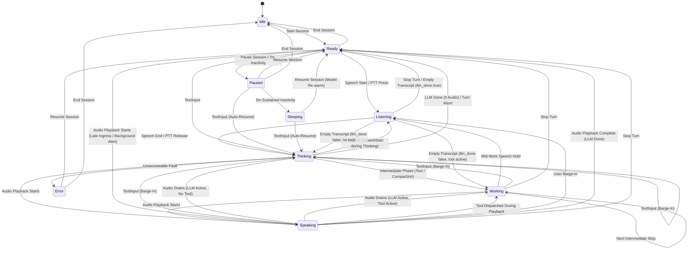
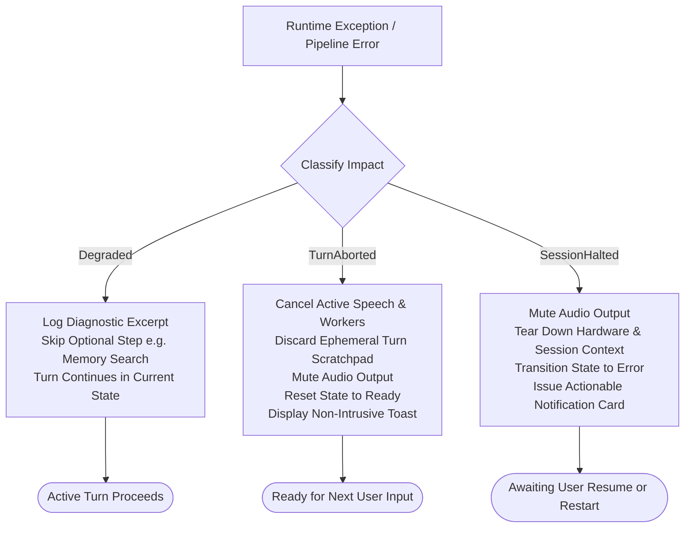

# Target Event-Domain Architectural Specification

## 1. Intent & Scope

### 1.1 Lane
Architecture & Concurrency Specification. This document specifies the event-driven concurrency model, interaction state machines, audio ingestion gating, and barge-in preemption for Vox.

### 1.2 Purpose
Vox coordinates low-latency voice interaction and operating system dictation across multiple parallel tasks. This specification establishes a single-writer event loop that eliminates race conditions, guarantees deterministic state transitions, and isolates high-frequency streaming data from the audio processing path.

### 1.3 Out of Scope
- Prompt assembly, token budgeting, and tool loop iterations (governed by `harness-spec.md`).
- Virtual keyboard simulation and desktop clipboard safety (governed by `dictation-spec.md`).
- Relational storage schemas and database transaction commits (governed by `db-spec.md`).
- Notification delivery and toast visual routing (governed by `notifications-spec.md`).

---

## 2. User Stories

| ID | Story |
| :--- | :--- |
| **US-EVT-01** | As a user speaking to the assistant, I want to interrupt assistant speech at any moment, so that audio playback stops immediately and the assistant listens to my new input. |
| **US-EVT-02** | As a user pausing an assistant session, I want the microphone hardware kept running, so that resuming the conversation takes less than 10 milliseconds without device delays. |
| **US-EVT-03** | As a user stepping away from a paused session for more than 5 minutes, I want large model weights unloaded from memory automatically, so that system RAM is reclaimed while standing by. |
| **US-EVT-04** | As a user experiencing a brief speech decoding glitch, I want the turn to abort cleanly back to ready state without getting stuck in an error state, so that I can speak again immediately. |
| **US-EVT-05** | As a user typing a query instead of speaking, I want my text processed through the same dialogue loop with audio synthesis, so that voice and text interact seamlessly. |
| **US-EVT-06** | As a user running other apps, I want the microphone ingestion gate closed when both assistant and dictation are idle, so that zero CPU is spent on background speech detection. |

---

## 3. Interaction State Machine

The interaction state machine transitions across nine discrete states:

---

## 4. Behavior Rules & Concurrency Invariants

### 4.1 Single-Writer Event Router & Turn Epochs
- **RULE-EVT-01 (Single Serialization Point)**: The central event router MUST serve as the sole writer for all interaction state transitions. All state-mutating events (user actions, speech boundaries, playback completion) MUST pass through the central FIFO event queue.
- **RULE-EVT-01A (Utterance vs. Turn Identity Binding)**:
  - `turn_id` (monotonic `AtomicU32`): Identifies the logical conversational dialogue turn. Allocated by the router exclusively on `next_turn()` when user speech text is verified (`TranscriptFinal` is non-empty) or text input is received.
  - `utterance_id` (monotonic `AtomicU32`): Identifies the physical speech segment and audio capture buffer. Allocated on `SpeechStart` across all states.
  - `SpeechStart` increments `utterance_id` to bound the incoming physical audio frames, but MUST NOT increment `turn_id`. Monotonic turn rotation occurs strictly upon semantic resolution (`TranscriptFinal`).
  - Late-final detection is keyed strictly on `utterance_id < state.pipeline.peek_utterance_id()` (or epoch mismatch), NEVER on `turn_id + 1 == peek_turn_id()`. Because `turn_id` remains unincremented during Stage 1 `Listening`, relying on turn adjacency drops valid late finals; physical utterance tracking resolves late segments deterministically.
- **RULE-EVT-02 (High-Frequency Stream Isolation)**: Real-time text tokens, interim subtitle updates, audio energy levels, and latency milestone metrics MUST bypass the central router queue and stream directly to the user interface. Central event volume MUST remain under 10 events per minute.
- **RULE-EVT-03 (Immediate Speech-End Response)**: When user speech concludes (speech detection silence cutoff or push-to-talk key release), the system MUST transition immediately from `Listening` to `Thinking`.
  - If speech-to-text yields recognized words, processing continues to response generation.
  - If speech-to-text yields empty text, the pipeline evaluates the **Stage 2 empty-transcript paths** governed by `RULE-EVT-08 §2a`: if `llm_done == true` → `Ready`; if `llm_done == false` and `current_activity.is_some()` → `Working`; otherwise rearm the stream token and resume `Thinking`. An informative notice MUST be displayed in all three cases. `RULE-EVT-03` does NOT unconditionally transition to `Ready`; the full Stage 2 resolution in `RULE-EVT-08 §2a` determines the destination state.

### 4.2 Audio Hardware Lifecycle & Sleep Standby
- **RULE-EVT-04 (Warm Pause Contract)**: When a session is paused:
  1. Audio playback MUST be muted immediately and active turn tokens cancelled.
  2. The assistant state MUST transition to `Paused`.
  3. Audio capture hardware MUST remain open and warm, guaranteeing resumption latency under 10ms.
- **RULE-EVT-05 (Complete Engine Teardown)**: When an assistant session ends, the session context MUST be unloaded. Audio capture hardware MUST be completely shut down if and only if the dictation track is also in `Idle` state.
- **RULE-EVT-06 (Deep Sleep Offload)**: When an assistant session remains in `Paused` state for 5 continuous minutes without resumption:
  1. The assistant state MUST transition to `Sleeping`.
  2. Language model and speech synthesis weights MUST be unloaded from memory to free system RAM.
  3. If dictation is enabled, the speech-to-text model MUST remain loaded in memory to allow instant hotkey dictation.
  4. Resuming from `Sleeping` MUST re-warm models in the background before entering `Ready`.
- **RULE-EVT-07 (Lock-Free Ingestion Gating)**: Audio frame ingestion into processing buffers MUST be governed strictly by an atomic gate flag recomputed whenever either track changes state.
  - The gate is OPEN if the assistant is `Ready`, `Listening`, `Thinking`, `Speaking`, or `Working`, OR dictation is `Ready`, `Listening`, or `Thinking`.
  - When the gate is CLOSED, incoming audio frames MUST be dropped immediately at the input callback, reducing background processing CPU to 0%.

### 4.3 Barge-In & Intermediate Execution
- **RULE-EVT-08 (Two-Stage Barge-In Interruption Protocol)**:
  Interruption decouples the fast acoustic reaction (`SpeechStart`) from the semantic dialogue resolution (`TranscriptFinal`).
  1. **Stage 1 — Acoustic and Generation Pause (`SpeechStart` / VAD / PTT)**:
     Whenever user speech starts or a push-to-talk trigger arrives while the assistant is in `Speaking`, `Thinking`, or `Working`:
     a. Sound card audio playback MUST mute immediately via `playback_engine.cancel()`.
     b. Active LLM token streaming MUST be cancelled immediately via `stream_cancel_token.cancel()`.
     c. State MUST transition immediately to `Listening`. The `current_activity` field MUST be preserved through this transition — it is NOT cleared on `Listening`. This guarantees that Stage 2 empty-transcript recovery can restore `Working` with the original tool envelope intact.
     d. The active conversational turn MUST NOT be cancelled (`turn_cancel_token` is preserved; `turn_id` is NOT incremented).
     e. Active background tool execution tasks MUST NOT be aborted.
  2. **Stage 2 — Semantic Resolution (`TranscriptFinal`)**:
     Upon receipt of the final user transcript from STT:
     a. **Empty Transcript (`transcript.trim().is_empty()`) — False Barge-In / Cough / Noise**:
        - The active turn is preserved. `turn_cancel_token` is NOT cancelled.
        - If `llm_done == true`: The assistant had already finished generation before the interruption; audio playback was truncated by the cough. State transitions to `Ready`.
        - If `llm_done == false` AND `current_activity.is_some()`: Background tools continue uninterrupted. State transitions back to `Working` (or `Speaking` if audio generated).
        - If `llm_done == false` AND `current_activity.is_none()`: Assistant was thinking. The interrupted stream pass did not cancel the turn. Rearm `stream_cancel_token`, transition to `Thinking`, and resume the cognitive loop.
     b. **Non-Empty Transcript (`!transcript.trim().is_empty()`) — Real Dialogue Barge-In**:
        - User intent is verified. User messages MUST ALWAYS start a new dialogue turn.
        - The prior active turn MUST be cancelled cleanly via `pipeline.cancel_active_turn()` (`turn_cancel_token.cancel()`, `hardware_cancel_flag = true`).
        - If partial assistant text was already spoken or generated, it MUST be saved to history as an interrupted turn.
        - All committed tool steps from preceding iterations ($0 \dots K-1$) MUST remain permanently preserved in history (`RULE-HARN-12`).
        - A new turn token and utterance ID MUST be generated via `next_turn()`.
        - If speech hold was active in `Working`, speech hold MUST be released before cancelling the turn.
        - User voice barge-in creates standard dialogue turns in `turns` table and NEVER injects synthetic user messages into `StepInbox` or `session_steps` (`RULE-HARN-18`).
        - State transitions to `Thinking`, and the new user transcript is dispatched as the `user_text` of the brand new dialogue turn!
- **RULE-EVT-08A (Rapid Query Burst Concatenation)**:
  When non-empty `TranscriptFinal` arrives following an interruption in `Thinking` on Step 0 before any tool execution or assistant tokens have been generated (`pending_user_query.is_some()`):
  1. The staged Step 0 user query MUST be extracted via `harness.take_staged_query(turn_id)`.
  2. The staged query and the new transcript MUST be concatenated into a single combined user query (`<staged_query> <new_text>`).
  3. The combined query is dispatched as the `user_text` of the new turn in `Thinking`.
- **RULE-EVT-08B (Mid-Turn Interruption & History Invariant)**:
  When non-empty `TranscriptFinal` arrives after Step 0 has completed (at least one tool step committed or partial text generated):
  1. The prior turn is finalized and closed with whatever `assistant_text` and `session_steps` were committed.
  2. The new transcript is dispatched as a standalone `user_text` in a new turn.
  3. The model prompt for the new turn naturally inherits the entire conversation history, including all committed steps of the interrupted turn.
- **RULE-EVT-08C (Working State Tool Non-Destruction on Acoustic Pause)**:
  Background tool executions run on Tokio tasks. Acoustic `SpeechStart` triggers Stage 1 (playback mute + `stream_cancel_token.cancel()`), but never aborts running tools. If `TranscriptFinal` is empty, tools continue to completion without loss of work. If `TranscriptFinal` is non-empty, `cancel_active_turn()` signals `turn_cancel_token`, which aborts the prior turn cleanly.
- **RULE-EVT-08D (Multimodal Typed Input & Text Barge-In)**:
  Typed user input (`TextInput`) provides an unambiguous, semantically complete query on ingress.
  1. **Idle Rejection**: In `InteractionState::Idle`, typed input is dropped.
  2. **Active State Interruption (Text Barge-In)**: If typed input arrives while in `Thinking`, `Speaking`, or `Working`, it represents an immediate user interruption. Because the text is already complete, it does NOT use the two-stage acoustic protocol. Instead, it:
     a. Releases any active speech hold barrier (`inbox.release_speech_hold()`).
     b. Mutes audio and aborts the in-flight turn via `cancel_active_turn()`.
     c. Advances turn identity via `next_turn()`.
     d. Clears accumulator state, stages the query, transitions to `Thinking`, and dispatches the new turn.
  3. **Ready Ingress**: In `Ready`, typed input advances `next_turn()`, transitions to `Thinking`, and dispatches the turn.
  4. **Standby Auto-Resume**: In `Paused` or `Sleeping`, the physical microphone is gated for acoustic privacy, but the session remains mounted. Receiving `TextInput` automatically resumes the session to `Ready` (`on_resume`) before executing the query, preventing dropped user input.
- **RULE-EVT-09 (Duplex Speaking State Invariant & Quiescence Law)**:
  1. **Playback Ingress**: Whenever audio playback begins on the sound card (`PlaybackStarted`), the pipeline transitions immediately from `Thinking`, `Working`, or `Ready` to `Speaking`. If transitioning from `Working`, the active `ActivityEnvelope` in `current_activity` MUST NOT be cleared. Transitioning from `Ready` accommodates late audio playback ingress where generation finished before sound card buffer onset, as well as spontaneous proactive speech synthesis (e.g. background alerts).
  2. **Playback Completion & Duplex Return**: When sound card playback drains (`PlaybackFinished` where `pending_tts_jobs == 0`):
     - If `llm_done == true` (the cognitive loop has emitted `LlmFinished`): the turn is complete, and the pipeline transitions `Speaking` $\to$ `Ready`.
     - If `llm_done == false` AND `current_activity.is_some()`: audio has drained while tool execution remains active; the pipeline transitions `Speaking` $\to$ `Working` restoring the active activity envelope.
     - If `llm_done == false` AND `current_activity.is_none()`: audio has drained (e.g. intermediate clause) while the model continues generating; the pipeline transitions `Speaking` $\to$ `Thinking`.
  3. **Cognitive Loop Completion (`LlmFinished`)**: When the cognitive loop completes with zero remaining tool steps, `loop.rs` emits `VoxEvent::LlmFinished { turn_id }`.
     - If audio is currently playing or queued (`pending_tts_jobs > 0 || sink_occupied`): the router marks `llm_done = true`; state remains in its current value (`Speaking`, `Working`, or `Thinking`) — no transition fires until audio drains.
     - If audio is already completely drained (`pending_tts_jobs == 0 && !sink_occupied`): the pipeline transitions immediately to `Ready`.
  4. **Atomic Flag Lifecycle — Set, Reset, and Epoch Authority**:
     - `llm_done` is **set** (`true`) exclusively by `mark_llm_finished(turn_id)` on the `vox-router` thread upon `VoxEvent::LlmFinished`, after an epoch guard confirms `turn_id` matches the active turn. It is **reset** (`false`) exclusively by `next_turn()` at the start of every new dialogue turn. No other path may set or clear this flag.
     - Zero-Audio Playback Fallback: If TTS produces zero audio samples for a clause (e.g. whitespace or unsupported punctuation), `tts/actor.rs` emits a fallback `PlaybackFinished` if and only if `remaining_jobs == 0 && !playback.is_armed() && playback.occupied_len() == 0`, ensuring the quiescence latch does not deadlock.
     - `PlaybackEngine::cancel()` flushes queued sound card audio and clears `sink_occupied`, but MUST NOT mutate `hardware_cancel_flag`. `hardware_cancel_flag` is **set** (`true`) exclusively by `cancel_active_turn()`. It is **reset** (`false`) by: (a) `next_turn()` on every real barge-in; (b) every Stage 2 empty-transcript return-to-active path (`Working`, `Thinking`, `Ready`) via `rearm_turn_cancel_token()`; and (c) any other return-to-ready path (e.g. `StopTurn`). Stage 1 (`on_interrupt`) MUST NOT set `hardware_cancel_flag`; it cancels only the stream token (`stream_cancel_token`) and mutes audio. Setting the hardware flag is strictly the authority of `cancel_active_turn()`.
  5. **Elimination of AudioIntent from State Gating**: `on_playback_finished` never inspects audio intent tags. Quiescence is determined strictly by the conjunction of cognitive completion (`llm_done == true`) and acoustic completion (`pending_tts_jobs == 0` with sound card buffer drained).
- **RULE-EVT-10 (Error Impact Classification)**: Errors MUST carry explicit impact levels:
  - `Degraded`: The turn continues with reduced fidelity; state does not change.
  - `TurnAborted`: The active turn fails cleanly; state resets directly to `Ready`.
  - `SessionHalted`: Unrecoverable error; state transitions to `Error`.
- **RULE-EVT-11 (Two-Phase Disengage & StopTurn Protocol)**:
  1. **Turn Abort (`StopTurn`)**: When `VoxEvent::StopTurn` is received during an active turn (`Listening`, `Thinking`, `Working`, `Speaking`):
     - Sound card playback MUST mute immediately and the AEC render queue MUST be cleared.
     - The active turn token MUST be cancelled (`turn_cancel_token().cancel()`), `hardware_cancel_flag` set to `true`, and turn guards reset.
     - The accumulator and `StepInbox` MUST be cleared synchronously on the `vox-router` thread.
     - If Step 0 was uncommitted (`pending_user_query.is_some()`), `discard_pending_turn(turn_id)` discards the staged query with zero history rollback.
     - The pipeline MUST transition cleanly to `InteractionState::Ready`. The session harness remains mounted, audio capture remains active, and model weights remain warm in RAM.
  2. **Session Disengage (`EndSession`)**: When `VoxEvent::EndSession` is received while in `InteractionState::Ready`:
     - The session context and harness MUST be unmounted.
     - Audio capture hardware MUST be stopped if dictation is idle.
     - Model weights cool down and state transitions cleanly to `InteractionState::Idle`.

### 4.4 Error Recovery & Failover Architecture

---

## 5. Unified Interaction Domain Matrix

Vox operates across three primary domain topologies:
1. **Modular Assistant**: Local speech detection $\to$ local transcription $\to$ local/cloud language model $\to$ local speech synthesis.
2. **Realtime Assistant**: Bidirectional streaming WebSocket with remote voice agent.
3. **Dictation**: Ambient speech-to-text routed directly to desktop applications without language model or synthesis overhead.

| Trigger / Event | Preconditions | Modular Assistant Action | Realtime Assistant Action | Dictation Action |
| :--- | :--- | :--- | :--- | :--- |
| **`SessionStart`** | `Idle` | Mounts session, warms local models, transitions to `Ready`. Audio capture starts. | Mounts session, opens provider WebSocket, transitions to `Ready`. | N/A (Dictation is ambient; controlled by settings). |
| **`PauseSession`** | Active session | Cancels active playback, keeps audio capture warm. Transitions to `Paused`. | Halts microphone passthrough, keeps connection alive. Transitions to `Paused`. | N/A |
| **`ResumeSession`** | `Paused`, `Sleeping`, or `Error` | If `Paused`: instant re-arm to `Ready`. If `Sleeping`: re-warms models in background. | Re-enables microphone passthrough; reconnects WebSocket if dropped. Transitions to `Ready`. | N/A |
| **`StopTurn`** | `Listening`, `Thinking`, `Working`, or `Speaking` | **Turn Abort**: Mutes audio, cancels turn token, sets hardware cancel flag, clears accumulator and `StepInbox`, discards staged query if uncommitted, transitions cleanly to `Ready`. Retains warm models and engaged session. | Mutes playback, sends interrupt command to server, cancels active turn, transitions to `Ready`. | Cancels active dictation turn, resets to `Ready`. |
| **`EndSession`** | Any active state | Unmounts session, clears state. Tears down audio capture if dictation is idle. Transitions to `Idle`. | Disconnects WebSocket, tears down audio capture if dictation is idle. Transitions to `Idle`. | N/A |
| **`SpeechStart` / `PttStart`** | `Ready` | Allocates new `utterance_id`, transitions to `Listening`. Begins audio capture. Monotonic `turn_id` is allocated upon non-empty transcription. | Allocates new turn ID, transitions to `Listening`. Begins streaming audio. | Allocates turn ID, transitions to `Listening`. Begins audio capture. |
| **`SpeechStart` / `PttStart`** | `Thinking`, `Working`, or `Speaking` | **Stage 1 (Acoustic & Stream Pause)**: Mutes audio playback immediately, cancels in-flight LLM stream via `stream_cancel_token`, allocates new `utterance_id`, transitions to `Listening`. Active tools continue. `turn_id` and `turn_cancel_token` remain preserved. | **Barge-In**: Mutes playback, sends interrupt command to server, allocates new turn ID, transitions to `Listening`. | If `Thinking`: captures turn $N+1$ without aborting turn $N$ transcription. |
| **`SpeechEnd` / `PttStop`** | `Listening` | Transitions to `Thinking`. Dispatches captured audio to speech-to-text. | Transitions to `Thinking`. Signals speech completion to remote provider. | Transitions to `Thinking`. Dispatches audio to speech-to-text. |
| **`TranscriptFinal`** | `Thinking` | **Stage 2 (Semantic Resolution)**: If non-empty: cancels prior turn via `cancel_active_turn()`, concatenates Step 0 staged query if present (`RULE-EVT-08A`), allocates `next_turn()`, transitions to `Thinking`, and dispatches query as brand new dialogue turn. If empty: preserves active turn, transitions to `Ready` if `llm_done`, `Working` if tool active, or rearms `stream_cancel_token` and resumes `Thinking`. | If words recognized: awaits remote audio. If empty: resets to `Ready`. | Transliterates if configured, dispatches text to desktop paste engine, resets to `Ready`. |
| **`TextInput`** | `Ready`, `Paused`, `Sleeping`, `Thinking`, `Speaking`, or `Working` | If `Ready`: advances `next_turn()`, transitions to `Thinking`, generates response. If `Paused` or `Sleeping`: auto-resumes session, advances `next_turn()`, transitions to `Thinking`. If `Thinking`, `Speaking`, or `Working`: acts as immediate text barge-in — cancels active turn via `cancel_active_turn()`, advances `next_turn()`, transitions to `Thinking`, and dispatches new query. If `Idle`: dropped. | If `Paused` or `Sleeping`: auto-resumes. If `Thinking`, `Speaking`, or `Working`: cancels active turn, sends text frame directly to WebSocket, transitions to `Thinking`. | Dropped (Dictation accepts voice input only). |
| **`PlaybackStarted`** | `Thinking`, `Working`, or `Ready` | Transitions to `Speaking`. Retains `current_activity` intact if transitioning from `Working` (does NOT wipe tool envelope). Accepts `Ready` for late audio playback ingress or background proactive alerts. | Transitions to `Speaking`. | N/A (Dictation produces no audio output). |
| **`PlaybackFinished`** | `Speaking` | **Duplex Quiescence Evaluation**: If `llm_done == true`, transitions to `Ready`. If `llm_done == false`, transitions back to `Working` (if `current_activity.is_some()`) or `Thinking`. | Transitions to `Ready` when server audio stream finishes playing. | N/A |
| **`LlmFinished`** | `Thinking`, `Working`, or `Speaking` | Calls `mark_llm_finished(turn_id)` (epoch-guarded). If audio still playing or queued (`pending_tts_jobs > 0 || sink_occupied`): marks `llm_done = true`; state remains in its current value (`Speaking`, `Working`, or `Thinking`) — no transition fires. If audio already drained (`pending_tts_jobs == 0 && !sink_occupied`): transitions immediately to `Ready`. | Evaluates turn completion. | N/A |
| **`TurnAborted`** | Any active state | Cancels audio, resets state directly to `Ready`. | Cancels audio, resets state directly to `Ready`. | Discards audio buffer, resets state directly to `Ready`. |

---

## 6. Architectural Decisions & Alternatives

| Decision | Choice | Rationale | Rejected Alternative |
| :--- | :--- | :--- | :--- |
| **Central Single Writer** | Dedicated sequential event router | Guarantees deterministic state transitions and prevents multi-threaded race conditions. | Multiple actors directly mutating shared state (caused out-of-order state overwrites and deadlocks). |
| **High-Frequency Stream Bypass** | Stream tokens and subtitles directly to UI | Keeps central event router queue clean (<10 events/min) while supporting high-speed token rendering. | Pushing every token through the central queue (caused severe channel congestion and latency spikes). |
| **Warm Pause Contract** | Keep audio hardware active during session pause | Enables instant resumption (<10ms) without operating system audio device delays or clicks. | Shutting down audio hardware on pause (added 500ms re-initialization lag and audio pops). |
| **Atomic Ingestion Gate** | Single atomic boolean recomputed on state change | Eliminates configuration queries on audio callback hot paths; drops frames before processing. | Polling configuration or reading multiple track states in audio callbacks (caused audio dropouts). |
| **Duplex Speaking State Machine** | `(Thinking \| Working) <==> Speaking` with `llm_done` latch | Reflects physical speaker audio truthfully while avoiding silent `Speaking` state when LLM pauses; eliminates `AudioIntent` from state gating. | Artificial `AudioIntent` tagging (`InterimFiller` vs `TurnResponse`) or synthetic `Finalizing` states (caused state bounce and deadlocks). |

---

## 7. Verification Criteria

- **Sequential Event Ordering**: Rapidly enqueue concurrent speech and push-to-talk triggers. Verify that all state transitions occur in strict sequential order without race conditions.
- **Barge-In Interruption Latency**: Trigger speech onset while assistant audio is actively playing. Verify that audio playback mutes within 30ms and the new turn begins listening immediately.
- **Duplex State Cycling**: Play interim audio clause during tool execution. Verify transition `Working` $\to$ `Speaking` on onset, and `Speaking` $\to$ `Working` on drain when `llm_done == false`.
- **Warm Pause Resumption**: Pause an active session. Measure time to return to ready state upon receiving a resume command; verify completion in under 10ms.
- **Microphone Ingestion Gate**: Set both assistant and dictation to idle. Feed test microphone input and verify that frames are dropped immediately with 0% speech detection CPU utilization.
- **Deep Sleep Transition**: Leave a session paused for 5 minutes. Verify that the assistant transitions to sleeping state and unloads local model weights from memory.
