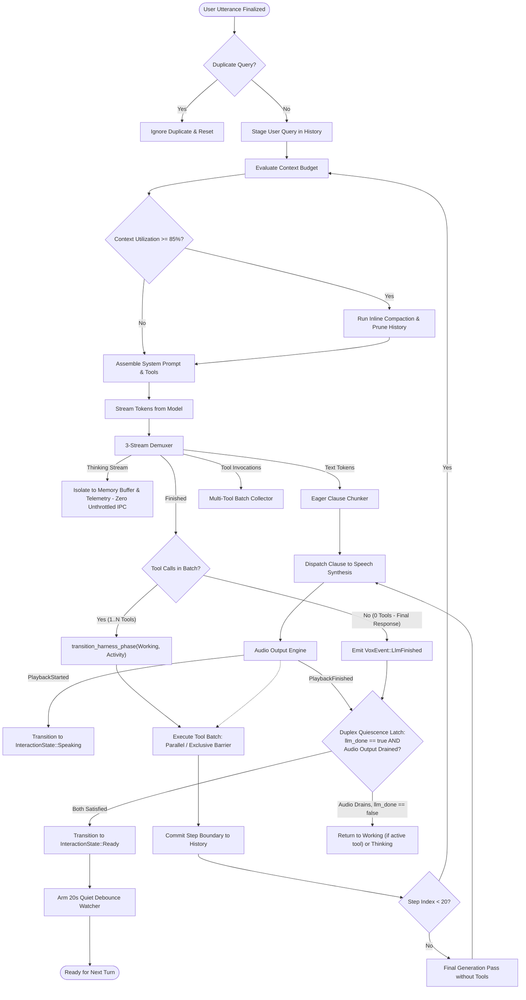
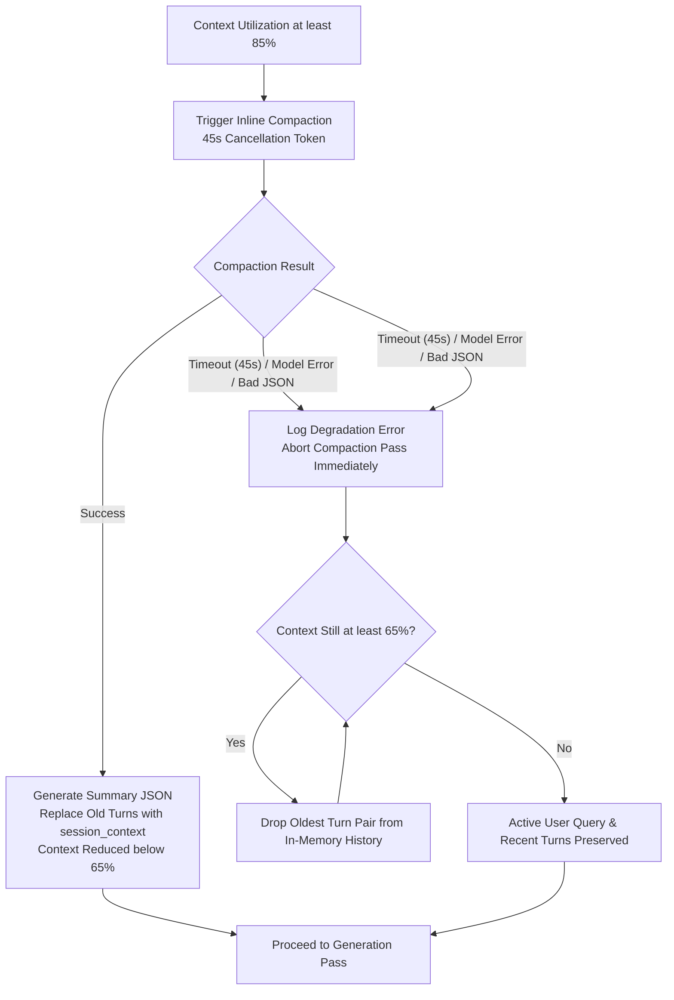

# LLM Agent Harness Runtime Specification

## 1. Intent & Scope

### 1.1 Lane
Cognitive Orchestration & Runtime Execution Specification. This document specifies the turn sequencing loop, context budget evaluation, prompt assembly, 3-stream demuxing, eager clause chunking for speech synthesis, and reentrant multi-tool execution in Vox.

### 1.2 Purpose
Vox separates stateless language model compute from conversational orchestration. The model produces multiplexed reasoning, conversational text, and structured tool calls. The Harness manages dialogue history, enforces context limits, streams speakable clauses to speech synthesis with sub-800ms latency, quarantines reasoning tokens, and executes agentic tools with zero schema bloat.

### 1.3 Out of Scope
- Operating system audio drivers and microphone callbacks (governed by `events-spec.md`).
- Virtual keyboard simulation and desktop clipboard safety (governed by `dictation-spec.md`).
- Relational table schemas and vector embedding storage (governed by `db-spec.md`).
- External model catalog synchronization and provider wire encoding (governed by `provider-model-catalog-spec.md`).

---

## 2. User Stories

| ID | Story |
| :--- | :--- |
| **US-HARN-01** | As a user conversing with the assistant, I want to hear the first spoken sentence within 800ms of speaking, so that conversation feels natural without waiting for the full response to generate. |
| **US-HARN-02** | As a user whose request requires tools, I want to hear the assistant speak its natural introductory thoughts immediately without dropped speech, so that I experience continuous conversational presence while tools execute. |
| **US-HARN-03** | As a user whose request triggers multiple tools, I want the assistant to execute parallel tools concurrently without artificial single-tool limits or schema-bloated filler parameters. |
| **US-HARN-04** | As a user in a long conversation, I want earlier context compressed automatically when memory exceeds 85%, so that conversation continues smoothly without overflowing model limits. |
| **US-HARN-05** | As a user interrupting the assistant mid-sentence, I want whatever partial text was spoken saved to history, so that follow-up questions understand what was already said. |
| **US-HARN-06** | As a user speaking repetitive greetings, I want accidental duplicate queries filtered out, so that the assistant does not waste tokens generating duplicate responses. |
| **US-HARN-07** | As a user interacting with advanced reasoning models (DeepSeek R1, Claude 3.7), I want thinking and reasoning tokens strictly isolated from speech and display, so that internal cognitive traces never leak into spoken audio or corrupt conversation context. |

---

## 3. Cognitive Turn Architecture

---

## 4. Behavior Rules & Lifecycle Invariants

### 4.1 Orchestrator Authority & Layering Invariants
- **RULE-HARN-01 (Single Cognitive Orchestrator & 4-Tier Layering Contract)**:
  - Exactly one Harness orchestrator MUST own turn sequencing, prompt assembly, context budgeting, and tool execution. External pipeline layers MUST interact exclusively via the turn execution gateway (`Harness::execute_turn` in `loop.rs`).
  - Cognitive execution adheres strictly to a 4-tier unidirectional boundary:
    1. **Tier 1 (Upstream Consumers)**: External pipeline handlers (`speech.rs`, `transcript.rs`, `text.rs`) interact exclusively through `Harness::execute_turn`.
    2. **Tier 2 (Coordinator — `loop.rs`)**: Exclusively coordinates turn state transitions and ReAct loop iterations. Direct formatting or dispatching of raw actor commands (`TtsCommand`, `LlmCommand`, `PersistenceEvent`) is strictly forbidden.
    3. **Tier 3 (Step Sequencing — `steps.rs`)**: Sequences discrete turn phases. Delegates strictly to `stages/` and `tools/`. Direct actor channel sending from `steps.rs` is strictly forbidden.
    4. **Tier 4 (Stages & Tools — `stages/` and `tools/`)**: Sibling modules under `services/harness/`. They encapsulate domain algorithms and exclusively own all downstream actor and persistence message dispatch.
  - This layering invariant is deterministically enforced by `./scripts/lint-arch.sh`.
- **RULE-HARN-01A (Off-Thread State Transition Protocol — transition_harness_phase)**:
  - Cognitive workers executing on Tokio background tasks MUST NOT call raw `pipeline::router::transition(...)` directly.
  - Intermediate phase transitions (`Thinking` $\to$ `Working` / `Thinking`) MUST invoke the guarded helper `transition_harness_phase(turn_id, target_state, activity, ...)` on `router.rs`:
    1. **Epoch & Cancel Guard**: If `turn_id != state.pipeline.peek_turn_id()`, or `turn_cancel_token().is_cancelled()`, or `state.pipeline.state() == InteractionState::Listening`, the call MUST drop immediately without mutating state. This prevents asynchronous Tokio tasks from overwriting user speech or barge-in transitions.
    2. **Duplex Audio Priority Guard**: The helper ALWAYS updates `state.pipeline.set_current_activity(activity)`. If the current pipeline state is `InteractionState::Speaking` (preamble audio is actively playing on the sound card), the helper MUST NOT force the pipeline out of `Speaking`. It updates `current_activity` and leaves the state in `Speaking`; when the preamble audio finishes playing, `on_playback_finished` automatically drops to `Working(activity)`.
- **RULE-HARN-02 (1:1 Session Mapping)**: The Harness lifecycle MUST map 1:1 to user session engagement:
  - Mounted when a session starts; loads persona prompt, personal memory, and uncompacted historical turns.
  - Deconstructed when a session ends; flushes pending metrics, cancels background timers, and retains zero conversational memory in RAM during idle state.
- **RULE-HARN-03 (Duplicate Query Filtering)**: If an incoming user query matches the preceding user query within a short temporal window, the Harness MUST ignore the duplicate without advancing turn counters or generating responses.

### 4.2 Context Budgeting & Compaction
- **RULE-HARN-04 (Context Utilization Formula)**: Context utilization MUST be calculated as:
  $$\text{Utilization} = \frac{\text{Tracked In-Memory Tokens}}{\text{Model Context Window} - \text{Reserved Output Tokens}}$$
- **RULE-HARN-05 (Context Classification & Actions)**:
  - **Nominal ($< 65\%$)**: Healthy context; turn proceeds directly.
  - **Soft ($65\% \le \text{Utilization} < 85\%$)**: Context elevated; arms a 20-second quiet debounce timer upon turn completion. If the user remains silent for 20 seconds, background compaction executes.
  - **Critical ($\ge 85\%$)**: Context saturated; triggers inline compaction before generating the response.
- **RULE-HARN-06 (Compaction Degradation Fallback & Active Turn Preservation)**:
  1. When mid-loop compaction triggers during an active turn on Step $K > 0$, `apply_session_context` MUST summarize only turns *prior* to the current turn's active query. The in-flight turn's trailing slice (`[Role::User, Role::Assistant(tool_calls), Role::Tool, ...]`) MUST be preserved intact in working memory. Active-turn steps MUST NEVER be erased or re-run from scratch.
  2. If inline compaction fails, times out, or returns invalid data:
     - The system MUST NOT retry in a loop or halt the voice turn.
     - The system MUST execute an atomic-turn-unit FIFO sliding window shift, dropping complete historical turns from the beginning of history until context drops below 65%.
     - Slicing between a `Role::Assistant(tool_calls)` and its matching `Role::Tool` messages is strictly forbidden to prevent provider HTTP 400 Bad Request errors.
     - The active turn's user query and in-flight tool steps MUST always be preserved.

### 4.3 Prompt Structure & KV-Cache Stability
- **RULE-HARN-07 (Fixed Prefix Order)**: To maximize KV-cache reuse across turns and reduce time-to-first-token, the root system prompt (Message 0) MUST enforce a strict fixed order:
  1. Base Persona instructions (static prefix).
  2. `<user_identity>`: Personal memory facts (capped at 20% of context window).
  3. `<session_context>`: Historical summary of compacted turns (if present).
  4. Passive memory negative guard (instructions to not recite memory unprompted).
- **RULE-HARN-08 (No Tool Instructions in Prompt Text)**: Available tools MUST be declared strictly via the structured API tools parameter, NEVER injected as raw text into the system prompt.

### 4.4 3-Stream Demuxing & Speech Delivery
- **RULE-HARN-09 (3-Stream Demuxing & Thinking Isolation)**:
  1. The streaming router MUST demux incoming model responses into three distinct channels in a single pass:
     - **Thinking Stream (`LlmStreamEvent::Thinking`)**: Captured into an isolated turn memory buffer and debug telemetry. Thinking tokens MUST NOT be passed to `ClauseChunker`, MUST NOT be sent to speech synthesis, MUST NOT be emitted as unthrottled per-token IPC events to the UI (complying with `events-spec.md RULE-EVT-02`), and MUST NOT be written to `turns.assistant_text`.
     - **Content Token Stream (`LlmStreamEvent::Token`)**: Eagerly chunked into speakable clauses and emitted to `IpcEvent::LlmToken`.
     - **Tool Call Stream (`LlmStreamEvent::ToolCall`)**: Buffered into a `Vec<CanonicalToolCall>` batch until `Finished`.
  2. Concrete provider stream adapters (`chat_completions.rs`, `ollama.rs`, `sidecar.rs`) MUST parse structured reasoning deltas or state-machine strip inline `<think>...</think>` tags at the network ingress boundary so raw thinking tags never enter the content token stream.
  3. The streaming router MUST NOT abort stream consumption upon receiving a tool call. It MUST continue reading until `Finished`, `Cancelled`, or `Error`.
- **RULE-HARN-10 (Sentence Boundary Rules)**:
  - Valid sentence terminators are periods (`.`) and question marks (`?`).
  - Terminal periods MUST be guarded against decimals (`3.14`) and abbreviations (`Dr.`, `e.g.`, `i.e.`).
  - Exclamation points (`!`) trigger a split only if the clause contains at least 4 words; short conversational openers (`"Hey!"`, `"Sure!"`) remain glued to the subsequent sentence to preserve natural speech melody.
  - If accumulated tokens exceed 22 words without terminal punctuation, the chunker MUST split at the nearest major syntactic boundary (semicolon, colon, or comma before coordinating conjunctions) to prevent runaway buffering.
- **RULE-HARN-10A (Preamble Speech Preservation)**:
  - If the model emits spoken tokens prior to tool calls in a generation pass (e.g. *"Let me search the files for that"*), the router MUST NOT clear the chunker or discard accumulated characters.
  - The preamble text MUST be preserved in `StreamPassOutcome::ToolCallsReceived` and recorded in conversation history as the assistant message initiating the tool calls.
- **RULE-HARN-10B (Streaming Speech Delivery & Duplex Quiescence Latch)**:
  1. Mid-stream clauses extracted by `ClauseChunker` MUST be dispatched to speech synthesis eagerly to guarantee $<800\text{ms}$ speech onset.
  2. Preamble audio playback on the sound card and background tool execution MUST execute concurrently. The coordinator MUST NOT await audio draining before launching tool futures.
  3. When audio playback begins on the sound card (`PlaybackStarted`), the pipeline transitions `Thinking` or `Working` $\to$ `Speaking`. The active `ActivityEnvelope` in `current_activity` MUST NOT be cleared.
  4. When a generation pass finishes with zero tool calls (`StreamPassOutcome::Completed`), the cognitive ReAct loop is complete, and `loop.rs` emits `VoxEvent::LlmFinished { turn_id }`.
  5. Upon receiving `VoxEvent::LlmFinished`, `on_llm_finished` marks `llm_done = true` for the active turn. If audio synthesis and playback have already completely drained (`pending_tts_jobs == 0 && !sink_occupied`), `on_llm_finished` transitions the pipeline immediately to `InteractionState::Ready`.
  6. Transition to `InteractionState::Ready` is governed strictly by the **Duplex Quiescence Law**, evaluated on `PlaybackFinished` (`pending_tts_jobs == 0` with sound card buffer drained):
     - If `llm_done == true`: transitions `Speaking` $\to$ `InteractionState::Ready`.
     - If `llm_done == false` AND `current_activity.is_some()`: transitions `Speaking` $\to$ `InteractionState::Working` restoring the active activity envelope.
     - If `llm_done == false` AND `current_activity.is_none()`: transitions `Speaking` $\to$ `InteractionState::Thinking` while the model continues generating subsequent clauses.
  7. Audio intent classification (`AudioIntent`) is eliminated from the playback completion contract. `PlaybackFinished` carries no intent discriminator and evaluates quiescence strictly against `llm_done` and `current_activity`.

### 4.5 Agentic Tool Execution Chassis
- **RULE-HARN-11 (ZBC Universal Tool Interface & Concurrency Mode)**:
  - Cognitive tool definitions MUST NOT declare execution flow categories (`Terminal` vs `NonTerminal`).
  - Cognitive tool JSON schemas MUST NOT include synthetic speech parameters (`spoken_filler` or `spoken_response`).
  - All tools adhere to a single canonical contract: name, description, JSON schema, and asynchronous execution returning `ToolResult`.
  - The legacy `respond_and_set_title` tool is replaced by the universal `set_title` tool taking only `{"title": "..."}`.
  - Tools self-declare their Harness-owned concurrency mode via `execution_mode(&self, args: &Value) -> ToolExecutionMode { Parallel, Exclusive }`.
  - Read-only tools (`search_memory`, `web_search`, `read_file`) and metadata update tools (`set_title`) declare `ToolExecutionMode::Parallel`.
  - Mutating tools (`write_file`, `bash`) declare `ToolExecutionMode::Exclusive`.
- **RULE-HARN-11A (Multi-Tool Batch Collection & Barrier Wave Scheduling)**:
  - The streaming demuxer collects all tool call requests emitted during a generation pass into a single batch.
  - The tool execution engine (`ToolExecutor::execute_batch`) schedules batch execution using Harness-owned barriers: contiguous `Parallel` tools run concurrently via `futures_util::future::join_all`, while `Exclusive` tools form strict sequential barriers that drain preceding waves before executing alone.
  - Outcomes MUST be committed to history in the exact sequence declared by the model, preserving deterministic declaration order across concurrent completions.
- **RULE-HARN-11B (Coordinator State Machine Authority & Immediate Step Commits)**:
  - The Harness coordinator (`loop.rs`) exclusively owns cognitive step state transitions via `transition_harness_phase`.
  - When a tool batch is received, the coordinator transitions the pipeline to `InteractionState::Working` with the active `ActivityEnvelope`. Downstream tools and audio callbacks MUST NOT initiate pipeline state transitions.
  - Intermediate cognitive ReAct iterations MUST NOT be accumulated in volatile turn-scoped scratchpads. At each step boundary, the assistant preamble message and all associated tool observations MUST be committed immediately to `ConversationHistoryStage` via `commit_tool_step`. On Step 0, `commit_tool_step` flushes the staged user query (`pending_user_query`) to canonical history before recording tool steps.
  - If batch execution is cancelled or suspended mid-batch (`cancel.is_cancelled()` or `SuspendForUser`), `commit_tool_step` MUST synthesize `"Tool execution cancelled"` fallback observations for all unexecuted calls in the batch, guaranteeing a strict 1:1 `tool_calls` $\leftrightarrow$ `Role::Tool` bijection and preventing provider HTTP 400 errors on subsequent turns.
- **RULE-HARN-11C (Reentrant Step Loop Ceiling & Mandatory Summary Pass)**:
  - The coordinator supports iterative ReAct execution up to `MAX_TOOL_STEPS = 20`.
  - If step 20 is reached without a terminal answer, the coordinator disables tools (`allow_tools = false`) and executes a mandatory final summary generation pass, producing a complete spoken summary. The coordinator MUST NOT abort with an unhandled error unless the summary pass itself fails.
- **RULE-HARN-11D (Relational Trajectory SSOT in Turso DB)**:
  - Cognitive trajectories MUST be persisted relationally in the local Turso database engine under a 1:N hierarchy:
    `sessions (1)` $\to$ `turns (N)` $\to$ `session_steps (M)` $\to$ `session_tool_calls (K)`.
  - `PersistenceWorker` processes events in FIFO order. `PersistenceEvent::StepCompleted` MUST be dispatched before the batch's `PersistenceEvent::ToolCallExecuted` events to guarantee the foreign key parent row exists before child rows are inserted.
- **RULE-HARN-12 (Interruption, Cancellation & Non-Rollback Invariant)**:
  - Interruption and steering lifecycle transitions are governed authoritatively by `docs/specs/events-spec.md §4.3` (SSOT: `RULE-EVT-08`, `RULE-EVT-08A`, `RULE-EVT-08B`, `RULE-EVT-08C`).
  - **Cancellation Tokens & Scopes**:
    - `stream_cancel_token`: Scoped to the individual in-flight LLM streaming pass. Cancelled immediately upon `SpeechStart` across all states to stop model token generation with zero latency.
    - `turn_cancel_token`: Scoped to the active conversational turn. Cancelled only upon terminal abort (`stop_turn`) or upon non-empty `TranscriptFinal` confirming real user barge-in.
  - **Tool Task Cancellation Boundaries**:
    - Terminal Turn Abort (`stop_turn` or barge-in on non-empty `TranscriptFinal` per `RULE-EVT-08`): Active tool execution tasks and child futures MUST be aborted via `turn_cancel_token`.
    - Mid-Work Acoustic Pause (`RULE-EVT-08C`): Active background tool tasks MUST NOT be aborted (`turn_cancel_token` is NOT cancelled). Tools run to completion while acoustic pause mutes audio and in-flight stream cancels via `stream_cancel_token`. If user speech yields empty transcript, tools continue and turn proceeds. If non-empty, `cancel_active_turn()` signals `turn_cancel_token`, aborting the prior turn cleanly.
  - **User Query Staging & Non-Rollback Law**:
    - User query staging (`pending_user_query: Option<(u32, String)>`) guarantees that uncommitted Step 0 user queries never pollute `ConversationHistoryStage`.
    - Interrupted Step 0 turns (`RULE-EVT-08A`) extract the staged query via `take_staged_query(turn_id)` into continuation prefix (`stash_for_continuation`). Positional rollback from history (`rollback_last_user_turn`) is permanently eliminated.
    - Once Step 0 tools commit (`commit_tool_step`), preceding tool observations remain permanently preserved in history. Query discarding is strictly forbidden.
    - Mid-turn barge-in in Step $K \ge 1$ (`RULE-EVT-08B`) preserves all committed tool steps, re-prompting Step $K$ on empty speech or committing a brand new dialogue turn with `user_text` on non-empty speech.
- **RULE-HARN-13 (Zero Unbounded Observations & Safe Truncation)**:
  - No tool execution outcome may inject content exceeding `max_observation_tokens` into conversation history.
  - Slicing MUST reserve marker overhead and snap to nearest newline `\n` within 200 bytes of the cut point, falling back to UTF-8 character-boundary snapping for single-line or minified payloads. Unaligned byte slicing is strictly forbidden.
  - All oversized outputs MUST write full content to `paths::session_tool_outputs_dir(session_id).join(format!("{}.txt", sanitized_call_id))` and return a head/tail preview containing the spillover marker.
- **RULE-HARN-14 (Two-Strike Monotonic Guardrail & Step-Boundary Error Cascades)**:
  - The coordinator MUST maintain a monotonic per-turn strike counter (`strike_count: u8`). Once Strike 1 is assigned, it remains locked at $\ge 1$ for the duration of the turn.
  - Repetitive loops evaluate across the in-memory sliding window ($\le 1\text{ KB}$):
    - Identical Call Loop: same tool with identical argument AND result hashes across steps.
    - Ping-Pong Loop: $A \to B \to A \to B$ alternation across steps.
    - Error Cascade: consecutive erroring steps across step boundaries (not intra-batch parallel calls on Step 0).
  - Strike 1 MUST inject an authoritative system steering warning into the observation.
  - Strike 2 MUST strip tools (`allow_tools = false`) and force a final spoken summary pass.
- **RULE-HARN-15 (Tier 4 Disk Cache Isolation & TTL)**:
  - Tool spillover files MUST reside exclusively under `paths::session_tool_outputs_dir(session_id)`.
  - Wiped on session deletion; startup sweep purges orphaned session folders, files with `mtime > 7 days`, and enforces a 100MB LRU directory ceiling.
- **RULE-HARN-16 (Transparent Compaction Over Silent Drops)**:
  - The coordinator MUST evaluate token budget before every reentrant pass. If utilization reaches $\ge 85\%$, inline compaction MUST trigger transparently with user-visible activity events.
  - Silent FIFO turn drops are forbidden while an LLM provider is available.
- **RULE-HARN-17 (Granular Step Provenance SSOT)**:
  - Every ReAct step MUST persist its `content`, `prompt_tokens`, `completion_tokens`, and `guardrail_strike` to `session_steps` in Turso DB. Mid-loop compaction links directly to `session_compactions.step_id`.
  - Every tool invocation MUST persist `truncated` and `spillover_path` in `session_tool_calls`.
  - Structured logs (`[StepAudit]`, `[TruncationAudit]`, `[GuardrailAudit]`) MUST be emitted at step and tool completion.
- **RULE-HARN-18 (Two-Phase Mid-Work Interruption, Step Steering & Disengage UX)**:
  - **SSOT Reference**: Interaction state transitions and steering definitions are governed authoritatively by `docs/specs/events-spec.md §4.3` (`RULE-EVT-08A`, `RULE-EVT-08B`, `RULE-EVT-08C`).
  - **Two-Step Disengage UX**:
    1. Step 1 (Active Turn Abort): When the user presses `Esc` or clicks the Stop button during an active turn (`Thinking`, `Working`, `Speaking`, `Listening`), the active turn aborts immediately to `InteractionState::Ready` via `stop_turn`. Active work cancels; sound card playback mutes; session remains engaged; models stay warm in RAM.
    2. Step 2 (Session Disengage): When the user presses `Esc` or clicks the Disengage button while in `InteractionState::Ready`, the session disengages cleanly to `InteractionState::Idle` via `end_session`. Audio capture stops and models cool down.
  - **Harness Steering Execution & Storage SSOT**:
    - Rapid Query Burst (Step 0 per `RULE-EVT-08A`): In-flight LLM stream cancels immediately via `stream_cancel_token`; uncommitted Step 0 user query is extracted via `take_staged_query(turn_id)` into continuation prefix (`stash_for_continuation`); new speech merges into combined prompt; model re-prompts in `Thinking`. Positional history rollback is permanently eliminated.
    - Mid-Turn Real Barge-In (Step $K \ge 1$ per `RULE-EVT-08B`): In-flight Step $K$ LLM stream cancels immediately via `stream_cancel_token`; committed tool steps remain in history; on non-empty `TranscriptFinal`, `cancel_active_turn()` finalizes the prior turn; allocates a new `turn_id` via `next_turn()`; new speech commits as a standard `Role::User(new_speech)` turn in `turns` table on top of tool history; model prompts in `Thinking`.
    - Active Working Tool Protection (`RULE-EVT-08C`): Sound card mutes immediately; in-flight tools complete current step uninterrupted; `stream_cancel_token` aborts token generation; on empty transcript, turn loop resumes without lost tool results; on non-empty transcript, prior turn is aborted cleanly and new turn begins.
  - **`StepInbox` Delivery SSOT**:
    - Buffers external programmatic notifications (e.g. sidecar alerts, scheduled jobs) with `QueuedMessageDelivery::{Immediate, TurnBoundary}` in `stages/inbox.rs`.
    - `Immediate` messages drain at step boundaries into `ConversationHistoryStage` via `step6_await_and_drain_inbox`.
    - `TurnBoundary` messages drain upon terminal turn completion to trigger the next conversational turn.
    - User voice barge-in creates standard dialogue turns in `turns` table and does NOT inject synthetic user messages into `StepInbox` or `session_steps`.

---

## 5. Prompt Tag Schema & History Representation

### 5.1 Delimiter Tags
To avoid formatting errors, prompt assembly uses strict XML tags:
- `<user_identity>...</user_identity>`: Wraps personal memory markdown facts in Message 0 (capped at 20% context window).
- `<session_context>...</session_context>`: Wraps the rolling summary of compacted turns in Message 0.

### 5.2 Dialogue History Representation
- Past conversation turns and multi-step tool interactions are represented in strict standard multi-turn formatting:
  - `{"role": "user", "content": "..."}`
  - `{"role": "assistant", "content": "Let me look that up...", "tool_calls": [...]}`
  - `{"role": "tool", "tool_call_id": "call_123", "content": "..."}`
  - `{"role": "assistant", "content": "The result is..."}`
- Tool call requests and tool observations are committed to history immediately at each step boundary (`RULE-HARN-11B`), ensuring subsequent reentrant steps and follow-up turns retain full conversational and evidence context.

---

## 6. Architectural Decisions & Alternatives

| Decision | Choice | Rationale | Rejected Alternative |
| :--- | :--- | :--- | :--- |
| **3-Stream Demuxing** | Demux thinking, content tokens, and tool calls in a single pass | Natively isolates reasoning tokens and collects multi-tool batches while preserving sub-800ms speech onset. | Monolithic text stream (leaked reasoning tokens into audio and truncated parallel tool calls). |
| **Natural Preamble Preservation** | Stream introductory text eagerly to speech synthesis without chunker wipe | Preserves conversational flow; user hears the assistant start working without awkward dead air. | Dropping preamble speech (`acc.chunker.clear()`) and patching with schema-bloated `spoken_filler`. |
| **Universal Tool Interface (ZBC)** | Zero flow classification (`Terminal`/`NonTerminal`) and zero speech parameters | Enforces clean separation of concerns: tools execute logic; the LLM speaks naturally; the coordinator manages state. | Legacy `Terminal` vs `NonTerminal` dual classification with artificial `spoken_response` and `spoken_filler` schema bloat. |
| **Duplex Quiescence Latch** | Router coordinates `(Thinking \| Working) <==> Speaking` with `llm_done` latch | Reflects physical audio truthfully, prevents silent `Speaking` state when LLM pauses, and eliminates `AudioIntent` from gating. | Artificial `AudioIntent` discriminator or loose multi-thread atomics (`turn_open`, `drained_while_open`). |
| **Fixed Prompt Prefix Order** | Static persona first, then memory, then summary | Maximizes KV-cache prefix hits across turns, cutting prefill latency and compute cost. | Dynamic prompt concatenation (invalidated KV-cache on every turn, causing latency spikes). |
| **Adaptive Runaway Chunker** | Backwards scan for syntax seams at 22 words | Prevents monotonic, runaway sentences while preserving natural prosodic clauses. | Fixed word-count splitting (chopped sentences mid-phrase, causing robotic audio artifacts). |
| **Fail-Fast FIFO Fallback** | Fall back to FIFO window shift on compaction failure | Guarantees the voice turn is never blocked when summarization fails or models stall. | Infinite compaction retry loop (froze voice interaction when compaction encountered errors). |

---

## 7. Verification Criteria

- **Eager Streaming Latency**: Measure time from speech end to first audio sample generated. Verify that first audio playback begins in $<800\text{ms}$ on standard hardware.
- **Preamble Speech Preservation**: Trigger a tool-calling query where the model speaks an introductory phrase. Verify that the preamble is synthesized, played on speakers, and committed to conversation history without truncation.
- **Multi-Tool Batch Collection**: Trigger a query invoking multiple tools. Verify that all tool calls in the pass are collected, scheduled across execution barriers, and executed without early return on the first tool call.
- **Duplex State Isolation**: Verify that preamble audio playback does NOT cause premature termination to `Ready` while tools are running, and transitions cleanly back to `Working` upon audio drain when `llm_done == false`.
- **Thinking Token Isolation**: Stream reasoning tokens (`<think>` or `reasoning_content`). Verify that thinking tokens are quarantined, never dispatched to `ClauseChunker`, never emitted to `IpcEvent::LlmToken`, and never persisted to `turns.assistant_text`.
- **Compaction Threshold Invariant**: Simulate conversation exceeding 85% context utilization. Verify that inline compaction executes before response generation, prunes history, and updates the session context.
- **Interrupted Turn Staging Discard**: Interrupt assistant speech within the first 100ms before artifacts are committed. Verify that the staged query is discarded via `discard_pending_turn` or stashed with zero history rollback.
