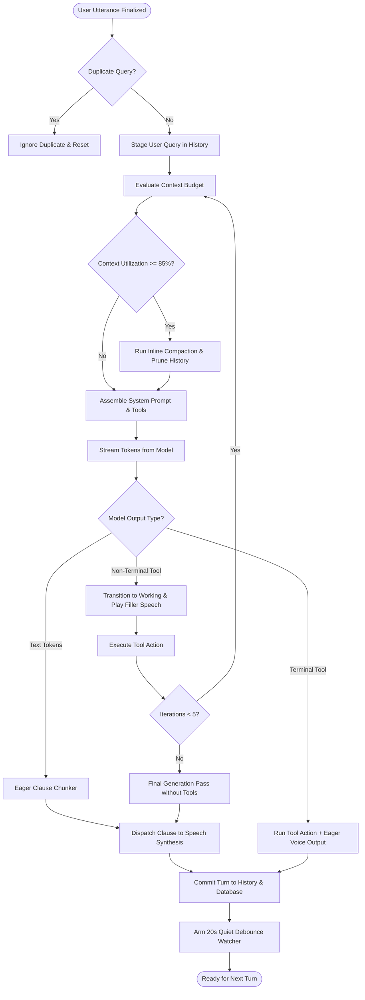
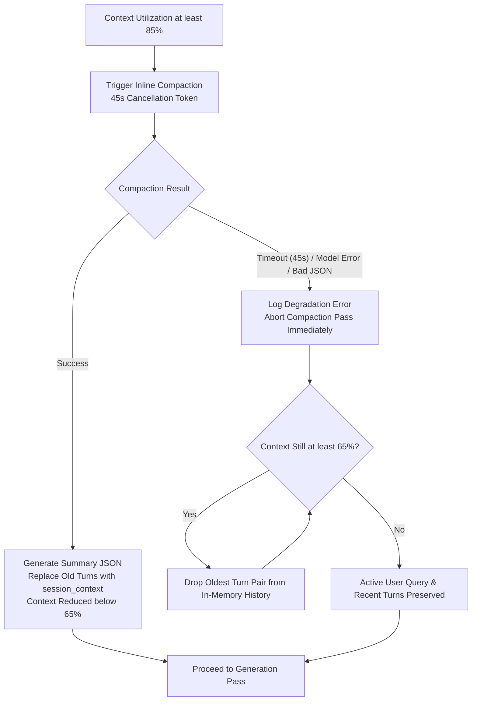

# LLM Agent Harness Runtime Specification

## 1. Intent & Scope

### 1.1 Lane
Cognitive Orchestration & Runtime Execution Specification. This document specifies the turn sequencing loop, context budget evaluation, prompt assembly, eager clause chunking for speech synthesis, and reentrant tool execution in Vox.

### 1.2 Purpose
Vox separates stateless language model compute from conversational orchestration. The model produces text tokens; the Harness manages dialogue history, enforces context limits, streams speakable clauses to speech synthesis with sub-second latency, and executes agentic tools.

### 1.3 Out of Scope
- Operating system audio drivers and microphone callbacks (governed by `events-spec.md`).
- Virtual keyboard simulation and desktop clipboard safety (governed by `dictation-spec.md`).
- Relational table schemas and vector embedding storage (governed by `db-spec.md`).
- External model catalog synchronization and provider wire encoding (governed by `provider-model-catalog-spec.md`).

---

## 2. User Stories

| ID | Story |
| :--- | :--- |
| **US-HARN-01** | As a user conversing with the assistant, I want to hear the first spoken sentence within 800ms of speaking, so that conversation feels natural without waiting for the full response to generate. |
| **US-HARN-02** | As a user asking a question that triggers a terminal tool (such as setting a session title), I want the assistant to speak its answer and run the tool in a single generation pass, so that I experience zero extra delay. |
| **US-HARN-03** | As a user asking a question that requires searching memory, I want the assistant to speak an interim filler phrase immediately, so that I do not experience dead air while the tool runs. |
| **US-HARN-04** | As a user in a long conversation, I want earlier context compressed automatically when memory exceeds 85%, so that conversation continues smoothly without overflowing model limits. |
| **US-HARN-05** | As a user interrupting the assistant mid-sentence, I want whatever partial text was spoken saved to history, so that follow-up questions understand what was already said. |
| **US-HARN-06** | As a user speaking repetitive greetings, I want accidental duplicate queries filtered out, so that the assistant does not waste tokens generating duplicate responses. |

---

## 3. Cognitive Turn Architecture

---

## 4. Behavior Rules & Lifecycle Invariants

### 4.1 Orchestrator Authority & Session Lifecycle
- **RULE-HARN-01 (Single Cognitive Orchestrator)**: Exactly one Harness orchestrator MUST own turn sequencing, prompt assembly, context budgeting, and tool execution. External pipeline layers MUST interact exclusively via the turn execution gateway.
- **RULE-HARN-02 (1:1 Session Mapping)**: The Harness lifecycle MUST map 1:1 to user session engagement:
  - Mounted when a session starts; loads persona prompt, personal memory, and uncompacted historical turns.
  - Deconstructed when a session ends; flushes pending metrics, cancels background timers, and retains zero conversational memory in RAM during idle state.
- **RULE-HARN-03 (Duplicate Query Filtering)**: If an incoming user query matches the preceding user query within a short temporal window, the Harness MUST ignore the duplicate without advancing turn counters or generating responses.

### 4.2 Context Budgeting & Compaction
- **RULE-HARN-04 (Context Utilization Formula)**: Context utilization MUST be calculated as:
  $$\text{Utilization} = \frac{\text{Tracked In-Memory Tokens}}{\text{Model Context Window} - \text{Reserved Output Tokens}}$$
- **RULE-HARN-05 (Context Classification & Actions)**:
  - **Nominal ($< 65\%$)**: Healthy context; turn proceeds directly.
  - **Soft ($65\% \le \text{Utilization} < 85\%$)**: Context elevated; arms a 20-second quiet debounce timer upon turn completion. If the user remains silent for 20 seconds, background compaction executes.
  - **Critical ($\ge 85\%$)**: Context saturated; triggers inline compaction before generating the response.
- **RULE-HARN-06 (Compaction Degradation Fallback)**: If inline compaction fails, times out, or returns invalid data:
  1. The system MUST NOT retry in a loop or halt the voice turn.
  2. The system MUST execute a FIFO sliding window shift, dropping the oldest historical turn pairs until context drops below 65%.
  3. The active user query MUST always be preserved.

### 4.3 Prompt Structure & KV-Cache Stability
- **RULE-HARN-07 (Fixed Prefix Order)**: To maximize KV-cache reuse across turns and reduce time-to-first-token, the root system prompt (Message 0) MUST enforce a strict fixed order:
  1. Base Persona instructions (static prefix).
  2. `<user_identity>`: Personal memory facts (capped at 20% of context window).
  3. `<session_context>`: Historical summary of compacted turns (if present).
  4. Passive memory negative guard (instructions to not recite memory unprompted).
- **RULE-HARN-08 (No Tool Instructions in Prompt Text)**: Available tools MUST be declared strictly via the structured API tools parameter, NEVER injected as raw text into the system prompt.

### 4.4 Eager Clause Chunking & Speech Delivery
- **RULE-HARN-09 (Eager Clause Streaming)**: Incoming model tokens MUST be normalized and chunked into speakable clauses eagerly as sentence boundaries are detected. Completed clauses MUST be dispatched immediately to speech synthesis to minimize time-to-first-audio.
- **RULE-HARN-10 (Sentence Boundary Rules)**:
  - Valid sentence terminators are periods (`.`) and question marks (`?`).
  - Terminal periods MUST be guarded against decimals (`3.14`) and abbreviations (`Dr.`, `e.g.`, `i.e.`).
  - Exclamation points (`!`) trigger a split only if the clause contains at least 4 words; short conversational openers (`"Hey!"`, `"Sure!"`) remain glued to the subsequent sentence to preserve natural speech melody.
  - If accumulated tokens exceed 22 words without terminal punctuation, the chunker MUST split at the nearest major syntactic boundary (semicolon, colon, or comma before coordinating conjunctions) to prevent runaway buffering.

### 4.5 Agentic Tool Execution Chassis
- **RULE-HARN-11 (Tool Classification & Execution Flow)**:
  - **Terminal Tools (Single-Pass Voice + Action)**: Terminal tools MUST include a required `spoken_response` parameter. Upon invocation:
    1. The `spoken_response` is dispatched immediately to speech synthesis.
    2. The tool action executes in the background.
    3. The pipeline transitions directly to `Speaking` without entering `Working`.
    4. The turn completes in a single generation pass with zero second-pass latency.
  - **Non-Terminal Tools (Reentrant Cognitive Loop)**: Non-terminal tools provide data needed for subsequent reasoning. Upon invocation:
    1. The pipeline transitions from `Thinking` to `Working`.
    2. The model-provided `spoken_filler` is dispatched to speech synthesis to eliminate dead air.
    3. The tool executes with a 10-second timeout.
    4. The result is staged into a turn-local scratchpad, and a reentrant generation pass executes.
    5. Reentrant iterations MUST NOT exceed 5. If breached, the Harness forces a final generation pass with tools disabled.
- **RULE-HARN-12 (Interruption & Cancellation Persistence)**:
  - When a turn is interrupted (barge-in):
    - If partial assistant text was already spoken, it MUST be saved to history as an interrupted turn.
    - If no assistant text was spoken, the turn MUST be rolled back from history.
    - The turn-local tool scratchpad MUST be discarded.

---

## 5. Prompt Tag Schema & History Representation

### 5.1 Delimiter Tags
To avoid formatting errors, prompt assembly uses strict XML tags:
- `<user_identity>...</user_identity>`: Wraps personal memory markdown facts in Message 0 (capped at 20% context window).
- `<session_context>...</session_context>`: Wraps the rolling summary of compacted turns in Message 0.

### 5.2 Dialogue History Representation
- Past conversation turns are represented strictly as alternating message entries:
  - `{"role": "user", "content": "..."}`
  - `{"role": "assistant", "content": "..."}`
- Tool call requests and tool results within a turn exist in an ephemeral scratchpad and are committed into message history upon turn completion to support verbal follow-ups.

---

## 6. Architectural Decisions & Alternatives

| Decision | Choice | Rationale | Rejected Alternative |
| :--- | :--- | :--- | :--- |
| **Eager Clause Streaming** | Stream clauses to TTS as sentences complete | Achieves sub-800ms speech onset without waiting for the full LLM response to generate. | Full-response buffering (added 3–6s latency before audio started). |
| **Terminal Tool Single-Pass** | Require `spoken_response` parameter in terminal tools | Resolves tools and voice response in a single LLM pass with zero 2-pass delay. | Standard 2-pass tool loop (forced a second complete LLM call just to say "Title updated"). |
| **Non-Terminal Spoken Filler** | Model-provided `spoken_filler` parameter | Eliminates dead air during tool execution with natural, context-aware filler phrases. | Awkward multi-second silence or repetitive hardcoded beeps during tool calls. |
| **Fixed Prompt Prefix Order** | Static persona first, then memory, then summary | Maximizes KV-cache prefix hits across turns, cutting prefill latency and compute cost. | Dynamic prompt concatenation (invalidated KV-cache on every turn, causing latency spikes). |
| **Adaptive Runaway Chunker** | Backwards scan for syntax seams at 22 words | Prevents monotonic, runaway sentences while preserving natural prosodic clauses. | Fixed word-count splitting (chopped sentences mid-phrase, causing robotic audio artifacts). |
| **Fail-Fast FIFO Fallback** | Fall back to FIFO window shift on compaction failure | Guarantees the voice turn is never blocked when summarization fails or models stall. | Infinite compaction retry loop (froze voice interaction when compaction encountered errors). |

---

## 7. Verification Criteria

- **Eager Streaming Latency**: Measure time from speech end to first audio sample generated. Verify that first audio playback begins in $<800\text{ms}$ on standard hardware.
- **Terminal Tool Single Pass**: Trigger `respond_and_set_title`. Verify that speech synthesis begins on the first pass and exactly one LLM generation request was made.
- **Non-Terminal Working Transition**: Trigger `search_memory`. Verify that state transitions to `Working`, interim filler audio plays, tool executes, and finalized answer plays after the reentrant pass.
- **Compaction Threshold Invariant**: Simulate conversation exceeding 85% context utilization. Verify that inline compaction executes before response generation, prunes history, and updates the session context.
- **Interrupted Turn Rollback**: Interrupt assistant speech within the first 100ms before words are synthesized. Verify that the turn is rolled back cleanly from history with zero partial turn artifacts.
