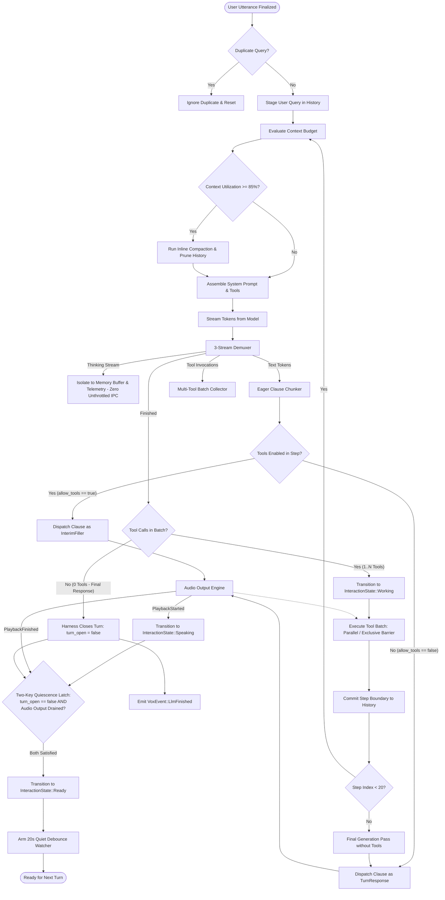
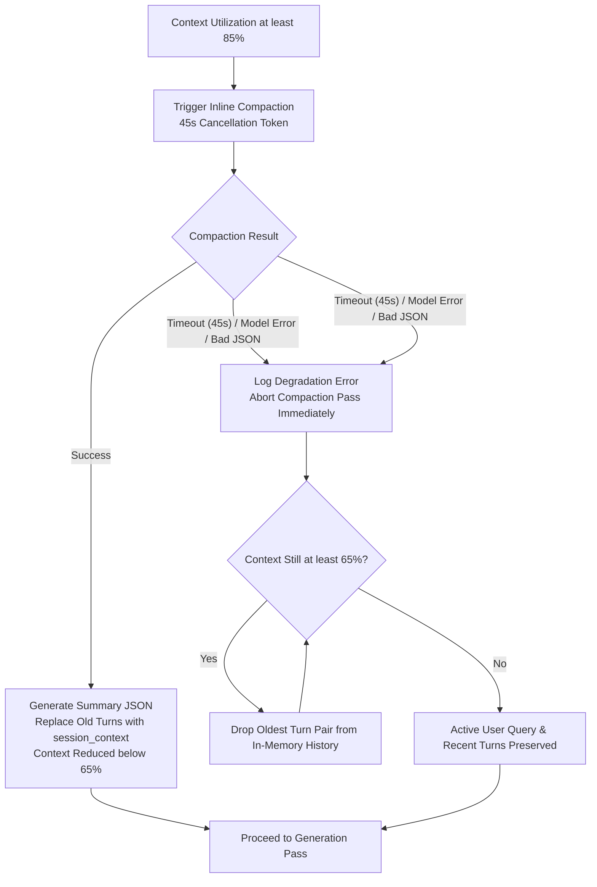

# LLM Agent Harness Runtime Specification

## 1. Intent & Scope

### 1.1 Lane
Cognitive Orchestration & Runtime Execution Specification. This document specifies the turn sequencing loop, context budget evaluation, prompt assembly, 3-stream demuxing, eager clause chunking for speech synthesis, and reentrant multi-tool execution in Vox.

### 1.2 Purpose
Vox separates stateless language model compute from conversational orchestration. The model produces multiplexed reasoning, conversational text, and structured tool calls. The Harness manages dialogue history, enforces context limits, streams speakable clauses to speech synthesis with sub-800ms latency, quarantines reasoning tokens, and executes agentic tools with zero schema bloat.

### 1.3 Out of Scope
- Operating system audio drivers and microphone callbacks (governed by `events-spec.md`).
- Virtual keyboard simulation and desktop clipboard safety (governed by `dictation-spec.md`).
- Relational table schemas and vector embedding storage (governed by `db-spec.md`).
- External model catalog synchronization and provider wire encoding (governed by `provider-model-catalog-spec.md`).

---

## 2. User Stories

| ID | Story |
| :--- | :--- |
| **US-HARN-01** | As a user conversing with the assistant, I want to hear the first spoken sentence within 800ms of speaking, so that conversation feels natural without waiting for the full response to generate. |
| **US-HARN-02** | As a user whose request requires tools, I want to hear the assistant speak its natural introductory thoughts immediately without dropped speech, so that I experience continuous conversational presence while tools execute. |
| **US-HARN-03** | As a user whose request triggers multiple tools, I want the assistant to execute parallel tools concurrently without artificial single-tool limits or schema-bloated filler parameters. |
| **US-HARN-04** | As a user in a long conversation, I want earlier context compressed automatically when memory exceeds 85%, so that conversation continues smoothly without overflowing model limits. |
| **US-HARN-05** | As a user interrupting the assistant mid-sentence, I want whatever partial text was spoken saved to history, so that follow-up questions understand what was already said. |
| **US-HARN-06** | As a user speaking repetitive greetings, I want accidental duplicate queries filtered out, so that the assistant does not waste tokens generating duplicate responses. |
| **US-HARN-07** | As a user interacting with advanced reasoning models (DeepSeek R1, Claude 3.7), I want thinking and reasoning tokens strictly isolated from speech and display, so that internal cognitive traces never leak into spoken audio or corrupt conversation context. |

---

## 3. Cognitive Turn Architecture

---

## 4. Behavior Rules & Lifecycle Invariants

### 4.1 Orchestrator Authority & Session Lifecycle
- **RULE-HARN-01 (Single Cognitive Orchestrator)**: Exactly one Harness orchestrator MUST own turn sequencing, prompt assembly, context budgeting, and tool execution. External pipeline layers MUST interact exclusively via the turn execution gateway.
- **RULE-HARN-02 (1:1 Session Mapping)**: The Harness lifecycle MUST map 1:1 to user session engagement:
  - Mounted when a session starts; loads persona prompt, personal memory, and uncompacted historical turns.
  - Deconstructed when a session ends; flushes pending metrics, cancels background timers, and retains zero conversational memory in RAM during idle state.
- **RULE-HARN-03 (Duplicate Query Filtering)**: If an incoming user query matches the preceding user query within a short temporal window, the Harness MUST ignore the duplicate without advancing turn counters or generating responses.

### 4.2 Context Budgeting & Compaction
- **RULE-HARN-04 (Context Utilization Formula)**: Context utilization MUST be calculated as:
  $$\text{Utilization} = \frac{\text{Tracked In-Memory Tokens}}{\text{Model Context Window} - \text{Reserved Output Tokens}}$$
- **RULE-HARN-05 (Context Classification & Actions)**:
  - **Nominal ($< 65\%$)**: Healthy context; turn proceeds directly.
  - **Soft ($65\% \le \text{Utilization} < 85\%$)**: Context elevated; arms a 20-second quiet debounce timer upon turn completion. If the user remains silent for 20 seconds, background compaction executes.
  - **Critical ($\ge 85\%$)**: Context saturated; triggers inline compaction before generating the response.
- **RULE-HARN-06 (Compaction Degradation Fallback)**: If inline compaction fails, times out, or returns invalid data:
  1. The system MUST NOT retry in a loop or halt the voice turn.
  2. The system MUST execute a FIFO sliding window shift, dropping the oldest historical turn pairs until context drops below 65%.
  3. The active user query MUST always be preserved.

### 4.3 Prompt Structure & KV-Cache Stability
- **RULE-HARN-07 (Fixed Prefix Order)**: To maximize KV-cache reuse across turns and reduce time-to-first-token, the root system prompt (Message 0) MUST enforce a strict fixed order:
  1. Base Persona instructions (static prefix).
  2. `<user_identity>`: Personal memory facts (capped at 20% of context window).
  3. `<session_context>`: Historical summary of compacted turns (if present).
  4. Passive memory negative guard (instructions to not recite memory unprompted).
- **RULE-HARN-08 (No Tool Instructions in Prompt Text)**: Available tools MUST be declared strictly via the structured API tools parameter, NEVER injected as raw text into the system prompt.

### 4.4 3-Stream Demuxing & Speech Delivery
- **RULE-HARN-09 (3-Stream Demuxing & Thinking Isolation)**:
  1. The streaming router MUST demux incoming model responses into three distinct channels in a single pass:
     - **Thinking Stream (`LlmStreamEvent::Thinking`)**: Captured into an isolated turn memory buffer and debug telemetry. Thinking tokens MUST NOT be passed to `ClauseChunker`, MUST NOT be sent to speech synthesis, MUST NOT be emitted as unthrottled per-token IPC events to the UI (complying with `events-spec.md RULE-EVT-02`), and MUST NOT be written to `turns.assistant_text`.
     - **Content Token Stream (`LlmStreamEvent::Token`)**: Eagerly chunked into speakable clauses and emitted to `IpcEvent::LlmToken`.
     - **Tool Call Stream (`LlmStreamEvent::ToolCall`)**: Buffered into a `Vec<CanonicalToolCall>` batch until `Finished`.
  2. Concrete provider stream adapters (`chat_completions.rs`, `ollama.rs`, `sidecar.rs`) MUST parse structured reasoning deltas or state-machine strip inline `<think>...</think>` tags at the network ingress boundary so raw thinking tags never enter the content token stream.
  3. The streaming router MUST NOT abort stream consumption upon receiving a tool call. It MUST continue reading until `Finished`, `Cancelled`, or `Error`.
- **RULE-HARN-10 (Sentence Boundary Rules)**:
  - Valid sentence terminators are periods (`.`) and question marks (`?`).
  - Terminal periods MUST be guarded against decimals (`3.14`) and abbreviations (`Dr.`, `e.g.`, `i.e.`).
  - Exclamation points (`!`) trigger a split only if the clause contains at least 4 words; short conversational openers (`"Hey!"`, `"Sure!"`) remain glued to the subsequent sentence to preserve natural speech melody.
  - If accumulated tokens exceed 22 words without terminal punctuation, the chunker MUST split at the nearest major syntactic boundary (semicolon, colon, or comma before coordinating conjunctions) to prevent runaway buffering.
- **RULE-HARN-10A (Preamble Speech Preservation)**:
  - If the model emits spoken tokens prior to tool calls in a generation pass (e.g. *"Let me search the files for that"*), the router MUST NOT clear the chunker or discard accumulated characters.
  - The preamble text MUST be preserved in `StreamPassOutcome::ToolCallsReceived` and recorded in conversation history as the assistant message initiating the tool calls.
- **RULE-HARN-10B (Stream Audio Intent & Two-Key Quiescence Latch)**:
  1. In any step where tools are enabled (`allow_tools == true`), mid-stream clauses extracted before `LlmResponse::Finished` MUST be dispatched to TTS with `AudioIntent::InterimFiller` (since the router cannot know in advance whether tool calls will follow). If `allow_tools == false`, all clauses are dispatched as `AudioIntent::TurnResponse`.
  2. While `turn_open == true` (the cognitive ReAct loop is still active), audio playback onset (`on_playback_started`) for `AudioIntent::InterimFiller` MUST NOT transition the pipeline to `Speaking`, and audio playback completion (`on_playback_finished`) MUST return early (`if state.pipeline.is_turn_open() { return; }`) so the pipeline remains stably in `Thinking` or `Working`.
  3. Preamble audio playback on the sound card and background tool execution MUST execute concurrently. The coordinator MUST NOT await audio draining before launching tool futures.
  4. When a generation pass finishes with zero tool calls (`StreamPassOutcome::Completed`), the cognitive turn is complete: any unpunctuated tail is flushed as `AudioIntent::TurnResponse`, and `loop.rs` emits `VoxEvent::LlmFinished { turn_id }`.
  5. Upon receiving `VoxEvent::LlmFinished`, `on_llm_finished` sets `turn_open = false` (**Key 1**). If audio synthesis or playback is still in progress (`pending_synthesis_jobs > 0` or sink active), `on_llm_finished` (or `on_playback_started` when `turn_open == false`) transitions the pipeline to `InteractionState::Speaking`.
  6. Transition to `InteractionState::Ready` is governed strictly by the **Two-Key Quiescence Latch** (`turn_open == false` AND `pending_synthesis_jobs == 0` with sound card buffer drained), evaluated in both `on_llm_finished` and `on_playback_finished` **regardless of whether the draining audio chunks were originally dispatched with `InterimFiller` or `TurnResponse`**.

### 4.5 Agentic Tool Execution Chassis
- **RULE-HARN-11 (ZBC Universal Tool Interface & Concurrency Mode)**:
  - Cognitive tool definitions MUST NOT declare execution flow categories (`Terminal` vs `NonTerminal`).
  - Cognitive tool JSON schemas MUST NOT include synthetic speech parameters (`spoken_filler` or `spoken_response`).
  - All tools adhere to a single canonical contract: name, description, JSON schema, and asynchronous execution returning `ToolResult`.
  - The legacy `respond_and_set_title` tool is replaced by the universal `set_title` tool taking only `{"title": "..."}`.
  - Tools self-declare their Harness-owned concurrency mode via `execution_mode(&self, args: &Value) -> ToolExecutionMode { Parallel, Exclusive }`.
  - Read-only tools (`search_memory`, `web_search`, `read_file`) and metadata update tools (`set_title`) declare `ToolExecutionMode::Parallel`.
  - Mutating tools (`write_file`, `bash`) declare `ToolExecutionMode::Exclusive`.
- **RULE-HARN-11A (Multi-Tool Batch Collection & Barrier Wave Scheduling)**:
  - The streaming demuxer collects all tool call requests emitted during a generation pass into a single batch.
  - The tool execution engine (`ToolExecutor::execute_batch`) schedules batch execution using Harness-owned barriers: contiguous `Parallel` tools run concurrently via `futures_util::future::join_all`, while `Exclusive` tools form strict sequential barriers that drain preceding waves before executing alone.
  - Outcomes MUST be committed to history in the exact sequence declared by the model, preserving deterministic declaration order across concurrent completions.
- **RULE-HARN-11B (Coordinator State Machine Authority & Immediate Step Commits)**:
  - The Harness coordinator (`loop.rs`) exclusively owns state machine transitions (`Thinking` $\to$ `Working` $\to$ `Speaking` $\to$ `Ready`).
  - When a tool batch is received, the coordinator transitions the pipeline to `InteractionState::Working` with the active `ActivityEnvelope`. Downstream tools and audio callbacks MUST NOT initiate pipeline state transitions.
  - Intermediate cognitive ReAct iterations MUST NOT be accumulated in volatile turn-scoped scratchpads. At each step boundary, the assistant preamble message and all associated tool observations MUST be committed immediately to `ConversationHistoryStage` via `commit_tool_step`.
  - If batch execution is cancelled or suspended mid-batch (`cancel.is_cancelled()` or `SuspendForUser`), `commit_tool_step` MUST synthesize `"Tool execution cancelled"` fallback observations for all unexecuted calls in the batch, guaranteeing a strict 1:1 `tool_calls` $\leftrightarrow$ `Role::Tool` bijection and preventing provider HTTP 400 errors on subsequent turns.
- **RULE-HARN-11C (Reentrant Step Loop Ceiling & Mandatory Summary Pass)**:
  - The coordinator supports iterative ReAct execution up to `MAX_TOOL_STEPS = 20`.
  - If step 20 is reached without a terminal answer, the coordinator disables tools (`allow_tools = false`) and executes a mandatory final summary generation pass, producing a complete spoken summary (`AudioIntent::TurnResponse`). The coordinator MUST NOT abort with an unhandled error unless the summary pass itself fails.
- **RULE-HARN-11D (Relational Trajectory SSOT in Turso DB)**:
  - Cognitive trajectories MUST be persisted relationally in the local Turso database engine under a 1:N hierarchy:
    `sessions (1)` $\to$ `turns (N)` $\to$ `session_steps (M)` $\to$ `session_tool_calls (K)`.
  - `PersistenceWorker` processes events in FIFO order. `PersistenceEvent::StepCompleted` MUST be dispatched before the batch's `PersistenceEvent::ToolCallExecuted` events to guarantee the foreign key parent row exists before child rows are inserted.
- **RULE-HARN-12 (Interruption, Cancellation & Non-Rollback Invariant)**:
  - When a turn is interrupted (barge-in):
    - Active tool execution tasks and child futures MUST be aborted via `CancellationToken`.
    - User turn rollback (`rollback_last_user_turn`) is strictly restricted to Step 0 interruptions where zero assistant speech and zero tool executions have occurred (`last.role == Role::User`).
    - Once Step 1 tools have commenced execution or spoken a preamble, `commit_tool_step` has run (`last.role == Role::Tool`), and rollback is strictly forbidden. Preceding tool observations remain permanently preserved in history.

---

## 5. Prompt Tag Schema & History Representation

### 5.1 Delimiter Tags
To avoid formatting errors, prompt assembly uses strict XML tags:
- `<user_identity>...</user_identity>`: Wraps personal memory markdown facts in Message 0 (capped at 20% context window).
- `<session_context>...</session_context>`: Wraps the rolling summary of compacted turns in Message 0.

### 5.2 Dialogue History Representation
- Past conversation turns and multi-step tool interactions are represented in strict standard multi-turn formatting:
  - `{"role": "user", "content": "..."}`
  - `{"role": "assistant", "content": "Let me look that up...", "tool_calls": [...]}`
  - `{"role": "tool", "tool_call_id": "call_123", "content": "..."}`
  - `{"role": "assistant", "content": "The result is..."}`
- Tool call requests and tool observations are committed to history immediately at each step boundary (`RULE-HARN-11B`), ensuring subsequent reentrant steps and follow-up turns retain full conversational and evidence context.

---

## 6. Architectural Decisions & Alternatives

| Decision | Choice | Rationale | Rejected Alternative |
| :--- | :--- | :--- | :--- |
| **3-Stream Demuxing** | Demux thinking, content tokens, and tool calls in a single pass | Natively isolates reasoning tokens and collects multi-tool batches while preserving sub-800ms speech onset. | Monolithic text stream (leaked reasoning tokens into audio and truncated parallel tool calls). |
| **Natural Preamble Preservation** | Stream introductory text as `AudioIntent::InterimFiller` without chunker wipe | Preserves conversational flow; user hears the assistant start working without awkward dead air. | Dropping preamble speech (`acc.chunker.clear()`) and patching with schema-bloated `spoken_filler`. |
| **Universal Tool Interface (ZBC)** | Zero flow classification (`Terminal`/`NonTerminal`) and zero speech parameters | Enforces clean separation of concerns: tools execute logic; the LLM speaks naturally; the coordinator manages state. | Legacy `Terminal` vs `NonTerminal` dual classification with artificial `spoken_response` and `spoken_filler` schema bloat. |
| **Harness-Owned State Transitions** | Coordinator (`loop.rs`) drives `Working` and `Ready` states | Decouples audio playback callbacks from state machines, eliminating mid-turn state inversion bugs. | Playback callbacks driving `Speaking` and `Ready` transitions on audio buffer draining. |
| **Fixed Prompt Prefix Order** | Static persona first, then memory, then summary | Maximizes KV-cache prefix hits across turns, cutting prefill latency and compute cost. | Dynamic prompt concatenation (invalidated KV-cache on every turn, causing latency spikes). |
| **Adaptive Runaway Chunker** | Backwards scan for syntax seams at 22 words | Prevents monotonic, runaway sentences while preserving natural prosodic clauses. | Fixed word-count splitting (chopped sentences mid-phrase, causing robotic audio artifacts). |
| **Fail-Fast FIFO Fallback** | Fall back to FIFO window shift on compaction failure | Guarantees the voice turn is never blocked when summarization fails or models stall. | Infinite compaction retry loop (froze voice interaction when compaction encountered errors). |

---

## 7. Verification Criteria

- **Eager Streaming Latency**: Measure time from speech end to first audio sample generated. Verify that first audio playback begins in $<800\text{ms}$ on standard hardware.
- **Preamble Speech Preservation**: Trigger a tool-calling query where the model speaks an introductory phrase. Verify that the preamble is synthesized, played on speakers, and committed to conversation history without truncation.
- **Multi-Tool Batch Collection**: Trigger a query invoking multiple tools. Verify that all tool calls in the pass are collected, scheduled across execution barriers, and executed without early return on the first tool call.
- **Interim Audio State Isolation**: Verify that preamble audio playback tagged `AudioIntent::InterimFiller` does NOT transition the pipeline to `Speaking` or `Ready` while tools are running.
- **Thinking Token Isolation**: Stream reasoning tokens (`<think>` or `reasoning_content`). Verify that thinking tokens are quarantined, never dispatched to `ClauseChunker`, never emitted to `IpcEvent::LlmToken`, and never persisted to `turns.assistant_text`.
- **Compaction Threshold Invariant**: Simulate conversation exceeding 85% context utilization. Verify that inline compaction executes before response generation, prunes history, and updates the session context.
- **Interrupted Turn Rollback**: Interrupt assistant speech within the first 100ms before words are synthesized. Verify that the turn is rolled back cleanly from history with zero partial turn artifacts.
