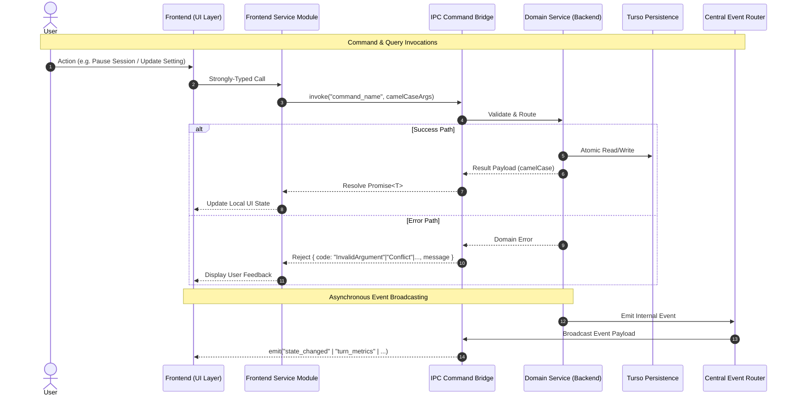

# IPC Command & Event Specification

## 1. Intent & Scope

### 1.1 Lane
Boundary & Interface Specification. This document specifies the frontend-to-backend command interfaces, backend-to-frontend event contracts, serialization schemas, and error conventions for Vox.

### 1.2 Purpose
Vox separates the native desktop/audio runtime from the user interface. This specification defines the strongly-typed asynchronous contract across this boundary, ensuring atomic mutations, predictable reload policies, and event-driven UI updates.

### 1.3 Out of Scope
- Database table schemas and SQL execution (governed by `db-spec.md`).
- Memory consolidation algorithms and semantic embeddings (governed by `memory-spec.md`).
- Real-time internal pipeline audio buffers and actor channels (governed by `events-spec.md`).

---

## 2. User Stories

| ID | Story |
| :--- | :--- |
| **US-IPC-01** | As a user browsing past sessions, I want fast, paginated session queries with turn counts and previews, so that I can quickly resume past context. |
| **US-IPC-02** | As a user editing my personal memory profile, I want markdown edits saved with optimistic concurrency validation, so that concurrent background merges do not overwrite my changes. |
| **US-IPC-03** | As a user reviewing proposed memory changes, I want to approve or reject batches of revisions in a single transaction, so that review is fast and atomic. |
| **US-IPC-04** | As a user speaking into the microphone, I want streaming transcripts and turn latencies delivered via real-time events, so that the UI reflects assistant state instantly. |
| **US-IPC-05** | As a user tuning settings, I want invalid inputs rejected with clear errors, and settings requiring hardware rebuilds to trigger coalesced restarts, so that settings always match runtime behavior. |
| **US-IPC-06** | As a user observing assistant tool calls, I want an activity indicator describing what the assistant is doing, so that long-running operations are visible. |

---

## 3. Boundary Invariants & Protocol Rules

### 3.1 Service Boundary
- **RULE-IPC-01 (Strict Boundary)**: The user interface layer MUST NEVER invoke raw transport primitives directly from presentation components. All IPC calls MUST route through strongly-typed frontend service modules.
- **RULE-IPC-02 (Adapter Only)**: Backend IPC handlers MUST act strictly as transport adapters. Handlers MUST validate input parameters, delegate execution to domain services or persistence components, and write zero raw queries.
- **RULE-IPC-03 (Case Serialization)**: Parameter contracts MUST accept parameters in `camelCase` from the frontend and serialize output payloads to `camelCase` JSON.

### 3.2 Error & Response Contracts
- **RULE-IPC-04 (Explicit Error Categories)**: All commands MUST return strongly-typed results. Failures MUST map to one of the following closed error categories:
  - `InvalidArgument`: Malformed input, unrecognised keys, or validation failure.
  - `NotFound`: Target resource ID does not exist.
  - `Conflict`: Optimistic concurrency version mismatch.
  - `Pipeline`: Audio engine, VAD, or model runtime failure.
  - `Database`: Underlying persistence engine error.
- **RULE-IPC-05 (Unknown Setting Rejection)**: Submitting an unrecognised setting key MUST return `InvalidArgument`. It MUST NOT return a success response with an unapplied flag.
- **RULE-IPC-06 (Backend-Owned Reload Policy)**: Setting mutation responses MUST return the determined reload policy (`Hot`, `WorkerCommand`, or `Restart`) and indicate whether a restart was scheduled. Restarts MUST be coalesced across concurrent mutations.

### 3.3 Protocol Flow & Boundary Sequencing

---

## 4. Frontend-to-Backend Commands

### 4.1 Projects Domain
| Command | Arguments | Return Shape | Behavioral Contract |
| :--- | :--- | :--- | :--- |
| `get_projects` | None | `Array<ProjectRecord>` | Returns all projects ordered newest first. Always includes the default project (`'default'`). |
| `create_project` | `name: string` | `ProjectRecord` | Validates non-empty name, mints unique slug/ID, creates project record. |
| `rename_project` | `projectId: string`, `newName: string` | `void` | Validates non-empty name, updates display name. Returns `NotFound` if missing. |
| `delete_project` | `projectId: string` | `void` | Hard deletes project. Rejects `'default'` and projects with active sessions with `InvalidArgument`. |

### 4.2 History & Persistence Domain
| Command | Arguments | Return Shape | Behavioral Contract |
| :--- | :--- | :--- | :--- |
| `get_sessions` | `projectId?: string` | `Array<SessionRecord>` | Returns sessions where `deletedAt` is null, ordered pinned first then newest. Includes `turnCount` and `firstMessage`. |
| `get_turns` | `sessionId: number` | `Array<TurnRecord>` | Returns finalized turns in sequential order (`turnId ASC`). |
| `update_session` | `sessionId: number`, `title?: string`, `isPinned?: boolean`, `projectId?: string` | `void` | Updates specified session fields. If any field changed, emits `sessions_changed` event. |
| `delete_session` | `sessionId: number`, `hard?: boolean` | `void` | If `hard=true`, permanently deletes session and cascades to turns/compactions. If `hard=false`/omitted, soft-deletes via `deletedAt`. Emits `sessions_changed`. |
| `get_transcript_history`| None | `Array<TranscriptTurn>`| Returns transient in-memory transcript deque for tray display without disk I/O. |

### 4.3 Personal Memory Domain
*The canonical personal memory representation is structured JSON. All IPC wire formats transmit rendered Markdown; canonical JSON never leaves the backend.*

| Command | Arguments | Return Shape | Behavioral Contract |
| :--- | :--- | :--- | :--- |
| `get_personal_memory` | `projectId?: string` | `PersonalMemoryRecord` | Returns active memory rendered to Markdown with version and last consolidated timestamp. |
| `save_personal_memory` | `content: string`, `expectedVersion: number`, `projectId?: string` | `PersonalMemoryRecord` | Converts rendered Markdown back to canonical semantic model, validates structure, and saves under optimistic concurrency check (`version == expectedVersion`). Emits `personal_memory_updated`. |
| `consolidate_personal_memory` | `comments?: Array<string>`, `projectId?: string`, `forced?: boolean` | `ConsolidationOutcome` | Integrates personal observations or stages comment edits into revisions. If compaction is running, returns `ConfirmationRequired(CompactionInProgress)`. If queue has pending items and `forced!=true`, returns `ConfirmationRequired(PendingQueueItems)`. Emits `personal_memory_updated` on completion. |
| `regenerate_personal_memory` | `projectId?: string` | `PersonalMemoryRecord` | Resynthesizes memory from all integrated facts, mints fresh semantic IDs, rejects superseded revisions, bumps version. Emits `personal_memory_updated`. |
| `get_personal_memory_versions`| `projectId?: string` | `Array<PersonalMemoryRecord>` | Returns historical versions rendered to Markdown ordered newest first. |
| `set_active_personal_memory_version`| `version: number`, `projectId?: string` | `PersonalMemoryRecord` | Activates selected historical version, marks other versions inactive. Emits `personal_memory_updated`. |
| `get_memory_revisions` | `projectId?: string` | `Array<MemoryRevisionView>` | Lists pending semantic operations (`create_section`, `create_block`, `update_block`, `delete_block`) with resolved human-readable previews. |
| `resolve_memory_revisions` | `decisions: Array<{id, action}>`, `projectId?: string` | `PersonalMemoryRecord` | Applies accepted operations to semantic model and rejects others in a single atomic transaction. Bumps document version and emits `personal_memory_updated`. |
| `get_observations` | `projectId?: string`, `status?: string`, `limit?: number`, `offset?: number` | `Array<ObservationRecord>` | Returns paginated raw observations extracted from sessions (`type = 'personal'`). |

### 4.4 Notifications Domain
| Command | Arguments | Return Shape | Behavioral Contract |
| :--- | :--- | :--- | :--- |
| `get_notifications` | None | `Array<NotificationRecord>` | Returns all non-dismissed notifications ordered newest first. |
| `mark_notifications_read` | `filter?: NotificationFilter` | `void` | Marks matching unread notifications as read. |
| `dismiss_notifications` | `filter?: NotificationFilter` | `void` | Marks matching notifications as dismissed. |
| `execute_notification_action` | `id: string`, `action?: string` | `void` | Polymorphic executor; triggers corresponding task (compaction rerun, consolidation, or error recovery) and updates notification in place. |

### 4.5 Pipeline & Audio Domain
| Command | Arguments | Return Shape | Behavioral Contract |
| :--- | :--- | :--- | :--- |
| `launch_engine` | None | `void` | Initializes audio capture, VAD, and pipeline actors in `Idle` state. |
| `stop_engine` | None | `void` | Cleanly stops workers and releases microphone devices. |
| `start_session` | `sessionId?: number` | `void` | Mounts session harness. If `sessionId` is provided (`Some(id)`), restores session continuation state; if omitted (`None`), initializes fresh conversation. Warms models and enters `Ready` state. |
| `create_session` | `projectId?: string` | `void` | Resets in-memory conversation context and unmounts active session to prepare for a fresh session. |
| `continue_session` | `sessionId: number` | `{ session, turns }` | Fetches historical turns and session details from database and loads context into in-memory state for immediate resumption. |
| `pause_session` | None | `void` | Pauses active assistant session; flushes audio buffers while keeping hardware warm. |
| `resume_session` | None | `void` | Resumes paused assistant session; re-arms VAD without device reinitialization. |
| `end_session` | None | `void` | Finalizes assistant session, records completion metrics, and tears down hardware if dictation is idle. |
| `ptt_start` | None | `void` | Opens push-to-talk recording window. |
| `ptt_stop` | None | `void` | Closes push-to-talk recording window and begins speech validation. |
| `ptt_cancel` | None | `void` | Cancels push-to-talk recording window and drops audio frames. |
| `submit_text_input` | `query: string` | `void` | Injects text directly into dialogue pipeline; auto-resumes if paused, interrupts active playback if engaged. |
| `set_playback_muted`| `muted: boolean` | `void` | Toggles speaker muting at audio output sink. |
| `set_mic_muted` | `muted: boolean` | `void` | Gates microphone audio ingestion before VAD. |
| `set_session_private_mode`| `enabled: boolean` | `void` | Enables incognito mode; suppresses database logging for current session. |
| `list_audio_devices` | None | `Array<AudioDevice>` | Enumerates available host microphones and sample rates. |

### 4.6 Settings & Model Management Domain
Settings mutations trigger one of three reload policies returned to the frontend:
- `Hot`: In-memory atomic configuration update; zero worker restarts or audio interruption.
- `WorkerCommand`: Dispatches a targeted actor command to active workers (e.g. updating VAD sensitivity or changing LLM model identifier) without full reinitialization.
- `Restart`: Requires a hardware engine rebuild (e.g. audio device or sample rate change). Concurrent restart mutations are coalesced into a single engine restart cycle.

| Command | Arguments | Return Shape | Behavioral Contract |
| :--- | :--- | :--- | :--- |
| `get_settings` | None | `BootState` | Returns full application settings object, directory health, and active configuration paths. |
| `get_settings_contract` | None | `SettingsContract` | Returns canonical settings classification contract: supported keys by domain, reload policies, secret keys, cloud providers, TTS providers, and numeric defaults. |
| `update_setting` | `domain: string`, `key: string`, `value: unknown` | `{ applied, reloadPolicy, message, restartScheduled }` | Polymorphic setting mutator. Handles domain selections (`active`, `last_selected`), custom server list (`servers`), active voice (`active_voice_id`), and sparse model parameters (`model_parameters`). Applies hot, worker command, or schedules coalesced restart. |
| `reset_settings` | None | `{ settings, reloadPolicy, message, restartScheduled }` | Resets settings to system defaults. |
| `get_model_catalog` | None | `ModelCatalog` | Returns verified model weights manifest. |
| `list_favorite_models` | None | `Array<string>` | Queries `models` table in Turso SQLite for models with `is_favorite = 1`, ordered newest first. |
| `toggle_model_favorite` | `modelId: string` | `boolean` | Atomically toggles `is_favorite` flag for model in `models` table. Returns new favorite boolean. |
| `get_provider_caps` | `providerId: string` | `ProviderCaps` | Returns dynamic capabilities (supported voices, cloning support). Rejects unknown providers with `InvalidArgument`. |
| `manage_models` | `action: string`, `modelId: string` | `void` | Downloads, verifies SHA-256, or deletes local model weights. Emits `model_progress`. |

### 4.7 Voice Catalog & Synthesis Domain
Unified voice management backed by the local Turso `voices` table, serving bundled profiles, custom user clones, and remote provider voices.

| Command | Arguments | Return Shape | Behavioral Contract |
| :--- | :--- | :--- | :--- |
| `list_voices` | `provider?: string` | `Array<UnifiedVoiceDto>` | Queries unified voice entries from Turso. Filters by provider slug when provided. Seeds manifest voices automatically if the table is empty. |
| `toggle_voice_favorite` | `voiceId: string` | `boolean` | Toggles favorite status in Turso `voices` table. Returns the new favorite state. |
| `record_voice_used` | `voiceId: string` | `void` | Updates the `last_used_at` millisecond epoch timestamp in the `voices` table for recents sorting. |
| `set_active_voice` | `voiceId: string` | `void` | Persists `tts.voice_id` into `settings.jsonc` and updates the usage timestamp in the database. |
| `synthesize_voice_preview` | `voiceId: string`, `prompt?: string`, `engine?: string` | `VoicePreviewResult` | Resolves the voice's owning provider from the Turso `voices` table (`engine` selects the modal context when the row is absent). Catalog providers (supertonic, kokoro) synthesize locally on a blocking thread; reference-clip families (chatterbox, zipvoice, custom) copy their reference audio; Edge voices synthesize online. Aborts previous in-flight synthesis. Enforces a 120-character prompt ceiling. |
| `sync_remote_voices` | None | `number` | Spawns a background task to fetch remote provider voices (e.g. Edge TTS) and bulk-upserts them into Turso in a single transaction. |
| `start_backend_recording` | None | `void` | Initiates CPAL microphone capture on a dedicated thread for custom voice cloning. |
| `stop_backend_recording` | None | `[Array<number>, number]` | Terminates CPAL capture and returns audio PCM f32 samples with the native sample rate. |
| `add_voice_from_file` | `name: string`, `filePath: string` | `UnifiedVoiceDto` | Validates WAV audio, writes reference sample, pre-bakes speaker embedding tensors, and inserts a custom clone record. |
| `add_voice_from_recording` | `name: string`, `pcmF32: Array<number>`, `sampleRate: number` | `UnifiedVoiceDto` | Encodes PCM samples to WAV, pre-bakes speaker embedding tensors, and inserts a custom clone record. |
| `delete_voice` | `voiceId: string` | `void` | Permanently deletes a custom voice record and its associated directory files. Rejects deletion of bundled or remote voices. |

---

## 5. Backend-to-Frontend Events

All backend events broadcast over the IPC bridge carry the following contracts:

| Event Name | Payload Shape | Description |
| :--- | :--- | :--- |
| `state_changed` | `{ owner, state, turnId, activity? }` | Primary state machine event (`Idle`, `Ready`, `Listening`, `Thinking`, `Speaking`, `Paused`, `Error`, `Sleeping`, `Working`). |
| `transcript_partial` | `{ turnId, text, owner? }` | Real-time streaming subtitle updates. |
| `transcript_final` | `{ turnId, text, owner? }` | Finalized STT transcript. |
| `llm_token` | `{ turnId, token }` | High-frequency assistant generation token stream. |
| `model_progress` | `{ modelId, step, progress, bytesDownloaded, totalBytes, error? }` | Model download/unpacking progress. |
| `telemetry` | `{ energy, vadProb, low, mid, high }` | 60Hz audio frequency visualizer data. |
| `system_stats` | `{ systemCpu, systemRamPct, voxCpu, voxRamMb, threads }` | Rolling 1-second system resource usage. |
| `notification_created` | `NotificationRecord` | Fired when an actionable notification is issued. |
| `notification_updated` | `NotificationRecord` | Fired when notification status or resolution updates. |
| `personal_memory_updated`| `PersonalMemoryRecord` | Fired when personal memory is modified, consolidated, or regenerated. |
| `turn_metrics` | `{ turnId, ttftMs, ttfaMs, totalVoiceLatencyMs, contextTokensUsed, contextWindow }` | Milestone latencies and token usage for assistant turns. |
| `sessions_changed` | `void` | Signals asynchronous session updates (e.g. title auto-generation). |
| `settings_updated` | `void` | Signals settings hot-reload completion. |

### 5.1 The `activity` Envelope Contract
When `state_changed` has `state === "Working"`, it MUST include an `activity` envelope:
- `kind`: Closed discriminator (`"tool"` or `"compaction"`).
- `name`: Operation identifier (e.g., tool name `'web_search'` or `'compaction'`).
- `callId`: Originating model tool invocation ID (present only when `kind === "tool"`).

*Invariants:*
- `activity` is present if and only if `state === "Working"`.
- Dictation state transitions NEVER enter `Working` and NEVER carry an `activity` envelope.
- Consumers MUST NOT branch on `name` alone; unknown names MUST fall back gracefully to the `kind` handler.

---

## 6. Architectural Decisions & Alternatives

| Decision | Choice | Rationale | Rejected Alternative |
| :--- | :--- | :--- | :--- |
| **Transport Boundary** | Native Desktop IPC Bridge (Tauri v2) | Low overhead, zero network port binding, native OS window lifecycle integration. | Local WebSocket or HTTP server (opens local attack surface and port collision issues). |
| **Memory IPC Format** | Rendered Markdown on Wire, Canonical JSON in DB | Keeps the frontend editor simple while maintaining structured semantic blocks in the database. | Transmitting raw JSON trees to frontend (forces complex AST manipulation into UI components). |
| **Batch Revision Resolution** | Atomic batch array in single IPC call | Eliminates race conditions and reduces N IPC roundtrips when reviewing suggestions. | Single-item resolution endpoints (causes multi-turn UI lag and partial commit states). |
| **Activity Envelope Polymorphism** | Generic `{ kind, name, callId }` structure | Uniformly represents non-terminal operations (tool executions and harness compactions) without schema bloat. | Separate top-level fields for every potential operation type. |

---

## 7. Verification Criteria

- **IPC Parameter Deserialization**: Automated tests verify that camelCase parameters sent from TypeScript map to backend arguments without missing fields.
- **Error Mapping Conformity**: Unit tests confirm that invalid arguments, missing records, and concurrency conflicts return the exact expected error categories (`InvalidArgument`, `NotFound`, `Conflict`).
- **Activity Envelope Delivery**: Triggering an agentic tool call verifies that `state_changed` emits with `state: "Working"` and a populated `activity` object, clearing it upon transition to `Speaking`.
- **Coalesced Settings Restart**: Simultaneously mutating two settings classified as `Restart` verifies that exactly one engine restart cycle executes.
- **Optimistic Memory Conflict**: Submitting `save_personal_memory` with an outdated `expectedVersion` returns `Conflict` without modifying persistent records.
- **Voice Preview Cancellation**: Issuing a second `synthesize_voice_preview` before the first completes verifies immediate cancellation of the previous synthesis worker via `AbortHandle`.