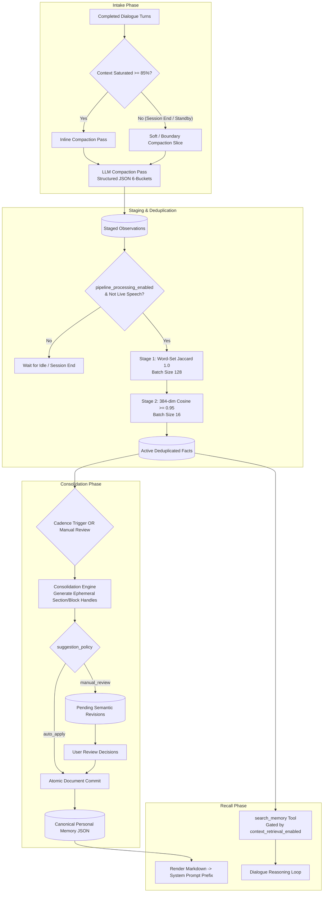

# Memory & Session Continuation Specification

## 1. Intent & Scope

### 1.1 Lane
Data & Cognitive Memory Specification. This document specifies the multi-tier memory architecture for Vox: Working Memory compaction, two-stage fact deduplication, structured Personal Memory evolution, and on-demand Episodic retrieval.

### 1.2 Purpose
Vox requires continuous context compression for long-running voice sessions, durable user personalization that evolves without manual configuration, and episodic factual retrieval without flooding the real-time audio pipeline.

### 1.3 Out of Scope
- Relational table schemas, column types, and foreign key constraints (governed by `db-spec.md`).
- Raw audio buffering, VAD, and speech token streaming (governed by `events-spec.md`).
- LLM prompt chassis assembly and tool execution loops (governed by `harness-spec.md`).

---

## 2. User Stories

| ID | Story |
| :--- | :--- |
| **US-MEM-01** | As a user conversing across dozens of turns, I want earlier context compacted into structured summaries without audio stutter, so that conversations can continue indefinitely within context limits. |
| **US-MEM-02** | As a user sharing personal details, I want the system to extract durable traits and consolidate them into a structured personal profile, so that the assistant remembers my preferences across sessions. |
| **US-MEM-03** | As a user reviewing proposed memory updates, I want changes staged as reviewable operations with persistent entity IDs, so that I can accept or reject individual facts without corrupting the document. |
| **US-MEM-04** | As a user editing my personal memory directly, I want to edit clean Markdown that safely round-trips into structured semantic blocks, so that I retain full manual control over what the assistant remembers. |
| **US-MEM-05** | As a user starting a new session, I want background memory ingestion paused immediately upon speech onset, so that vectorization never competes with real-time voice latency. |
| **US-MEM-06** | As a user asking about past decisions, I want the assistant to query episodic memory on-demand via tools rather than injecting all past facts on every turn, so that turn latency and token costs remain minimal. |

---

## 3. Cognitive Memory Architecture & Lifecycle



---

## 4. Behavior Rules & Lifecycle Invariants

### 4.1 Working Memory & Context Compaction
- **RULE-MEM-01 (Turn Finalization)**: A conversational turn MUST be committed to working memory and persistence only after assistant speech playback completes or dictation finishes.
- **RULE-MEM-02 (Critical Inline Compaction)**: When conversational context utilization reaches or exceeds 85% of the model context window:
  1. The system MUST play an organic transitional phrase to prevent dead air.
  2. The system MUST execute an inline compaction pass bound to the turn's cancellation token (maximum 45s timeout).
  3. If compaction fails or times out, the system MUST fall back immediately to FIFO truncation (dropping the oldest turn pair) to avoid blocking assistant response.
  4. The model MUST NEVER retry inline compaction in a loop on failure.
- **RULE-MEM-03 (Soft Compaction Gating & Debounce)**: Opportunistic soft compaction (context utilization between 65% and 85%) MUST fire ONLY when all of the following conditions are met:
  1. The user setting for automatic compaction (`auto_compaction`) is enabled (`true`).
  2. The pipeline is operating in modular mode (`Modular`).
  3. The pipeline state is in `Ready` or `Paused` standby.
  4. The system has observed a continuous 20-second quiet debounce period. Any user speech onset or state transition MUST abort the timer.
- **RULE-MEM-04 (Boundary & Session-End Compaction Gating)**:
  1. When a session terminates, restarts, or switches while uncompacted turns remain, the system MUST create a persistent compaction notification receipt.
  2. If `auto_compaction` is enabled (`true`), the system MUST automatically execute the compaction slice in the background and update the notification upon completion.
  3. If `auto_compaction` is disabled (`false`), the system MUST hold the notification in `pending` state awaiting manual user confirmation.
- **RULE-MEM-05 (Compaction Input Isolation)**: Compaction passes MUST run against an isolated summarization prompt. The compaction prompt MUST NEVER receive personal memory blobs, conversational personas, or TTS style instructions.
- **RULE-MEM-06 (Compaction Determinism)**: Compaction execution MUST use low temperature (0.2), disable reasoning mode, enforce JSON schema output, and determine maximum output tokens autonomously via context ratio calculations without using conversational user settings.
- **RULE-MEM-07 (Global Compaction Exclusion)**: At most one compaction run across the entire application and database MAY execute at any time. Concurrent requests MUST be rejected with a busy error.

### 4.2 Observation Ingestion & 2-Stage Deduplication
- **RULE-MEM-08 (Ingestion Pipeline Configuration Gate)**: All background deduplication sweeps (Boot Sweep and Session-End Sweep) MUST be strictly gated by the pipeline processing configuration toggle (`pipeline_processing_enabled`). When set to `false`, background deduplication sweeps MUST NOT execute.
- **RULE-MEM-09 (Speech Hot-Path Preemption)**: When an assistant session begins, any active background memory ingestion sweep MUST be aborted immediately via a cancellation token to guarantee zero CPU/RAM contention during live speech.
- **RULE-MEM-10 (Two-Stage Dedup Policy)**:
  - **Stage 1 (Exact Match)**: Atomically claims items in batches of up to 128 items and computes word-set Jaccard similarity (threshold 1.0) against active facts of the same type. On exact match, the incoming fact becomes `active` and the older matching fact transitions to `inactive`.
  - **Stage 2 (Semantic Cosine Match)**: Claims remaining items in batches of 16 to prevent memory contention. Generates 384-dimensional dense embeddings. If cosine similarity against an existing active fact $\ge 0.95$, the incoming fact becomes `active` and the older fact transitions to `inactive`. The sweep MUST loop until all staged items drain.
- **RULE-MEM-11 (Non-Destructive Inactivation)**: Facts MUST NEVER be hard-deleted during deduplication passes. Superseded duplicates MUST transition to `inactive` status.

### 3.3 Personal Memory Model, Policies & Consolidation
- **RULE-MEM-12 (Structured Canonical Representation)**: Personal Memory MUST be stored as a canonical semantic JSON document consisting of sections and prose blocks. Markdown is a derived projection for display and prompt injection only.
- **RULE-MEM-13 (Last-Block Deletion Refusal)**: Any semantic operation that would remove the final remaining block of a section MUST be refused. Sections MUST NOT be silently deleted via block removal; empty sections are pruned only via explicit post-mutation cleanup.
- **RULE-MEM-14 (Grounded Integration Transition)**: Candidate observations presented to consolidation MUST transition to `integrated` ONLY if their semantic content is measurably represented in the resulting memory document. Omitted observations MUST remain `active` for future passes.
- **RULE-MEM-15 (Persistent Entity Identity)**: Revisions MUST address persistent semantic block/section IDs, not positional line indices. Resolving or rejecting one revision MUST NEVER invalidate or shift other pending revisions in a batch.
- **RULE-MEM-16 (Consolidation Suggestion Policy)**:
  - When the suggestion policy (`suggestion_policy`) is set to `manual_review` (default), observation integration and comment edits MUST be staged as pending revisions for user review.
  - When set to `auto_apply`, non-destructive operations from observation integration MUST automatically commit into a new memory version, while comment-directed edits always stage for user review.
- **RULE-MEM-17 (Consolidation Cadence)**:
  - When cadence (`consolidation_cadence`) is `manual`, consolidation executes only on demand.
  - When cadence is `daily`, consolidation executes automatically at the configured time (`consolidation_time`). Missed runs while the application was closed MUST emit a persistent actionable notification card.

### 3.4 Episodic Retrieval & Model Lifecycle Gating
- **RULE-MEM-18 (Context Retrieval Configuration Gate)**:
  - On-demand episodic retrieval MUST be gated by the context retrieval setting (`context_retrieval_enabled`).
  - When `true`, the text embedding model is pre-warmed asynchronously upon session start, and the `search_memory` tool is exposed to the model.
  - When `false`, `search_memory` MUST be pruned from the model tool definitions, and any loaded embedding model weights MUST be immediately evicted from RAM.
- **RULE-MEM-19 (Zero-Idle Memory Eviction)**: When the application is in `Idle` state and no sessions are active, all ONNX embedding models MUST be unloaded from memory. Model weights MUST NOT reside in RAM during idle standby.

---

## 5. Structured Data Contracts

### 5.1 Compaction 6-Bucket Schema
Every compaction pass produces a structured JSON output across 6 closed categories:
```json
{
  "personal": ["<durable user traits, preferences, identity, lifestyle, or habits>"],
  "objective": ["<active goals, ongoing endeavors, projects, or topics user is focusing on>"],
  "workdone": ["<accomplished tasks, completed actions, reached decisions, or historical milestones>"],
  "blocker": ["<current obstacles, open questions, roadblocks, or frustrations>"],
  "next_step": ["<planned future actions, commitments, scheduled tasks, or intentions>"],
  "pitfall": ["<expressed dislikes, things to avoid, lessons learned, or negative experiences>"]
}
```
*Attribution Invariant*: Facts in the `personal` category MUST originate exclusively from user speech turns with verifiable turn citations.

### 5.2 Canonical Personal Memory Schema
```json
{
  "sections": [
    {
      "id": "sec_7a8b9c_1234",
      "title": "Engineering Focus",
      "blocks": [
        {
          "id": "blk_3d4e5f_5678",
          "text": "Addy is building Vox, a voice-first AI desktop assistant."
        }
      ]
    }
  ]
}
```

### 5.3 Consolidation Wire Handles & Delta Operations
During incremental consolidation and comment edits, the active memory is rendered with ephemeral handles (`s1`, `s2` for sections; `b1`, `b2` for blocks) to prevent exposing internal persistent IDs to the LLM:
```json
{
  "new": [{ "title": "Health & Routine", "blocks": ["Runs 5km three times a week."] }],
  "add": [{ "section": "s1", "text": "Redesigning the memory engine with semantic blocks." }],
  "update": [{ "block": "b1", "text": "Addy is building Vox v2, a modular voice AI assistant." }],
  "delete": [{ "block": "b2", "observation": "O3" }]
}
```
- `new`: Instantiates a new section with initial blocks.
- `add`: Appends a new block to an existing section handle.
- `update`: Replaces the text of an existing block handle while preserving its persistent ID.
- `delete`: Removes a block handle; MUST cite the invalidating observation label (`O{n}`).

---

## 6. Episodic Retrieval & Model Lifecycle

- **On-Demand Search**: Episodic facts (`objective`, `workdone`, `blocker`, etc.) are retrieved exclusively when the model calls the non-terminal tool `search_memory(query)`. Facts are NEVER injected automatically on every turn.
- **Eager Session Pre-Warming**: When an assistant session starts, the text embedding model is loaded asynchronously in background to ensure zero cold-start delay on first tool invocation.
- **Zero-Idle RAM Eviction**: When the assistant is `Idle` and no sessions are active, all embedding models MUST be unloaded from memory. Model weights MUST NOT reside in RAM during idle standby.

---

## 7. Architectural Decisions & Alternatives

| Decision | Choice | Rationale | Rejected Alternative |
| :--- | :--- | :--- | :--- |
| **Personal Memory Storage** | Structured semantic JSON with persistent IDs | Enables fine-grained block revisions, structured diffing, and stable identity across edits. | Plain Markdown file (fragile regex parsing, high merge collisions, prone to accidental section deletion). |
| **Compaction Output Architecture** | Dual-destination structured JSON (6 categories) | Supplies working memory continuity while feeding episodic ingestion queues with clear taxonomy. | Unstructured prose summaries (causes loss of explicit project blockers, next steps, and user preferences). |
| **Observation Dedup Strategy** | 2-Stage: Exact Jaccard (1.0) then Semantic Cosine ($\ge 0.95$) | Eliminates 70–80% of duplicate facts instantly in Stage 1 before allocating CPU/ONNX resources for embedding. | Single-stage dense embedding for all incoming facts (causes high CPU spikes and thread contention). |
| **Episodic Context Delivery** | Explicit Tool Calling (`search_memory`) | Protects turn latency (<200ms) and context budgets by retrieving past context only when genuinely relevant. | Automatic per-turn semantic injection (floods prompt with irrelevant historical facts and increases cost). |
| **Revision Addressing** | Ephemeral handles mapped to persistent IDs | Prevents model hallucinations of random UUIDs while decoupling revisions from line/character positions. | Line number or positional index addressing (invalidated whenever a preceding line changes). |

---

## 8. Verification Criteria

- **Compaction Context Preservation**: Run a 30-turn automated dialogue exceeding 85% context utilization. Verify that Critical Compaction executes with speech filler, prunes raw turns, and preserves ongoing goals in the session context.
- **Fast FIFO Truncation Fallback**: Mock a compaction timeout (simulating 45s stall). Verify that the system drops the oldest turn pair and continues generating assistant speech without error.
- **Dedup Pipeline Accuracy**: Feed 10 identical personal observations followed by 5 semantically similar observations ($\text{cosine} > 0.95$). Verify that exactly 1 active fact remains in the registry with older facts marked `inactive`.
- **Grounded Integration Verification**: Run incremental consolidation with an observation omitted by the LLM response. Verify that the omitted observation remains `status = 'active'` and is not marked `integrated`.
- **Last-Block Deletion Guard**: Submit a revision batch containing `delete_block` for the sole block in a section. Verify that the deletion is rejected with an explanatory error while valid operations in the batch commit successfully.
