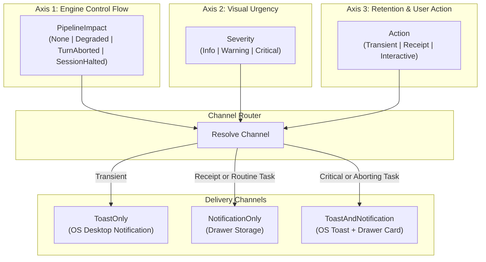
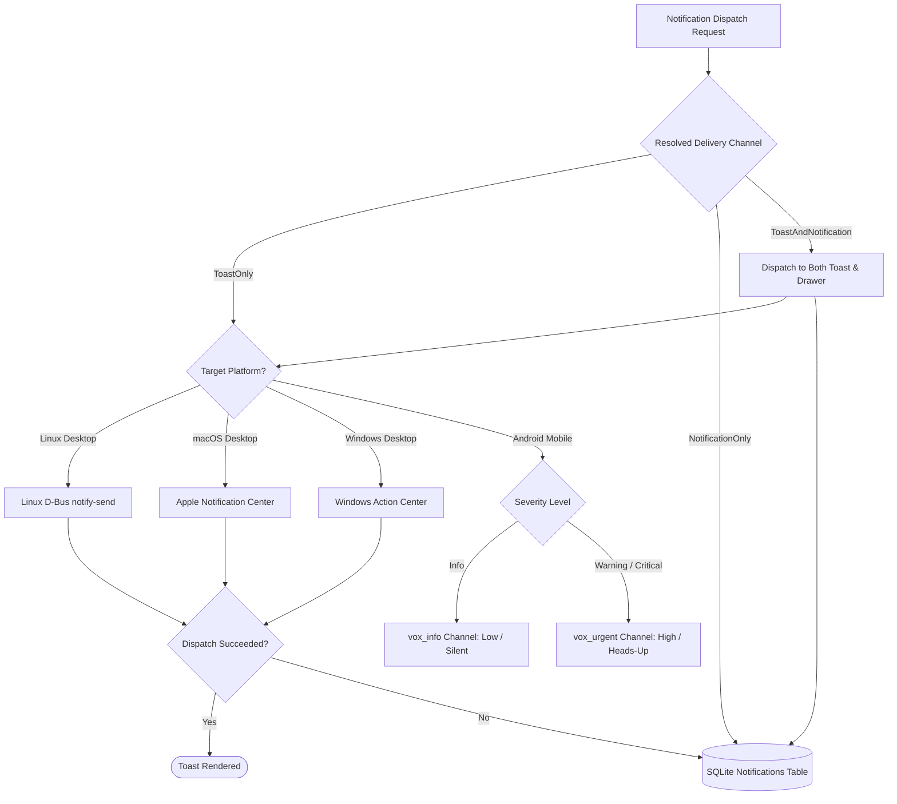

# Notification & Alerting Specification

## 1. Intent & Scope

### 1.1 Lane
Alerting & Task Remediation Behavioral Specification. This document specifies the notification routing engine, delivery channels, user attention states, and task remediation contracts.

### 1.2 Purpose
Vox requires a deterministic alerting model that separates engine execution flow from visual urgency, delivers non-intrusive alerts outside the application window, and provides actionable background task management without notification clutter.

### 1.3 Out of Scope
- Database table schemas, indexes, and SQL constraints (governed by `db-spec.md`).
- Frontend IPC bridge serialization and command signatures (governed by `ipc-spec.md`).
- Visual CSS themes, spacing tokens, and typography (governed by `design-spec.md`).
- Pipeline audio processing and error generation (governed by `events-spec.md`).

---

## 2. User Stories

| ID | Story |
| :--- | :--- |
| **US-NOTIF-01** | As a user dictating into an external application, I want a transient confirmation toast that auto-dismisses after 3 seconds, so that I know my speech was pasted without switching windows. |
| **US-NOTIF-02** | As a user managing background tasks, I want compaction and memory consolidation records stored quietly in the drawer with duplicate rollups, so that I have a clean audit history without intrusive popups. |
| **US-NOTIF-03** | As a user encountering an uncompacted session or a disconnected microphone, I want an actionable drawer card with a single-click action button, so that I can remediate the issue immediately. |
| **US-NOTIF-04** | As a user who dismissed an actionable notification, I want my dismissal honored permanently across application restarts, so that the system never pesters me with dismissed items. |
| **US-NOTIF-05** | As an active voice speaker, I want voice turn failures to cancel pending speech cleanly and alert me without freezing the audio loop, so that conversation recovers immediately. |
| **US-NOTIF-06** | As an Android user, I want background tasks sent to quiet notification channels while critical errors show heads-up banners, so that notification priority matches mobile conventions. |

---

## 3. The Three Orthogonal Dimensions

Alerting separates concerns across three independent dimensions. No dimension implies or overrides another:

### 3.1 `PipelineImpact` (Engine Flow)
Answers: *What must the voice runtime do?*
- `None`: Does not affect the conversational turn loop (e.g., dictation, background compaction, settings).
- `Degraded`: The voice turn continues. Quality drops (e.g., dropped speech synthesis fallback, skipped memory retrieval).
- `TurnAborted`: The active turn fails cleanly. Pending speech is cancelled and the assistant resets to ready state.
- `SessionHalted`: Unrecoverable breakdown. Speech stops, active session ends, and the assistant enters error state.

### 3.2 `Severity` (Visual Urgency)
Answers: *What visual priority does the user see?*
- `Info`: Routine success, normal telemetry, or informational receipts.
- `Warning`: Recoverable degradation, missed schedules, or high load.
- `Critical`: Unrecoverable errors, invalid credentials, or disconnected hardware.

### 3.3 `Action` (Retention & Interaction)
Answers: *Where does the event live, and what does the user do?*
- `Transient`: Ephemeral feedback for live interaction. Never saved to the database. Auto-dismisses after 3 seconds.
- `Receipt`: Passive historical record. Saved to the drawer; contains no action button. Never displays an external OS toast.
- `Interactive`: Actionable task or remediation card. Saved to the drawer with a primary action button (e.g., Compact, Consolidate, Open Settings).

---

## 4. Behavior Rules & Lifecycle Invariants

### 4.1 Channel Resolution Rules
- **RULE-NOTIF-01 (Transient Handling)**: When `Action` is `Transient`, the delivery channel MUST be `ToastOnly`. The event MUST NOT be saved to the database.
- **RULE-NOTIF-02 (Receipt Handling)**: When `Action` is `Receipt`, the delivery channel MUST be `NotificationOnly`. The event MUST be stored in the drawer without displaying an external OS popup.
- **RULE-NOTIF-03 (Interactive Routing)**: When `Action` is `Interactive`:
  - If `PipelineImpact` is `SessionHalted` OR `Severity` is `Critical`, the channel MUST be `ToastAndNotification`.
  - If `PipelineImpact` is `TurnAborted` AND `Severity` is `Warning`, the channel MUST be `ToastAndNotification`.
  - For all other interactive events, the channel MUST be `NotificationOnly`.

### 4.2 Deterministic Routing Matrix

| `PipelineImpact` | `Severity` | `Action` | Resolved Channel | System Behavior & UX Contract |
| :--- | :--- | :--- | :--- | :--- |
| `None` | `Info` | `Transient` | **`ToastOnly`** | External desktop toast for 3s. No database write. |
| `None` | `Info` | `Receipt` | **`NotificationOnly`** | Silent drawer record. No toast popup. |
| `None` | `Info` | `Interactive` | **`NotificationOnly`** | Actionable drawer card with task button. No popup. |
| `None` | `Warning` | `Receipt` | **`NotificationOnly`** | Silent warning record in drawer. |
| `None` | `Warning` | `Interactive` | **`NotificationOnly`** | Actionable remediation card in drawer. |
| `Degraded` | `Warning` | `Transient` | **`ToastOnly`** | External toast warning. Turn continues uninterrupted. |
| `Degraded` | `Warning` | `Interactive` | **`NotificationOnly`** | Drawer card. Turn continues uninterrupted. |
| `TurnAborted` | `Warning` | `Transient` | **`ToastOnly`** | External toast alert. Turn resets to ready state. |
| `TurnAborted` | `Warning` | `Interactive` | **`ToastAndNotification`** | External toast alert and actionable drawer card. |
| `SessionHalted` | `Critical` | `Transient` | **`ToastOnly`** | External toast alert. Session transitions to error state. |
| `SessionHalted` | `Critical` | `Interactive` | **`ToastAndNotification`** | External toast alert and actionable drawer card. |

### 4.3 Persistence & Task Idempotency
- **RULE-NOTIF-04 (Receipt Rollup)**: Receipts sharing a common correlation group key MUST be displayed in the UI as a single card with an occurrence counter `(×N)` and latest timestamp, preserving complete history without drawer spam.
- **RULE-NOTIF-05 (Interactive Task Idempotency)**: Interactive notifications MUST use an entity-scoped group key (e.g., specific session ID or device name). If an active card already exists for that entity, incoming alerts MUST update the existing card in place rather than creating duplicate buttons.
- **RULE-NOTIF-06 (In-Place Task Resolution)**: When an actionable remediation finishes or fails, the system MUST update the existing notification card in place (`resolution: resolved` or `failed`). It MUST NOT create a secondary receipt card.
- **RULE-NOTIF-07 (Dismissal Sovereignty)**: Once a user dismisses a notification, that dismissal MUST be permanent. System startup sweeps and background checkers MUST NEVER recreate or resurrect a dismissed card for that entity.
- **RULE-NOTIF-08 (Hot-Path Isolation)**: Real-time audio threads and speech detection loops MUST NEVER dispatch notifications or write to the database directly. They MUST emit pipeline events; alerting MUST execute asynchronously.

---

## 5. Platform Delivery Contracts

### 5.1 Desktop Notification Surface
- Desktop toasts MUST use native OS notification dispatchers (Linux D-Bus `notify-send`, macOS Notification Center, Windows Action Center).
- Desktop toasts MUST NOT steal input focus or open separate webview windows.
- If native toast dispatch fails, the system MUST automatically save the alert to the persistent drawer (`NotificationOnly`) so that alerts are never lost.
- Multi-step operations (such as dictation listening $\to$ transcribing $\to$ finished) MUST update a single resident notification in place via platform replace IDs rather than stacking popups.

### 5.2 Android Notification Surface
- On Android, where transient toasts cannot be updated dynamically, transient alerts are dispatched to native notification channels.
- Android notifications MUST map to two write-once channels based on `Severity`:
  - `vox_info`: Low importance (silent, shade only) for `Severity::Info`.
  - `vox_urgent`: High importance (heads-up banner with sound) for `Severity::Warning` and `Severity::Critical`.
- Channel importance is write-once and MUST NOT be reset or deleted on startup to preserve user preferences.

---

## 6. Architectural Decisions & Alternatives

| Decision | Choice | Rationale | Rejected Alternative |
| :--- | :--- | :--- | :--- |
| **Alerting Dimensions** | 3 independent axes (`PipelineImpact`, `Severity`, `Action`) | Decouples engine execution control from UI visual weight and persistence. | Single overloaded enum (forced styling choices to dictate error recovery behavior). |
| **Desktop Transient Alerts** | Native OS dispatchers | 0MB additional webview RAM, native OS appearance, and zero window focus stealing. | Custom transparent webview overlay (added 40MB RAM, flickered on Wayland, stole focus). |
| **Task Idempotency** | Entity-scoped in-place updates via correlation key | Prevents duplicate buttons for the same task in the drawer. | Appending every task event as a new card (flooded drawer with duplicate buttons). |
| **Task Resolution Model** | In-place status update (`resolution: resolved`) | Converts actionable cards into clean receipts without visual jumping or card deletions. | Deleting actionable card and inserting a separate receipt card (caused UI race conditions). |
| **Permanent Dismissal** | Dismissed status honored permanently across boots | Respects user intent and avoids re-nagging for previously dismissed items. | Regenerating alerts on every startup (annoyed users by ignoring dismissals). |
| **Android Channel Model** | Write-once dual channels split by `Severity` | Conforms to mobile notification importance standards while preserving user system overrides. | Recreating channels on boot (wiped user channel customizations). |

---

## 7. Verification Criteria

- **Channel Resolution**: Automated tests verify that every row in the 3D Truth Table maps to the exact expected channel (`ToastOnly`, `NotificationOnly`, `ToastAndNotification`).
- **Transient Zero-Persistence**: Triggering a `Transient` alert verifies native OS dispatch and confirms zero records are written to the database.
- **Task In-Place Resolution**: Triggering an actionable compaction card, executing the action, and observing completion confirms the existing card updates in place with `resolution = resolved`, with zero duplicate receipt cards created.
- **Dismissal Permanence**: Dismiss an actionable card and trigger a system startup sweep. Verify that the dismissed card is neither resurrected nor duplicated.
- **Hot-Path Isolation**: Static code analysis confirms that audio capture callbacks and voice activity detection threads make zero direct calls to the notification service or database.
