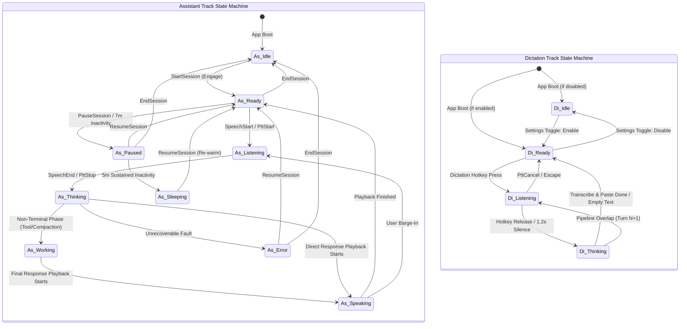
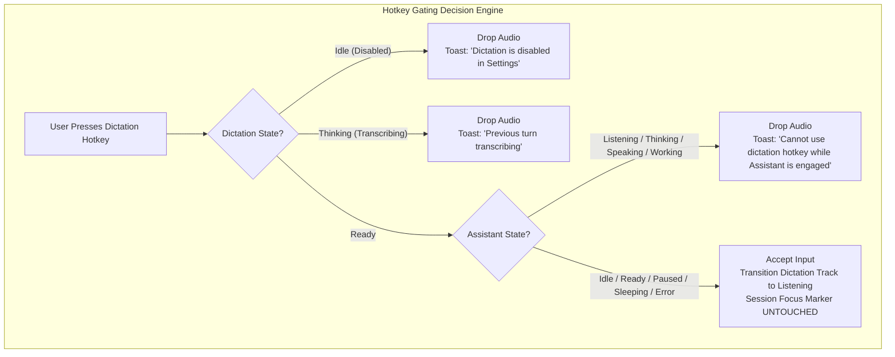

# Interaction Track Ownership & Focus Lifecycle Specification

## 1. Intent & Scope

### 1.1 Lane
Interaction Ownership & Focus Lifecycle Specification. This document specifies the ownership contracts, state machines, hotkey preemption rules, and session lifecycle transitions between the Assistant track and the Dictation track.

### 1.2 Purpose
Vox runs two concurrent speech tracks: an ambient OS utility (Dictation) and a conversational AI harness (Assistant). This specification enforces strict priority gating, eliminates hotkey race conditions, and prevents state hijacking.

### 1.3 Out of Scope
- STT model inference algorithms and acoustic model weights (governed by model manifests).
- Virtual keyboard simulation and paste engine platform internals (governed by `dictation-spec.md`).
- Inter-process communication schema definitions (governed by `ipc-spec.md`).

---

## 2. User Stories

| ID | Story |
| :--- | :--- |
| **US-OWN-01** | As a user conversing with the Assistant, I want accidental dictation hotkey presses blocked with an informative notification, so that my active conversation is never interrupted. |
| **US-OWN-02** | As a user working in desktop applications, I want the dictation hotkey ready instantly when no assistant session is engaged, so that speech-to-text pasting feels immediate. |
| **US-OWN-03** | As a user pausing an assistant session, I want dictation capability restored immediately, so that I can dictate notes while the assistant stands by. |
| **US-OWN-04** | As a user with dictation disabled in settings, I want pressing the dictation shortcut to inform me with a toast instead of silently failing, so that system state is transparent. |
| **US-OWN-05** | As a user releasing a dictation key while transcribing, I want rapid subsequent presses gated safely, so that two transcription runs never collide or corrupt input fields. |

---

## 3. Dual-Track State Machine Architecture

---

## 4. Behavior Rules & Lifecycle Invariants

### 4.1 Ownership Definition & Boundaries
- **RULE-OWN-01 (Session Focus Marker)**: The system MUST maintain a single primary session focus marker representing whether the user is engaged in an active Assistant session or in ambient Dictation mode.
- **RULE-OWN-02 (Exclusive User-Command Driver)**: The session focus marker MUST be mutated exclusively by explicit user session lifecycle actions (`StartSession`, `PauseSession`, `ResumeSession`, `EndSession`) and application startup.
- **RULE-OWN-03 (Worker Non-Authority)**: Background workers, audio listeners, hotkey listeners, and pipeline stages MUST NEVER mutate the session focus marker.
- **RULE-OWN-04 (Dictation Read-Only Invariant)**: The dictation pipeline and global dictation hotkey MUST NEVER mutate the session focus marker. They strictly inspect system state and enqueue processing events (`PttStart { owner: Dictation }`).

### 4.2 State-Driven Gating (Zero Settings Sniffing)
- **RULE-OWN-05 (State Reflection)**: Pipeline actors MUST determine dictation readiness from the active dictation state machine, NEVER by reading raw settings files directly.
  - Dictation disabled $\iff$ Dictation state is `Idle`.
  - Dictation enabled and standby $\iff$ Dictation state is `Ready`.
- **RULE-OWN-06 (Hardware Standby & Teardown)**: When both Assistant state and Dictation state are in `Idle` state, the audio capture hardware MUST be completely powered down to eliminate CPU consumption and battery drain.

### 4.3 Hotkey Gating & Preemption
- **RULE-OWN-07 (Assistant Priority Gate)**: If a dictation hotkey event occurs while the Assistant is actively engaged (`Listening`, `Thinking`, `Speaking`, or `Working`):
  1. The incoming audio MUST be dropped immediately.
  2. The active Assistant interaction MUST NOT be interrupted.
  3. The system MUST display an ephemeral user notification: *"Cannot use dictation hotkey while Assistant is engaged"*.
- **RULE-OWN-08 (Concurrency Protection)**: If a dictation hotkey press occurs while a previous dictation turn is still transcribing (`Thinking`):
  1. The new event MUST be dropped to prevent synthetic paste races.
  2. The system MUST notify the user: *"Previous turn transcribing"*.
- **RULE-OWN-09 (Disabled Dictation Gate)**: If a dictation hotkey press occurs while dictation is `Idle`:
  1. The incoming audio MUST be dropped.
  2. The system MUST display an ephemeral notification: *"Dictation is disabled in Settings"*.
- **RULE-OWN-10 (Non-Preemptive Dictation Overlap)**: In Dictation Passive mode, speech onset during `Thinking` starts Turn $N+1$ without aborting Turn $N$ transcription.

### 4.4 Remote Session Ownership
Remote control introduces a second possible owner of the session and the microphone. The rules below are governed by [`remote-control-spec.md`](remote-control-spec.md); they extend this spec and take precedence over it where they conflict.

- **RULE-OWN-11 (Session Origin Is Explicit)**: The audio capture source MUST be selected by an explicit **session origin** — `Local` (the host's own microphone) or `Remote` (a controller's audio stream). The selection MUST be a deterministic choice made once at session start, never a fallback chain that tries one source and silently degrades to the other.
- **RULE-OWN-12 (Exclusive Remote Capture)**: While a controller is attached, the host engine MUST use the network capture as the **exclusive** audio source. It MUST NOT fall back to the local laptop microphone, and the local capture hardware MUST NOT be opened for the assistant track. A remote session that silently falls back to the host microphone would answer a remote user with the wrong room's audio.
- **RULE-OWN-13 (Dictation Gated Under Remote Control)**: While a controller is attached, the dictation track MUST be gated, and the dictation hotkey MUST be non-functional — **regardless of the pipeline state**, including `Paused`. Dictation is restored only when the controller detaches.
  - This rule **overrides RULE-OWN-03 and the `Pause Assistant Session` row of §5**, which otherwise restore dictation on pause. A pause does not release the microphone: the controller still owns it.
- **RULE-OWN-14 (Remote Session Definition)**: A remote session is active when the canonical `RemoteLinkState` is `Connected` — **not** when the pipeline happens to be non-idle. A controller that is attached but has not started a turn still owns the microphone, and dictation is still gated.
- **RULE-OWN-15 (No Shadow Flags)**: No component may derive "is a remote session active" from its own state, a settings read, or a boolean of its own. Every consumer MUST query the canonical `RemoteLinkState` defined in `remote-control-spec.md` §9.1. This mirrors RULE-OWN-05's prohibition on settings sniffing.

---

## 5. State Transition & User Action Matrix

| User Action / Trigger | Input Event | Preconditions & Gating | Executed System Action | Resulting Focus | Fallback / Error Behavior |
| :--- | :--- | :--- | :--- | :--- | :--- |
| **Application Launch** | System Boot | Cold start | Initializes audio engine; sets dictation to `Ready` if enabled, else `Idle`. | **Dictation** | Deterministic boot default. |
| **Start Assistant Session** | `StartSession` | Assistant is `Idle` | Warms pipeline models; transitions Assistant to `Ready`. | **Assistant** | If startup fails: Assistant moves to `Error`, focus reverts to `Dictation`. |
| **Pause Assistant Session** | `PauseSession` / 7m Idle | Assistant is active | Pauses turn loop, flushes audio buffers, keeps engine warm; Assistant moves to `Paused`. | **Dictation** | Resumes to `Assistant` on manual resume. |
| **Resume Assistant Session** | `ResumeSession` | Assistant is `Paused` or `Sleeping` | Re-arms voice activity detection and pipeline streams; Assistant moves to `Ready`. | **Assistant** | If resume fails: Assistant moves to `Error`, focus reverts to `Dictation`. |
| **End Assistant Session** | `EndSession` | Any active Assistant state | Teardown session harness, records end metrics, transitions Assistant to `Idle`. | **Dictation** | Shuts down audio capture if dictation is `Idle`. |
| **Dictation Press (Nominal)** | `PttStart { Dictation }` | Dictation is `Ready`; Assistant is `Idle`, `Ready`, `Paused`, `Sleeping`, or `Error` | Starts voice activity validation; transitions Dictation to `Listening`. | **Unchanged** | Audio captured until key release. |
| **Dictation Press (Disabled)** | `PttStart { Dictation }` | Dictation is `Idle` | Drops audio; notifies user: *"Dictation is disabled in Settings"*. | **Unchanged** | No state transition. |
| **Dictation Press (Engaged)** | `PttStart { Dictation }` | Assistant is `Listening`, `Thinking`, `Speaking`, or `Working` | Drops audio; notifies user: *"Cannot use dictation hotkey while Assistant is engaged"*. | **Unchanged** | Assistant continues uninterrupted. |
| **Dictation Press (Colliding)** | `PttStart { Dictation }` | Dictation is `Thinking` | Drops audio; notifies user: *"Previous turn transcribing"*. | **Unchanged** | Awaits prior turn completion. |
| **Dictation Key Release** | `PttStop { Dictation }` | Dictation is `Listening` | Finalizes speech capture; if speech present moves to `Thinking`, else returns to `Ready`. | **Unchanged** | If empty audio, transitions directly to `Ready`. |
| **Dictation STT Finalized** | Final Transcript | Dictation is `Thinking` | Dispatches text to desktop paste engine; transitions Dictation to `Ready`. | **Unchanged** | If paste fails, falls back to clipboard with honest toast. |
| **Toggle Dictation Enable** | Setting Mutation | Dictation is `Idle` | Transitions Dictation to `Ready`; powers on audio capture if needed. | **Unchanged** | If capture init fails, moves to `Error`. |
| **Toggle Dictation Disable** | Setting Mutation | Dictation is `Ready` | Transitions Dictation to `Idle`; powers down audio capture if Assistant is `Idle`. | **Unchanged** | Immediate teardown. |

---

## 6. Architectural Decisions & Alternatives

| Decision | Choice | Rationale | Rejected Alternative |
| :--- | :--- | :--- | :--- |
| **Session Focus Scope** | Exclusive IPC session marker | Guarantees clear single-writer authority over conversational vs ambient focus. | Shared mutable ownership flags written by background threads and hotkeys (caused race conditions and erratic state). |
| **Dictation Hotkey Gating** | Non-preemptive gating with user feedback | Protects conversational context and cognitive tool execution from accidental keystrokes. | Preemptive pipeline hijacking (cancelling assistant speech mid-thought whenever dictation hotkey is hit). |
| **Decoupled Settings Sniffing** | Direct interaction state inspection (`Ready` vs `Idle`) | Decouples runtime audio DSP and hot-paths from file I/O and configuration locks. | Polling configuration structs on every hotkey press (adds latency and lock contention). |
| **Hardware Teardown** | Idle hardware shutdown when both tracks are `Idle` | Eliminates continuous battery drain and background CPU consumption when idle. | Keeping microphone streams permanently open 24/7 (wastes battery and keeps OS recording indicators active). |
| **Remote Session Ownership** | An explicit `SessionOrigin` on the session, with the remote capture exclusive | The host's microphone and the controller's microphone are different rooms. A fallback chain would answer a remote user with the wrong room's audio. | Trying the local microphone first and falling back to the network source (or the reverse) at capture time. |

---

## 7. Verification Criteria

- **Assistant Hotkey Immunity**: While Assistant is in `Speaking` or `Thinking` state, press the dictation hotkey. Verify that Assistant speech is not truncated and the exact toast *"Cannot use dictation hotkey while Assistant is engaged"* is emitted.
- **Immediate Ambient Dictation**: In clean startup state with no active session, press the dictation hotkey. Verify that dictation starts within 50ms and pastes text into active window upon release.
- **Session Focus Handover**: Start a session, verify focus is `Assistant`. Pause session, verify focus becomes `Dictation` and dictation works. Resume session, verify focus restores to `Assistant`.
- **Rapid Retrigger Protection**: Rapidly tap the dictation key while a long sentence is transcribing. Verify that subsequent key presses do not create duplicate paste streams or crash the STT pipeline, emitting *"Previous turn transcribing"*.
- **Zero Background Mutation**: Run continuous automated testing simulating VAD noise, tool executions, and audio dropouts; verify that the session focus marker is never mutated by non-IPC events.
- **Hardware Power Down**: With both Assistant and Dictation in `Idle`, verify that CPAL microphone streams are completely closed and background recording indicators disappear.
- **Remote Capture Exclusivity**: With a controller attached, verify that the host's CPAL microphone stream is NOT opened for the assistant track and that only the network capture feeds the pipeline. Verify that the local microphone is never opened as a fallback when the network stream drops.
- **Dictation Gated Under Remote Control**: With a controller attached and the pipeline `Paused`, press the dictation hotkey. Verify that the press is dropped, that no dictation turn begins, and that dictation becomes usable again only after the controller detaches — overriding the `Pause Assistant Session` row of §5.
- **Single Remote State Source**: Grep the backend source for `controller_attached`, `is_remote_connected`, and `remote_attached`. Verify that no such identifier exists, and that every remote-state consumer reads the canonical `RemoteLinkState`.
