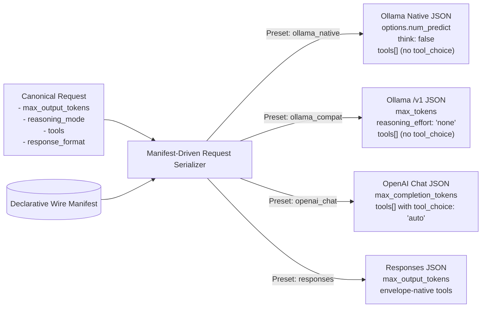
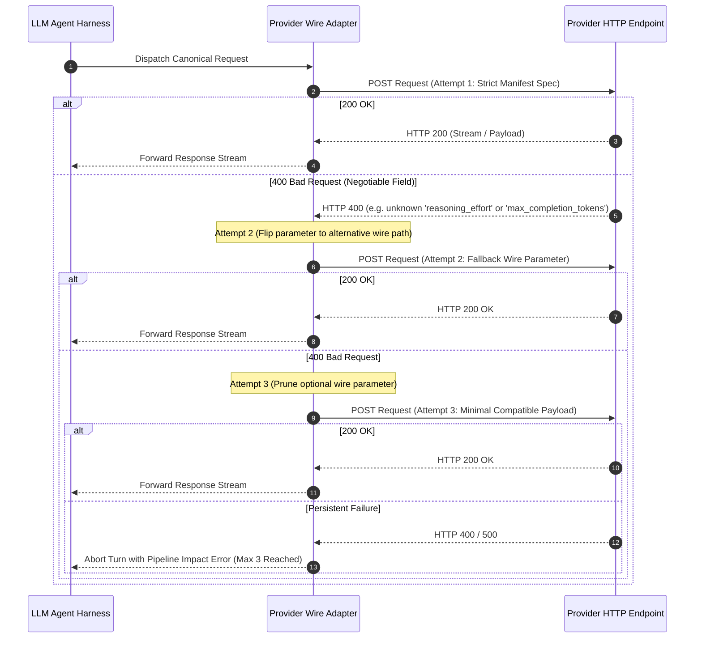

# Provider & Model Catalog Specification

## 1. Intent & Scope

### 1.1 Lane
Provider Wire Contract & Model Catalog Specification. This document specifies the declarative wire manifest for LLM providers, empirical capability discovery and probing, external catalog synchronization, and token budget calculation.

### 1.2 Purpose
Vox connects to diverse local engines, self-hosted servers, and cloud providers that vary in wire protocols, token limit parameters, reasoning flags, tool streaming framing, and context window limits. This specification establishes a single declarative contract that eliminates runtime guessing and ad-hoc URL sniffing.

### 1.3 Out of Scope
- Prompt engineering, conversation loop orchestration, and tool execution lifecycles (governed by `harness-spec.md`).
- Memory vector extraction and storage (governed by `memory-spec.md`).
- Static binary and model weight distribution formats (governed by model manifests).

---

## 2. User Stories

| ID | Story |
| :--- | :--- |
| **US-PROV-01** | As a user connecting a local Ollama or cloud LLM endpoint, I want requests serialized with the exact wire parameters required by that provider, so that requests never fail with 400 Bad Request errors. |
| **US-PROV-02** | As a user launching Vox offline, I want the system to start with bundled model specifications and wire presets, so that local models function without internet access. |
| **US-PROV-03** | As a user configuring models, I want capabilities (context limits, tool calling support) discovered with clear provenance, so that settings sliders reflect true hardware and server boundaries. |
| **US-PROV-04** | As a user running reasoning models, I want thinking mode disabled or enabled explicitly via provider-native keys, so that internal chain-of-thought tokens do not consume the voice turn token budget. |
| **US-PROV-05** | As an autonomous compaction engine, I want compaction token limits derived deterministically from probed model context ceilings, so that summarization never overflows model limits. |
| **US-PROV-06** | As a user inspecting model diagnostics, I want failed capability probes to detail exact HTTP or network error causes, so that connection problems can be diagnosed easily. |

---

## 3. Behavior Rules & Lifecycle Invariants

### 3.1 Declarative Wire Contracts (Zero URL Sniffing)
- **RULE-PROV-01 (Manifest as SSOT)**: Serialization for any provider MUST be driven exclusively by the declarative provider wire manifest. The system MUST NOT infer wire formats, endpoints, or parameter names from URL substrings (e.g. `ends_with("/v1")`), model name strings, or ad-hoc conditionals.
- **RULE-PROV-02 (Single Translation Point)**: Each transport MUST expose a single request serializer accepting canonical requests and emitting provider-compliant JSON. Multiple serializers or cross-transport imports are FORBIDDEN.
- **RULE-PROV-03 (No Dual Emission)**: Emitting multiple conflicting wire representations for a single canonical intent (e.g. sending both `think: false` and `reasoning_effort: "none"`) is STRICTLY FORBIDDEN. Exactly one wire path and value MUST be emitted per intent as defined in the manifest.
- **RULE-PROV-04 (Restricted Passthrough)**: Non-standard parameters (e.g., `top_k`) MUST NOT be emitted at the top level of standard chat payloads. They MAY only be passed via explicitly declared provider passthrough blocks.

### 3.2 Tool Streaming & Framing Contracts
- **RULE-PROV-05 (Explicit Stream Parser)**: Transports MUST declare their streaming tool parser:
  - Standard delta accumulation: tool call chunks MUST be accumulated keyed by `(index, id)` tuples. Keying by index alone is FORBIDDEN to prevent collisions across parallel tool calls.
  - Line-delimited JSON (NDJSON): tool calls MUST be parsed per complete line without cross-line state leakage.
- **RULE-PROV-06 (Thinking Token Isolation)**: Internal model reasoning or thinking tokens MUST be routed to a designated diagnostics channel or discarded; they MUST NEVER be concatenated into speakable voice text streams.

### 3.3 Capability Resolution & Provenance Hierarchy
- **RULE-PROV-07 (Provenance Hierarchy)**: Resolved model capabilities MUST carry explicit provenance with the following strict precedence:
  $$\text{UserConfigured} > \text{ProbedServer} > \text{CatalogBaseline} > \text{DeclaredStatic} > \text{FamilyBaseline} > \text{Unknown}$$
- **RULE-PROV-08 (Tri-State Support Flags)**: Capability flags (`supports_tools`, `supports_latin`, `supports_devanagari`) MUST be tri-state (`yes` | `no` | `unknown`). A probe that could not run MUST yield `unknown`, NEVER `no`.
- **RULE-PROV-09 (Probe Failure Isolation)**: A failed or timed-out capability check MUST NOT persist a negative capability (`supports_tools: false`) to cache. Failed checks MUST record HTTP status or error excerpts in probe diagnostic logs.
- **RULE-PROV-10 (Offline Startup & Background Sync)**: Startup MUST function with zero network access using bundled static manifests. When network is present, background catalog updates MUST use conditional HTTP requests (`ETag` / `If-None-Match`). Cache writes MUST be atomic.

## 4. Canonical-to-Wire Mapping Contract

### 4.1 Canonical Request Transformation Architecture

### 4.2 Bounded Wire Negotiation & Fallback Flow

### 4.3 Declarative Wire Mapping Table

The declarative manifest maps canonical generation parameters to exact wire payloads:

| Canonical Parameter | Ollama Native | Ollama OpenAI Compat (`/v1`) | OpenAI Chat | Responses Transport |
| :--- | :--- | :--- | :--- | :--- |
| `max_output_tokens` | `options.num_predict` | `max_tokens` | `max_completion_tokens` or `max_tokens` | `max_output_tokens` |
| `reasoning_mode: Disabled` | `think: false` | `reasoning_effort: "none"` | `reasoning_effort: "none"` (if reasoning model) else omit | Warn and omit |
| `reasoning_mode: Enabled` | Manifest-defined enable control | Manifest-defined enable control | Manifest-defined enable control | Manifest-defined enable control |
| `tools` (Present) | `tools[]`, omit `tool_choice` | `tools[]`, omit `tool_choice` | `tools[]` with `tool_choice: "auto"` | Envelope-native tools format |
| `response_format: JsonSchema` | `format: <schema>` | `response_format: {json_schema}` | `response_format: {json_schema}` | `text: {format: {json_schema}}` |
| `stream_usage` | Omitted (NDJSON) | `stream_options: {include_usage: true}` if supported | `stream_options: {include_usage: true}` if supported | Omitted |

---

## 5. Token Budget Allocation

### 5.1 User Setting Ceilings
- **Context Window Floor**: Invariant floor of 8,192 tokens. Ceiling is bounded by the probed or catalog capability ceiling.
- **Dialogue Token Limit**: User-configured conversational `max_output_tokens` governs interactive dialogue turns only and MUST NOT constrain background compaction passes.

### 5.2 Compaction Token Budget
Compaction output budgets are calculated deterministically from probed context capacity without hardcoded magic numbers:
$$\text{slice\_budget} = \lfloor \text{context\_window} \times 0.15 \rfloor$$
$$\text{effective\_output\_tokens} = \min(\text{slice\_budget},\; \text{probed\_max\_output\_tokens})$$
*When probed maximum output tokens are `Unknown`, `slice_budget` is used directly.*

---

## 6. Voice Providers & Unified Catalog Architecture

### 6.1 Unified Voice Facade
The TTS subsystem exposes a unified catalog facade in `services/tts/voice.rs` that homogenizes voice profiles across bundled local engines (Kokoro, Supertonic, Zipvoice, Chatterbox) and cloud/remote engines (Edge TTS, Azure Speech, Google Cloud TTS). All providers emit a standardized `UnifiedVoiceDto` contract.

### 6.2 Declarative Voice Manifest
A static declarative manifest `voices_manifest.json` embedded into the binary at compile time defines default voices, metadata tags, and sample preview sentences for all local TTS models. On first launch, manifest entries populate the Turso `voices` table automatically to guarantee full offline functionality.

### 6.3 Remote Edge TTS Provider & Synchronization
Online Edge TTS voices are managed via decoupled non-blocking background synchronization:
- Network discovery queries the Microsoft ReadAloud endpoint with trusted client token and Chrome/Edge user-agent.
- Fetched voice records are normalized (locale, accent, gender, display names) and bulk-inserted into the local Turso `voices` table in a single transaction.
- The UI queries local database state exclusively, ensuring zero UI blocking during network calls.

### 6.4 Preview Synthesis Engine
On-demand audio previews are managed by `services/tts/preview.rs`:
- **Single-Flight Cancellation**: A centralized `Mutex<Option<AbortHandle>>` aborts any in-flight synthesis when a new preview is requested.
- **Prompt Safety**: Prompts are capped at 120 characters to prevent excessive generation latency.
- **LRU Disk Cache**: Previews are cached at `cache/tts/previews/{hash}.wav` bounded by a 25 MB / 50 files limit with automatic LRU eviction.

### 6.5 Engine-to-Catalog Scope & Clone Capability
The frontend never branches on provider id literals (Invariant 6: model agnosticism). Engine-to-catalog mapping lives in `services/tts/voice.rs` (`resolve_voice_scope`, surfaced via the `get_voice_scope` IPC command returning `VoiceScopeDto { voice_provider, can_clone, cloud_sync }`):
- **Voice family scope**: the active engine id maps to its DB `provider_id` filter 1:1, except `chatterbox_remote`, which shares the `chatterbox` voice rows (no `provider_id = 'chatterbox_remote'` rows exist — an unmapped query returns an empty catalog). `list_unified_voices` applies the same normalization.
- **Clone capability**: `can_clone` mirrors backend `ProviderCaps.clone` (`factory::caps_for_id`). Only the Chatterbox family (local + remote) declares `clone: true` — cloned reference voices are consumed solely by the Chatterbox conditioning path (`resolve_reference_audio` over `voice_dir`). Kokoro/Supertonic resolve integer catalog indices, Zipvoice uses voice packs, Edge TTS is cloud-managed. The clone entry points (header action, Cloned scope chip, `CloneVoiceDrawer`) render only when `can_clone` is true.
- **Cloud sync hint**: `cloud_sync` is true for `TtsVoiceSource::Edge` and `TtsVoiceSource::Cloud` and drives the empty-state hint while background sync populates cloud voices.

### 6.6 Cloud TTS Providers (Azure Speech + Google Cloud TTS)
Both implement the existing `TtsProvider::synthesize_chunk` contract on the dedicated OS TTS worker thread. No new trait, event, or harness path.
- **Azure Speech** (`azure_tts`, `TtsVoiceSource::Cloud`, `clone: false`): one REST SSML POST per clause to `{region}.tts.speech.microsoft.com/cognitiveservices/v1` (or custom-domain base), `X-Microsoft-OutputFormat: raw-24khz-16bit-mono-pcm` (headerless s16le → f32, zero decode). Auth resolved once at construction: `providers.jsonc tts.azure_tts.key` → `AZURE_SPEECH_KEY` env → Entra (`tts.azure_tts.resource_id` + `az login`, `aad#resource#token` format, 8-min token cache, one 401 refresh). One bounded 429 backoff honoring `Retry-After` (cap 10 s), then typed `TtsError::RateLimited`. Voice sync: `voices/list` filtered to GA + Neural + `en*` + ≥24000 Hz, rows keyed `provider_id = 'azure_tts'`.
- **Google Cloud TTS** (`google_tts`, `TtsVoiceSource::Cloud`, `clone: false`): one `StreamingSynthesize` bidi stream per clause via `google-cloud-texttospeech-v1` (config → text → half-close → PCM-24k chunks; server starts only after half-close, so clause granularity is the correct design). Speaking rate set server-side (`speaking_rate`, 0.25–2.0). Auth is local ADC (`gcloud auth application-default login`), optional `tts.google_tts.project_override` as quota project; clauses over 5000 bytes are rejected with an actionable error. RPC codes map to `TtsError::{Auth, RateLimited, VoiceNotFound, Cancelled, SynthesisFailed}`. Voice sync: `voices:list` per `en-{US,GB,AU,IN}` filtered to `Chirp3-HD`, rows keyed `provider_id = 'google_tts'`.
- Secrets (keys, tokens, SSML bodies) never reach logs or IPC payloads; `check_provider_health` reuses reachability semantics (any non-5xx proves routing).

### 6.7 Default TTS Provider & Edge TTS Availability

**Edge TTS is currently unavailable.** The Microsoft ReadAloud endpoint returns HTTP 403 for every client, regardless of user agent, locale, or voice. This is an upstream service change, not a configuration error, and it is not a Vox bug.

Consequences and required behaviour:

- **The default TTS provider is `supertonic`, not `edge_tts`.** `TtsActiveProvider`'s `#[default]` variant MUST be changed. A first-run install that defaults to a provider that always fails is a broken first-run experience, and it is the reason the remote-control host path was blocked: the host must be able to speak.
- **`edge_tts` remains in the provider list, but MUST fail loudly.** Selecting it MUST surface an explicit, actionable error — *"Edge TTS is currently unavailable (HTTP 403 from the upstream service)"* — never an empty audio buffer and never a silent fallback to another provider. A silent fallback would hide the misconfiguration and produce a voice the user did not choose.
- **The fallback rule is deterministic, not chained.** The provider factory MUST resolve exactly one provider. There is no "try A, then B, then C" chain (`.agents/rules/backend-style-guide.md` §7).

*Verification*: With `supertonic` selected and its weights present, a synthesis request returns non-silent PCM. With `edge_tts` selected, the request returns the explicit availability error.

---

## 7. Architectural Decisions & Alternatives

| Decision | Choice | Rationale | Rejected Alternative |
| :--- | :--- | :--- | :--- |
| **Unified Voice Catalog** | Single `voices` table with engine slugs | Eliminates table fragmentation (`voice_favorites`, `voice_recents`, `remote_voice_cache`) and simplifies UI queries. | Separate tables per provider (caused query divergence and sync bugs). |
| **Declarative Wire Manifest** | Static JSON manifest declaring paths and values | Decouples wire protocol quirks from code logic; updates without compiling Rust code. | Scattered `if/else` checks across transports (caused silent bugs and HTTP 400 errors). |
| **Tri-State Capability Flags** | `yes` \| `no` \| `unknown` enum | Prevents failed network probes from disabling tool support or falsifying capabilities. | Binary booleans (a failed probe forced `false`, disabling tools permanently). |
| **Tool Stream Keying** | `(index, id)` composite key | Accommodates providers (like Ollama `/v1`) that reuse index `0` across parallel tool calls. | Index-only keying (collapses and corrupts parallel tool calls). |
| **Bounded Negotiation Loop** | Max 3 attempts on 400 with parameter flip | Recovers from minor remote drift while preventing infinite negotiation loops during voice turns. | Unbounded retry loops (caused voice turns to hang indefinitely on persistent errors). |
| **Bundled Catalog Snapshot** | Bundled static manifest with ETag background sync | Guarantees instant, reliable offline startup while keeping capabilities current when online. | Runtime-mandatory HTTP fetch on boot (adds startup delay and breaks offline use). |

---

## 8. Verification Criteria

- **Zero URL Sniffing Audit**: Static architectural tests verify that no transport or adapter checks for URL substrings (e.g. `ends_with("/v1")`) to branch serialization logic.
- **Golden Serialization Fixtures**: Unit tests verify that every provider preset maps canonical parameters to exact golden JSON output and confirms absent keys (e.g. zero `tool_choice` on Ollama presets).
- **Parallel Tool Stream Accumulation**: Replaying streaming SSE fixtures with repeated indices verifies that parallel tool calls accumulate distinctly into separate tool call objects without corruption.
- **Offline Startup Verification**: Launching the provider subsystem with network interfaces disabled confirms immediate resolution of bundled catalog models and wire presets.
- **Probe Failure Non-Degradation**: Simulating a network timeout during a capability probe verifies that `supports_tools` remains `unknown` with logged diagnostics, rather than persisting `false`.
- **Voice Catalog Offline Seeding**: Cold application startup on an unseeded database confirms that all manifest voice entries populate the `voices` table without network access.

