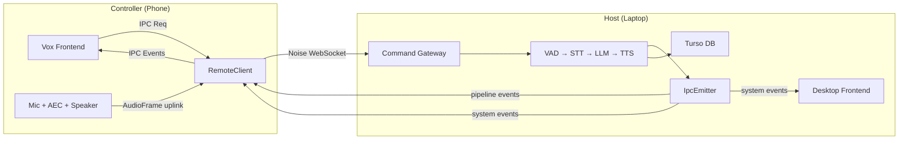
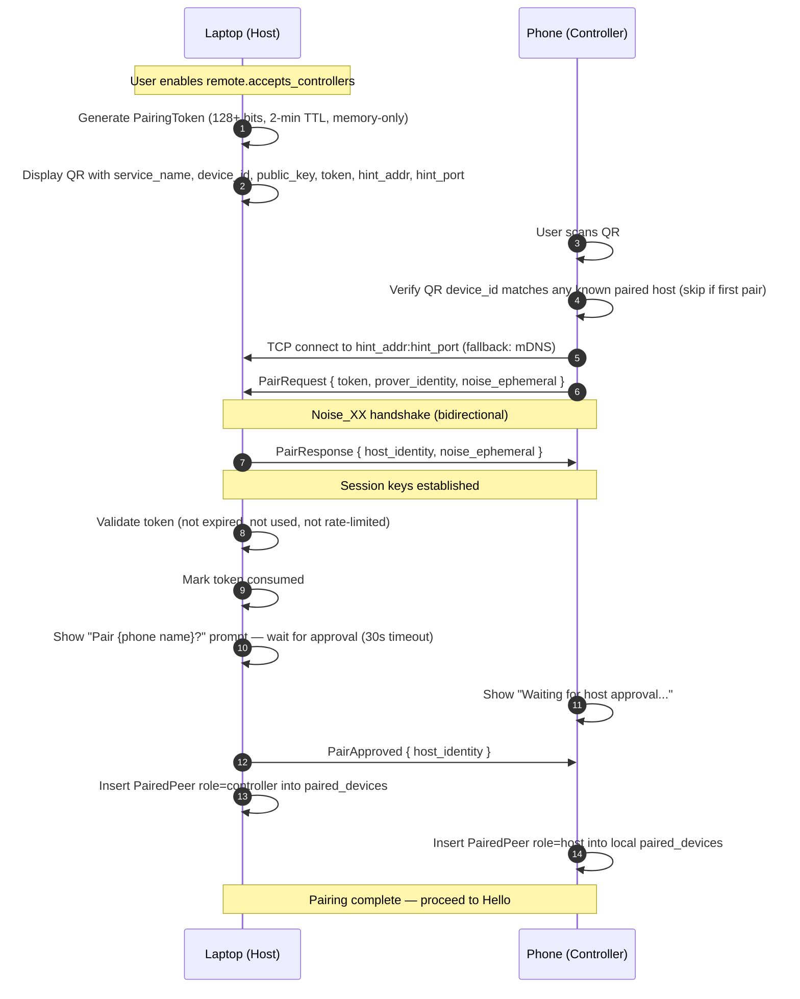
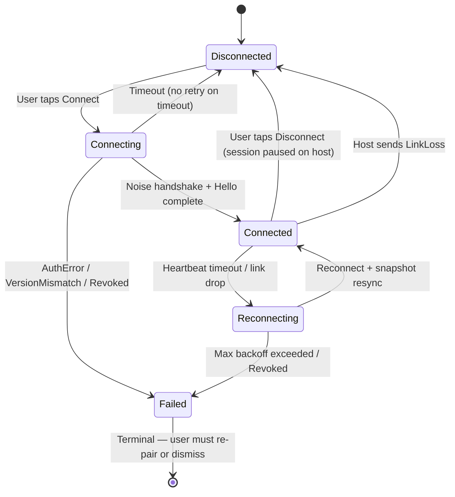

# Remote Control Specification

## 1. Intent & Scope

### 1.1 Lane
Protocol, Interface & Behavioral Specification. This document specifies the behavioral contracts, wire protocol invariants, identity model, security model, event routing rules, and IPC classification for the Vox Remote Control feature.

### 1.2 Purpose
Vox Remote Control allows a paired phone to act as the microphone, speaker, and UI surface for a laptop running the full Vox assistant pipeline. The phone carries zero model weights and runs zero local inference. The laptop is always the pipeline host. The phone is always the controller (thin client).

The spec is written to survive the addition of new transports (off-LAN, relay), new platforms (tablet, second laptop), and new codecs without requiring architectural changes. The extension guard rails in §3 define the seams that make this possible.

### 1.3 Out of Scope
- Off-LAN transport (QUIC, WebRTC, relay server) — future Connector; not in v1.
- Background and screen-off operation on Android — not in v1.
- Multiple simultaneous hosts or controllers — not in v1.
- Opus codec — PCM16 is v1. The codec byte exists for forward compatibility.
- IPC command schema definitions (governed by `ipc-spec.md`; this spec adds routing classifications and four new events).
- Database schemas for sessions, turns, and memory (governed by `db-spec.md`; this spec adds `paired_devices` to §5).
- Audio pipeline internals, VAD/STT/TTS algorithms (governed by `events-spec.md` and `harness-spec.md`).
- Acoustic echo cancellation implementation (governed by `aec_system_architecture_and_plan.md`; AEC runs on the phone's mic input before frames are sent and is independent of wire-protocol control messages).

---

## 2. User Stories

| ID | Story |
| :--- | :--- |
| **US-RC-01** | As a user at my desk, I want to pair my phone to my laptop once by scanning a QR code and confirming on the laptop, so that I never have to enter an IP address or repeat setup. |
| **US-RC-02** | As a user in another room, I want to open Vox on my phone, tap my laptop's name, and start speaking, so that the laptop's AI answers through my phone speaker without me being at the desk. |
| **US-RC-03** | As a user in a remote session, I want to see the full Vox UI on my phone (transcript, orb state, settings) exactly as I would on the laptop, so that I can read responses and adjust settings from my phone. |
| **US-RC-04** | As a user who set PTT mode on my phone during a remote session, I want that setting saved on the laptop, so that the next remote session starts in PTT mode without me configuring it again. |
| **US-RC-05** | As a user who disconnects the phone intentionally, I want the laptop session paused (not terminated), so that I can resume from the laptop or reconnect the phone and continue. |
| **US-RC-06** | As a user whose Wi-Fi hiccups briefly, I want the phone to reconnect automatically and resume the session without me doing anything. |
| **US-RC-07** | As a user on the laptop while the phone is connected, I want to see a "Remote session active" badge and a dimmed, disabled Engage button, so that I know the phone is in control. |
| **US-RC-08** | As a user on the laptop, I want to use the session history, settings, and memory panels normally even while the phone is running a remote session. |
| **US-RC-09** | As a user with a lost phone, I want to revoke that device from the laptop's settings so it can never connect again. |
| **US-RC-10** | As a developer adding a second transport, I want to implement only a new Connector that passes the existing conformance suite, with no changes to the gateway, audio adapters, or phone client. |

---

## 3. Extension Guard Rails

These invariants are not negotiable. They are the seams that allow off-LAN, Opus, and background operation to arrive as additive tickets rather than refactors.

**RAIL-RC-01 (Identity is a key, never an address).** A peer's identity is its device credential (public key + derived device ID). IP addresses and hostnames are ephemeral address hints. Losing or changing an IP never changes identity.

**RAIL-RC-02 (Every caller dials through a Connector).** All connections are established through a `Connector` implementation. In v1, only `LanConnector` exists. A new Connector is a drop-in that passes the conformance suite without touching the command gateway, event emitter, or phone client.

**RAIL-RC-03 (Auth and encryption are at the app layer, transport-independent).** The Noise_XX protocol handshake (§5.2) provides mutual authentication, session keys, and replay protection independent of the transport. A future relay Connector carries the same handshake unchanged.

**RAIL-RC-04 (Wire protocol is versioned from the first byte).** Every connection begins with a versioned Noise prologue and a `Hello` message. Peers with incompatible versions MUST reject before any other message.

**RAIL-RC-05 (One conformance suite governs every Connector).** Every `Link` and `Connector` implementation MUST pass the loopback conformance suite without modification.

---

## 4. Roles, Topology & Modes

### 4.1 Terminology

**Host** — the laptop. Owns the assistant pipeline, the Turso database (sessions, turns, memory), and the settings store. There is exactly one host per session.

**Controller** — the phone. Provides audio capture (microphone) and audio playout (speaker) during a remote session. Runs the Vox UI as a thin client. Carries zero model weights.

### 4.2 Two Distinct Settings

These two settings are separate and must not be conflated.

| Setting | Owner | Meaning |
| :--- | :--- | :--- |
| `remote.accepts_controllers` | Host (laptop) | When true, the host advertises itself via mDNS and accepts incoming controller connections. When false, the host behaves identically to a standalone Vox installation. |
| `remote.execution_mode` | Controller (phone) | `local` = phone runs its own pipeline (standalone). `remote` = phone connects to a paired host and acts as thin client. |

### 4.3 Topology (v1, LAN)



---

## 5. Identity & Security

### 5.1 Device Identity

**`DeviceKey`** — an Ed25519 keypair. The private key MUST be stored as a mode-0600 file (`~/.vox/device.key` on desktop; app-private storage on Android). It MUST NOT be stored in the database (the DB is exported and backed up). It MUST zeroize on drop.

**`DeviceId`** — derived deterministically: `SHA-256("vox/device-id/v1" ‖ raw_public_key_bytes)`. Encoded as lowercase hex. A new key always produces a new ID. The stored ID can never diverge from its key.

**`PeerIdentity`** — `{ device_id, public_key, display_name }`. The constructor MUST reject any identity where `device_id ≠ derive(public_key)`.

> [!NOTE]
> Open question OQ-RC-02 covers Android Keystore vs. file storage — see §15.

### 5.2 Encryption & Mutual Authentication (Noise Protocol)

All connections use the **Noise_XX pattern** (`snow` crate, or equivalent audited Rust implementation). Noise_XX provides:
- Mutual authentication of both peers using their static Ed25519 / X25519 keys.
- Forward-secret session keys for each connection.
- Replay protection (nonces are internal to the Noise state machine).
- Transport independence (RAIL-RC-03): a relay Connector carries the same handshake.

> [!IMPORTANT]
> The Noise_XX pattern requires X25519 static keys (Curve25519 DH), not Ed25519 signing keys. The device key material must therefore be stored as a Curve25519 static key used for Noise, with Ed25519 signing derived from the same seed. Alternatively, the implementation may store both key types derived from a single 32-byte seed. The identity derivation rule in §5.1 applies to whichever key form is used for the `DeviceId` hash — specify in the implementation which key bytes are hashed and document this in the implementation notes of the spec. **This is open question OQ-RC-05; resolve before T3.1.**

The Noise handshake replaces the hand-rolled challenge-response described in earlier drafts. Channel binding is intrinsic to the Noise session; no separate `channel_binding` field is needed.

The Noise prologue MUST include the protocol version byte so that a version mismatch is authenticated and tamper-evident.

**No custom cryptography.** Implementations MUST NOT hand-roll handshakes. Use `snow` or another audited Noise library.

### 5.3 Pairing Protocol

Pairing happens once and establishes mutual trust. The QR is shown on the laptop; the phone camera scans it.



**Pairing token invariants:**
- MUST be ≥ 128 bits of cryptographic randomness.
- MUST be single-use (mark consumed before sending `PairApproved`).
- MUST expire after 2 minutes.
- MUST be invalidated after 3 failed validation attempts from the same source IP.
- MUST be stored in memory only. No database table.
- Per-IP rate limit: 5 pairing attempts per minute.
- The QR MUST include `hint_addr` and `hint_port` (the laptop's current IP and listening port) as a `Lan` address hint. mDNS is a fallback, not the only path (see §6.1).
- The phone MUST verify that the `device_id` in the QR matches the peer it connected to after the Noise handshake, before accepting `PairApproved`.
- The host MUST wait for explicit user approval before inserting the paired peer record.

### 5.4 `paired_devices` Table

Both the laptop and phone maintain a `paired_devices` table in their local Turso database.

```sql
CREATE TABLE IF NOT EXISTS paired_devices (
    device_id    TEXT    PRIMARY KEY,
    public_key   BLOB    NOT NULL CHECK (length(public_key) = 32),
    display_name TEXT    NOT NULL,
    role         TEXT    NOT NULL CHECK (role IN ('controller', 'host')),
    trust_level  TEXT    NOT NULL DEFAULT 'full' CHECK (trust_level IN ('full')),
    hints        TEXT    NOT NULL DEFAULT '[]',   -- JSON AddressHint[], forward-compatible
    paired_at    INTEGER NOT NULL,
    last_seen_at INTEGER
);
```

- `role`: `controller` on the laptop's table (phone is a controller); `host` on the phone's table (laptop is the host). A peer MUST be rejected if it connects in a role that contradicts its stored `role`.
- `hints`: JSON array of `AddressHint` objects. The only mutable column. Updated by mDNS refresh and observed successful connections.
- `last_seen_at`: MUST only be written on connect and disconnect events. Never written per heartbeat (RULE-DB-04 from `db-spec.md`).
- The table name is `paired_devices` (not `devices`) to avoid collision with `AudioDevice` / `list_audio_devices`.

### 5.5 Address Hints

```
AddressHint (#[non_exhaustive], JSON-tagged):
  Lan { addr: SocketAddr, port: u16, source: HintSource, last_ok_at: Option<i64> }

HintSource: Qr | Mdns | Observed
```

Hints are connection candidates, not identity. The hint array MUST be updated on:
- Successful connection (source: `Observed`).
- mDNS record refresh (source: `Mdns`).

An unknown `kind` in the JSON array MUST round-trip without data loss (forward compat for relay hints).

### 5.6 Revocation

Revocation MUST:
1. Delete the device's row from `paired_devices`.
2. Close any open connection from that device immediately.
3. Take effect without restarting the app.

After revocation, any connection attempt from that device MUST be rejected. The connection state machine MUST enter `Failed(Revoked)` as a terminal state (no retry).

---

## 6. Connection Lifecycle

### 6.1 Discovery (LAN v1)

When `remote.accepts_controllers` is enabled, the host MUST:
1. Bind a TCP listener on a configurable port (default: dynamically selected free port, not hardcoded).
2. Advertise a mDNS service `_vox._tcp.local` with the host's `device_id` in the TXT record so the phone can match the service to a paired peer.

**Primary discovery path:** The QR code embeds `hint_addr:hint_port` (laptop's current IP and bound port). The phone connects to this address first.

**mDNS fallback:** When the hint address fails (DHCP change, network change), the phone browses `_vox._tcp.local` and matches the discovered service's TXT `device_id` against its `paired_devices` table.

**Manual fallback:** A "Enter address manually" option MUST be available for environments where mDNS multicast is blocked (guest Wi-Fi, corporate networks, Android multicast lock issues).

The phone MUST show a list of discovered and manually-entered hosts by display name, not by IP address.

> [!WARNING]
> Note for implementors: incoming TCP requires a firewall rule on the laptop's port. The port being dynamic (not 7700) means it cannot be pre-provisioned. The setup guide should inform users of this. The mDNS service record advertises the actual port.

### 6.2 Connection State Machine (Controller Side)



`Failed` is a terminal state. `AuthError::Revoked`, `AuthError::UnknownPeer`, and `VersionMismatch` MUST transition to `Failed`, not `Reconnecting`. A revoked device MUST NOT retry with backoff.

### 6.3 Heartbeat (Bidirectional Ping/Pong)

- The host sends a `Ping` every **2 seconds** on the control channel.
- The controller MUST respond with a `Pong` containing the received ping's `seq` number within **1 second**.
- If the host does not receive a `Pong` within 1 second, it retries. After **3 missed pongs** (≈ 6 seconds total), the host MUST call `PauseSession` and emit `LinkLoss` to the controller.
- If the controller does not receive a `Ping` for **6 seconds**, it enters `Reconnecting`.
- Heartbeat intervals and timeouts are named constants, not magic numbers.

### 6.4 Intentional Disconnect

When the controller sends `Disconnect`:
- The host MUST call `PauseSession`. Session persists.
- The host MUST write `last_seen_at` for the controller's `paired_devices` row (connect/disconnect only — RULE-DB-04).
- The host desktop UI MUST restore the Engage button and remove the "Remote session active" badge.
- The controller may reconnect later and send `ResumeSession`.
- The laptop may resume the session locally at any time after the controller disconnects.

---

## 7. Wire Protocol

### 7.1 Transport & Framing

All messages travel over WebSocket. WebSocket already delimits messages; **no additional length prefix is used**. There are two WebSocket connections per link (§7.5). The maximum message size before authentication is **4 KB** with a **5-second deadline** to complete the handshake. After authentication, the maximum control message size is **64 KB**. Messages exceeding these limits MUST cause immediate connection termination.

**Encoding:**
- Control messages (all types except `AudioFrame`): JSON-encoded UTF-8 in WebSocket text frames.
- Audio frames: binary WebSocket frames (raw bytes, not JSON).

On receipt of an unknown message type, the receiver MUST log a warning and skip the message (do not close). This enables forward compatibility (RAIL-RC-04).

### 7.2 Hello Exchange (Post-Noise)

After the Noise handshake completes (§5.2), each side sends a `Hello`. No other message type may be sent before `Hello` is complete in both directions.

Because Noise_XX already provides mutual authentication, `Hello` carries negotiation fields only — no auth proof is needed.

```json
{
  "type": "Hello",
  "version": 1,
  "sender_identity": { "device_id": "<hex>", "display_name": "<string>" },
  "capabilities": 1
}
```

On receiving the peer's `Hello`:
1. Check `version` compatibility. Incompatible → send `VersionMismatch` and close.
2. Look up the peer's `device_id` in `paired_devices`. Absent → send `UnknownPeer` and close.
3. Check the peer's `role` in `paired_devices` matches the connection direction. Mismatch → send `RoleNotPermitted` and close.
4. Send `AttachSnapshot` (§8.3).

`capabilities` is a bitmask negotiated per-connection. It MUST NOT be baked into a static stored credential (it changes across app versions).

### 7.3 Message Types

| Type | Direction | Transport | Description |
| :--- | :--- | :--- | :--- |
| `Hello` | Both | Control | First post-Noise message. Version, identity, capabilities. |
| `Req` | Controller → Host | Control | IPC command. Fields: `request_id`, `command`, `args` (JSON). |
| `Res` | Host → Controller | Control | IPC response. Fields: `request_id`, `ok`, `payload` (JSON). |
| `Err` | Host → Controller | Control | IPC error. Fields: `request_id`, `code` (IPC error category), `message`. |
| `Event` | Host → Controller | Control | IPC event forwarded to phone. Fields: `event_name`, `payload` (JSON). |
| `AttachSnapshot` | Host → Controller | Control | Sent immediately after Hello. Fields: `state` (StateChanged payload), `session_id`, `settings` (redacted BootState). |
| `Disconnect` | Controller → Host | Control | Intentional disconnect. Host pauses session. |
| `Ping` | Host → Controller | Control | Liveness probe. Fields: `seq`. Sent every 2 seconds. |
| `Pong` | Controller → Host | Control | Liveness response. Fields: `seq` (echoed). Must be sent within 1 second. |
| `LinkLoss` | Host → Controller | Control | Host closing connection due to pause or idle. Fields: `reason` (`host_paused` \| `host_idle`). |
| `VersionMismatch` | Both | Control | Sent before close when Hello version is incompatible. |
| `UnknownPeer` | Host → Controller | Control | Sent before close when device_id is not in paired_devices. |
| `RoleNotPermitted` | Host → Controller | Control | Sent before close when peer role contradicts stored role. |
| `AudioFrame` | Both | Audio | PCM16 audio data. Binary frame (§7.4). |
| `PttMarker` | Controller → Host | Audio | PTT button event. Travels on the audio socket to preserve ordering with audio frames (§7.4). |
| `Flush` | Host → Controller | Audio | Discard buffered audio. Carries `epoch` field (§7.4). |
| `PairRequest` | Controller → Host | Pre-auth | Pairing initiation with token. Pre-Noise. |
| `PairApproved` | Host → Controller | Pre-auth | Host accepted the pairing. |
| `PairDenied` | Host → Controller | Pre-auth | Host rejected or timed out. |

### 7.4 Audio Frame & Related Messages

**Two sockets, not one.** Every link has a control WebSocket and a separate audio WebSocket. Audio frames are binary WebSocket frames on the audio socket. High-frequency audio never blocks control messages (Ping, Flush, Disconnect).

**Audio socket authentication.** After the control-channel Noise handshake and Hello complete, the host issues a short-lived `session_token` (32 random bytes). The controller's audio WebSocket MUST send this token as its first binary message before any audio data. The host validates the token and closes the audio socket immediately on mismatch.

**Stream format per direction:**

| Direction | Rate | Channels | Bit depth | Frame size |
| :--- | :--- | :--- | :--- | :--- |
| Uplink (phone mic → host) | 16 kHz | Mono | PCM16 (i16) | 20 ms = 320 samples = 640 bytes |
| Downlink (host TTS → phone) | 24 kHz | Mono | PCM16 (i16) | 20 ms = 480 samples = 960 bytes |

The stream format for each direction MUST be declared in the `Hello` message as `uplink_format` and `downlink_format` fields (sample rate, channels, frame size). The receiver MUST reject a mismatched format.

**AudioFrame binary layout:**

```
[u8: codec]           -- 0x00 = PCM16; reserved for Opus (future)
[u32_be: seq]         -- monotonic frame counter; gaps indicate loss
[u64_be: epoch]       -- monotonic epoch counter; increments on every Flush
[u64_be: sample_offset] -- absolute sample position from session start
[remaining bytes: samples] -- i16 little-endian PCM
```

`epoch` is used to discard stale in-flight frames that arrived after a `Flush`.

**PttMarker** travels on the audio socket (not control) to guarantee ordering with audio frames:

```json
{ "type": "PttMarker", "action": "start" | "stop" | "cancel",
  "sample_offset": <u64>, "epoch": <u64> }
```

**Flush** carries the new `epoch` value. The controller MUST drop all buffered `AudioFrame` messages whose `epoch` is less than the `Flush.epoch`.

```json
{ "type": "Flush", "epoch": <u64> }
```

> [!NOTE]
> **Why Gate/Flush/PttMarker are distinct from AEC:** AEC (Acoustic Echo Cancellation, `sonora` crate) runs on the phone's mic input *before* frames are encoded and sent. It removes the acoustic echo of the phone's own speaker from the microphone signal — a local audio quality operation. `Gate`, `Flush`, and `PttMarker` are network-level coordination signals:
> - `Flush` tells the phone to discard frames already in the network buffer (stale after barge-in or session pause). AEC cannot retroactively invalidate in-flight bytes.
> - `PttMarker` is a UI event (button press/release) that must be co-ordered with the audio frames it surrounds so the host's VAD can gate correctly.
> - There is no Gate message in the v1 protocol. Ingestion gate state (idle/active) is carried by `state_changed` IPC events, which are already forwarded to the controller. The controller uses `state_changed` to know when to start/stop sending audio.

---

## 8. IPC Command Routing

### 8.1 Classification

Every IPC command is classified at **domain + key granularity** (not just command name) in a static routing table. `update_setting` and `get_settings` are single commands with per-key semantics. The routing table must classify each domain and key separately.

| Class | Meaning | Gateway action |
| :--- | :--- | :--- |
| **Remote** | Executes on the host; result forwarded to controller. | Forward to host backend. |
| **Local** | Only meaningful on host hardware or host-local state. | Reject with `RemoteError::Denied` before execution. |
| **Split** | Command reaches the host, but response is filtered or annotated before forwarding. `get_settings` is Split (API keys redacted). | Forward; apply filter to response. |
| **Denied** | Never callable remotely. Reserved; currently empty. | Reject with `RemoteError::Denied`. |

**Examples (non-exhaustive):**

| Command / domain+key | Class | Reason |
| :--- | :--- | :--- |
| `start_session`, `ptt_start`, `submit_text_input` | Remote | Core interaction commands |
| `update_setting` / `appearance.*`, `ui.*` | Local | Appearance is per-device; changing theme on phone must not change laptop theme |
| `update_setting` / `interaction.*`, `memory.*`, `tts.*`, `llm.*` | Remote | Pipeline settings; phone changes persist on host |
| `list_audio_devices` | Local | Returns laptop's hardware list; meaningless on phone |
| `manage_models` | Local | Downloads to laptop's filesystem |
| `get_settings` | Split | Forwarded but secret fields redacted |
| `get_settings_contract` | Remote | Schema only; no secrets |
| `list_voices`, `set_active_voice` | Remote | Voice catalog is host-side |

A static compile-time test MUST assert that every command name and every `update_setting` domain/key has an explicit entry in the routing table.

### 8.2 Write Commands Blocked During Remote Session

When `remote.accepts_controllers` is true and a controller is connected, the host MUST block local IPC mutations from the desktop window that would conflict with the active remote session. Specifically, `start_session`, `end_session`, `pause_session`, and `resume_session` MUST be rejected from the local desktop IPC channel. The desktop Engage button MUST be disabled in the UI before these commands can be sent.

### 8.3 Attach Snapshot

When a controller successfully completes the `Hello` handshake, the host MUST immediately send `AttachSnapshot` containing:
- Current `state_changed` payload (pipeline state).
- Current `session_id` (or null if no session is active).
- Current settings as `BootState` with all secret fields replaced by `"[REDACTED]"`.

### 8.4 Secret Redaction

The following fields MUST be replaced with `"[REDACTED]"` in any settings payload forwarded to a controller: `api_key`, `azure_key`, and any field whose key contains `_key`, `_token`, or `_secret`. A static list of redacted field names MUST be maintained and tested.

---

## 9. Event Routing

### 9.1 Pipeline State vs. Network State — Decoupled

Pipeline state (Idle, Ready, Listening, Thinking, Speaking, Working, Paused, Sleeping, Error) is governed by the host's `events-spec.md` state machine. This state is communicated via `state_changed` IPC events.

Network/connection state (Disconnected, Connecting, Connected, Reconnecting, Failed) is the controller's own state machine (§6.2). It is NOT a pipeline state. The host has no `remote_connected` pipeline state.

These two state machines are explicitly decoupled. The host tracks whether a controller is attached as a separate flag (`controller_attached: bool`). This flag gates event fanout and the desktop UI badge, but does not alter the pipeline state machine.

### 9.2 Event Fanout Policy

When a controller is attached, IPC events are fanned out as follows:

**Pipeline events → controller only:**
`state_changed`, `transcript_partial`, `transcript_final`, `llm_token`, `turn_metrics`, `telemetry`

These events describe the active voice interaction. They go to the controller (the active UI surface) only. The host desktop does NOT receive these during a remote session to avoid duplicate rendering of pipeline state on a passive surface.

**Network and system events → both:**
`sessions_changed`, `settings_updated`, `personal_memory_updated`, `notification_created`, `notification_updated`, `model_progress`, `system_stats`, `engine_restart_state`, `memory_ingestion_updated`

These events describe host state that is meaningful on both surfaces.

**Remote control events → host desktop only:**
`remote_device_connected`, `remote_device_disconnected`

These are how the desktop knows to show/hide the "Remote session active" badge.

> [!IMPORTANT]
> When the controller disconnects, the host MUST immediately resume sending pipeline events to the desktop window. The desktop is a passive observer during remote sessions, not permanently excluded.

### 9.3 Rate Limits on High-Frequency Events (Controller Channel)

| Event | Controller rate limit | Desktop rate limit |
| :--- | :--- | :--- |
| `telemetry` | ≤ 30 Hz (drop-oldest) | No limit (all 60 Hz) |
| `llm_token` | ≤ 1 per 50 ms (throttled) | No limit |
| All others | No limit | No limit |

### 9.4 Host Desktop State During Remote Session

When a controller is attached and the pipeline is in any active state:
- The Engage button MUST be visually dimmed and non-interactive.
- The orb MUST be rendered in a passive dimmed style.
- A "Remote session active" badge MUST be visible in the desktop header.
- All other desktop panels (session history, settings, memory, notifications) MUST remain fully functional.

When the controller disconnects, all three indicators MUST return to normal immediately.

---

## 10. Security Model

### 10.1 Trust Model

Trust is established by pairing and verified by the Noise handshake. A device is trusted if and only if it has a valid row in `paired_devices`. The Noise handshake verifies:
1. The peer's static key is the same key used at pairing time (Noise_XX binds to static keys).
2. The peer's `device_id` in `Hello` matches the `paired_devices` row.
3. The peer's `role` matches the connection direction.

No per-command authentication occurs after connection is established.

### 10.2 Revocation

See §5.6. After revocation, the peer's Noise static key is no longer trusted. Any connection attempt transitions to `Failed(Revoked)`.

### 10.3 Pairing Rate Limits & Defenses

- 5 pairing attempts per minute per source IP.
- Pairing token invalidated after 3 failed attempts from the same IP.
- Host requires explicit user approval before inserting a paired peer record.
- QR token entropy ≥ 128 bits.

### 10.4 Routing Allowlist Enforcement

The command gateway MUST enforce the routing table (§8.1) on every `Req` message. `Local` and `Denied` commands MUST be rejected before execution. A static test MUST assert that every command has a routing classification.

---

## 11. `ownership-spec.md` Amendment

**SessionOrigin** must be added to `ownership-spec.md`. When a controller is attached, the host engine MUST use `NetworkAudioCapture` (phone mic stream) as the exclusive audio capture source. It MUST NOT fall back to the local laptop microphone. The laptop dictation hotkey MUST be gated (non-functional) while a controller is attached.

**Conflict with US-OWN-03:** `ownership-spec.md` US-OWN-03 says pausing restores dictation. The remote control rule takes precedence: while a controller is attached, dictation is gated regardless of pipeline state (even Paused). Dictation is only restored when the controller disconnects.

**"Remote session" definition:** A remote session is active when `controller_attached = true`, not merely when the pipeline is non-Idle. If the phone is attached but no session has started, dictation is still gated.

---

## 12. `db-spec.md` Amendment

Add `paired_devices` as §5.14 in `db-spec.md`. The `paired_devices` table has no foreign keys to any existing table — it is an independent entity. Add it to the ER diagram as a standalone node.

---

## 13. `ipc-spec.md` Amendment

Add the following events to §5 of `ipc-spec.md`:

| Event | Payload | Goes to |
| :--- | :--- | :--- |
| `attach_snapshot` | `{ state: StateChangedPayload, sessionId: number \| null, settings: BootState }` | Controller only (via `AttachSnapshot` wire message) |
| `link_loss` | `{ reason: "host_paused" \| "host_idle" }` | Controller only |
| `remote_device_connected` | `{ deviceId: string, displayName: string }` | Host desktop only |
| `remote_device_disconnected` | `{ deviceId: string }` | Host desktop only |

---

## 14. Vocabulary

| Term | Definition |
| :--- | :--- |
| **Host** | The laptop. Runs the assistant pipeline, owns the DB and settings. |
| **Controller** | The phone. Thin client: provides mic audio, receives speaker audio, mirrors the UI. |
| **`remote.accepts_controllers`** | Host-side boolean setting: when true, the host accepts controller connections. |
| **`remote.execution_mode`** | Controller-side setting: `local` (standalone pipeline) or `remote` (thin client). |
| **PeerIdentity** | `{ device_id, public_key, display_name }`. Canonical identity. |
| **DeviceId** | `SHA-256("vox/device-id/v1" ‖ pubkey_bytes)`. 32 bytes, lowercase hex. |
| **DeviceKey** | Ed25519 / Curve25519 keypair. Private half never leaves the device. Never in the DB. |
| **PairedPeer** | A device that has completed pairing and has a row in `paired_devices`. |
| **Noise_XX** | Noise Protocol Framework pattern providing mutual auth + session keys. |
| **LanConnector** | The v1 Connector. Establishes Noise-over-WebSocket connections over LAN. |
| **AttachSnapshot** | State snapshot sent to the controller immediately after Hello. |
| **LinkLoss** | Host-initiated connection close due to session pause or idle. |
| **Pipeline state** | Idle / Ready / Listening / Thinking / Working / Speaking / Paused / Sleeping / Error. Governed by `events-spec.md`. |
| **Network state** | Disconnected / Connecting / Connected / Reconnecting / Failed. Controller's own state machine. Decoupled from pipeline state. |
| **PCM16** | 16-bit signed integer audio. Uplink: 16 kHz mono, 20 ms frames (640 bytes). Downlink: 24 kHz mono, 20 ms frames (960 bytes). |
| **Epoch** | A monotonic counter on AudioFrame and Flush, incremented on each Flush, used to discard stale in-flight frames. |

---

## 15. Decisions

| Decision | Choice | Reason | Rejected Alternative |
| :--- | :--- | :--- | :--- |
| **Phone role** | Thin client (zero pipeline) | Phone skips model download; all inference on laptop. | Phone runs its own pipeline when remote is off (true but orthogonal; remote mode always makes phone thin). |
| **Settings ownership** | Pipeline settings on host; appearance settings local to each device | Appearance is per-device preference. Pipeline settings must be shared to persist across reconnects. | All settings on host (phone can't have its own theme); all settings local (pipeline mode lost on reconnect). |
| **Encryption** | Noise_XX pattern | Mutual auth + forward-secret session keys + replay protection in one audited primitive. Transport-independent (RAIL-RC-03). | TLS with self-signed certs (more complex cert management); hand-rolled challenge-response (not audited, no forward secrecy). |
| **Auth timing** | Post-Noise Hello (no auth proof needed) | Noise_XX authenticates both sides via static keys. Hello carries negotiation only. | Hand-rolled challenge-response in Hello (redundant with Noise; ordering bug class). |
| **Event fanout** | Pipeline events → controller only; system events → both | Desktop is passive during remote session; controller is the active UI. Desktop still needs system updates. | All events to both (desktop renders pipeline state it cannot act on); all events to controller only (desktop loses system visibility). |
| **Pipeline vs. network state** | Explicitly decoupled | Host pipeline state machine must not acquire a new `remote_connected` state — it changes behavior for existing tests and specs. | A `remote_connected` pipeline state (violates events-spec; no clean state machine transition for it). |
| **Gate message** | Removed from v1 | Ingestion gate state is already carried by `state_changed` IPC events. AEC handles echo suppression. No separate Gate wire message needed. | Gate message (redundant with state_changed; contradicted existing ingestion rules in events-spec). |
| **Heartbeat** | Bidirectional Ping/Pong every 2 s | Idle controller sends nothing; host cannot distinguish silence from health without a Pong response. | Host-only heartbeat (cannot detect dead controller). |
| **Address discovery** | QR carries IP hint + port; mDNS as fallback; manual entry as tertiary | IP-in-QR works immediately on first connect. mDNS covers DHCP changes. Manual entry covers blocked multicast. | mDNS only (many routers block multicast; Android needs multicast lock). |
| **Port selection** | Dynamic free port, advertised in mDNS service record | Avoids hardcoded port conflicts. | Fixed port 7700 (conflicts with Meilisearch default). |
| **Pairing consent** | Host shows approval prompt; explicit user tap required | Prevents rogue QR photos from pairing unauthorised devices. | Automatic approval (QR window is the only gate; photographed QR bypasses it). |
| **Audio sockets** | Two WebSocket connections per link | High-frequency audio frames never block control messages (Ping, Flush, Disconnect). | Single multiplexed socket (audio volume starves control messages). |
| **Audio socket auth** | Session token issued by host, sent as first audio socket message | Ties the audio socket to the authenticated control channel without a second Noise handshake. | No audio socket auth (unauthenticated audio injection possible). |
| **Audio format** | Uplink 16 kHz, downlink 24 kHz, both declared in Hello | Uplink matches STT expectation (16 kHz); downlink matches TTS output (24 kHz). Format declared per-direction to make mismatches detectable. | Same format both directions (requires resampling either STT input or TTS output unnecessarily). |
| **Flush epoch** | `epoch` field on AudioFrame; bumped on Flush | Allows controller to discard stale in-flight frames reliably without wall-clock comparison. | Sequence number alone (cannot distinguish gap-loss from stale-after-flush). |
| **Session on disconnect** | Session paused (not terminated) | Allows resume from laptop or phone reconnect; no conversation lost. | Session terminated (destructive; confusing if disconnect was accidental). |
| **`paired_devices` table name** | `paired_devices` | Avoids collision with `AudioDevice` / `list_audio_devices` IPC domain. | `devices` (naming collision). |

---

## 16. Verification Criteria

- **VERIFY-RC-01 (Identity derivation):** `DeviceId = SHA-256("vox/device-id/v1" ‖ pubkey_bytes)` for both generated and file-reloaded keys. Tested with a golden vector.
- **VERIFY-RC-02 (Pairing token single-use):** Using the same token twice succeeds on the first use and fails on the second.
- **VERIFY-RC-03 (Pairing token expiry):** A token used after 2 minutes is rejected.
- **VERIFY-RC-04 (Host identity verification):** Phone rejects `PairApproved` if the Noise peer's `device_id` does not match the QR's `device_id`.
- **VERIFY-RC-05 (Role enforcement):** A `host`-role peer connecting as a controller receives `RoleNotPermitted` and the connection closes.
- **VERIFY-RC-06 (Revocation terminal state):** After `paired_devices` row deletion, a connection attempt transitions to `Failed(Revoked)` — no retry loop.
- **VERIFY-RC-07 (Routing table completeness):** Static test asserts every command name and every `update_setting` domain/key has an entry in the routing table.
- **VERIFY-RC-08 (Secret redaction):** A `get_settings` response forwarded to a controller has all secret fields replaced with `"[REDACTED]"`. Tested with a known settings fixture.
- **VERIFY-RC-09 (Pipeline events → controller only):** In a loopback test with an attached controller, `state_changed` is delivered to the controller but NOT to the desktop event channel during the remote session.
- **VERIFY-RC-10 (Rate limiting):** At 60 Hz pipeline telemetry, controller receives ≤ 30 telemetry events per second. Desktop receives all 60.
- **VERIFY-RC-11 (Session preserved on disconnect):** After controller disconnects, host pipeline state is `Paused`. A subsequent `ResumeSession` succeeds.
- **VERIFY-RC-12 (Flush epoch):** After a `Flush(epoch=N)` is sent, `AudioFrame` messages with `epoch < N` that arrive late are discarded without being processed.
- **VERIFY-RC-13 (Audio socket auth):** An audio WebSocket that sends audio frames without first sending the valid session token is immediately closed by the host.
- **VERIFY-RC-14 (Heartbeat dead controller):** If the controller sends no `Pong` for 6 seconds, the host calls `PauseSession` and emits `LinkLoss`.
- **VERIFY-RC-15 (Conformance suite):** Every `Connector` implementation passes the loopback conformance suite. Failure blocks the ticket.

---

## 17. Open Questions

| ID | Question | Blocks |
| :--- | :--- | :--- |
| **OQ-RC-01** | Off-LAN: relay server vs. QUIC hole-punching vs. user VPN? | F2 Connector. No impact on v1. |
| **OQ-RC-02** | Android Keystore vs. app-private file for `DeviceKey`. Keystore Ed25519 support requires API 28+. If minimum API is lower, file storage is mandatory. | Android controller implementation. |
| **OQ-RC-03** | Noise_XX with `snow` crate: confirm Android (aarch64-linux-android) build succeeds via `verify-targets.sh`. `snow` is pure Rust but this must be verified. | T3.1 (Host identity + pairing protocol). |
| **OQ-RC-04** | Multiple controllers (F4): one at a time or simultaneous? Arbitration rule needed. | F4 only. |
| **OQ-RC-05** | Key material: Ed25519 seed vs. separate Curve25519 key for Noise. Document which bytes are hashed for `DeviceId`. | T3.1. |
