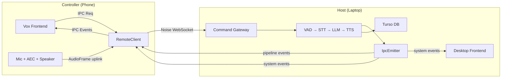
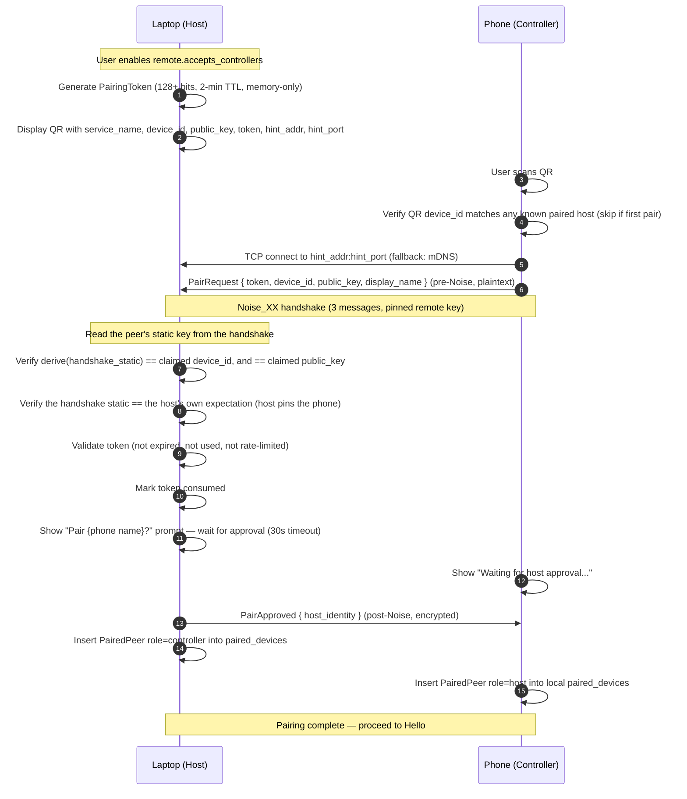
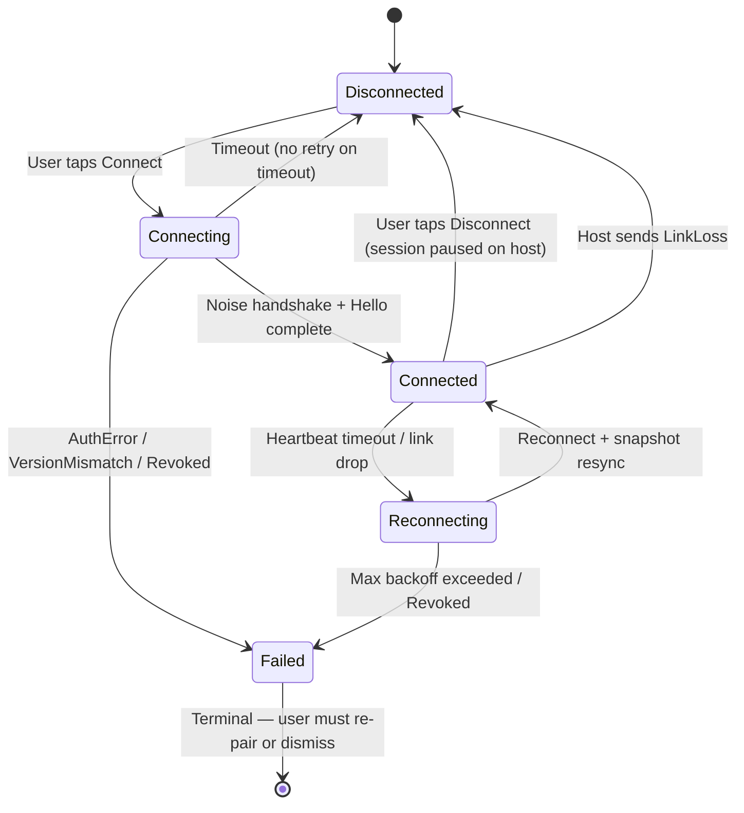

# Remote Control Specification

## 1. Intent & Scope

### 1.1 Lane
Protocol, Interface & Behavioral Specification. This document specifies the behavioral contracts, wire protocol invariants, identity model, security model, event routing rules, and IPC classification for the Vox Remote Control feature.

### 1.2 Purpose
Vox Remote Control allows a paired phone to act as the microphone, speaker, and UI surface for a laptop running the full Vox assistant pipeline. The phone carries zero model weights and runs zero local inference. The laptop is always the pipeline host. The phone is always the controller (thin client).

The spec is written to survive the addition of new transports (off-LAN, relay), new platforms (tablet, second laptop), and new codecs without requiring architectural changes. The extension guard rails in §3 define the seams that make this possible.

### 1.3 Out of Scope
- Off-LAN transport (QUIC, WebRTC, relay server) — future Connector; not in v1.
- Background and screen-off operation on Android — not in v1.
- Multiple simultaneous hosts or controllers — not in v1.
- Opus codec — PCM16 is v1. The codec byte exists for forward compatibility.
- IPC command schema definitions (governed by `ipc-spec.md`; this spec adds routing classifications and four new events).
- Database schemas for sessions, turns, and memory (governed by `db-spec.md`; this spec adds `paired_devices` to §5).
- Audio pipeline internals, VAD/STT/TTS algorithms (governed by `events-spec.md` and `harness-spec.md`).
- Acoustic echo cancellation implementation (governed by `aec_system_architecture_and_plan.md`; AEC runs on the phone's mic input before frames are sent and is independent of wire-protocol control messages).

---

## 2. User Stories

| ID | Story |
| :--- | :--- |
| **US-RC-01** | As a user at my desk, I want to pair my phone to my laptop once by scanning a QR code and confirming on the laptop, so that I never have to enter an IP address or repeat setup. |
| **US-RC-02** | As a user in another room, I want to open Vox on my phone, tap my laptop's name, and start speaking, so that the laptop's AI answers through my phone speaker without me being at the desk. |
| **US-RC-03** | As a user in a remote session, I want to see the full Vox UI on my phone (transcript, orb state, settings) exactly as I would on the laptop, so that I can read responses and adjust settings from my phone. |
| **US-RC-04** | As a user who set PTT mode on my phone during a remote session, I want that setting saved on the laptop, so that the next remote session starts in PTT mode without me configuring it again. |
| **US-RC-05** | As a user who disconnects the phone intentionally, I want the laptop session paused (not terminated), so that I can resume from the laptop or reconnect the phone and continue. |
| **US-RC-06** | As a user whose Wi-Fi hiccups briefly, I want the phone to reconnect automatically and resume the session without me doing anything. |
| **US-RC-07** | As a user on the laptop while the phone is connected, I want to see a "Remote session active" badge and a dimmed, disabled Engage button, so that I know the phone is in control. |
| **US-RC-08** | As a user on the laptop, I want to browse the session history, settings, and memory panels normally with every mutating control disabled, so that the phone's view stays authoritative and nothing on the laptop can change what the phone is showing. |
| **US-RC-09** | As a user with a lost phone, I want to revoke that device from the laptop's settings so it can never connect again. |
| **US-RC-10** | As a developer adding a second transport, I want to implement only a new Connector that passes the existing conformance suite, with no changes to the gateway, audio adapters, or phone client. |

---

## 3. Extension Guard Rails

These invariants are not negotiable. They are the seams that allow off-LAN, Opus, and background operation to arrive as additive tickets rather than refactors.

**RAIL-RC-01 (Identity is a key, never an address).** A peer's identity is its device credential (public key + derived device ID). IP addresses and hostnames are ephemeral address hints. Losing or changing an IP never changes identity.

**RAIL-RC-02 (Every caller dials through a Connector).** All connections are established through a `Connector` implementation. In v1, only `LanConnector` exists. A new Connector is a drop-in that passes the conformance suite without touching the command gateway, event emitter, or phone client.

**RAIL-RC-03 (Auth and encryption are at the app layer, transport-independent).** The Noise_XX protocol handshake (§5.2) provides mutual authentication, session keys, and replay protection independent of the transport. A future relay Connector carries the same handshake unchanged.

**RAIL-RC-04 (Wire protocol is versioned from the first byte).** Every connection begins with a versioned Noise prologue and a `Hello` message. Peers with incompatible versions MUST reject before any other message.

**RAIL-RC-05 (One conformance suite governs every Connector).** Every `Link` and `Connector` implementation MUST pass the loopback conformance suite without modification.

---

## 4. Roles, Topology & Modes

### 4.1 Terminology

**Host** — the laptop. Owns the assistant pipeline, the Turso database (sessions, turns, memory), and the settings store. There is exactly one host per session.

**Controller** — the phone. Provides audio capture (microphone) and audio playout (speaker) during a remote session. Runs the Vox UI as a thin client. Carries zero model weights.

### 4.2 Two Distinct Settings

These two settings are separate and must not be conflated.

| Setting | Owner | Meaning |
| :--- | :--- | :--- |
| `remote.accepts_controllers` | Host (laptop) | When true, the host advertises itself via mDNS and accepts incoming controller connections. When false, the host behaves identically to a standalone Vox installation. |
| `remote.execution_mode` | Controller (phone) | `local` = phone runs its own pipeline (standalone). `remote` = phone connects to a paired host and acts as thin client. |

### 4.3 Topology (v1, LAN)



---

## 5. Identity & Security

### 5.1 Device Identity

**`DeviceKey`** — an X25519 keypair. The private key MUST be stored as a mode-0600 file (`~/.vox/device.key` on desktop; app-private storage on Android). It MUST NOT be stored in the database (the DB is exported and backed up). It MUST zeroize on drop.

**`DeviceId`** — derived deterministically: `SHA-256("vox/device-id/v1" ‖ x25519_public_key)`. Encoded as lowercase hex. A new key always produces a new ID. The stored ID can never diverge from its key. The identity layer owns the derivation; the persistence layer stores the id and the key verbatim and never re-derives it (see `db-spec.md` §5.14 and RULE-DB-05, where the pair is stored).

> [!IMPORTANT]
> **Which bytes are hashed (resolves OQ-RC-05):** the hashed bytes are the **X25519 static public key** (32 bytes) used for the Noise_XX handshake. `DeviceKey` IS the X25519 keypair — no Ed25519 key exists in v1. `DeviceId` therefore hashes exactly the 32 bytes that Noise authenticates, which makes the identity and the transport key the same object by construction. A peer whose Noise static key differs can never produce a colliding `DeviceId`.

**`PeerIdentity`** — `{ device_id, public_key, display_name }`. The constructor MUST reject any identity where `device_id ≠ derive(public_key)`.

> [!NOTE]
> Open question OQ-RC-02 covers Android Keystore vs. file storage — see §15.

### 5.2 Encryption & Mutual Authentication (Noise Protocol)

All connections use the **Noise_XX pattern** (`snow` crate, or equivalent audited Rust implementation). Noise_XX provides:
- Mutual authentication of both peers using their static X25519 keys.
- Forward-secret session keys for each connection.
- Replay protection (nonces are internal to the Noise state machine).
- Transport independence (RAIL-RC-03): a relay Connector carries the same handshake.

> [!IMPORTANT]
> **Resolved (OQ-RC-05).** The Noise_XX pattern requires X25519 static keys (Curve25519 DH), not Ed25519 signing keys. `DeviceKey` is therefore **an X25519 keypair and nothing else** — the Noise static key doubles as the device identity key, so there is no second key type to keep in sync and no Ed25519 key in v1. The identity derivation rule in §5.1 hashes exactly those 32 X25519 public key bytes. The 32-byte private key is stored as a mode-0600 file and zeroized on drop.

The Noise handshake replaces the hand-rolled challenge-response described in earlier drafts. Channel binding is intrinsic to the Noise session; no separate `channel_binding` field is needed.

The Noise prologue MUST include the protocol version byte so that a version mismatch is authenticated and tamper-evident.

**No custom cryptography.** Implementations MUST NOT hand-roll handshakes. Use `snow` or another audited Noise library.

### 5.3 Pairing Protocol

Pairing happens once and establishes mutual trust. The QR is shown on the laptop; the phone camera scans it.



> [!IMPORTANT]
> **The claimed identity in `PairRequest` is a claim, not a credential.** It is sent before any key is established, so anyone on the LAN can assert any `device_id` and any `public_key`. It MUST NOT be trusted on its own.
>
> What makes it trustworthy is that it is **cryptographically bound to the Noise handshake that follows**. The host MUST verify, after the handshake completes, that all three of these hold:
> 1. the peer's static key as read from the completed handshake,
> 2. the `public_key` claimed in the `PairRequest`, and
> 3. the `device_id` claimed in the `PairRequest` — which must equal `derive(peer's static key)`,
>
> are the same object. If they are not, the host MUST refuse the pairing and close the connection. This is the same binding rule as §10.1, applied at pairing time.
>
> The `PairRequest` therefore carries **no ephemeral key**. In the Noise_XX pattern the ephemeral keys are generated and exchanged *by the handshake itself*; a pre-Noise message that carried an "ephemeral" would be a second, unauthenticated key exchange, and there is no reason to have one. The `PairRequest` carries a token and a claimed identity, nothing else.

**Pairing token invariants:**
- MUST be ≥ 128 bits of cryptographic randomness.
- MUST be single-use (mark consumed before sending `PairApproved`).
- MUST expire after 2 minutes.
- MUST be invalidated after 3 failed validation attempts from the same source IP.
- MUST be stored in memory only. No database table.
- Per-IP rate limit: 5 pairing attempts per minute.
- The QR MUST include `hint_addr` and `hint_port` (the laptop's current IP and listening port) as a `Lan` address hint. mDNS is a fallback, not the only path (see §6.1).
- The phone MUST verify that the `device_id` in the QR matches the peer it connected to after the Noise handshake, before accepting `PairApproved`.
- The host MUST wait for explicit user approval before inserting the paired peer record.
- The host MUST NOT pin the phone's static key before the handshake, because it does not yet know which peer is connecting. The host learns the peer's identity from the handshake and then looks it up (§7.2). The **phone** pins the host's key, from the QR on first pairing and from its own `paired_devices` row afterwards.

### 5.4 `paired_devices` Table

Both the laptop and phone maintain a `paired_devices` table in their local Turso database.

```sql
CREATE TABLE IF NOT EXISTS paired_devices (
    device_id    TEXT    PRIMARY KEY,
    public_key   BLOB    NOT NULL CHECK (length(public_key) = 32),
    display_name TEXT    NOT NULL,
    role         TEXT    NOT NULL CHECK (role IN ('controller', 'host')),
    trust_level  TEXT    NOT NULL DEFAULT 'full' CHECK (trust_level IN ('full')),
    hints        TEXT    NOT NULL DEFAULT '[]',   -- JSON AddressHint[], forward-compatible
    paired_at    INTEGER NOT NULL,
    last_seen_at INTEGER
);
```

- `role`: `controller` on the laptop's table (phone is a controller); `host` on the phone's table (laptop is the host). A peer MUST be rejected if it connects in a role that contradicts its stored `role`.
- `hints`: JSON array of `AddressHint` objects. The only mutable column. Updated by mDNS refresh and observed successful connections.
- `last_seen_at`: MUST only be written on connect and disconnect events. Never written per heartbeat (RULE-DB-04 from `db-spec.md`).
- The table name is `paired_devices` (not `devices`) to avoid collision with `AudioDevice` / `list_audio_devices`.

### 5.5 Address Hints

```
AddressHint (#[non_exhaustive], JSON-tagged):
  Lan { addr: SocketAddr, port: u16, source: HintSource, last_ok_at: Option<i64> }

HintSource: Qr | Mdns | Observed
```

Hints are connection candidates, not identity. The hint array MUST be updated on:
- Successful connection (source: `Observed`).
- mDNS record refresh (source: `Mdns`).

An unknown `kind` in the JSON array MUST round-trip without data loss (forward compat for relay hints).

### 5.6 Revocation

Revocation MUST:
1. Delete the device's row from `paired_devices`.
2. Close any open connection from that device immediately.
3. Take effect without restarting the app.

After revocation, any connection attempt from that device MUST be rejected. The connection state machine MUST enter `Failed(Revoked)` as a terminal state (no retry).

**Revocation is permanent. It is not the same operation as a host-initiated disconnect** (§6.6), which ends the current link and keeps the pairing. Revocation is for a device that is lost or should never connect again; a host-initiated disconnect is for a device that should stop connecting *now* and be allowed back later.

---

## 6. Connection Lifecycle

### 6.1 Discovery (LAN v1)

When `remote.accepts_controllers` is enabled, the host MUST:
1. Bind a TCP listener on a configurable port (default: dynamically selected free port, not hardcoded).
2. Advertise a mDNS service `_vox._tcp.local` with the host's `device_id` in the TXT record so the phone can match the service to a paired peer.

**Primary discovery path:** The QR code embeds `hint_addr:hint_port` (laptop's current IP and bound port). The phone connects to this address first.

**mDNS fallback:** When the hint address fails (DHCP change, network change), the phone browses `_vox._tcp.local` and matches the discovered service's TXT `device_id` against its `paired_devices` table.

**Manual fallback:** A "Enter address manually" option MUST be available for environments where mDNS multicast is blocked (guest Wi-Fi, corporate networks, Android multicast lock issues).

The phone MUST show a list of discovered and manually-entered hosts by display name, not by IP address.

> [!WARNING]
> Note for implementors: incoming TCP requires a firewall rule on the laptop's port. The port being dynamic (not 7700) means it cannot be pre-provisioned. The setup guide should inform users of this. The mDNS service record advertises the actual port.

### 6.2 Connection State Machine (Controller Side)

The controller drives the canonical `RemoteLinkState` enum defined in §9.1.



`Failed` is a terminal state. `AuthError::Revoked`, `AuthError::UnknownPeer`, and `VersionMismatch` MUST transition to `Failed`, not `Reconnecting`. A revoked device MUST NOT retry with backoff.

**The host occupies a subset of this enum** (§9.1). The host never dials, so it never enters `Connecting` or `Reconnecting`: a link that drops at the host is simply `Connected → Disconnected`, and the controller independently decides whether to retry.

### 6.3 Heartbeat (Bidirectional Ping/Pong)

- The host sends a `Ping` every **2 seconds** on the control channel.
- The controller MUST respond with a `Pong` containing the received ping's `seq` number within **1 second**.
- If the host does not receive a `Pong` within 1 second, it retries. After **3 missed pongs** (≈ 6 seconds total), the host MUST call `PauseSession` and emit `LinkLoss` to the controller.
- If the controller does not receive a `Ping` for **6 seconds**, it enters `Reconnecting`.
- Heartbeat intervals and timeouts are named constants, not magic numbers.

### 6.4 Intentional Disconnect

When the controller sends `Disconnect`:
- The host MUST call `PauseSession`. Session persists.
- The host MUST write `last_seen_at` for the controller's `paired_devices` row (connect/disconnect only — RULE-DB-04).
- The host desktop UI MUST restore the Engage button and remove the "Remote session active" badge.
- The controller may reconnect later and send `ResumeSession`.
- The laptop may resume the session locally at any time after the controller disconnects.

### 6.5 Host Admission Rules

The host MUST refuse a controller connection, with a **distinct, non-terminal-to-the-user reason** in each case, so that the controller can tell the user what to do:

| Condition | Host behaviour | Controller message |
| :--- | :--- | :--- |
| `remote.accepts_controllers` is false | Send `LinkRefused` with reason `not_accepting`, then close. | "Your laptop is not accepting remote connections." |
| A local session is active on the host | Send `LinkRefused` with reason `host_busy`, then close. The host does **not** pause, adopt, or destroy the local session. | "Your laptop is in a session right now." |
| Another controller is already attached | Send `LinkRefused` with reason `controller_attached`, then close. The host serves one controller at a time in v1. | "Another device is already connected." |
| Peer not in `paired_devices` | `UnknownPeer`, then close. | "This device is not paired with your laptop." |
| Protocol version incompatible | `VersionMismatch`, then close. | "Update the app on your laptop." |

> [!NOTE]
> **Amended from the original draft.** The original draft defined none of these. Three consequences followed: a controller could not distinguish "the laptop is off" from "the laptop is not accepting"; a controller could attach to a host that was already running a local session, producing two session owners; and a second controller could attach alongside the first. The table above closes all three.
>
> **The first three rows were also unexpressible on the wire.** The spec named a distinct user-facing message for each, but no message type carried the reason, so the controller could only have learned "refused" and guessed which of the three it was. `LinkRefused` (§7.3) closes that gap, with one reason code per row.

**Distinguishing "host offline" from "host not accepting".** A host that is not accepting still **advertises** its mDNS service, with an `accepts` flag in the TXT record. A controller that browses and finds the service learns the host is reachable but not accepting, and can say so precisely. A controller that finds no service at all reports the host as unreachable.

### 6.6 Host-Initiated Disconnect

The host MUST be able to disconnect an attached controller **without revoking its pairing**. This is distinct from revocation (§5.6), which is permanent.

On a host-initiated disconnect the host MUST:
1. Send `LinkLoss` with reason `host_disconnected`.
2. Close the link.
3. Call `PauseSession`. The session persists, exactly as in §6.4.
4. Write `last_seen_at` for the controller's `paired_devices` row.
5. **Keep** the `paired_devices` row. The controller remains paired and may reconnect later.

> [!NOTE]
> **Amended from the original draft.** The original draft gave the host exactly two ways to end a controller's participation: wait for the controller to disconnect, or revoke the device permanently. A user whose phone is on the sofa next to the laptop had no way to take the session back without destroying the pairing. Revocation remains available and is the correct action for a **lost** device.

---

## 7. Wire Protocol

### 7.1 Transport & Framing

All messages travel over WebSocket. WebSocket already delimits messages; **no additional length prefix is used**. There are two WebSocket connections per link (§7.4). The maximum message size before authentication is **4 KB** with a **5-second deadline** to complete the handshake. After authentication, the maximum control message size is **64 KB**. Messages exceeding these limits MUST cause immediate connection termination.

**Noise framing (resolves the transport layering).** Each link runs the Noise_XX handshake (§5.2) **inside** the WebSocket connection. The layering is:

```
TCP  →  WebSocket  →  Noise_XX  →  application message
```

- **TLS is NOT used.** Noise already provides mutual authentication, confidentiality, forward secrecy and replay protection. Adding TLS would introduce a second, redundant trust anchor and require a certificate lifecycle that a LAN peer has no way to provision. The WebSocket is therefore `ws://` on the LAN.
- **One WebSocket message = one Noise message.** The Noise handshake is a **sequence of messages**, and each one is carried in its own binary WebSocket message. The exchange is driven by the Noise state machine until it reports the handshake complete — the message count is a property of the pattern, not a constant this spec hardcodes.
- **The Noise prologue is NEVER transmitted.** The prologue is mixed into the handshake hash by both peers, so a peer with a different prologue fails the handshake with a decryption error rather than negotiating. The prologue therefore **MUST NOT** be sent as a WebSocket message, and a receiver that receives one is talking to a peer that does not understand the protocol.
- **Every post-handshake WebSocket frame is binary.** The "text vs binary" distinction of a plain WebSocket carries no meaning once Noise encrypts: the outer frame is opaque bytes, and the *inner* plaintext is what the protocol describes. The protocol-level distinction survives inside the Noise plaintext (a control message is JSON, an audio message is a binary frame body).

**The pre-handshake phase is plaintext, and only one message may occupy it.** Before the Noise handshake completes, the control socket carries exactly one application message: `PairRequest` (§5.3). It is sent in the clear, because the peer has no session key yet. Everything after the handshake is Noise-encrypted. The 4 KB pre-authentication cap applies to the pre-handshake phase; the 64 KB cap applies afterwards. A receiver MUST treat any pre-handshake message other than `PairRequest` as a protocol error and close the connection.

> [!NOTE]
> **Why the pairing token may travel in the clear.** The `PairRequest` carries the pairing token before any key is established, so the token crosses the LAN in plaintext. That is acceptable because the token is single-use, expires after 2 minutes, is rate-limited per source IP, and — the reason that actually matters — the host still requires **explicit user approval** before it writes the paired-peer row. A sniffer who steals the token cannot pair a device without the human tapping "Pair this phone?". A token that is valid *and* approved is the only thing that creates trust.

> [!NOTE]
> **Amended after the W1 wave, from verified ground truth.** The first draft of this section said the handshake was "carried as the first two WebSocket binary messages (prologue + handshake payload)". Both halves were wrong. The Noise prologue is mixed into the handshake hash and is never sent — sending it would leak the version byte to a passive observer and would be rejected by a conforming peer. And the message count is not two: the Noise_XX pattern is a three-message exchange (the initiator's ephemeral; the responder's ephemeral, static and DH; the initiator's static and DH), with sizes that depend on the primitives. This amendment states the rule that is actually implementable — drive the state machine, send one message per turn, never send the prologue — and leaves the count to the Noise implementation.

**Encoding (inside the Noise plaintext):**
- Control messages (all types except `AudioFrame`): JSON-encoded UTF-8.
- Audio frames: a binary frame body (§7.4), not JSON.

On receipt of an unknown message type, the receiver MUST log a warning and skip the message (do not close). This enables forward compatibility (RAIL-RC-04).

### 7.2 Hello Exchange (Post-Noise)

After the Noise handshake completes (§5.2), each side sends a `Hello`. No other message type may be sent before `Hello` is complete in both directions.

Because Noise_XX already provides mutual authentication, `Hello` carries negotiation fields only — no auth proof is needed.

```json
{
  "type": "Hello",
  "version": 1,
  "sender_identity": { "device_id": "<hex>", "display_name": "<string>" },
  "capabilities": 1
}
```

On receiving the peer's `Hello`:
1. Check `version` compatibility. Incompatible → send `VersionMismatch` and close.
2. Look up the peer's `device_id` in `paired_devices`. Absent → send `UnknownPeer` and close.
3. Check the peer's `role` in `paired_devices` matches the connection direction. Mismatch → send `RoleNotPermitted` and close.
4. Send `SessionToken` (§7.4).
5. Send `AttachSnapshot` (§8.3).

`capabilities` is a bitmask negotiated per-connection. It MUST NOT be baked into a static stored credential (it changes across app versions).

> [!NOTE]
> **Amended after the W1 wave.** The original draft of §7.2 listed only four steps and never said how the controller learns the `session_token` that §7.4 requires it to present on the audio socket. The host issued a token into the void. `SessionToken` is now a message type (§7.3), and step 4 above sends it. Its arrival is also the signal that the controller opens the audio socket — a controller MUST NOT open the audio socket before it holds the token, because the host would close it as unauthenticated.

### 7.3 Message Types

| Type | Direction | Transport | Description |
| :--- | :--- | :--- | :--- |
| `Hello` | Both | Control | First post-Noise message. Version, identity, capabilities. |
| `Req` | Controller → Host | Control | IPC command. Fields: `request_id`, `command`, `args` (JSON). |
| `Res` | Host → Controller | Control | IPC response. Fields: `request_id`, `ok`, `payload` (JSON). |
| `Err` | Host → Controller | Control | IPC error. Fields: `request_id`, `code` (IPC error category), `message`. |
| `Event` | Host → Controller | Control | IPC event forwarded to phone. Fields: `event_name`, `payload` (JSON). |
| `SessionToken` | Host → Controller | Control | The audio-socket session binding (§7.4). Fields: `token` (32 random bytes, hex-encoded). Sent by the host immediately after the `Hello` exchange. |
| `AttachSnapshot` | Host → Controller | Control | Sent immediately after Hello. Fields: `state` (StateChanged payload), `session_id`, `settings` (redacted BootState). |
| `Disconnect` | Controller → Host | Control | Intentional disconnect. Host pauses session. |
| `Ping` | Host → Controller | Control | Liveness probe. Fields: `seq`. Sent every 2 seconds. |
| `Pong` | Controller → Host | Control | Liveness response. Fields: `seq` (echoed). Must be sent within 1 second. |
| `LinkLoss` | Host → Controller | Control | Host closing connection due to pause, idle, or an explicit host-initiated disconnect. Fields: `reason` (`host_paused` \| `host_idle` \| `host_disconnected`). |
| `VersionMismatch` | Both | Control | Sent before close when Hello version is incompatible. |
| `UnknownPeer` | Host → Controller | Control | Sent before close when device_id is not in paired_devices. |
| `RoleNotPermitted` | Host → Controller | Control | Sent before close when peer role contradicts stored role. |
| `LinkRefused` | Host → Controller | Control | Sent before close when the host refuses the connection under §6.5. Fields: `reason` (`not_accepting` \| `host_busy` \| `controller_attached`). |
| `AudioFrame` | Both | Audio | PCM16 audio data. Binary frame (§7.4). |
| `PttMarker` | Controller → Host | Audio | PTT button event. Travels on the audio socket to preserve ordering with audio frames (§7.4). |
| `Flush` | Host → Controller | Audio | Discard buffered audio. Carries `epoch` field (§7.4). |
| `PairRequest` | Controller → Host | Pre-auth | Pairing initiation. Fields: `token`, `device_id`, `public_key`, `display_name`. Pre-Noise, plaintext, and therefore a *claim* that the host verifies against the completed handshake (§5.3). |
| `PairApproved` | Host → Controller | Pre-auth | Host accepted the pairing. Fields: `host_identity`. Sent post-Noise, so it is encrypted. |
| `PairDenied` | Host → Controller | Pre-auth | Host rejected or timed out. Sent post-Noise, so it is encrypted. |

### 7.4 Audio Frame & Related Messages

**Two sockets, not one.** Every link has a control WebSocket and a separate audio WebSocket. Audio frames are binary WebSocket frames on the audio socket. High-frequency audio never blocks control messages (Ping, Flush, Disconnect).

**Audio socket authentication.** The audio WebSocket is authenticated by its **own Noise_XX handshake**, using the same static key pair as the control channel. The controller MUST complete a full Noise handshake on the audio socket before sending any application data; the host MUST close the audio socket immediately if the handshake fails, times out, or completes against a different static key than the control channel.

In addition, after the control-channel Noise handshake and Hello complete, the host issues a short-lived `session_token` (32 random bytes). The host MUST deliver it to the controller as a `SessionToken` message (§7.3) on the control channel. The controller's audio WebSocket MUST send this token as its first application message, immediately after its own Noise handshake and before any audio data. The host validates the token and closes the audio socket immediately on mismatch.

The token is **single-use and time-limited**: it is consumed by the first audio socket that presents it, and it expires after the `SESSION_TOKEN_TTL` interval. A token that is presented on a second audio socket MUST be rejected, so a captured token cannot be replayed onto a later session.

**Why both.** The Noise handshake on the audio socket provides the same mutual authentication and confidentiality as the control channel — the audio stream is voice data and MUST NOT cross the LAN in plaintext. The `session_token` provides an *additional* binding that the audio socket belongs to the **same logical session** as the control channel, which a standalone Noise handshake alone cannot express. Neither mechanism replaces the other; the token is not a substitute for encryption.

> [!NOTE]
> **Amended from the original draft.** The first draft of this section specified token-only authentication for the audio socket, which left the audio channel unencrypted and unauthenticated against an off-path attacker. The dual mechanism above closes that gap.

**Stream format per direction:**

| Direction | Rate | Channels | Bit depth | Frame size |
| :--- | :--- | :--- | :--- | :--- |
| Uplink (phone mic → host) | 16 kHz | Mono | PCM16 (i16) | 20 ms = 320 samples = 640 bytes |
| Downlink (host TTS → phone) | 24 kHz | Mono | PCM16 (i16) | 20 ms = 480 samples = 960 bytes |

The stream format for each direction MUST be declared in the `Hello` message as `uplink_format` and `downlink_format` fields (sample rate, channels, frame size). The receiver MUST reject a mismatched format.

**AudioFrame binary layout:**

```
[u8: codec]           -- 0x00 = PCM16; reserved for Opus (future)
[u32_be: seq]         -- monotonic frame counter; gaps indicate loss
[u64_be: epoch]       -- monotonic epoch counter; increments on every Flush
[u64_be: sample_offset] -- absolute sample position from session start
[remaining bytes: samples] -- i16 little-endian PCM
```

`epoch` is used to discard stale in-flight frames that arrived after a `Flush`.

**Audio-socket payload discrimination.** The WebSocket text/binary distinction does not survive Noise encryption (§7.1), but the audio socket carries two different payload shapes: a binary `AudioFrame` body and a JSON `PttMarker` or `Flush`. Every inner payload on the audio socket therefore begins with a **one-byte tag**:

| Tag | Meaning | Body |
| :--- | :--- | :--- |
| `0x00` | Binary audio frame | The `AudioFrame` layout above, starting at the codec byte. |
| `0x01` | JSON audio-control message | A `PttMarker` or `Flush` object. |

The control socket needs no tag: every inner payload there is a JSON control message. A receiver MUST treat an unknown tag as a protocol error and close the audio socket, because a mis-tagged frame cannot be safely interpreted as either shape.

> [!NOTE]
> **Why this was not in the first draft.** The first draft specified that post-handshake frames are all binary, then specified that `PttMarker` and `Flush` are JSON, without saying how a receiver told the two apart. Guessing from the first byte would have made `0x00` (the PCM16 codec byte) collide with a JSON payload's opening brace, and the failure would have been silent — a PTT marker read as an audio frame. An explicit tag makes the distinction unambiguous.

**PttMarker** travels on the audio socket (not control) to guarantee ordering with audio frames:

```json
{ "type": "PttMarker", "action": "start" | "stop" | "cancel",
  "sample_offset": <u64>, "epoch": <u64> }
```

**Flush** carries the new `epoch` value. The controller MUST drop all buffered `AudioFrame` messages whose `epoch` is less than the `Flush.epoch`.

```json
{ "type": "Flush", "epoch": <u64> }
```

> [!NOTE]
> **Why Gate/Flush/PttMarker are distinct from AEC:** AEC (Acoustic Echo Cancellation, `sonora` crate) runs on the phone's mic input *before* frames are encoded and sent. It removes the acoustic echo of the phone's own speaker from the microphone signal — a local audio quality operation. `Gate`, `Flush`, and `PttMarker` are network-level coordination signals:
> - `Flush` tells the phone to discard frames already in the network buffer (stale after barge-in or session pause). AEC cannot retroactively invalidate in-flight bytes.
> - `PttMarker` is a UI event (button press/release) that must be co-ordered with the audio frames it surrounds so the host's VAD can gate correctly.
> - There is no Gate message in the v1 protocol. Ingestion gate state (idle/active) is carried by `state_changed` IPC events, which are already forwarded to the controller. The controller uses `state_changed` to know when to start/stop sending audio.

---

## 8. IPC Command Routing

### 8.1 Classification

Every IPC command is classified at **domain + key granularity** (not just command name) in a static routing table. `update_setting` and `get_settings` are single commands with per-key semantics. The routing table must classify each domain and key separately.

| Class | Meaning | Gateway action |
| :--- | :--- | :--- |
| **Remote** | Executes on the host; result forwarded to controller. | Forward to host backend. |
| **Local** | Only meaningful on host hardware or host-local state. | Reject with `RemoteError::Denied` before execution. |
| **Split** | Command reaches the host, but response is filtered or annotated before forwarding. `get_settings` is Split (API keys redacted). | Forward; apply filter to response. |
| **Denied** | Never callable remotely. Reserved; currently empty. | Reject with `RemoteError::Denied`. |

**Examples (non-exhaustive):**

| Command / domain+key | Class | Reason |
| :--- | :--- | :--- |
| `start_session`, `ptt_start`, `submit_text_input` | Remote | Core interaction commands |
| `update_setting` / `appearance.*` | Local | Appearance is per-device; changing theme on phone must not change laptop theme |
| `update_setting` / `interaction.*`, `working_memory.*`, `tts.*`, `llm.*` | Remote | Pipeline settings; phone changes persist on host |
| `update_setting` / `remote.accepts_controllers` | Local | Host-side switch; a controller must never be able to enable or disable controller acceptance |
| `update_setting` / `remote.execution_mode` | Local | Controller-side switch; local to whichever device evaluates it |
| `list_audio_devices` | Local | Returns laptop's hardware list; meaningless on phone |
| `manage_models` | Local | Downloads to laptop's filesystem |
| `get_settings` | Split | Forwarded but secret fields redacted |
| `get_settings_contract` | Remote | Schema only; no secrets |
| `list_voices`, `set_active_voice` | Remote | Voice catalog is host-side |

> [!NOTE]
> **Amended from the original draft.** The original example table listed an `ui.*` settings domain. No such domain exists in the codebase; the appearance domain is `appearance.*`. This spec uses `appearance.*`.

**Completeness requirement.** The routing table MUST contain an explicit entry for:

- **every** IPC command name in the registry,
- **every** `update_setting` domain and key, at domain+key granularity,
- the `model_parameters` pseudo-domain, which routes to the model registry rather than the settings struct but is still reachable through `update_setting`.

A static compile-time test MUST assert this completeness (VERIFY-RC-07). The test enumerates the command registry and the settings key table and fails if any entry is missing from the routing table.

### 8.2 Local Writes Are Blocked During A Remote Session

**RULE-RC-GUARD (All local writes are blocked while a remote session is active).**
When a controller is attached, the host MUST refuse **every** local write command from the desktop. Only reads, and the appearance settings, remain available.

**Why.** While a remote session is active the phone is the surface the user is looking at, and the desktop is a passive observer. If the desktop can mutate state, it can change what the phone is showing — behind the user's back, and without the phone's view ever refreshing to match. The phone's view must be authoritative for the duration of the session. A user reading a notification on the phone must be able to trust that nothing on the laptop changed underneath them.

**How it is expressed.**

1. The decision is made by **one function**, driven by **one value**: the canonical `RemoteLinkState` (§9.1). No component may implement its own notion of "is a remote session active".
2. The classification is **default-deny**. A command is permitted while a remote session is active **only** if it appears in the permitted list below. A command added in the future is blocked until someone deliberately classifies it. This is the safety direction: a forgotten classification costs a disabled button, not a corrupted session.
3. The **command origin** is an explicit parameter on the affected service functions — not a thread-local, not a global flag, not a boolean. The desktop path passes `ControlOrigin::Desktop`; the gateway passes `ControlOrigin::Controller`. The rule applies only to `Desktop`.
4. A blocked write **does not take effect**, and the caller receives an explicit error naming the reason. The desktop MUST disable the corresponding controls. The backend and the UI read the **same** `RemoteLinkState`, so they cannot disagree.

#### 8.2.1 Permitted while a remote session is active

**Reads — every command that observes state and changes nothing:**

| Domain | Commands |
| :--- | :--- |
| Audio | `list_audio_devices` |
| Catalog | `get_model_catalog`, `get_provider_caps`, `check_provider_health`, `probe_provider_target`, `list_llm_models`, `probe_model_capabilities`, `get_model_capabilities_cache`, `list_favorite_models` |
| Memory | `get_personal_memory`, `get_personal_memory_versions`, `get_observations`, `get_ingestion_stats`, `get_memory_revisions` |
| Monitoring | `get_runtime_snapshot`, `get_profiler_snapshot` |
| Notifications | `notification_permission_state`, `get_notifications` |
| Persistence | `get_transcript_history`, `get_sessions`, `get_turns` |
| Projects | `get_projects` |
| Settings | `get_restart_status`, `get_settings`, `get_settings_contract` |
| Setup | `check_updates`, `fetch_manifest`, `get_runtime_report`, `get_onboarding_status` |
| Voices | `list_voices`, `get_voice_scope` |

**Window chrome — the desktop's own window furniture, not application state:**
`show_main_window`, `hide_tray_window`, `set_window_click_through`.

**The appearance domain only:**
`update_setting` and `apply_settings_patch` with domain `appearance` (`theme`, `accent_seed`). Appearance is a per-device preference. Changing the laptop's theme does not change what the phone is showing, and the phone's theme is its own.

**Remote-control administration — these MUST stay available, because the situation that needs them is precisely the situation in which a phone is attached:**

| Command | Why it stays available |
| :--- | :--- |
| `disconnect_device` | End this phone's link now, keep the pairing. Blocking this would trap the user. |
| `revoke_device` | Permanently remove a **lost** device. Revoking the lost phone is the exact action needed while another phone is attached. |
| `pair_new_device` | Pair an additional device. Pairing does not disturb the live session. |
| `update_setting` with domain `remote`, key `accepts_controllers` | Turn remote control off entirely. Turning it off drops any attached controller. |

#### 8.2.2 Blocked — everything else

By default, every command not listed in §8.2.1 is blocked. In practical terms that is:

- **Every session and pipeline command:** `launch_engine`, `stop_engine`, `start_session`, `end_session`, `pause_session`, `resume_session`, `ptt_start`, `ptt_stop`, `ptt_cancel`, `submit_text_input`, `set_playback_muted`, `set_mic_muted`, `set_session_private_mode`, `create_session`, `continue_session`.
- **Every settings domain except `appearance`:** `vad`, `stt`, `llm`, `tts`, `interaction`, `dictation`, `working_memory`, `persona`, `personal_memory`, `system`, `remote.execution_mode`, and the `model_parameters` pseudo-domain. `reset_settings` is blocked.
- **Every memory, project and notification mutation:** `save_personal_memory`, `consolidate_personal_memory`, `regenerate_personal_memory`, `set_active_personal_memory_version`, `resolve_memory_revisions`, `create_project`, `rename_project`, `delete_project`, `update_session`, `delete_session`, `compact_session`, `request_notification_permission`, `debug_fire_transient`, `mark_notifications_read`, `dismiss_notifications`, `execute_notification_action`.
- **Every model, provider and voice mutation:** `manage_models`, `setup_remote_server`, `toggle_model_favorite`, `complete_setup_wizard`, `reveal_wizard`, `set_active_voice`, `toggle_voice_favorite`, `record_voice_used`, `synthesize_voice_preview`, `add_voice_from_file`, `add_voice_from_recording`, `delete_voice`, `rename_voice`, `start_backend_recording`, `stop_backend_recording`, `sync_remote_voices`.
- **Every telemetry and profiler write:** `record_memory_profile_event`.

> [!NOTE]
> **Amended from the original draft.** The first draft blocked four session commands and said the rest of the desktop "MUST remain fully functional". The second draft widened the set to the commands that contend for the turn. This amendment replaces both with a single rule: **all writes are blocked, appearance excepted**, because the phone's view is authoritative during a remote session and a write from the laptop changes that view without the phone ever learning about it.

### 8.3 Attach Snapshot

When a controller successfully completes the `Hello` handshake, the host MUST immediately send `AttachSnapshot` containing:
- Current `state_changed` payload (pipeline state).
- Current `session_id` (or null if no session is active).
- Current settings as `BootState` with all secret fields replaced by `"[REDACTED]"` (§8.4).
- The **recent turns of the active session** (transcript history), so that a controller joining a live conversation sees the conversation rather than a blank screen.

> [!NOTE]
> **Amended from the original draft.** The original snapshot carried no transcript. A controller that paired mid-conversation would open onto an empty transcript while the host was mid-turn, which contradicts US-RC-03 ("I want to see the full Vox UI on the phone … exactly as I would on the laptop").

The snapshot is also the resynchronisation payload: it is re-sent after a reconnect (§6.2), so a controller that lost its link recovers its full view without a separate query.

### 8.4 Secret Redaction

The following fields MUST be replaced with `"[REDACTED]"` in any settings payload forwarded to a controller: `api_key`, `azure_key`, and any field whose key contains `_key`, `_token`, or `_secret`. A static list of redacted field names MUST be maintained and tested.

The generic key-name rule is **not sufficient on its own** and the explicit list MUST cover these shapes, which the name rule misses:

| Shape | Example | Why the name rule misses it |
| :--- | :--- | :--- |
| A map of secrets | `llm.cloud_keys`, `realtime.api_keys` | The container name does not contain `_key` |
| A list of objects holding secrets | `llm.servers[].api_key`, `tts.servers[].api_key` | The secret is nested one level down |
| A bare secret field | `tts.azure_tts.key` | The field name is `key`, which does not contain `_key` |

> [!IMPORTANT]
> `tts.azure_tts.key` is a live Azure Speech API key. It MUST be added to the shared secret-key list in the settings module, not only to the redaction list, so that it is also masked in diagnostic logging. Until that is done, the redaction is not complete and the field MUST be redacted by the explicit list.

The desktop's own `get_settings` response is **not** redacted. The desktop is the machine that holds the keys and needs them to reach its own providers. Only the controller-facing payload is redacted.

---

## 9. Event Routing

### 9.1 Pipeline State vs. Network State — Decoupled

Pipeline state (Idle, Ready, Listening, Thinking, Speaking, Working, Paused, Sleeping, Error) is governed by the host's `events-spec.md` state machine. This state is communicated via `state_changed` IPC events.

Network/connection state is governed by a **single canonical enum**, `RemoteLinkState`, defined in the remote session module. It is NOT a pipeline state. The host has no `remote_connected` pipeline state.

```
RemoteLinkState
├── Disabled       remote control switched OFF (host only)
├── Disconnected   no link
├── Connecting     handshake in progress
├── Connected      link is up
├── Reconnecting   link dropped, retrying with backoff
└── Failed(kind)   terminal: Revoked | UnknownPeer | VersionMismatch | Timeout | Transport | RateLimited | HostBusy
```

**The host and the controller read the same enum.** The controller drives it through the full dial-driven state machine (§6.2). The host never dials, so it only ever occupies a subset:

| State | Controller | Host |
| :--- | :---: | :---: |
| `Disabled` | — | ✔ |
| `Disconnected` | ✔ | ✔ |
| `Connecting` | ✔ | — |
| `Connected` | ✔ | ✔ |
| `Reconnecting` | ✔ | — |
| `Failed` | ✔ | — |

> [!IMPORTANT]
> **Amended from the original draft.** The first draft of this section specified a `controller_attached: bool` flag on the host. That is replaced by `RemoteLinkState`. A boolean that shadows a state transition violates `.agents/rules/backend-style-guide.md` §5 ("Never introduce boolean flags that shadow state transitions"), and it is the reason the original design produced scattered, contradictory checks across the engine, dictation, lifecycle, router and gateway. **Every consumer of remote state MUST query the canonical enum.** No `is_connected`, `controller_attached`, or equivalent boolean may exist anywhere in the codebase.

These two state machines are explicitly decoupled. `RemoteLinkState` gates event fanout and the desktop UI badge, but does not alter the pipeline state machine.

**State delivery.** The backend owns the state and pushes it:
- A `remote_state_changed` IPC event is emitted on every transition, on both the host and the controller. The desktop and the phone run the same frontend, so the same event name and payload type serve both.
- A `get_link_state` IPC command returns the current value. It exists **only on the controller**, and **only** to hydrate the initial render: the controller auto-reconnects (§6.2, US-RC-06), so its state can already be `Reconnecting` before the UI mounts, and a frontend that only listened for events would wait forever for a transition that already happened. The host does **not** need the command: a host that has just booted cannot have a controller attached, because the link died with the previous process, so the desktop starts at `Disconnected` and follows the event.

**The general rule for the whole feature:** the backend owns state and pushes it; the frontend may read it once at boot, never to drive it.

### 9.2 Event Fanout Policy

When a controller is attached, IPC events are fanned out as follows:

**Pipeline events → controller only:**
`state_changed`, `transcript_partial`, `transcript_final`, `llm_token`, `turn_metrics`, `telemetry`

These events describe the active voice interaction. They go to the controller (the active UI surface) only. The host desktop does NOT receive these during a remote session to avoid duplicate rendering of pipeline state on a passive surface.

**Network and system events → both:**
`sessions_changed`, `settings_updated`, `personal_memory_updated`, `notification_created`, `notification_updated`, `model_progress`, `system_stats`, `engine_restart_state`, `memory_ingestion_updated`

These events describe host state that is meaningful on both surfaces.

**Remote control events → host desktop only:**
`remote_device_connected`, `remote_device_disconnected`

These are how the desktop knows to show/hide the "Remote session active" badge.

> [!IMPORTANT]
> When the controller disconnects, the host MUST immediately resume sending pipeline events to the desktop window. The desktop is a passive observer during remote sessions, not permanently excluded.

### 9.3 Rate Limits on High-Frequency Events (Controller Channel)

| Event | Controller rate limit | Desktop rate limit |
| :--- | :--- | :--- |
| `telemetry` | ≤ 30 Hz (drop-oldest) | No limit (all 60 Hz) |
| `llm_token` | ≤ 1 per 50 ms (throttled) | No limit |
| All others | No limit | No limit |

### 9.4 Host Desktop State During Remote Session

When a controller is attached and the pipeline is in any active state:
- The Engage button MUST be **disabled** — the control is not clickable and carries the platform's disabled affordance. It is not merely dimmed and left live.
- The orb MUST be rendered in a passive dimmed style.
- Every mutating control on every desktop panel MUST be **disabled** while the controller is attached, per §8.2. The panels themselves remain browsable.
- A "Remote session active" badge MUST be visible in the desktop header.
- All other desktop panels (session history, settings, memory, notifications) MUST remain **browsable**; only their mutating controls are disabled, per §8.2.

When the controller disconnects, every disabled control MUST return to normal immediately.

---

## 10. Security Model

### 10.1 Trust Model

Trust is established by pairing and verified by the Noise handshake. A device is trusted if and only if it has a valid row in `paired_devices`. The Noise handshake verifies:
1. The peer's static key is the same key used at pairing time (Noise_XX binds to static keys).
2. The peer's `device_id` in `Hello` matches the `paired_devices` row.
3. The peer's `role` matches the connection direction.

No per-command authentication occurs after connection is established.

### 10.2 Revocation

See §5.6. After revocation, the peer's Noise static key is no longer trusted. Any connection attempt transitions to `Failed(Revoked)`.

### 10.3 Pairing Rate Limits & Defenses

- 5 pairing attempts per minute per source IP.
- Pairing token invalidated after 3 failed attempts from the same IP.
- Host requires explicit user approval before inserting a paired peer record.
- QR token entropy ≥ 128 bits.

### 10.4 Routing Allowlist Enforcement

The command gateway MUST enforce the routing table (§8.1) on every `Req` message. `Local` and `Denied` commands MUST be rejected before execution. A static test MUST assert that every command has a routing classification.

---

## 11. `ownership-spec.md` Amendment

**SessionOrigin** must be added to `ownership-spec.md`. When a controller is attached, the host engine MUST use `NetworkAudioCapture` (phone mic stream) as the exclusive audio capture source. It MUST NOT fall back to the local laptop microphone. The laptop dictation hotkey MUST be gated (non-functional) while a controller is attached.

**Conflict with US-OWN-03:** `ownership-spec.md` US-OWN-03 says pausing restores dictation. The remote control rule takes precedence: while a controller is attached, dictation is gated regardless of pipeline state (even Paused). Dictation is only restored when the controller disconnects.

**"Remote session" definition:** A remote session is active when `controller_attached = true`, not merely when the pipeline is non-Idle. If the phone is attached but no session has started, dictation is still gated.

---

## 12. `db-spec.md` Amendment

Add `paired_devices` as §5.14 in `db-spec.md`. The `paired_devices` table has no foreign keys to any existing table — it is an independent entity. Add it to the ER diagram as a standalone node.

---

## 13. `ipc-spec.md` Amendment

Add the following events to §5 of `ipc-spec.md`:

| Event | Payload | Goes to |
| :--- | :--- | :--- |
| `attach_snapshot` | `{ state: StateChangedPayload, sessionId: number \| null, settings: BootState }` | Controller only (via `AttachSnapshot` wire message) |
| `link_loss` | `{ reason: "host_paused" \| "host_idle" }` | Controller only |
| `remote_device_connected` | `{ deviceId: string, displayName: string }` | Host desktop only |
| `remote_device_disconnected` | `{ deviceId: string }` | Host desktop only |

---

## 14. Vocabulary

| Term | Definition |
| :--- | :--- |
| **Host** | The laptop. Runs the assistant pipeline, owns the DB and settings. |
| **Controller** | The phone. Thin client: provides mic audio, receives speaker audio, mirrors the UI. |
| **`remote.accepts_controllers`** | Host-side boolean setting: when true, the host accepts controller connections. |
| **`remote.execution_mode`** | Controller-side setting: `local` (standalone pipeline) or `remote` (thin client). |
| **PeerIdentity** | `{ device_id, public_key, display_name }`. Canonical identity. |
| **DeviceId** | `SHA-256("vox/device-id/v1" ‖ pubkey_bytes)`. 32 bytes, lowercase hex. |
| **DeviceKey** | X25519 keypair — the Noise static key and the identity key are the same object. Private half never leaves the device. Never in the DB. |
| **PairedPeer** | A device that has completed pairing and has a row in `paired_devices`. |
| **Noise_XX** | Noise Protocol Framework pattern providing mutual auth + session keys. |
| **LanConnector** | The v1 LAN implementation of the `RemoteLink` trait: Noise_XX over WebSocket over TCP. |
| **AttachSnapshot** | State snapshot sent to the controller immediately after Hello. |
| **LinkLoss** | Host-initiated connection close due to session pause or idle. |
| **Pipeline state** | Idle / Ready / Listening / Thinking / Working / Speaking / Paused / Sleeping / Error. Governed by `events-spec.md`. |
| **Network state** | Disconnected / Connecting / Connected / Reconnecting / Failed. Controller's own state machine. Decoupled from pipeline state. |
| **PCM16** | 16-bit signed integer audio. Uplink: 16 kHz mono, 20 ms frames (640 bytes). Downlink: 24 kHz mono, 20 ms frames (960 bytes). |
| **Epoch** | A monotonic counter on AudioFrame and Flush, incremented on each Flush, used to discard stale in-flight frames. |
| **SessionToken** | The 32-byte single-use token the host issues after the `Hello` exchange and the controller presents on the audio socket, binding the two sockets to one logical session. |

---

## 15. Decisions

| Decision | Choice | Reason | Rejected Alternative |
| :--- | :--- | :--- | :--- |
| **Phone role** | Thin client (zero pipeline) | Phone skips model download; all inference on laptop. | Phone runs its own pipeline when remote is off (true but orthogonal; remote mode always makes phone thin). |
| **Settings ownership** | Pipeline settings on host; appearance settings local to each device | Appearance is per-device preference. Pipeline settings must be shared to persist across reconnects. | All settings on host (phone can't have its own theme); all settings local (pipeline mode lost on reconnect). |
| **Encryption** | Noise_XX pattern | Mutual auth + forward-secret session keys + replay protection in one audited primitive. Transport-independent (RAIL-RC-03). | TLS with self-signed certs (more complex cert management); hand-rolled challenge-response (not audited, no forward secrecy). |
| **Auth timing** | Post-Noise Hello (no auth proof needed) | Noise_XX authenticates both sides via static keys. Hello carries negotiation only. | Hand-rolled challenge-response in Hello (redundant with Noise; ordering bug class). |
| **Event fanout** | Pipeline events → controller only; system events → both | Desktop is passive during remote session; controller is the active UI. Desktop still needs system updates. | All events to both (desktop renders pipeline state it cannot act on); all events to controller only (desktop loses system visibility). |
| **Pipeline vs. network state** | Explicitly decoupled | Host pipeline state machine must not acquire a new `remote_connected` state — it changes behavior for existing tests and specs. | A `remote_connected` pipeline state (violates events-spec; no clean state machine transition for it). |
| **Gate message** | Removed from v1 | Ingestion gate state is already carried by `state_changed` IPC events. AEC handles echo suppression. No separate Gate wire message needed. | Gate message (redundant with state_changed; contradicted existing ingestion rules in events-spec). |
| **Heartbeat** | Bidirectional Ping/Pong every 2 s | Idle controller sends nothing; host cannot distinguish silence from health without a Pong response. | Host-only heartbeat (cannot detect dead controller). |
| **Address discovery** | QR carries IP hint + port; mDNS as fallback; manual entry as tertiary | IP-in-QR works immediately on first connect. mDNS covers DHCP changes. Manual entry covers blocked multicast. | mDNS only (many routers block multicast; Android needs multicast lock). |
| **Port selection** | Dynamic free port, advertised in mDNS service record | Avoids hardcoded port conflicts. | Fixed port 7700 (conflicts with Meilisearch default). |
| **Pairing consent** | Host shows approval prompt; explicit user tap required | Prevents rogue QR photos from pairing unauthorised devices. | Automatic approval (QR window is the only gate; photographed QR bypasses it). |
| **Audio sockets** | Two WebSocket connections per link | High-frequency audio frames never block control messages (Ping, Flush, Disconnect). | Single multiplexed socket (audio volume starves control messages). |
| **Audio socket auth** | Session token issued by host, sent as first audio socket message | Ties the audio socket to the authenticated control channel without a second Noise handshake. | No audio socket auth (unauthenticated audio injection possible). |
| **Audio format** | Uplink 16 kHz, downlink 24 kHz, both declared in Hello | Uplink matches STT expectation (16 kHz); downlink matches TTS output (24 kHz). Format declared per-direction to make mismatches detectable. | Same format both directions (requires resampling either STT input or TTS output unnecessarily). |
| **Flush epoch** | `epoch` field on AudioFrame; bumped on Flush | Allows controller to discard stale in-flight frames reliably without wall-clock comparison. | Sequence number alone (cannot distinguish gap-loss from stale-after-flush). |
| **Session on disconnect** | Session paused (not terminated) | Allows resume from laptop or phone reconnect; no conversation lost. | Session terminated (destructive; confusing if disconnect was accidental). |
| **`paired_devices` table name** | `paired_devices` | Avoids collision with `AudioDevice` / `list_audio_devices` IPC domain. | `devices` (naming collision). |
| **Key material** | A single X25519 keypair per device | Noise_XX needs an X25519 static key. Using it as the identity key too means the identity and the transport key are the same object — nothing to keep in sync, and `DeviceId` cannot be forged without also forging the Noise handshake. | A separate Ed25519 identity key (two key types, two derivations, two places to get wrong). |
| **Transport layering** | TCP → WebSocket → Noise_XX. No TLS | Noise already provides mutual authentication, confidentiality, forward secrecy and replay protection. TLS would add a second trust anchor and a certificate lifecycle a LAN peer cannot provision. | TLS with self-signed certificates and a manual fingerprint exchange. |
| **Audio channel encryption** | The audio socket runs its own Noise handshake, plus the session token as a session binding | The audio stream is voice data and must not cross the LAN in plaintext. The token additionally proves the audio socket belongs to the same logical session as the control channel, which a standalone handshake cannot express. | Token-only authentication (as in the first draft) — unauthenticated, unencrypted audio. |
| **State representation** | One canonical `RemoteLinkState` enum, read by every consumer | A boolean shadowing a state transition violates `.agents/rules/backend-style-guide.md` §5 and produced contradictory checks across engine, dictation, lifecycle, router and gateway. | `controller_attached: bool` (as in the first draft). |
| **Guard scope** | Block every local write, except the appearance domain | During a remote session the phone is the surface the user is looking at, so a write from the laptop changes what the phone shows without the phone's view ever refreshing to match. Reads and the appearance domain stay available. | Blocking only the commands that contend for the turn — that still let a laptop write change the phone's view. |
| **Guard mechanism** | One function, driven by `RemoteLinkState`, with an explicit `ControlOrigin` parameter | A disabled button is an affordance, not an enforcement boundary, and the UI and the backend must not be able to disagree about whether a session is live. | A thread-local caller marker, or per-component boolean checks. |
| **Host admission** | The host refuses a controller when it is not accepting, when a local session is active, or when another controller is attached — each with a distinct reason | Two session owners and two microphone owners cannot coexist, and the controller must be able to tell the user what to do. | Silent refusal, or a controller attaching to a busy host. |
| **Ending a controller's participation** | Host-initiated disconnect (keeps the pairing) is distinct from revocation (permanent) | A phone on the sofa should be able to be disconnected without destroying a pairing the user still wants. | Revocation as the only host-side exit. |
| **Snapshot contents** | The `AttachSnapshot` carries recent turns | A controller joining a live conversation must see the conversation (US-RC-03). | State, session id and settings only. |
| **mDNS when not accepting** | The host advertises with an `accepts` flag even when it refuses connections | Otherwise "not accepting" and "offline" are indistinguishable to the controller. | Advertising only when accepting. |
| **Concurrency** | One controller at a time in v1 | Arbitration between multiple controllers is deferred (OQ-RC-04, F4) and must not be half-designed. | Simultaneous controllers. |

---

## 16. Verification Criteria

- **VERIFY-RC-01 (Identity derivation):** `DeviceId = SHA-256("vox/device-id/v1" ‖ pubkey_bytes)` for both generated and file-reloaded keys. Tested with a golden vector.
- **VERIFY-RC-02 (Pairing token single-use):** Using the same token twice succeeds on the first use and fails on the second.
- **VERIFY-RC-03 (Pairing token expiry):** A token used after 2 minutes is rejected.
- **VERIFY-RC-04 (Host identity verification):** Phone rejects `PairApproved` if the Noise peer's `device_id` does not match the QR's `device_id`.
- **VERIFY-RC-05 (Role enforcement):** A `host`-role peer connecting as a controller receives `RoleNotPermitted` and the connection closes.
- **VERIFY-RC-06 (Revocation terminal state):** After `paired_devices` row deletion, a connection attempt transitions to `Failed(Revoked)` — no retry loop.
- **VERIFY-RC-07 (Routing table completeness):** Static test asserts every command name and every `update_setting` domain/key has an entry in the routing table.
- **VERIFY-RC-08 (Secret redaction):** A `get_settings` response forwarded to a controller has all secret fields replaced with `"[REDACTED]"`. Tested with a known settings fixture.
- **VERIFY-RC-09 (Pipeline events → controller only):** In a loopback test with an attached controller, `state_changed` is delivered to the controller but NOT to the desktop event channel during the remote session.
- **VERIFY-RC-10 (Rate limiting):** At 60 Hz pipeline telemetry, controller receives ≤ 30 telemetry events per second. Desktop receives all 60.
- **VERIFY-RC-11 (Session preserved on disconnect):** After controller disconnects, host pipeline state is `Paused`. A subsequent `ResumeSession` succeeds.
- **VERIFY-RC-12 (Flush epoch):** After a `Flush(epoch=N)` is sent, `AudioFrame` messages with `epoch < N` that arrive late are discarded without being processed.
- **VERIFY-RC-13 (Audio socket auth):** An audio WebSocket that sends audio frames without first sending the valid session token is immediately closed by the host.
- **VERIFY-RC-14 (Heartbeat dead controller):** If the controller sends no `Pong` for 6 seconds, the host calls `PauseSession` and emits `LinkLoss`.
- **VERIFY-RC-15 (Conformance suite):** Every `RemoteLink` implementation passes the conformance suite. Failure blocks the ticket. The suite is generic over the link type and names no implementation, so a new transport cannot be added without proving it behaves like a link.
- **VERIFY-RC-16 (All local writes are blocked):** While `RemoteLinkState == Connected`, every command not in the §8.2.1 permitted list is rejected with an explicit error when invoked with `ControlOrigin::Desktop`. The same calls with `ControlOrigin::Controller` succeed. Every command in the permitted list remains callable from the desktop, including every read and the `appearance` domain. A new command that is not in the permitted list is blocked by default.
- **VERIFY-RC-17 (State is the single source):** A test asserts that the codebase contains no boolean field or accessor that shadows `RemoteLinkState` — specifically no `controller_attached`, no `is_remote_connected`, no `remote_attached` identifier in the backend source.
- **VERIFY-RC-18 (Host admission):** A controller that connects while a local session is active on the host is refused with the "host busy" reason, and the host's local session is neither paused nor destroyed by the refusal. A controller that connects while `remote.accepts_controllers` is false is refused with the "not accepting" reason.
- **VERIFY-RC-19 (Host-initiated disconnect keeps the pairing):** After a host-initiated disconnect, the controller's `paired_devices` row still exists and the controller can reconnect successfully. After a revocation, the row is gone and the reconnect is refused terminally.
- **VERIFY-RC-20 (Snapshot carries the transcript):** A controller that attaches to a host with an active session receives the recent turns in the `AttachSnapshot`, not an empty transcript.
- **VERIFY-RC-21 (Audio channel is encrypted):** The audio WebSocket rejects a connection that has not completed a Noise handshake, and rejects one whose handshake used a different static key than the control channel. The plaintext of an audio frame is never observable on the wire.
- **VERIFY-RC-22 (State delivery is push-based):** A `remote_state_changed` event is emitted on every `RemoteLinkState` transition on both the host and the controller. The controller's initial state is retrievable via `get_link_state`. The host exposes no such command and does not need one.

---

## 17. Open Questions

| ID | Question | Status | Blocks |
| :--- | :--- | :--- | :--- |
| **OQ-RC-01** | Off-LAN: relay server vs. QUIC hole-punching vs. user VPN? | Open. No impact on v1. | F2 Connector only. |
| **OQ-RC-02** | Android Keystore vs. app-private file for `DeviceKey` private half. | **Resolved:** app-private file storage in v1, mode-0600, zeroized on drop. The Android Keystore is deferred: its EC support does not cover every supported API level, and the key must be exportable to the Noise implementation in v1. | Nothing. |
| **OQ-RC-03** | `snow` crate: confirm the Android (`aarch64-linux-android`) build succeeds via `verify-targets.sh`. | **Resolved by verification:** `snow` is pure Rust with no C toolchain, and the dual-target compile gate passes with it in the dependency set. `mdns-sd` and `qrcode` are verified in the same pass. | Nothing. |
| **OQ-RC-04** | Multiple controllers (F4): one at a time or simultaneous? Arbitration rule needed. | **Resolved for v1:** one controller at a time. A second connection is refused with a distinct "host busy" reason (§6.5). Simultaneous controllers remain deferred to F4. | Nothing. |
| **OQ-RC-05** | Key material: Ed25519 seed vs. a separate Curve25519 key for Noise. Which bytes are hashed for `DeviceId`? | **Resolved:** `DeviceKey` is an X25519 keypair and nothing else. `DeviceId` hashes the 32 X25519 public key bytes (§5.1). | Nothing. |

> [!NOTE]
> All open questions that blocked the v1 implementation path are now closed. The remaining open question (OQ-RC-01) concerns only the deferred off-LAN connector.
