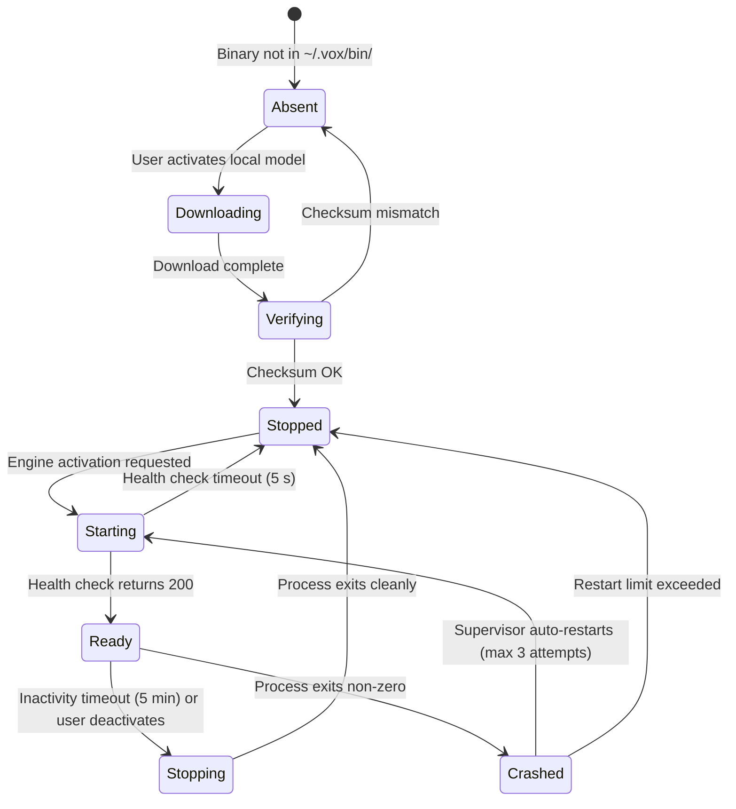

# Vox Sidecar Architecture Specification

## 1. Intent & Scope

### 1.1 Lane
Architecture Specification. This document specifies the behavioral contracts, lifecycle invariants, communication protocol, storage layout, and deployment rules for the optional sidecar binary subsystem in Vox.

### 1.2 Purpose
Vox currently compiles `llama-cpp-4`, `llama-cpp-sys-4`, `chatterbox-rs`, `google-cloud-texttospeech-v1`, `google-cloud-gax`, and `azure_identity` into the main desktop binary. These dependencies collectively pull in C++ toolchains, gRPC/protobuf compilers, and large ML runtimes, causing slow cold-compile times on every build. The sidecar system decouples optional, heavy, niche engine dependencies into separate binaries that the main Vox application downloads and supervises on demand.

### 1.3 Scope
This spec covers:
- Which capabilities move to sidecars and which stay native.
- The storage location and integrity rules for downloaded sidecar binaries.
- The inter-process communication contract between Vox and each sidecar.
- The sidecar process lifecycle (start, health, restart, stop).
- The CI/CD publication and on-demand download protocol.
- **Android Platform Pruning & In-Process Contract**: Downloadable sidecars are desktop-only. All sidecar-backed features are pruned on Android (due to SELinux W^X). If Android support is desired in the future, sidecars must become in-process library crates (`crates/`) linked directly into `libvox_lib.so` via NDK.
- Which existing tests are affected.

### 1.4 Out of Scope
- The internal inference logic of the sidecar binaries (owned by `sidecars/vox-llm` and `sidecars/vox-tts-clone`).
- The model download protocol (governed by existing model manager).
- UI changes beyond transient toast notifications during binary download.
- Any changes to the `sherpa-onnx` STT pipeline, audio capture, or VAD.

---

## 2. Authoritative Findings

The following findings are **confirmed** by code inspection and external verification:

### 2.1 Google Cloud TTS (`google_tts`) — Cannot Be Replaced with REST

The Vox Google TTS provider uses `StreamingSynthesize`, a **gRPC bidirectional streaming RPC** (`google_cloud_texttospeech_v1::client::TextToSpeech::streaming_synthesize`). This API has **no REST/HTTP equivalent** — Google does not expose `StreamingSynthesize` over WebSockets, SSE, or standard HTTP chunked transfer.

Switching to the unary REST endpoint (`POST https://texttospeech.googleapis.com/v1/text:synthesize`) would:
1. Require receiving the full audio before playback begins (no clause-level streaming), directly contradicting the clause-granularity architecture in `providers-spec.md §3.3`.
2. Return base64-encoded audio instead of raw PCM streaming, requiring an additional decode step.

**Decision**: `google-cloud-texttospeech-v1` and `google-cloud-gax` **must remain as-is** if Google Cloud TTS is supported. The options are: keep them in the main binary, or move the entire Google TTS provider to a sidecar. See §4.2.

### 2.2 Cloud TTS (`google_tts` and `azure_tts`) — Lifted and Shifted into Sidecar

Both cloud TTS providers that require external vendor SDKs move into `sidecars/vox-tts-cloud`:
1. **Google Cloud TTS (`google_tts`)**: Uses `StreamingSynthesize` (gRPC bidirectional streaming). Requires `google-cloud-texttospeech-v1` and `google-cloud-gax`.
2. **Azure AI Speech (`azure_tts`)**: Uses `reqwest` for HTTP synthesis and `azure_identity` / `azure_core` for Entra token acquisition (`az login`).

**Decision**: Lift and shift the existing implementations of both `google_tts.rs` and `azure_tts.rs` directly into `sidecars/vox-tts-cloud`. No new MSAL code or rewritten auth flows are needed. Both providers run inside the sidecar process, completely removing all 4 cloud TTS crates (`google-cloud-texttospeech-v1`, `google-cloud-gax`, `azure_identity`, `azure_core`) from `app/src-tauri/Cargo.toml`. This immediately eliminates over **500 transitive crates** from the main Vox binary.

### 2.3 Chatterbox and Llama.cpp — Separate Sidecars Required

`chatterbox-rs` vendors and CMake-builds its own `chatterbox-cpp` and static GGML library (`libtts-cpp.a`). `llama-cpp-sys-4` independently vendors `llama.cpp` and builds its own GGML static library. If both are linked into the same binary, the linker resolves duplicate `ggml_*` symbols — this is a confirmed pitfall already documented in `.agents/rules/android-style-guide.md §Pitfall 10`.

**Decision**: `vox-llm` and `vox-tts-clone` are two distinct sidecar binaries. They must not be merged into one.

---

## 3. Capability Classification

| Capability | Crate(s) | Decision | Rationale |
| :--- | :--- | :--- | :--- |
| Audio I/O & AEC | `cpal`, `rubato`, `sonora` | **Native** | Real-time audio; required on every boot. |
| Speech-to-Text | `sherpa-onnx` | **Native** | Primary voice input; required on every session. |
| Voice Activity Detection | `earshot`, `nnnoiseless` | **Native** | Sub-millisecond latency gating. |
| Cloud LLM (all providers) | `reqwest` | **Native** | Lightweight HTTP/SSE; zero C++ overhead. |
| Cloud TTS (Google & Azure) | `google-cloud-texttospeech-v1`, `google-cloud-gax`, `azure_identity`, `azure_core` | **Sidecar: `vox-tts-cloud`** | Lifted and shifted as-is. Eliminates 500+ transitive crates from main binary. |
| Local GGUF LLM | `llama-cpp-4`, `llama-cpp-sys-4` | **Sidecar: `vox-llm`** | C++ build; only usable on GPU-equipped machines. |
| Local Voice Cloning | `chatterbox-rs` | **Sidecar: `vox-tts-clone`** | C++ build; niche feature; GGML symbol collision with `vox-llm`. |

---

## 4. Workspace Structure

### 4.1 Cargo Workspace Root
A `Cargo.toml` workspace is added at the repository root. The main app and sidecars become independent workspace members. Cargo builds only the member explicitly requested (e.g., `cargo build -p Vox` compiles the main app with zero sidecar dependency resolution).

```text
vox/
├── Cargo.toml                          # [workspace] root
├── app/
│   └── src-tauri/
│       ├── Cargo.toml                  # Main app — removes llama-cpp-*, chatterbox-rs (+ gcp if chosen)
│       └── src/
│           └── services/
│               └── sidecar/            # Supervisor module (desktop-only, cfg-gated)
└── sidecars/
    ├── vox-llm/                        # Local GGUF LLM runner
    │   ├── Cargo.toml                  # llama-cpp-4, llama-cpp-sys-4, axum, tokio
    │   └── src/main.rs
    └── vox-tts-clone/                  # Local voice cloning runner
        ├── Cargo.toml                  # chatterbox-rs, axum, tokio
        └── src/main.rs
```

### 4.2 Cloud TTS Sidecar (`vox-tts-cloud`)
All cloud TTS providers that use external vendor SDKs (Google Cloud TTS with gRPC and Azure AI Speech with Entra auth) live in `vox-tts-cloud`. Future cloud TTS integrations requiring vendor SDKs must be added here, not to the main app.
```text
└── sidecars/
    └── vox-tts-cloud/                 # All cloud TTS providers that need heavy SDKs
        ├── Cargo.toml                 # google-cloud-texttospeech-v1, google-cloud-gax, azure_identity, azure_core, axum
        └── src/
            ├── main.rs                # HTTP server, route dispatch
            ├── google_tts.rs          # Moved from app/src-tauri
            └── azure_tts.rs           # Moved from app/src-tauri
```

### 4.3 Android Platform Pruning & In-Process Contract
All sidecar-backed capabilities (local GGUF LLM, local Chatterbox voice cloning, Google Cloud gRPC TTS, Azure Entra auth) are explicitly **pruned from the Android build target**:
- **Why Pruned**: Android SELinux and W^X (Write XOR Execute) security policies strictly prohibit spawning or executing downloaded binary executables from writable application storage (`~/.vox/bin/` or `/data/data/com.vox.app/`).
- **Architectural Contract for Future Android Support**:
  To support any of these features on Android in the future, they **CANNOT** run as external sidecar processes. Instead:
  1. The sidecar implementation must be refactored into a reusable library crate (`crates/`).
  2. The main Vox Android binary must add the crate as a direct in-process dependency:
     ```toml
     [target.'cfg(target_os = "android")'.dependencies]
     vox-llm-core = { path = "../../crates/vox-llm-core" }
     ```
  3. All native C/C++ libraries (`llama.cpp`, `chatterbox.cpp`) must be cross-compiled via the Android NDK and statically linked directly into `libvox_lib.so` inside the APK.
  4. On Android, the provider dispatch layer must bypass the process supervisor and call the internal library crate directly in-process.

---

## 5. Storage Specification (Amendment to `storage-spec.md`)

### 5.1 New Tier: Downloadable Sidecar Binaries

The following paths are added to the `~/.vox/` directory hierarchy defined in `storage-spec.md §4`:

```text
~/.vox/
├── bin/                          # Sidecar binaries (Mode 0755)
│   ├── vox-llm                   # Local LLM executable (Linux/macOS)
│   ├── vox-llm.exe               # Local LLM executable (Windows)
│   ├── vox-tts-clone             # Voice cloning executable
│   └── manifest.json             # Version + SHA-256 hashes for all sidecars
└── run/
    ├── vox-llm.sock              # Unix Domain Socket — LLM (Linux/macOS)
    ├── vox-tts-clone.sock        # Unix Domain Socket — voice cloning
    │                             # Windows uses Named Pipes instead of .sock files
    └── sidecars.pid              # PID file for each running sidecar
```

### 5.2 Storage Rules
- **RULE-SIDECAR-01 (Dedicated Binary Directory)**: All downloadable sidecar executables MUST reside in `$VOX_HOME/bin/`. No sidecar binary may be placed in `cache/`, `data/`, `run/`, or any OS temp directory.
- **RULE-SIDECAR-02 (Cryptographic Integrity)**: Before executing any downloaded sidecar binary, Vox MUST verify its SHA-256 checksum against a signed remote manifest. A checksum mismatch MUST prevent execution and surface an error to the user.
- **RULE-SIDECAR-03 (Executable Permissions)**: After download and verification, sidecar binaries MUST be set to mode `0755` on Unix. On Windows, the `.exe` extension is sufficient; no explicit `chmod` is required.
- **RULE-SIDECAR-04 (Wipeability)**: Deleting `$VOX_HOME/bin/` must not affect any user data, transcripts, settings, or model weights. Vox must re-download on next activation.
- **RULE-SIDECAR-05 (Desktop-Only)**: The `bin/` and `run/*.sock` paths are only created on desktop builds. Android builds MUST NOT create or reference these paths.

---

## 6. Communication Protocol

### 6.1 Transport Selection
| Platform | Transport | Address |
| :--- | :--- | :--- |
| Linux, macOS | Unix Domain Socket (UDS) | `~/.vox/run/{name}.sock` |
| Windows | Named Pipe | `\\.\pipe\vox-{name}` |

TCP ports are prohibited to prevent collisions with other software on user machines.

### 6.2 Application Protocol
Each sidecar exposes a subset of the OpenAI-compatible HTTP API over the transport:

| Sidecar | Endpoint | Notes |
| :--- | :--- | :--- |
| `vox-llm` | `GET /v1/models` | Health check — returns 200 when the engine is ready. |
| `vox-llm` | `POST /v1/chat/completions` | Standard OpenAI streaming chat completions. |
| `vox-tts-clone` | `GET /health` | Returns 200 when the voice model is loaded. |
| `vox-tts-clone` | `POST /v1/audio/speech` | Accepts text, returns raw PCM audio stream. |

Vox communicates with sidecars via `reqwest` using Unix socket transport (no new crates required). The main LLM service already sends OpenAI-compatible requests — replacing the embedded provider with a sidecar provider requires no change to the wire format.

### 6.3 Startup Arguments
Vox spawns each sidecar with the socket path and model path as command-line arguments:
```
vox-llm --socket ~/.vox/run/vox-llm.sock --model ~/.vox/models/llm/qwen/model.gguf
vox-tts-clone --socket ~/.vox/run/vox-tts-clone.sock --voices ~/.vox/data/voices/
```

---

## 7. Process Lifecycle Invariants

### 7.1 Lifecycle State Machine


### 7.2 Rules
- **RULE-SIDECAR-06 (Single Instance)**: At most one instance of each sidecar may run at a time. The supervisor holds an exclusive lock on `~/.vox/run/{name}.pid`.
- **RULE-SIDECAR-07 (Health Gate)**: Vox MUST NOT route any requests to a sidecar until `GET /v1/models` (or `GET /health`) returns HTTP 200. Health polling interval is 200 ms, timeout is 5 seconds.
- **RULE-SIDECAR-08 (Inactivity Reap)**: A sidecar process idle for 5 minutes (no requests in flight) MUST be terminated by the supervisor to release GPU memory.
- **RULE-SIDECAR-09 (Crash Restart Limit)**: The supervisor MAY restart a crashed sidecar up to 3 consecutive times. After 3 failures, the supervisor emits a toast error and stops attempting. The user must manually re-activate.
- **RULE-SIDECAR-10 (Graceful Shutdown)**: On Vox exit, the supervisor MUST send SIGTERM (Unix) or `TerminateProcess` (Windows) to all running sidecars and wait up to 2 seconds for clean exit.
- **RULE-SIDECAR-11 (Low Priority)**: Sidecars are spawned with below-normal process priority (`nice +10` on Unix, `BELOW_NORMAL_PRIORITY_CLASS` on Windows) to prevent audio capture stutters.

---

## 8. CI/CD, Build, and Download Protocol

### 8.1 Build Isolation
Sidecars are compiled in independent GitHub Actions matrix jobs triggered by changes in `sidecars/**`. The main Vox CI job does not build sidecar crates.

### 8.2 Release Artifact Format
Each sidecar release produces per-platform compressed archives:
- `vox-llm-linux-x86_64.tar.gz`
- `vox-llm-linux-aarch64.tar.gz`
- `vox-llm-macos-x86_64.tar.gz`
- `vox-llm-macos-aarch64.tar.gz`
- `vox-llm-windows-x86_64.zip`

Each archive contains the binary and a `sha256.txt` file.

### 8.3 Remote Manifest
A signed `manifest.json` is published alongside releases:
```json
{
  "version": "1.0.0",
  "sidecars": {
    "vox-llm": {
      "linux-x86_64": { "url": "...", "sha256": "..." },
      "macos-aarch64": { "url": "...", "sha256": "..." }
    },
    "vox-tts-clone": { ... }
  }
}
```

### 8.4 On-Demand Download Flow
1. User activates a local GGUF model or voice cloning TTS in Settings.
2. Supervisor checks `~/.vox/bin/{name}` existence and SHA-256 against `manifest.json`.
3. If missing or hash mismatch: stream the archive, extract, verify, chmod.
4. A transient toast notification displays: `"Preparing local engine…"` during download.
5. After verification, the supervisor spawns the sidecar process.
6. No modal is shown. No user action is required beyond selecting the model.

### 8.5 Local Development Testing (No CI Required)
For local testing without pushing to any branch:
```bash
# Build a sidecar locally
cargo build --release -p vox-llm

# Override the path so Vox skips download and uses the local build
VOX_SIDECAR_BIN_OVERRIDE_vox_llm=/path/to/target/release/vox-llm cargo tauri dev
```
The `VOX_SIDECAR_BIN_OVERRIDE_{name}` environment variable causes the supervisor to use the provided path directly and skip download and checksum verification.

---

## 9. Open Questions

*None — all decisions are resolved.*

---

## 10. Test Suite Impact

### 10.1 Tests That Reference Embedded LLM
The following integration tests call into the embedded LLM service directly and will require updating to target the new `SidecarLlmProvider`:
- `tests/transcript_to_llm_test.rs` — Spawns a real `EmbeddedProvider` against a local GGUF model.
- `tests/llm_to_tts_test.rs` — Configures `category: "embedded"` in settings.
- `tests/model_eviction_test.rs` — References `category: "embedded"`.
- `tests/model_manager_test.rs` — References `category: "embedded"`.
- `tests/settings_persistence_test.rs` — Round-trips `category: "embedded"` settings.

### 10.2 Migration Strategy
- The `LlmProvider` trait (the public contract) is unchanged.
- A new `SidecarLlmProvider` implementation is added, replacing `EmbeddedProvider` in non-test code.
- Integration tests that need a real local LLM response are annotated with `#[ignore]` and require a running `vox-llm` sidecar (gated behind `VOX_SIDECAR_BIN_OVERRIDE_vox_llm`).
- Tests that use the `"embedded"` category string in settings JSON remain valid — the category string does not change; only the implementation behind it changes.

---

## 11. Vocabulary

| Term | Meaning |
| :--- | :--- |
| **Sidecar** | A separate binary process that Vox downloads, spawns, and supervises on demand. |
| **Supervisor** | The component inside the main Vox process that manages sidecar lifecycle. |
| **UDS** | Unix Domain Socket — the IPC transport used on Linux and macOS. |
| **Named Pipe** | The Windows IPC equivalent of a Unix Domain Socket. |
| **Manifest** | A signed JSON file that describes sidecar versions, download URLs, and SHA-256 checksums. |
| **Inactivity Reap** | The supervisor terminating an idle sidecar to release GPU/CPU memory. |

---

## 12. Decisions

| Decision | Choice | Reason | Rejected Alternative |
| :--- | :--- | :--- | :--- |
| **Google TTS transport** | Keep gRPC SDK | `StreamingSynthesize` has no REST equivalent; replacing it would break clause-streaming latency. | Replace with REST unary endpoint (causes full-synthesis wait before first audio byte). |
| **Chatterbox + llama.cpp isolation** | Separate sidecars | Both vendor their own GGML; merging them causes duplicate `ggml_*` linker symbols. | Single combined sidecar (linker crash). |
| **IPC transport** | UDS / Named Pipe | Zero port conflicts; restricted OS permissions; no firewall alerts. | TCP localhost port (conflicts with Ollama, other services on port 11434). |
| **Download trigger** | Silent background on model selection | No separate install modal needed; integrates with existing model download progress. | Prompt user with explicit "Install Engine" modal (unnecessary friction). |
| **Android** | No sidecars | W^X policy blocks spawning downloaded executables on Android 10+. | Sidecar on Android (OS kernel kills it immediately). |
| **Azure Entra extraction** | Deferred | 224 crates but Rust-only, no C++; extraction requires reimplementing MSAL token flow from scratch. | Move to sidecar now (disproportionate risk for marginal build time gain). |
