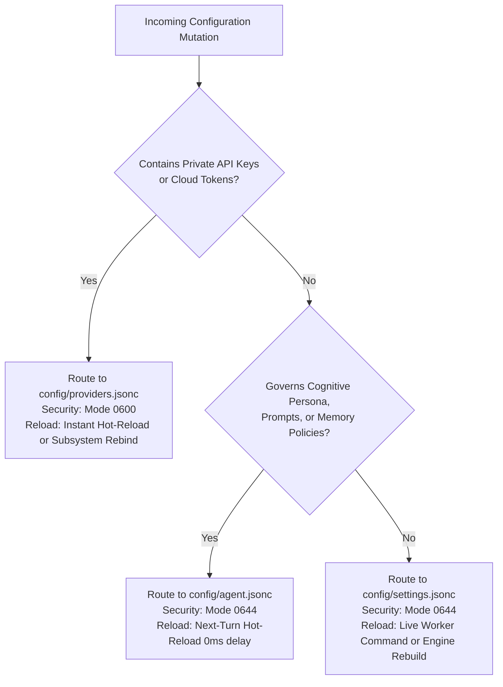
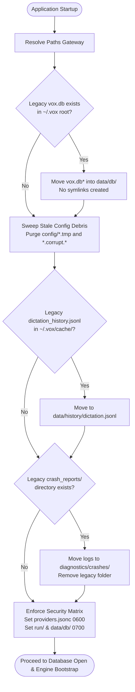

# Storage, Filesystem & Configuration Specification

## 1. Intent & Scope

### 1.1 Lane
Filesystem & Configuration Architecture Specification. This document specifies the on-disk directory hierarchy, permissions matrix, configuration decomposition, reload contracts, and boot migration rules for Vox.

### 1.2 Purpose
Vox requires a predictable, partitioned filesystem layout that isolates disposable caches from durable databases, decouples multi-gigabyte neural network models, protects cloud credentials, and enforces atomic configuration reload policies.

### 1.3 Out of Scope
- Database table schemas, indexing, and SQL transactions (governed by `db-spec.md`).
- Memory retrieval algorithms and consolidation schedules (governed by `memory-spec.md`).
- Inter-process communication protocol payloads (governed by `ipc-spec.md`).

---

## 2. User Stories

| ID | Story |
| :--- | :--- |
| **US-STORAGE-01** | As a user, I want heavy model weights stored on a customizable drive, so that my root volume does not run out of space. |
| **US-STORAGE-02** | As a user clearing disk space, I want to wipe the cache directory without losing transcripts, personal memory, or settings, so that system maintenance is risk-free. |
| **US-STORAGE-03** | As an external desktop script, I want to read general application settings without exposing cloud API secrets, so that helper scripts remain secure. |
| **US-STORAGE-04** | As a user tuning agent prompts or temperature, I want changes to apply on the very next turn without restarting the application, so that prompt iteration is instant. |
| **US-STORAGE-05** | As an OS window manager, I want transient runtime sockets kept in dedicated user runtime directories with restricted permissions, so that multi-user or network mount conflicts are avoided. |

---

## 3. Architecture Diagrams

### 3.1 Configuration Decomposition Decision Tree


### 3.2 Startup Boot & Legacy Migration Protocol


---

## 4. Tiered Filesystem Layout

Vox organizes all on-disk artifacts under the root directory (`$VOX_HOME`, defaulting to `~/.vox/`) into six discrete lifecycle tiers:

```
~/.vox/
├── config/             # Tier 1: User & Agent Configuration (0644 / 0600)
│   ├── settings.jsonc  # Host hardware, VAD, UI theme, active engine selections
│   ├── providers.jsonc # Cloud endpoints, model identifiers, API keys (0600)
│   └── agent.jsonc     # Cognitive persona, prompt templates, memory policies
│
├── data/               # Tier 2: Durable User State (Backup & Sync Target)
│   ├── db/             # Primary embedded database files (0700)
│   ├── history/        # Dictation transcripts in JSON Lines format
│   └── voices/         # Custom acoustic samples and precomputed voice packs
│
├── models/             # Tier 3: Static Model Weights (Overridable via VOX_MODELS_DIR)
│   ├── manifests/      # Model registry manifests
│   ├── stt/            # Acoustic & ASR models
│   ├── tts/            # Speech synthesis voice packs
│   ├── vad/            # Voice activity detection weights
│   ├── embedding/      # Dense text embedding models
│   ├── translit/       # Script transliteration models
│   ├── classifier/     # Intent routing models
│   └── llm/            # Local LLM quantized weights
│
├── cache/              # Tier 4: Disposable Scratch (Wipeable at any time)
│   ├── catalog/        # Remote provider model catalog cache
│   ├── updates/        # Update check manifests
│   ├── temp/           # Transient audio resample buffers
│   ├── assets/         # Materialized desktop notification icons
│   └── tts/            # Transient audio preview cache (25MB LRU boundary)
│
├── diagnostics/        # Tier 5: Observability & Diagnostics
│   ├── logs/           # Rolling daily operational logs
│   └── crashes/        # Panic backtraces, minidumps, and crash logs
│
└── run/                # Tier 6: Ephemeral Runtime State (0700)
    ├── vox.sock        # Unix domain IPC trigger socket
    ├── vox.pid         # Single-instance process lock
    └── bin/            # Desktop keybind integration scripts
```

---

## 5. Behavior Rules & Lifecycle Invariants

### 5.1 Filesystem Tiers
- **RULE-STORAGE-01 (Single Path Gateway)**: All path resolution MUST occur through the centralized paths component. Subsystems MUST NOT hardcode string paths or construct paths independently.
- **RULE-STORAGE-02 (Disposable Cache Invariant)**: The `cache/` directory MUST contain only reproducible or ephemeral assets. If `cache/` is deleted entirely while the application is stopped, Vox MUST boot cleanly, reconstitute temporary assets, and suffer zero loss of user configuration, sessions, or transcripts.
- **RULE-STORAGE-03 (Model Decoupling)**: Model weights MUST default to `~/.vox/models/` but MUST prioritize the `VOX_MODELS_DIR` environment variable when present.
- **RULE-STORAGE-04 (Transient Runtime Sockets)**: Unix domain sockets and process locks MUST reside in `$XDG_RUNTIME_DIR/vox/` when available on Linux, falling back to `~/.vox/run/`. These directories MUST be created with POSIX mode `0700`.
- **RULE-STORAGE-05 (Secret Isolation)**: API keys and server secrets MUST reside strictly in `config/providers.jsonc`. Telemetry, diagnostics, and UI debug logs MUST NEVER record or output the contents of `providers.jsonc`. Cloud TTS credentials follow this rule: `tts.azure_tts.key` (Speech resource key) lives in `providers.jsonc` only; Google uses local ADC with no stored secret; `tts.google_tts.project_override` is a non-secret quota hint.
- **RULE-STORAGE-09 (Voice Asset Storage & LRU Cache)**:
  - Canonical active voice identifier persists as `tts.active_voice_id` and `realtime.active_voice_id` strings in `settings.jsonc`.
  - Bundled voice definitions compile into binary via `voices_manifest.json` under `services/tts/`.
  - Custom cloned audio samples persist in `data/voices/{id}/source.wav`, and precomputed speaker embedding tensors persist in `data/voices/{id}/baked/speaker.safetensors`.
  - On-demand synthesized preview audio files reside in disposable cache `cache/tts/previews/{sha256(provider + voice_id + prompt)}.wav` subject to a 25 MB / 50 files LRU cache boundary.
  - Remote provider catalogs persist directly in Turso database (`voices` table), never in configuration files.

### 5.2 Field-Level Configuration Schema Mapping
The configuration is decomposed into three files according to domain volatility, security tier, and reload semantics:

| Configuration Target | Contained Domain Field Groups | Security Tier | Reload Action & Timing Budget |
| :--- | :--- | :--- | :--- |
| **`config/settings.jsonc`** | - `appearance`: Theme, accent styling<br>- `vad`: Energy threshold, PTT gate, silence duration, onset<br>- `interaction`: Mode (`Passive` \| `PTT`), Pipeline (`Modular` \| `Realtime`)<br>- `dictation`: Output mode, silence auto-stop<br>- `system`: Setup completion flag<br>- `working_memory`: Privacy mode, context share ceiling, search toggle<br>- `personal_memory`: Context retrieval toggle, fact budgets, schedule<br>- `engine_selectors`: Uniform `active` (`{ category, provider, model }`) and `last_selected` (`{ embedded, server, cloud }`) across `stt`, `llm`, `tts`, and `realtime` | Public (`0644`) | - Audio DSP/VAD/Memory: Dispatched via worker command ($\le 100\text{ ms}$)<br>- Engine Switch: Coalesced engine restart cycle |
| **`config/providers.jsonc`** | - `llm.servers`: Inventory of named custom servers (`id`, `name`, `url`, optional `model`/`protocol`/`api_key`)<br>- `llm.cloud_keys`: Provider API keys (`nvidia`, `openrouter`, `groq`)<br>- `tts.servers`: Inventory of named custom TTS servers (`id`, `name`, `url`, `remote_path`, `api_key`)<br>- `realtime.api_keys`: Cloud credentials per provider (`gemini_live`, `deepgram_voice_agent`) | Restricted (`0600`) | Instant hot-reload or subsystem rebind on change |
| **`config/agent.jsonc`** | - `persona`: System prompts (`modular_prompt`, `realtime_prompt`) (thin file reserved for future MCP tools & agent skills) | Public (`0644`) | Next-turn hot reload ($0\text{ ms}$ delay; read live on each turn) |

- **RULE-STORAGE-06 (Format Standards)**: Configuration files MUST parse as JSONC (lenient JSON permitting comments and trailing commas). Append-only transcripts MUST use JSONL (JSON Lines).
- **RULE-STORAGE-07 (Dynamic Audio Routing Exemption)**: Live microphone input and audio output devices are physical transient system states. They MUST NOT be persisted into `settings.jsonc`, but instead dynamically discovered and updated at runtime.
- **RULE-STORAGE-10 (Sparse Model Provenance Invariant)**: Per-model parameter overrides (speed, context window, temperature, threads, layers) MUST NOT be stored in `settings.jsonc` or `providers.jsonc`. They MUST persist sparsely on-demand in the Turso SQLite `models` table (`parameters` JSON column). Untouched catalog models default to catalog parameters without database rows.

### 5.3 Startup Migration Protocol
- **RULE-STORAGE-08 (Automated One-Way Migration)**: On startup before opening database connections or loading models, the system MUST execute an automated legacy layout migration:
  1. If legacy `vox.db` is found in root, move database files into `data/db/`.
  2. If legacy `cache/dictation_history.jsonl` exists, move it into `data/history/dictation.jsonl`.
  3. If legacy `crash_reports/` directory exists, move contents into `diagnostics/crashes/` and remove the old directory.
  4. Sweep and purge abandoned temporary files (`config/*.tmp`, `config/*.corrupt.*`).
  5. Apply Zero Backward Compatibility: do not create legacy symlinks.

---

## 6. Security & Permissions Matrix

| Target Directory / File | POSIX Mode | Required Ownership | Rationale |
| :--- | :--- | :--- | :--- |
| `~/.vox/run/` | `0700` (`drwx------`) | Current user | Protects single-instance lock and IPC trigger socket. |
| `~/.vox/config/providers.jsonc` | `0600` (`-rw-------`) | Current user | Contains private cloud API tokens and endpoints. |
| `~/.vox/config/*.jsonc` | `0644` (`-rw-r--r--`) | Current user | User settings accessible to companion desktop scripts. |
| `~/.vox/data/db/` | `0700` (`drwx------`) | Current user | Personal memory, conversation transcripts, and knowledge graph. |
| `~/.vox/diagnostics/` | `0700` (`drwx------`) | Current user | Prevents unauthorized access to crash dumps and backtraces. |

---

## 7. Architectural Decisions & Alternatives

| Decision | Choice | Rationale | Rejected Alternative |
| :--- | :--- | :--- | :--- |
| **3-Way Configuration Split** | Separate `settings.jsonc`, `providers.jsonc`, and `agent.jsonc` | Isolates secrets with file permissions (`0600`), decouples slow hardware restarts from fast cognitive prompt changes. | Monolithic `settings.json` (risks accidental credential leakage in diagnostic dumps and requires restarts for prompt tweaks). |
| **Lenient JSONC Format** | JSON with Comments and Trailing Commas | Human-readable, allows inline documentation and comments, easily parsed and edited by users. | Strict JSON (fails on trailing commas and comments) or YAML/TOML (parsing quirks, type ambiguities). |
| **Decoupled Model Weights** | `VOX_MODELS_DIR` environment override | Allows multi-gigabyte models to reside on secondary SSDs or shared volumes without filling home partition. | Mandatory fixed location under `~/.vox/models/` (forces full disk fills on smaller root partitions). |
| **Transient OS Audio State** | Zero persistence for input/output device selections | OS audio routes change dynamically (headsets plug/unplug); saving static device names causes silent failures on disconnect. | Persisting active device IDs in `settings.jsonc` (leads to stale devices and audio dropouts). |

---

## 8. Verification Criteria

- **Cache Wiping Verification**: Execute `rm -rf ~/.vox/cache/` while the application is shut down. Verify that subsequent launch succeeds without errors and that sessions, settings, and personal memory remain fully intact.
- **Model Path Override**: Set `VOX_MODELS_DIR=/custom/models/` and verify that model loading probes resolve models from the custom directory path.
- **Permission Enforcement**: File permission checks on startup verify that `config/providers.jsonc` and `run/` have modes `0600` and `0700` respectively; if too permissive, permissions are corrected automatically.
- **Turn-Hot Agent Reload**: Mutating the prompt in `config/agent.jsonc` during an active session is observed in the prompt sent to the LLM on the immediate subsequent turn without application restart.
- **Migration Verification**: Creating mock legacy files (`~/.vox/vox.db`, `~/.vox/cache/dictation_history.jsonl`) triggers migration into `data/db/` and `data/history/` on boot with 0 legacy symlinks created.
- **Voice Cache Boundary Verification**: Synthesizing previews beyond the 25 MB / 50 files limit confirms LRU eviction of the oldest preview audio files without impacting stored voice records.
