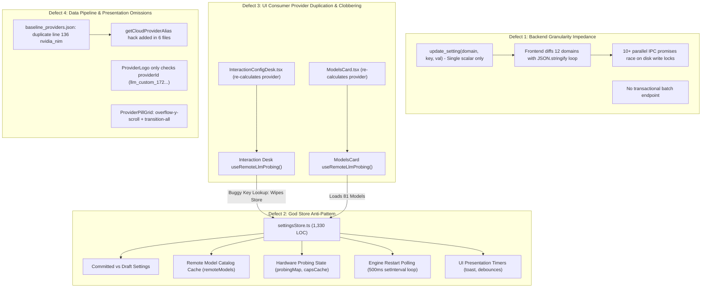

# Settings Architecture, Store Decomposition & Catalog Convergence Plan

## 1. Executive Summary & Root Cause Audit

The recurring state wipe-outs, screen flashes, duplicate aliases, and missing logos are **not random visual flakes**. They stem from a concrete architectural failure across the IPC boundary, the Zustand store layer, and UI consumers.

### The 4 Architectural Defects



---

## 2. File Blast-Radius Census

### Core Files Causing the Mess (15 Files Total)

| File Path | Domain | Role in the Defect | Target Action |
| :--- | :--- | :--- | :--- |
| `app/src/store/settingsStore.ts` | Store | 1,330-line God Store. Packs preferences, remote catalog, probing, JSON diffing, and 500ms restart loop. | **Decompose** into pure config store; delete diff loop; delegate catalog & lifecycle. |
| `app/src/store/catalogStore.ts` | Store | *Does not exist.* | **Create** dedicated store for `remoteModels`, `capabilitiesCache`, `probingMap`. |
| `app/src/store/engineStatusStore.ts` | Store | *Does not exist.* | **Create** event-driven store for engine restart status. Replaces 500ms polling. |
| `app/src-tauri/src/ipc/settings.rs` | Rust Backend | Only exposes single-scalar `update_setting`. Drives the client diff loop. | **Add `apply_settings_patch`** and emit `engine-restart-state`. |
| `app/src-tauri/src/config/mutation.rs` | Rust Backend | Lacks batch setting mutation helper. | **Add `apply_settings_batch_mutation`**. |
| `app/src-tauri/src/services/llm/catalog/baseline_providers.json` | Manifest SSOT | Duplicate line 136 (`nvidia_nim`) vs line 271 (`nvidia`). | **Delete line 136**. Canonical ID is `"nvidia"`. |
| `app/src-tauri/src/config/contract.rs` | Rust Backend | Hardcoded deduplication skip (`id == "nvidia_nim"`). | **Remove skip hack**. |
| `app/src-tauri/src/services/llm/catalog/presets.rs` | Rust Backend | Has `id == "nvidia_nim" && lower == "nvidia"` alias fallback. | **Remove alias fallback**. |
| `app/src/shared/lib/activeSelection.ts` | Frontend Lib | Contains `getCloudProviderAlias` hack. | **Purge alias function**. |
| `app/src/shared/hooks/useProviderSelection.ts` | Frontend Hook | Has bidirectional alias lookups for `nvidia_nim`. | **Purge alias lookups**. |
| `app/src/shared/hooks/useRemoteLlmProbing.ts` | Frontend Hook | Directly mutates `useSettingsStore` with `remoteModels: []` on empty key. | **Migrate to `catalogStore`**. Guard against wiping on inactive views. |
| `app/src/shared/components/settings/interaction/InteractionConfigDesk.tsx` | Interaction Desk | Re-implements 50 lines of provider calculation with a bug that omits committed keys; calls `useRemoteLlmProbing` which wipes the store. | **Delete provider calculation**. **Remove `useRemoteLlmProbing`**. Adopt `selectActiveLlmProvider`. |
| `app/src/shared/components/settings/models/ModelsCard.tsx` | Model Hub | Re-implements 50 lines of provider calculation. | **Delete provider calculation**. Adopt `selectActiveLlmProvider`. Connect to `catalogStore`. |
| `app/src/shared/components/settings/models/catalog/RemoteCatalogSection.tsx` | Remote Catalog | 700 lines. Duplicates 150 lines of `RemoteModelCard` JSX inline; has `selectedModelId` pinning dependency that causes screen flash. | **Use `<RemoteModelCard />`**. Fix sort/pin memo dependencies. Connect to `catalogStore`. |
| `app/src/shared/components/settings/providers/ProviderLogo.tsx` | Presentation | Only inspects `providerId`. Receives `llm_custom_172...`, so Ollama/vLLM fall back to chassis SVG. | **Accept `name?: string` and `dialect?: string`**. Match `"ollama"`, `"vllm"`, `"lmstudio"`. |
| `app/src/shared/components/settings/interaction/ProviderPillGrid.tsx` | Presentation | Uses `overflow-y-scroll` + `[scrollbar-gutter:stable]`. Cards have `transition-all` causing subpixel hover flutter. | **Change to `overflow-y-auto`**. Change `transition-all` to `transition-colors`. Pass `server.name` to `ProviderLogo`. |

### Files Confirmed NOT at Fault (Pure Presentation / Clean)
- `RemoteServerSetup.tsx`: Clean SSH input form (receives props, zero store logic).
- `ModelModal.tsx`: Clean modular shell (`CatalogModalShell` + `RemoteModelCard`).
- `ProviderModal.tsx`: Clean modular shell (only needs `server.name` passed down to card).
- `ExpandableList.tsx`: Clean UI shell.

---

## 3. Dependency Graph & Orchestration Matrix

```
[Independent Tracks - Can Start in Parallel]
├── Ticket 1: Backend SSOT & Alias Purge (Rust + JSON)
├── Ticket 2: Atomic IPC Batch Patch & Event Engine (Rust)
├── Ticket 7: Ollama & Custom Server Logo Detection (TSX)
└── Ticket 8: Scrollbar Flicker & Hover Jitter Fix (TSX)

[Sequential Chain]
Ticket 1 + Ticket 2
       │
       ▼
Ticket 3: Decompose `catalogStore` & `engineStatusStore` (TS)
       │
       ▼
Ticket 4: Rewrite `settingsStore` & Purge Client Aliases (TS)
       │
       ▼
Ticket 5: Interaction Desk & ModelsCard Consumer Convergence (TSX)
       │
       ▼
Ticket 6: RemoteCatalogSection Deduplication & Flash Fix (TSX)
```

---

## 4. Detailed Implementation Tickets

### Phase A: Backend Transactional Core & SSOT Integrity

#### Ticket 1: Purge Duplicate Provider ID & Eliminate Backend Aliases
* **Type:** Backend Integrity & SSOT
* **Dependencies:** None (Independent)
* **Target Files:**
  - `app/src-tauri/src/services/llm/catalog/baseline_providers.json`
  - `app/src-tauri/src/config/contract.rs`
  - `app/src-tauri/src/services/llm/catalog/presets.rs`
  - `app/src-tauri/src/services/llm/config.rs`
* **Changes:**
  1. In `baseline_providers.json`, delete the duplicate row at line 136 (`"id": "nvidia_nim"`). Preserve the catalog metadata on line 271 (`"id": "nvidia"`, `"catalog": "nvidia"`).
  2. In `contract.rs`, remove the conditional skip: `if id == "nvidia_nim" && ...`.
  3. In `presets.rs:54`, remove `|| (p.id == "nvidia_nim" && lower == "nvidia")`.
  4. In `presets.rs:149-154`, update test assertion to check `preset.id == "nvidia"`.
  5. In `services/llm/config.rs:220-227`, remove the `provs.cloud_keys.get("nvidia_nim")` fallback block.
* **Verification:**
  - `cd app/src-tauri && cargo test presets`
  - `./scripts/verify-targets.sh` (0 errors, 0 warnings on desktop and Android).

---

#### Ticket 2: Transactional IPC Batch Patch & Event-Driven Engine Restart
* **Type:** Backend IPC & Core Architecture
* **Dependencies:** None (Independent)
* **Target Files:**
  - `app/src-tauri/src/ipc/settings.rs`
  - `app/src-tauri/src/config/mutation.rs`
  - `app/src-tauri/src/core/events.rs`
* **Changes:**
  1. In `config/mutation.rs`, add `apply_settings_patch_tree(settings: &mut VoxSettings, patch: &serde_json::Value) -> Result<Vec<(String, String)>, String>`. It iterates over domain objects, applies mutations in memory, and returns all modified `(domain, key)` pairs.
  2. In `ipc/settings.rs`, add the IPC command:
     ```rust
     #[tauri::command]
     pub async fn apply_settings_patch<R: tauri::Runtime>(
         patch: serde_json::Value,
         app: AppHandle<R>,
     ) -> Result<SettingUpdateResult, VoxIpcError>
     ```
     - Acquires `state.settings.write()` once.
     - Calls `apply_settings_patch_tree`.
     - Computes the aggregate reload policy. If any changed key requires `Restart`, it schedules **exactly one** engine restart.
     - Triggers `schedule_debounced_save`.
     - Emits `IpcEvent::SettingsUpdated`.
  3. In `request_engine_restart` and restart worker, emit `IpcEvent::EngineRestartState` with payload `{ restarting: bool, target: Option<String> }`.
  4. Register `apply_settings_patch` in `tauri::generate_handler!`.
* **Verification:**
  - Unit test in `app/src-tauri/tests/settings_persistence_test.rs` asserting atomic multi-key update with a single restart trigger.
  - `./scripts/verify-targets.sh`.

---

### Phase B: Store Decomposition & Active Provider SSOT

#### Ticket 3: Create Dedicated `catalogStore` and `engineStatusStore`
* **Type:** Frontend Architecture / State Management
* **Dependencies:** Ticket 2
* **Target Files:**
  - `app/src/store/catalogStore.ts` (NEW)
  - `app/src/store/engineStatusStore.ts` (NEW)
  - `app/src/services/catalogService.ts`
  - `app/src/shared/hooks/useRemoteLlmProbing.ts`
* **Changes:**
  1. Create `catalogStore.ts`:
     - State: `remoteModels: LlmModelInfo[]`, `loadingRemoteModels: boolean`, `remoteModelsError: string | null`, `capabilitiesCache: Record<string, ModelCapabilities>`, `probingMap: Record<string, ProbeStatus>`.
     - Actions: `loadRemoteModels(provider, force?)`, `clearRemoteModels()`, `probeCapabilities(provider, modelId)`, `loadCapabilitiesCache()`, `patchCapabilities()`.
     - Ensure `loadRemoteModels` caches results by `provider.base_url` or `provider.id` so switching tabs does not flash or re-fetch unnecessarily.
  2. Create `engineStatusStore.ts`:
     - Listens to Tauri event `engine-restart-state`.
     - Replaces the 500ms `get_restart_status` polling loop.
  3. Update `useRemoteLlmProbing.ts` to delegate exclusively to `catalogStore`.
* **Verification:**
  - `pnpm -C app vitest run src/test/catalogStore.test.ts` (new tests verifying store isolation).

---

#### Ticket 4: Decompose `settingsStore.ts` & Purge Client-Side Alias Shims
* **Type:** Frontend Architecture / Store Refactor
* **Dependencies:** Ticket 1, Ticket 2, Ticket 3
* **Target Files:**
  - `app/src/store/settingsStore.ts`
  - `app/src/shared/lib/activeSelection.ts`
  - `app/src/shared/hooks/useProviderSelection.ts`
  - `app/src/test/activeCardPrimacy.regression.test.ts`
* **Changes:**
  1. Remove `remoteModels`, `loadingRemoteModels`, `remoteModelsError`, `capabilitiesCache`, `probingMap` from `settingsStore.ts`. Re-export or forward to `catalogStore` if needed during migration.
  2. Replace the 200-line JSON diff loop in `saveSettings` with a single call to `invoke("apply_settings_patch", { patch: dirtyTree })`.
  3. Delete `getCloudProviderAlias` in `activeSelection.ts`.
  4. Remove all alias fallbacks (`getCloudProviderAlias`) from `activeSelection.ts`, `settingsStore.ts`, and `useProviderSelection.ts`.
  5. Add canonical selector in `settingsStore.ts`:
     ```ts
     export function selectActiveLlmProvider(state: SettingsState): LlmProviderConfig {
       const active = state.draftSettings?.llm?.active ?? state.settings?.llm?.active;
       const kind = active?.category ?? "embedded";
       if (kind === "embedded") return { kind: "embedded" };
       if (kind === "server") {
         const servers = state.draftSettings?.llm?.servers ?? state.settings?.llm?.servers ?? [];
         const s = servers.find((entry) => entry.id === active?.provider);
         return {
           kind: "server",
           provider_id: s?.id,
           base_url: s?.url || "",
           model: active?.model || "",
           api_key: s?.api_key,
           provider_name: s?.name,
         };
       }
       const cloudId = active?.provider ?? "nvidia";
       const contractEntry = state.contract?.llm_cloud_providers?.find((p) => p.id === cloudId);
       const cloudEntry = contractEntry || CLOUD_PROVIDERS.find((p) => p.id === cloudId);
       const apiKey = getEffectiveCloudApiKey(state.draftSettings, state.settings, cloudId);
       return {
         kind: "cloud",
         provider_id: cloudId,
         base_url: contractEntry?.base_url || cloudEntry?.url || "",
         model: active?.model || "",
         api_key: apiKey,
         provider_name: cloudEntry?.name || cloudId,
       };
     }
     ```
  6. Update tests in `activeCardPrimacy.regression.test.ts` to remove obsolete alias tests.
* **Verification:**
  - `pnpm -C app tsc --noEmit`
  - `pnpm -C app vitest run`

---

### Phase C: UI Consumer Convergence & Race Elimination

#### Ticket 5: Interaction Desk & ModelsCard Consumer Convergence
* **Type:** UI State Convergence & Defect Resolution
* **Dependencies:** Ticket 3, Ticket 4
* **Target Files:**
  - `app/src/shared/components/settings/interaction/InteractionConfigDesk.tsx`
  - `app/src/shared/components/settings/models/ModelsCard.tsx`
* **Changes:**
  1. In `InteractionConfigDesk.tsx`:
     - Delete custom `currentProvider` useMemo (lines 137–159).
     - Adopt `const currentProvider = useSettingsStore(selectActiveLlmProvider)`.
     - **DELETE** `useRemoteLlmProbing` invocation (lines 161–165). The interaction desk has no business triggering model fetches or wiping model state!
     - When expanding to models modal, read `remoteModels` directly from `useCatalogStore((s) => s.remoteModels)`.
  2. In `ModelsCard.tsx`:
     - Delete custom `provider` useMemo (lines 117–164).
     - Adopt `const provider = useSettingsStore(selectActiveLlmProvider)`.
     - Connect `useRemoteLlmProbing` (or direct catalogStore actions) so that `ModelsCard` is the **sole orchestrator** of LLM model fetching.
* **Verification:**
  - Select NVIDIA in Interaction Desk -> Step 2 -> Model Hub displays 81 loaded models immediately with zero "API key required" flip-flop.
  - Console verification: Zero parallel clobbering log entries.

---

#### Ticket 6: RemoteCatalogSection Deduplication & Selection Flash Fix
* **Type:** Component Refactoring & Performance
* **Dependencies:** Ticket 3, Ticket 5
* **Target Files:**
  - `app/src/shared/components/settings/models/catalog/RemoteCatalogSection.tsx`
* **Changes:**
  1. Delete 150 lines of duplicate inline model card JSX (lines 304–510).
  2. Replace with standard `<RemoteModelCard model={model} isSelected={isSelected} ... />`.
  3. Fix the active model pinning memo:
     - The dependency array currently includes `selectedModelId` (draft), causing the list to re-sort, jump, and flash instantly when clicked.
     - Follow the specification: List sorting and primacy are gated strictly on `committedRemoteModelId`. Clicking a model only updates the active border highlight (`isSelected`), with zero re-sorting or layout shifts until committed.
  4. Subscribe to `useCatalogStore` for catalog models and capabilities.
* **Verification:**
  - Clicking any model card in the list re-highlights immediately with 0ms lag, no layout jump, and no temporary "No model selected" flash.

---

### Phase D: Presentation Polish & Visual Stability

#### Ticket 7: Ollama & Custom Server Logo Detection
* **Type:** UI Presentation / Asset Fidelity
* **Dependencies:** None (Independent)
* **Target Files:**
  - `app/src/shared/components/settings/providers/ProviderLogo.tsx`
  - `app/src/shared/components/settings/providers/SelectableCard.tsx`
  - `app/src/shared/components/settings/interaction/ProviderPillGrid.tsx`
  - `app/src/shared/components/settings/providers/ProviderModal.tsx`
* **Changes:**
  1. In `ProviderLogo.tsx`:
     - Update props:
       ```ts
       export interface ProviderLogoProps {
         providerId?: string;
         providerName?: string;
         dialect?: string;
         logo?: string | null;
         size?: number;
         className?: string;
       }
       ```
     - Normalization string: `const norm = `${providerId || ""} ${providerName || ""} ${dialect || ""} ${logo || ""}`.toLowerCase();`.
     - When `norm` contains `"ollama"`, return the Ollama SVG.
     - When `norm` contains `"lmstudio"` or `"lm-studio"`, return the LM Studio SVG.
     - When `norm` contains `"vllm"`, return the vLLM SVG.
  2. In `SelectableCard.tsx`: Pass `providerName={name}` to `<ProviderLogo />`.
  3. In `ProviderPillGrid.tsx`: Pass `providerName={server.name}` to `<ProviderLogo />`.
  4. In `ProviderModal.tsx`: Pass `providerName={server.name}` to `<SelectableCard />`.
* **Verification:**
  - Ollama custom server card in both Modal and Pill Grid displays the official Ollama SVG instead of the fallback chassis icon.

---

#### Ticket 8: Scrollbar Flicker & Hover Jitter Elimination
* **Type:** UI Stability / CSS Refinement
* **Dependencies:** None (Independent)
* **Target Files:**
  - `app/src/shared/components/settings/interaction/ProviderPillGrid.tsx`
* **Changes:**
  1. In `ProviderPillGrid.tsx:273`:
     - Replace `overflow-y-scroll` with `overflow-y-auto`.
     - Remove `[scrollbar-gutter:stable]` which was forcing a blank track on unscrollable small grids.
  2. On card containers (lines 78, 114, 177):
     - Replace `transition-all` with `transition-colors duration-150`.
     - `transition-all` animates subpixel border-width and min-height on hover, triggering continuous layout recalculations in Chrome.
* **Verification:**
  - Hovering mouse rapidly across provider pills produces zero scrollbar flicker or jitter.

---

## 5. Execution Summary Table

| Batch | Tickets | Can Run In Parallel? | Files Touched |
| :--- | :--- | :--- | :--- |
| **Batch 1** | Ticket 1 (SSOT Purge), Ticket 2 (Batch IPC), Ticket 7 (Logo), Ticket 8 (Scrollbar) | **YES — Completely isolated files** | `baseline_providers.json`, `ipc/settings.rs`, `config/mutation.rs`, `presets.rs`, `contract.rs`, `ProviderLogo.tsx`, `ProviderPillGrid.tsx` |
| **Batch 2** | Ticket 3 (Decompose `catalogStore`), Ticket 4 (Rewrite `settingsStore`) | **Sequential after Batch 1** | `catalogStore.ts`, `engineStatusStore.ts`, `settingsStore.ts`, `activeSelection.ts`, `useProviderSelection.ts` |
| **Batch 3** | Ticket 5 (Desk/Card Convergence), Ticket 6 (RemoteCatalogSection Polish) | **Sequential after Batch 2** | `InteractionConfigDesk.tsx`, `ModelsCard.tsx`, `RemoteCatalogSection.tsx` |

**Total codebase surface:** 15 files precisely targeted. Zero layout or unrelated components touched. Zero backward-compatibility shims introduced.
